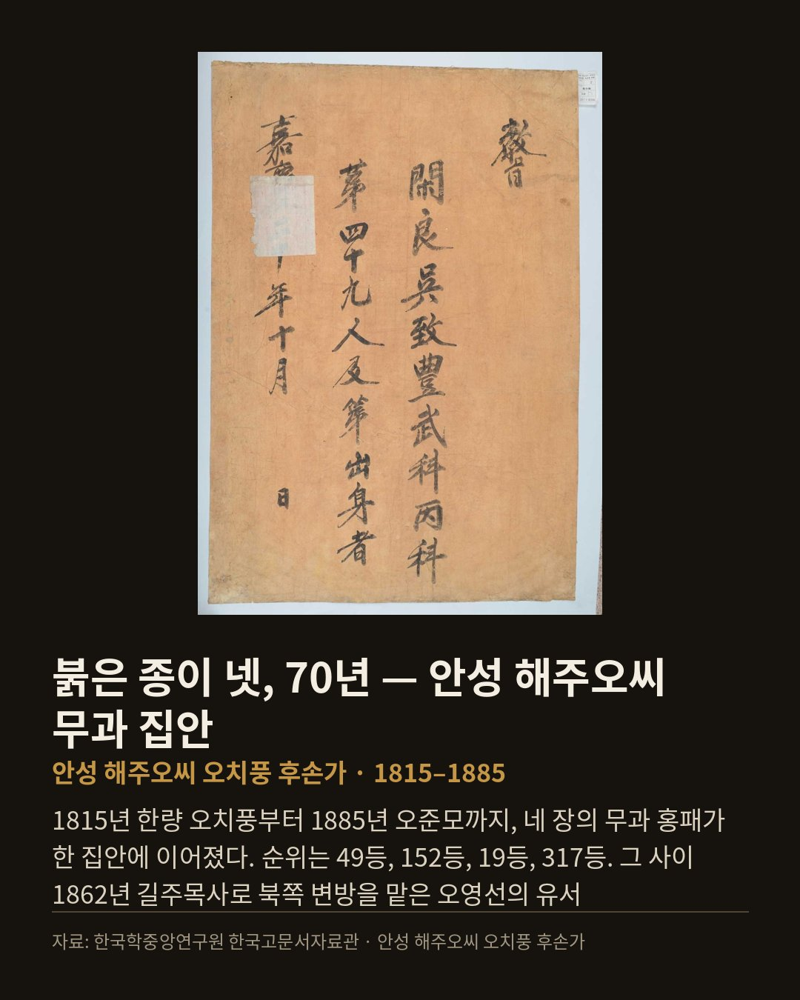
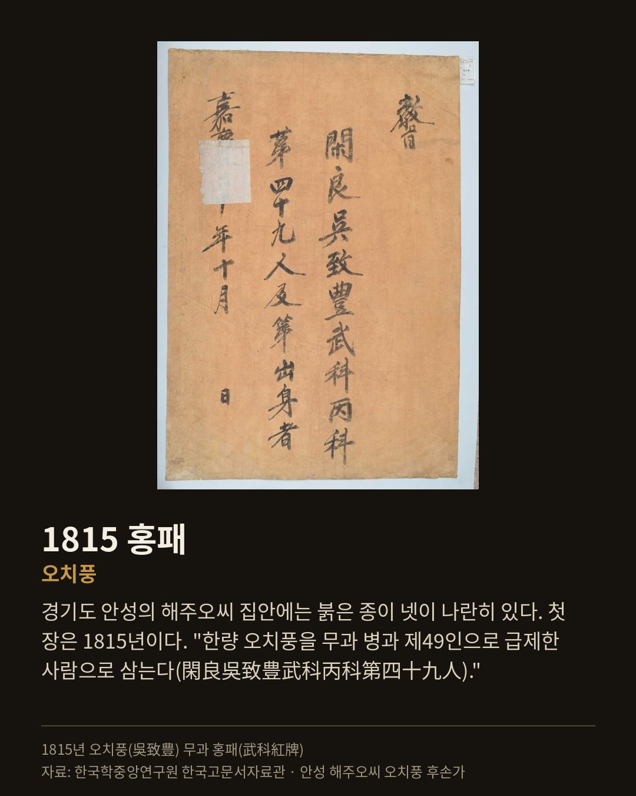
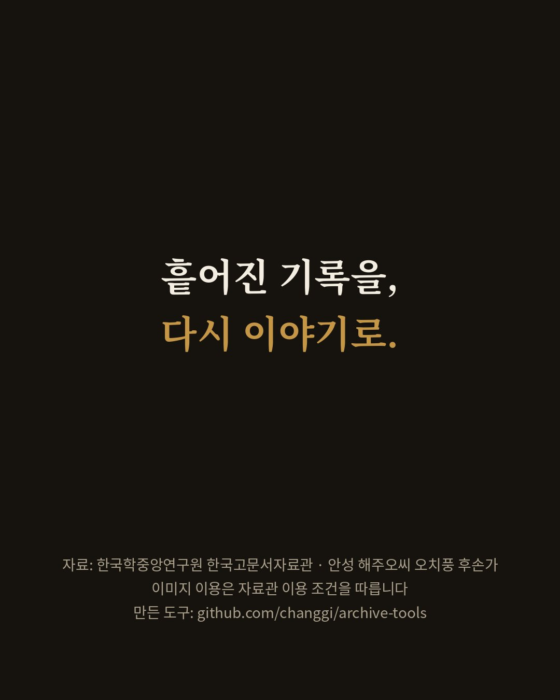

# EP.59 붉은 종이 넷, 70년 — 안성 해주오씨 무과 집안

안성 해주오씨 오치풍 후손가 (문중) · 1815년 한량 오치풍부터 1885년 오준모까지, 네 장의 무과 홍패가 한 집안에 이어졌다. 순위는 49등, 152등, 19등, 317등. 그 사이 1862년 길주목사로 북쪽 변방을 맡은 오영선의 유서

- 🌐 [전시 웹페이지](https://changgi.github.io/archive-tools/examples/ochipung/exhibit.html) (한자 위 한글 독음 · 원문 해석) · [수업 활동지](https://changgi.github.io/archive-tools/examples/ochipung/handout.html)
- 🎬 영상: [릴스 9:16](https://changgi.github.io/archive-tools/examples/media/ep59-ochipung_reel.mp4) · [가로 16:9](https://changgi.github.io/archive-tools/examples/media/ep59-ochipung_wide.mp4) · 홍보 글: [`promo.md`](promo.md)
- 카드뉴스: [`cards/`](cards/) · SNS 글: [`sns.txt`](sns.txt) · 판독·해석 표: [`selection.csv`](selection.csv)


<!-- DELIVERY -->
## 전달 에디팅 — 이 기록을 이렇게 전합니다

- **핵심 정서** — 끈기
- **한 문장** — 합격 순위보다, 4대에 걸쳐 같은 길을 이어 간 집안의 끈기가 보인다는 것.
- **열기** — 한 집안에 무과 홍패가 넷. 마지막 장은 색깔부터 다릅니다.
- **펼치기** — 오치풍 무과 홍패 → 오영선 무과 홍패 → 오영선 유서 → 오관영 무과 홍패 → 오준모 무과 홍패 (1815–1885년) — 붉은 종이 네 장을 나란히 놓고 순위 숫자를 크게 보여 주어, 집안의 70년을 한눈에 보게 했습니다.
- **절정** — "한량 오준모를 무과 병과 제317인으로(閑良吳俊模武科丙科第三百十七人)" — 화면·공간에서 이 한 줄만 크게, 소리를 줄여 집중
- **여운** — 317등으로 붙은 오준모는 그 숫자를 자랑스러워했을까요? — 질문으로 끝내고 답은 보는 사람에게
- **감각과 물질** — 붉은 종이 네 장을 순위 숫자 크기로 · 붉은 종이를 실물 크기로 복제해 벽에 거는 연출 · 역마 방울·말발굽 소리와 함께 펼치는 두루마리
- **통로와 매개** — 온라인: 릴스(열기) → 카드뉴스(펼치기) → 전시 웹페이지(절정·원문) → 비하인드 카드(여운) / 오프라인: 원본 크기 복제·낭독·참여 벽 / 남기기: 활동지·질문 카드
- **여운 장치** — "순위보다 중요한 것"
- **전달 에디팅 전** — 5건의 문서를 1815–1885년 연대순으로 놓고 문서명 · 유형 · 해설을 붙인다 — 정확하지만, 지나가면 잊힌다.
- **전달 에디팅 후** — 핵심 정서는 「끈기」. 「한 집안에 무과 홍패가 넷. 마지막 장은 색깔부터 다릅니다.」로 열고, 문서를 대비와 순서로 펼친 뒤, "한량 오준모를 무과 병과 제317인으로(閑良吳俊模武科丙科第三百十七人)"에서 멈춘다. 붉은 종이 네 장을 순위 숫자 크기로. 마지막엔 「"순위보다 중요한 것"」로 보는 사람이 자기 이야기를 남기고 떠나게 한다.

전문: [`delivery.md`](delivery.md)
<!-- /DELIVERY -->

<!-- CURATOR -->
## 비하인드 — 큐레이터 노트

- **왜 이 문서들인가** — 70년 동안 한 집안에서 무과 홍패 네 장이 나왔고, 순위가 49·152·19·317등으로 제각각이었습니다.
- **전하고 싶은 것** — 합격 순위보다, 4대에 걸쳐 같은 길을 이어 간 집안의 끈기가 보인다는 것.
- **이렇게 보이길 바랐다** — 붉은 종이 네 장을 나란히 놓고 순위 숫자를 크게 보여 주어, 집안의 70년을 한눈에 보게 했습니다.
- **이렇게 써 주세요** — 조선 후기 무과의 확대, 가업으로서의 무관을 다루는 수업에 쓰세요.
- **남겨 둔 질문** — 317등으로 붙은 오준모는 그 숫자를 자랑스러워했을까요?
- **제작 기록** — 문서 5건 · 1815–1885년 · 원본 사진 9면(문서 전체) · 원문 판독 5건 · 번역 5건

전문: [`curator.md`](curator.md)
<!-- /CURATOR -->

## 이야기 — 사료가 말하는 대로

한 집안에 무과 홍패가 넷. 마지막 장은 색깔부터 다릅니다.

> **1815 홍패** — 경기도 안성의 해주오씨 집안에는 붉은 종이 넷이 나란히 있다. 첫 장은 1815년이다. "한량 오치풍을 무과 병과 제49인으로 급제한 사람으로 삼는다(閑良吳致豊武科丙科第四十九人)."
> **1836 홍패** — 21년 뒤, 두 번째 붉은 종이. "부사용 오영선을 무과 병과 제152인으로(副司勇吳永善武科丙科第一百五十二人)." 150명이 넘는 동기들 사이에서 시작한 길이었다.
> **1862 유서** — 26년 뒤, 152등으로 시작한 오영선은 함경도 길주를 지키는 목사가 된다. 임금은 비밀 병부를 내리며 번호까지 적는다. "비상한 명이 있으면 부절을 맞추어 의심이 없은 뒤에 따르라. 제39부를 내린다(如有非常之命 合符無疑 … 故賜押第三十九符)."
> **1861 홍패** — 그 한 해 전, 집안의 또 다른 젊은이가 붉은 종이를 받았다. 이름의 마지막 글자가 문서명과 다르다. "한량 오관영(吳觀泳)을 무과 병과 제19인으로."
> **1885 홍패** — 그리고 마지막 장은 1885년, 빛깔부터 다르다. 보랏빛 분홍 종이. "한량 오준모를 무과 병과 제317인으로(閑良吳俊模武科丙科第三百十七人)." 9년 뒤, 무과는 사라진다. 이 집안의 네 번째 홍패가 마지막이었다.

| 표지 | 1번 카드 | 마무리 |
|---|---|---|
|  |  |  |

## 선별 문서 (5점)

| # | 연도 | 유형 | 문서명 | 원본 |
|---|---|---|---|---|
| 1 | 1815 | 홍패 | 1815년 오치풍(吳致豊) 무과 홍패(武科紅牌) | [원본 보기](https://archive.aks.ac.kr/viewer/viewer.do#imgnode.do?itemId=book&gubun=booktree&depth=6&upPath=01%5E0141%5EL014131%5EL014131F02%5EL014131F0201&dataId=G002%2BKHD%2BKSM-XA.1815.0000-20160706.C0802_002_00002_XXX&itemType=) |
| 2 | 1836 | 홍패 | 1836년 오영선(吳永善) 무과 홍패(武科紅牌) | [원본 보기](https://archive.aks.ac.kr/viewer/viewer.do#imgnode.do?itemId=book&gubun=booktree&depth=6&upPath=01%5E0141%5EL014131%5EL014131F02%5EL014131F0201&dataId=G002%2BKHD%2BKSM-XA.1836.0000-20160706.C0802_002_00003_XXX&itemType=) |
| 3 | 1862 | 유서 | 1862년 오영선(吳永善) 유서(諭書) | [원본 보기](https://archive.aks.ac.kr/viewer/viewer.do#imgnode.do?itemId=book&gubun=booktree&depth=6&upPath=01%5E0141%5EL014131%5EL014131F02%5EL014131F0201&dataId=G002%2BKHD%2BKSM-XA.1862.0000-20160706.C0802_002_00001_XXX&itemType=) |
| 4 | 1861 | 홍패 | 1861년 오관영(吳觀永) 무과 홍패(武科紅牌) | [원본 보기](https://archive.aks.ac.kr/viewer/viewer.do#imgnode.do?itemId=book&gubun=booktree&depth=6&upPath=01%5E0141%5EL014131%5EL014131F02%5EL014131F0201&dataId=G002%2BKHD%2BKSM-XA.1861.0000-20160706.C0802_002_00004_XXX&itemType=) |
| 5 | 1885 | 홍패 | 1885년 오준모(吳俊模) 무과 홍패(武科紅牌) | [원본 보기](https://archive.aks.ac.kr/viewer/viewer.do#imgnode.do?itemId=book&gubun=booktree&depth=6&upPath=01%5E0141%5EL014131%5EL014131F02%5EL014131F0201&dataId=G002%2BKHD%2BKSM-XA.1885.0000-20160706.C0802_002_00005_XXX&itemType=) |

## 원문 판독과 해석

### 1. 1815년 오치풍(吳致豊) 무과 홍패(武科紅牌)

**원문 판독**

```
敎旨
閑良吳致豊武科丙科
第四十九人及第出身者
嘉慶(二十)年十月 日 (도장 — 연도 부분에 종이 덧댐)
```

**원문 해석** 교지. 한량 오치풍을 무과 병과 제49인으로 급제하여 출신한 사람으로 삼는다. 가경 20년(1815) 10월 일.

**해제** 1815년(순조 15), 오치풍(吳致豊)이 무과에 급제하고 받은 홍패입니다. 이름 앞 '閑良(한량)'은 무과를 준비하는, 아직 벼슬 없는 사람을 부르는 말입니다. 연도 부분 위에 종이가 덧대어져 있어 '二十'은 문서명에 따라 보충했습니다.

### 2. 1836년 오영선(吳永善) 무과 홍패(武科紅牌)

**원문 판독**

```
敎旨
副司勇吳永善武科丙科
第一百五十二人及第出身者
道光十六年三月初七日 (도장)
```

**원문 해석** 교지. 부사용 오영선을 무과 병과 제152인으로 급제하여 출신한 사람으로 삼는다. 도광 16년(1836) 3월 7일.

**해제** 1836년(헌종 2), 다음 세대 오영선(吳永善)의 무과 홍패입니다. 이미 종9품 군직 '부사용'을 띠고 있었고, 순위는 병과 152등입니다. 무과는 한 번에 수백 명을 뽑는 일이 많아 순위가 큰 숫자로 나옵니다.

### 3. 1862년 오영선(吳永善) 유서(諭書)

**원문 판독**

```
諭通政大夫行吉州都護府使兼吉
州鎭兵馬僉節制使關北兵馬防
禦使南道後衛將吳永善
卿受委一方 體任非輕 凡發兵應
機 安民制敵 一應常事 自有舊
章 慮或有予與卿獨斷處置
事 非密符莫可施爲 且意外
詐謀 不可不預防 如有非常之命 合
符無疑 然後當就命 故賜押第
三十九符 卿其受之 故諭
同治元年三月初一日 (도장)
```

**원문 해석** 통정대부 행 길주도호부사 겸 길주진 병마첨절제사 관북 병마방어사 남도 후위장 오영선에게 이른다. 경은 한 지방을 맡았으니 소임이 가볍지 않다. 무릇 군사를 일으켜 기회에 대응하고 백성을 편안히 하며 적을 제압하는 모든 일상적인 일은 옛 규정이 있다. 다만 혹시 나와 경만이 홀로 결단하여 처리할 일이 있으면 밀부가 아니면 시행할 수 없다. 또 뜻밖의 속임수를 미리 막지 않을 수 없으니, 만일 비상한 명이 있으면 부절을 맞추어 의심이 없은 뒤에 명을 따르라. 그러므로 압(押) 제39부를 내리니, 경은 받으라. 그러므로 이른다. 동치 원년(1862) 3월 1일.

**해제** 1862년(철종 13) 3월, 오영선을 함경도 길주목사 겸 관북 방어사로 보내며 내린 유서입니다. 앞선 에피소드(EP.31·41·57)에서 훼손으로 끊겼던 유서의 끝부분 — '뜻밖의 속임수를 미리 막아야 하니, 비상한 명이 있으면 부절을 맞춘 뒤에 따르라, 제39부를 내린다' — 까지 온전히 남아 있습니다. 받은 밀부의 번호(第三十九符)가 적힌 점이 눈에 띕니다.

### 4. 1861년 오관영(吳觀永) 무과 홍패(武科紅牌)

**원문 판독**

```
敎旨
閑良吳觀泳武科丙科
第十九人及第出身者
咸豐十一年四月 日 (도장)
```

**원문 해석** 교지. 한량 오관영을 무과 병과 제19인으로 급제하여 출신한 사람으로 삼는다. 함풍 11년(1861) 4월 일.

**해제** 1861년(철종 12), 오관영의 무과 홍패입니다. 문서명은 '吳觀永'이나 홍패에는 '吳觀泳'으로 적혀 있습니다. 순위는 병과 19등입니다.

### 5. 1885년 오준모(吳俊模) 무과 홍패(武科紅牌)

**원문 판독**

```
敎旨
閑良吳俊模武科丙科
第三百十七人及第出身者
光緖十一年三月 日 (도장)
```

**원문 해석** 교지. 한량 오준모를 무과 병과 제317인으로 급제하여 출신한 사람으로 삼는다. 광서 11년(1885) 3월 일.

**해제** 1885년(고종 22), 오준모의 무과 홍패입니다. 앞의 세 장과 달리 붉은 기가 보랏빛에 가까운 분홍 종이에 썼습니다. 순위는 317등으로, 이 무렵 무과 급제자가 매우 많았음을 보여 줍니다. 무과는 1894년 갑오개혁으로 폐지됩니다.

판독·해석·이야기는 이미지에 근거한 초안이며(검토 전 "초안" 표시), 정확한 판독은 원문 확인이 필요합니다. □는 읽지 못한 글자, (?)는 불확실한 글자입니다.
이미지: 한국학중앙연구원 한국고문서자료관 소장·제공. "원본" 링크를 누르면 자료관 뷰어에서 그 문서가 열립니다. 재사용은 자료관에 문의하세요(소장처 동의 필요).
