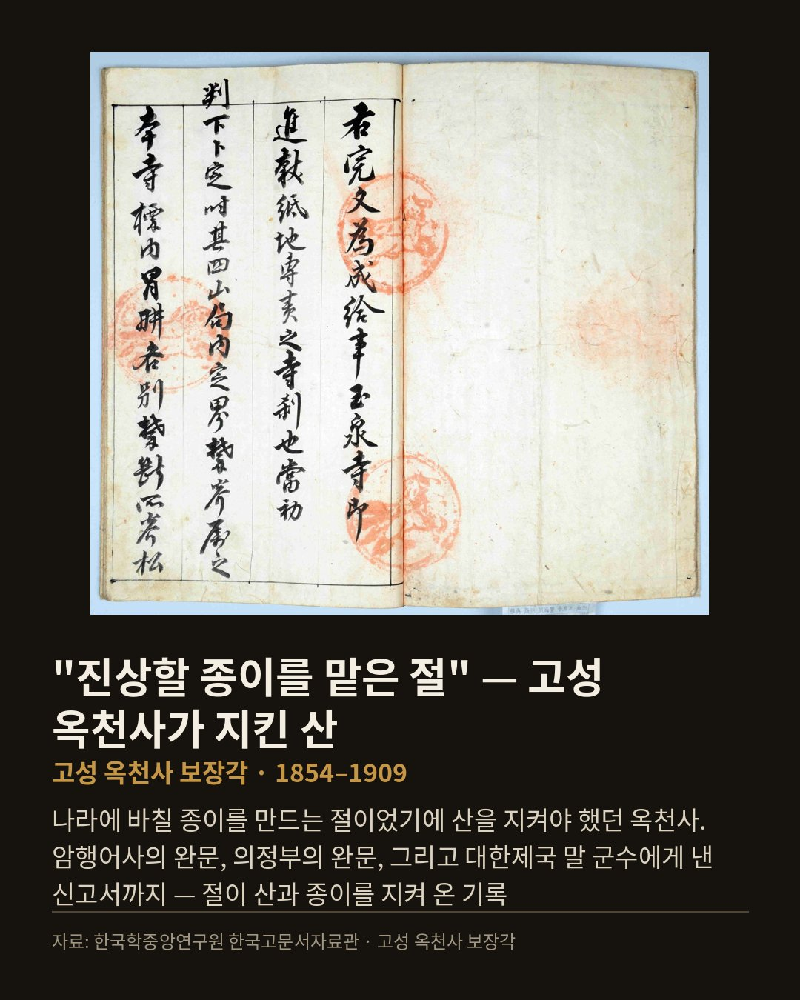
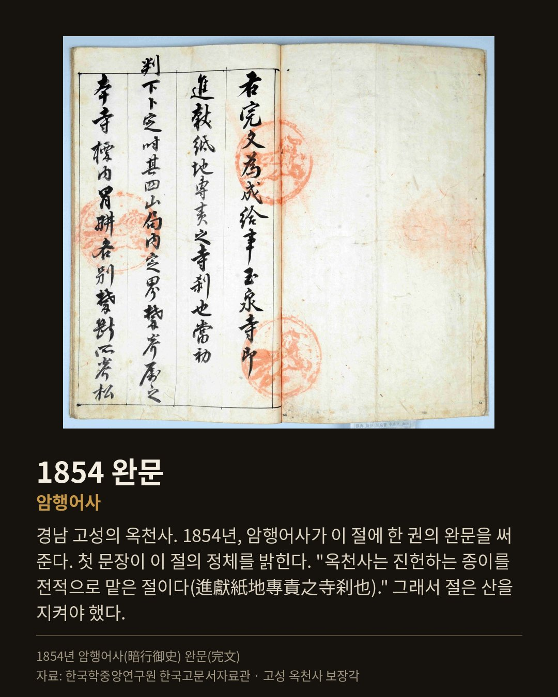
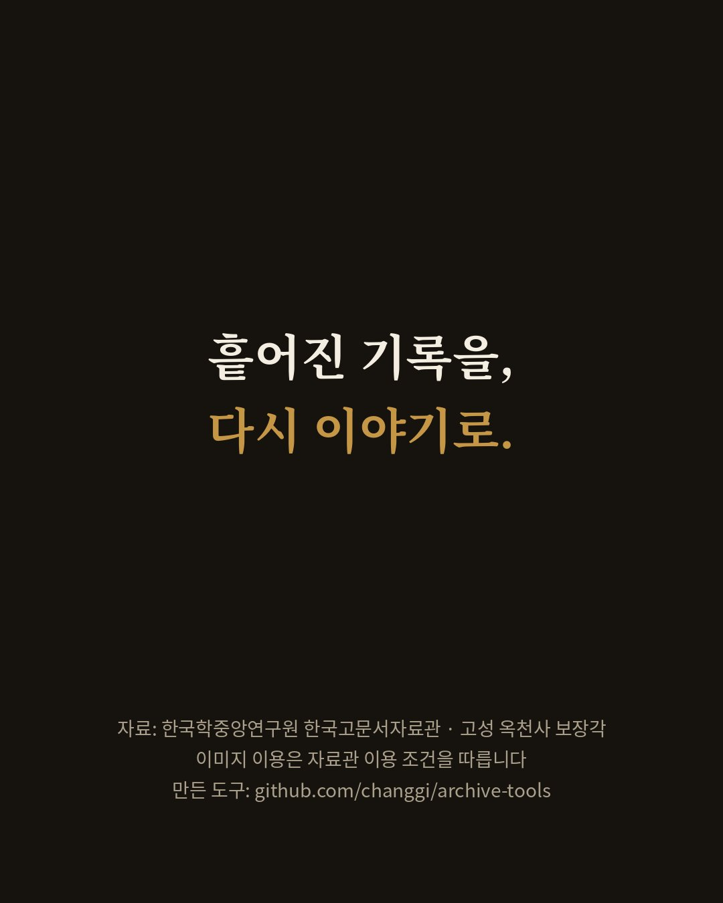

# EP.34 "진상할 종이를 맡은 절" — 고성 옥천사가 지킨 산

고성 옥천사 보장각 (사찰) · 나라에 바칠 종이를 만드는 절이었기에 산을 지켜야 했던 옥천사. 암행어사의 완문, 의정부의 완문, 그리고 대한제국 말 군수에게 낸 신고서까지 — 절이 산과 종이를 지켜 온 기록

- 🌐 [전시 웹페이지](https://changgi.github.io/archive-tools/examples/okcheonsa/exhibit.html) (한자 위 한글 독음 · 원문 해석) · [수업 활동지](https://changgi.github.io/archive-tools/examples/okcheonsa/handout.html)
- 🎬 영상: [릴스 9:16](https://changgi.github.io/archive-tools-next/media/ep34-okcheonsa_reel.mp4) · [가로 16:9](https://changgi.github.io/archive-tools-next/media/ep34-okcheonsa_wide.mp4) · 홍보 글: [`promo.md`](promo.md)
- 카드뉴스: [`cards/`](cards/) · SNS 글: [`sns.txt`](sns.txt) · 판독·해석 표: [`selection.csv`](selection.csv)


<!-- DELIVERY -->
## 전달 에디팅 — 이 기록을 이렇게 전합니다

- **핵심 정서** — 정성
- **한 문장** — 종이를 만드는 일은 절의 생존이자 나라에 대한 의무였다는 것.
- **열기** — 왜 한 절이 받은 문서마다 "종이"를 이야기할까요?
- **펼치기** — 암행어사 완문 → 의정부 완문 → 옥천사 토지수수료 인증서－1 (1854–1909년) — '종이를 맡은 절'이라는 첫 문장으로 시작해, 산을 지키는 문서들로 이어 갔습니다.
- **절정** — "장부 기재를 마쳤다, 수수료 50전(帳簿記載畢 手數料金額五拾錢也)" — 화면·공간에서 이 한 줄만 크게, 소리를 줄여 집중
- **여운** — 오늘 우리가 쓰는 종이는 누가, 어디서 만들까요? — 질문으로 끝내고 답은 보는 사람에게
- **감각과 물질** — 한지 뜨기 체험 — 진헌하던 종이를 직접 떠 보기 · 규약을 판에 새기고 관람객이 자기 규칙을 써 보는 벽
- **통로와 매개** — 온라인: 릴스(열기) → 카드뉴스(펼치기) → 전시 웹페이지(절정·원문) → 비하인드 카드(여운) / 오프라인: 원본 크기 복제·낭독·참여 벽 / 남기기: 활동지·질문 카드
- **여운 장치** — 직접 뜬 종이에 한 줄 쓰기
- **전달 에디팅 전** — 3건의 문서를 1854–1909년 연대순으로 놓고 문서명 · 유형 · 해설을 붙인다 — 정확하지만, 지나가면 잊힌다.
- **전달 에디팅 후** — 핵심 정서는 「정성」. 「왜 한 절이 받은 문서마다 "종이"를 이야기할까요?」로 열고, 문서를 대비와 순서로 펼친 뒤, "장부 기재를 마쳤다, 수수료 50전(帳簿記載畢 手數料金額五拾錢也)"에서 멈춘다. 한지 뜨기 체험 — 진헌하던 종이를 직접 떠 보기. 마지막엔 「직접 뜬 종이에 한 줄 쓰기」로 보는 사람이 자기 이야기를 남기고 떠나게 한다.

전문: [`delivery.md`](delivery.md)
<!-- /DELIVERY -->

<!-- CURATOR -->
## 비하인드 — 큐레이터 노트

- **왜 이 문서들인가** — 한 절이 받은 문서마다 '진헌할 종이'를 이야기하고 있었습니다.
- **전하고 싶은 것** — 종이를 만드는 일은 절의 생존이자 나라에 대한 의무였다는 것.
- **이렇게 보이길 바랐다** — '종이를 맡은 절'이라는 첫 문장으로 시작해, 산을 지키는 문서들로 이어 갔습니다.
- **이렇게 써 주세요** — 한지와 사찰 경제, 공물 제도 수업에 쓰세요.
- **만들며 있었던 일** — 같은 옥천사의 청련암 만일계(EP.87)와 함께 보면 좋습니다.
- **남겨 둔 질문** — 오늘 우리가 쓰는 종이는 누가, 어디서 만들까요?
- **제작 기록** — 문서 3건 · 1854–1909년 · 원본 사진 22면(문서 전체) · 원문 판독 3건 · 번역 3건 · 못 읽은 글자 □ 2 · 불확실 (?) 9 · 해제에 "확인 필요"를 단 문서 3건

전문: [`curator.md`](curator.md)
<!-- /CURATOR -->

## 이야기 — 사료가 말하는 대로

왜 한 절이 나라에서 받은 문서마다 '종이'를 이야기할까요?

> **1854 완문** — 경남 고성의 옥천사. 1854년, 암행어사가 이 절에 한 권의 완문을 써 준다. 첫 문장이 이 절의 정체를 밝힌다. "옥천사는 진헌하는 종이를 전적으로 맡은 절이다(進獻紙地專責之寺刹也)." 그래서 절은 산을 지켜야 했다.
> **1891 완문** — 37년 뒤 1891년, 이번에는 의정부의 완문이다. 종이를 바치는 절의 부담은 여전했다. "온갖 폐단이 고슴도치 털처럼 모여 버티기 어렵다(百弊蝟集)." 절은 문서를 받아 하나하나 번호를 매겨 보관했다.
> **1909 인증서** — 1909년 겨울, 대한제국이 저물어 가던 때. 옥천사의 승려 대표가 군수에게 신고서를 낸다. 일본에서 인쇄한 양식 용지에, 이장이 확인 도장을 찍는다. "장부 기재를 마쳤다, 수수료 50전(帳簿記載畢 手數料金額五拾錢也)." 임금이 지켜 주던 산을, 이제 절이 스스로 신고해야 했다.

| 표지 | 1번 카드 | 마무리 |
|---|---|---|
|  |  |  |

## 선별 문서 (3점)

| # | 연도 | 유형 | 문서명 | 원본 |
|---|---|---|---|---|
| 1 | 1854 | 완문 | 1854년 암행어사(暗行御史) 완문(完文) | [원본 보기](https://archive.aks.ac.kr/viewer/viewer.do#imgnode.do?itemId=book&gubun=booktree&depth=6&upPath=05%5E0547%5EL054701%5EL054701F02%5EL054701F0204&dataId=G002%2BKHD%2BKSM-XD.1854.0000-20160429.C0704_002_00008_XXX&itemType=) |
| 2 | 1891 | 완문 | 1891년 의정부(議政府) 완문(完文) | [원본 보기](https://archive.aks.ac.kr/viewer/viewer.do#imgnode.do?itemId=book&gubun=booktree&depth=6&upPath=05%5E0547%5EL054701%5EL054701F02%5EL054701F0204&dataId=G002%2BKHD%2BKSM-XD.1891.0000-20160429.C0704_002_00029_XXX&itemType=) |
| 3 | 1909 | 인증서 | 1909년 옥천사(玉泉寺) 토지수수료(土地手數料) 인증서(認證書)－1 | [원본 보기](https://archive.aks.ac.kr/viewer/viewer.do#imgnode.do?itemId=book&gubun=booktree&depth=6&upPath=05%5E0547%5EL054701%5EL054701F02%5EL054701F0204&dataId=G002%2BKHD%2BKSM-XD.1909.0000-20160429.C0704_002_00064_002&itemType=) |

## 원문 판독과 해석

### 1. 1854년 암행어사(暗行御史) 완문(完文)

**원문 판독**

```
(표지)
玉泉寺禁養定界內火田防禁完文
甲寅閏七月 日 (붉은 도장)
繡衣(押)
(붉은 글씨, 뒤에 적은 분류) 甲種一號 / 咸豐四年
(2면)
右完文爲成給事 玉泉寺卽
進獻紙地專責之寺刹也 當初
判下下定時 其四山局內定界禁(?)斷處之
本寺標內冒耕者別禁斷以禁(?)松
(이하 다음 면 — 이미지 미수집)
```

**원문 해석** (표지) 옥천사 금양(禁養) 경계 안의 화전(火田)을 막고 금하는 완문. 갑인년(1854) 윤7월 일. 수의(繡衣, 암행어사) 수결.
(본문) 이 완문을 만들어 주는 일. 옥천사는 [나라에] 진헌하는 종이(紙地)를 전적으로 맡은 절이다. 처음 [임금의] 판하로 정할 때 사방 산의 국내(局內)에 경계를 정해 금하고 단속하게 하였으니, 본사의 경계 표지 안에서 몰래 경작하는 자는 별도로 금단하여 소나무를 [기르게] … (이하 다음 면)

**해제** 1854년(철종 5, 甲寅) 윤7월, 암행어사(繡衣)가 고성 옥천사에 발급한 완문(完文)입니다. 옥천사가 나라에 바치는 종이를 만드는 절이므로, 절 주변 산의 금양(禁養, 나무를 기르기 위해 벌목·경작을 금하는 구역) 경계 안에서 화전을 일구는 것을 막으라는 내용입니다. 종이의 원료(닥나무)와 땔감을 얻을 산을 보호한 것입니다. 표지의 붉은 '甲種一號', '咸豐四年'은 뒷날 분류하며 적은 것입니다. 받은 이미지는 3면까지라 본문 뒷부분은 원문 확인이 필요합니다.

### 2. 1891년 의정부(議政府) 완문(完文)

**원문 판독**

```
(표지)
議政府(수결)
玉泉寺完文
辛卯九月 日 (붉은 도장)
(붉은 글씨, 뒤에 적은 분류) 甲種十一號
(3면)
光緖十七年辛卯九月 日
右節目 內需司 □本府(?)
啓(?)緣 內司(?)屬 慶尙道
晉州玉泉寺白綿(?)紙地
進上之刹 而換定物種(?)
者 百弊蝟集 莫□支(…)
(이하 이미지 없음 — 원문 확인 필요)
```

**원문 해석** (표지) 의정부. 옥천사 완문. 신묘년(1891) 9월 일.
(본문) 광서 17년 신묘 9월 일. 이 절목은 내수사(왕실 재정 관청)가 … 아뢴 바에 따라, 내수사에 속한 경상도 진주 옥천사는 백면지(?)를 진상하는 절인데, [진상] 물종을 바꾸어 정한 뒤로 온갖 폐단이 고슴도치 털처럼 모여 버티기 어려우니 … (이하 원문 확인 필요)

**해제** 1891년(고종 28) 9월, 의정부가 옥천사에 발급한 완문입니다. 37년 전 암행어사 완문과 마찬가지로 옥천사가 '종이를 진상하는 절'이라는 점을 앞세우고, 진상 물종이 바뀐 뒤 폐단이 '고슴도치 털처럼 모였다(百弊蝟集)'고 적었습니다. 이 무렵 옥천사는 고성이 아닌 진주에 속해 있었습니다. 흘림이 섞여 있고 받은 면이 한 면뿐이라 뒷부분은 원문 확인이 필요합니다.

### 3. 1909년 옥천사(玉泉寺) 토지수수료(土地手數料) 인증서(認證書)－1

**원문 판독**

```
(오른쪽 — 푸른 괘선 신청서)
隆熙三年十二月二十七日
慶尙南道固城郡介川面玉泉寺僧代表
申請人 時任職 金德巖 (도장)
固城郡守 座下
(바탕에 비친 인쇄 글자 — 一 所在地 … 山林 … 申請書 …, 판독 필요)
(왼쪽 — 붉은 괘선 인증서)
第 號
認證書
帳簿記載畢
手數料金額五拾錢也
隆熙三年十二月二十五日(?)
慶尙南道固城郡介川面楡田洞里長 沈尙元(?) (도장)
(가장자리 인쇄) 大阪黑川製
```

**원문 해석** (신청서) 융희 3년(1909) 12월 27일. 경상남도 고성군 개천면 옥천사 승려 대표 신청인 시임직(현 소임자) 김덕암. 고성군수 좌하(앞).
(인증서) 제 호. 인증서. 장부에 기재를 마쳤음. 수수료 금액 50전. 융희 3년 12월 25일(?). 경상남도 고성군 개천면 유전동 이장 심상원(?).

**해제** 1909년(융희 3) 12월, 옥천사 승려 대표 김덕암이 고성군수에게 낸 신청서와 이장이 발급한 수수료 인증서입니다. 붉은 괘선과 푸른 괘선이 인쇄된 양식 용지이고, 가장자리에 '大阪黑川製(오사카 구로카와 제작)'라는 인쇄소 표시가 있습니다. 1908년 삼림법에 따라 산림 소유자는 지적(地籍)을 신고해야 했으므로, 절 소유 산림을 신고하고 수수료 50전을 낸 기록으로 보입니다(푸른 인쇄 글자가 흐려 확인 필요).

판독·해석·이야기는 이미지에 근거한 초안이며(검토 전 "초안" 표시), 정확한 판독은 원문 확인이 필요합니다. □는 읽지 못한 글자, (?)는 불확실한 글자입니다.
이미지: 한국학중앙연구원 한국고문서자료관 소장·제공. "원본" 링크를 누르면 자료관 뷰어에서 그 문서가 열립니다. 재사용은 자료관에 문의하세요(소장처 동의 필요).
