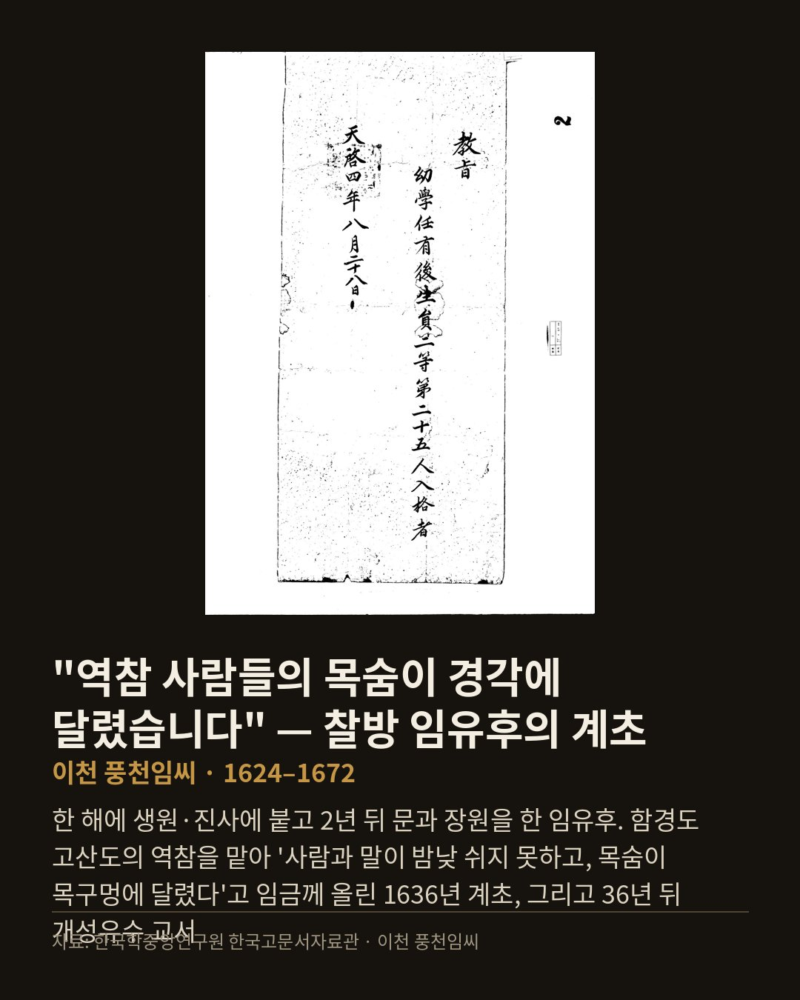
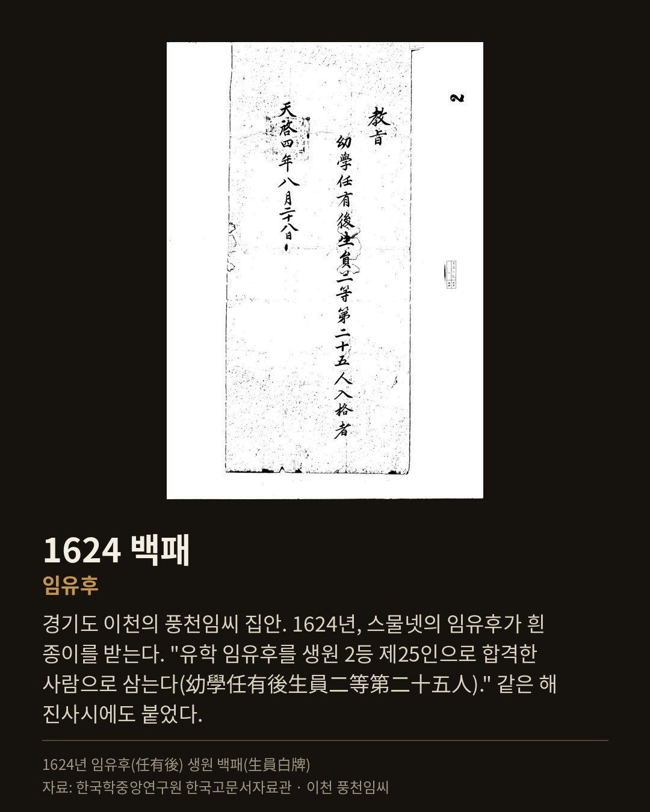
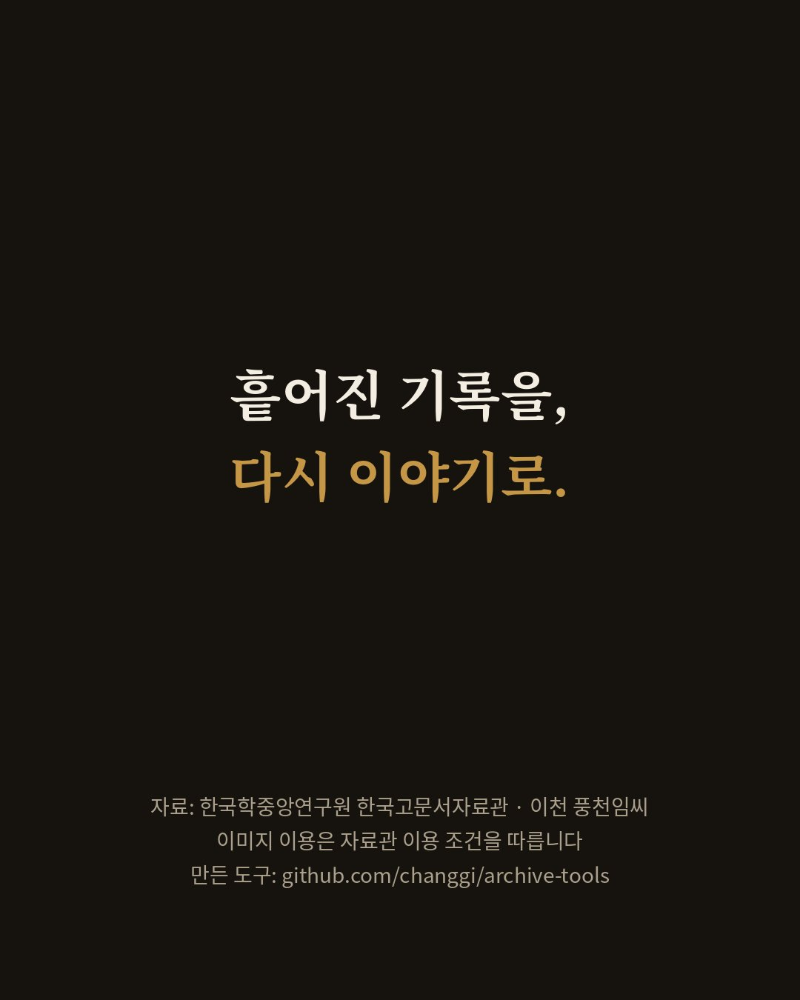

# EP.56 "역참 사람들의 목숨이 경각에 달렸습니다" — 찰방 임유후의 계초

이천 풍천임씨 (문중) · 한 해에 생원·진사에 붙고 2년 뒤 문과 장원을 한 임유후. 함경도 고산도의 역참을 맡아 '사람과 말이 밤낮 쉬지 못하고, 목숨이 목구멍에 달렸다'고 임금께 올린 1636년 계초, 그리고 36년 뒤 개성유수 교서

- 🌐 [전시 웹페이지](https://changgi.github.io/archive-tools/examples/pungcheon-im/exhibit.html) (한자 위 한글 독음 · 원문 해석) · [수업 활동지](https://changgi.github.io/archive-tools/examples/pungcheon-im/handout.html)
- 🎬 영상: [릴스 9:16](https://changgi.github.io/archive-tools-next/media/ep56-pungcheon-im_reel.mp4) · [가로 16:9](https://changgi.github.io/archive-tools-next/media/ep56-pungcheon-im_wide.mp4) · 홍보 글: [`promo.md`](promo.md)
- 카드뉴스: [`cards/`](cards/) · SNS 글: [`sns.txt`](sns.txt) · 판독·해석 표: [`selection.csv`](selection.csv)


<!-- DELIVERY -->
## 전달 에디팅 — 이 기록을 이렇게 전합니다

- **핵심 정서** — 고단함
- **한 문장** — 나라의 길(역참)은 이름 없는 역졸과 말의 고단함 위에 놓여 있었다는 것.
- **열기** — 사람을 부르고 말을 찾는 소리가 밤낮 쉬지 않는다' — 380년 전 역참은 어땠을까요?
- **펼치기** — 임유후 생원 백패 → 임유후 문과 홍패 → 고산도찰방 임유후 계초 → 임유후 교서 (1624–1672년) — 장원 급제의 화려함 뒤에, 변방 역참의 비명을 이어 붙여 대비를 만들었습니다.
- **절정** — "사람을 부르고 말을 찾는 소리가 밤낮으로 쉬지 않습니다(喚人呼馬 日夜不休)" — 화면·공간에서 이 한 줄만 크게, 소리를 줄여 집중
- **여운** — 그 보고를 읽은 임금은 역참 사람들을 위해 무엇을 했을까요? — 질문으로 끝내고 답은 보는 사람에게
- **감각과 물질** — 역참 말발굽과 숨소리, 밤낮 바뀌는 조명 · 흰 종이 한 장에 조명 하나 · 붉은 종이를 실물 크기로 복제해 벽에 거는 연출 · 두루마리를 실제 길이로 펼친 복제
- **통로와 매개** — 온라인: 릴스(열기) → 카드뉴스(펼치기) → 전시 웹페이지(절정·원문) → 비하인드 카드(여운) / 오프라인: 원본 크기 복제·낭독·참여 벽 / 남기기: 활동지·질문 카드
- **여운 장치** — 이름 없는 역졸에게 한 줄
- **전달 에디팅 전** — 4건의 문서를 1624–1672년 연대순으로 놓고 문서명 · 유형 · 해설을 붙인다 — 정확하지만, 지나가면 잊힌다.
- **전달 에디팅 후** — 핵심 정서는 「고단함」. 「사람을 부르고 말을 찾는 소리가 밤낮 쉬지 않는다' — 380년 전 역참은 어땠을까요?」로 열고, 문서를 대비와 순서로 펼친 뒤, "사람을 부르고 말을 찾는 소리가 밤낮으로 쉬지 않습니다(喚人呼馬 日夜不休)"에서 멈춘다. 역참 말발굽과 숨소리, 밤낮 바뀌는 조명. 마지막엔 「이름 없는 역졸에게 한 줄」로 보는 사람이 자기 이야기를 남기고 떠나게 한다.

전문: [`delivery.md`](delivery.md)
<!-- /DELIVERY -->

<!-- CURATOR -->
## 비하인드 — 큐레이터 노트

- **왜 이 문서들인가** — 찰방 임유후가 역참 사람들의 고통을 '목숨이 목구멍에 달렸다'고 올린 1636년 계초가 생생했습니다.
- **전하고 싶은 것** — 나라의 길(역참)은 이름 없는 역졸과 말의 고단함 위에 놓여 있었다는 것.
- **이렇게 보이길 바랐다** — 장원 급제의 화려함 뒤에, 변방 역참의 비명을 이어 붙여 대비를 만들었습니다.
- **이렇게 써 주세요** — 교통·통신 제도사, 공직자의 보고 문서 읽기 수업에 쓰세요.
- **남겨 둔 질문** — 그 보고를 읽은 임금은 역참 사람들을 위해 무엇을 했을까요?
- **제작 기록** — 문서 4건 · 1624–1672년 · 원본 사진 5면(문서 전체) · 원문 판독 4건 · 번역 4건 · 못 읽은 글자 □ 0 · 불확실 (?) 2 · 해제에 "확인 필요"를 단 문서 1건

전문: [`curator.md`](curator.md)
<!-- /CURATOR -->

## 이야기 — 사료가 말하는 대로

'사람을 부르고 말을 찾는 소리가 밤낮 쉬지 않는다' — 380년 전 역참은 어땠을까요?

> **1624 백패** — 경기도 이천의 풍천임씨 집안. 1624년, 스물넷의 임유후가 흰 종이를 받는다. "유학 임유후를 생원 2등 제25인으로 합격한 사람으로 삼는다(幼學任有後生員二等第二十五人)." 같은 해 진사시에도 붙었다.
> **1626 홍패** — 2년 뒤, 붉은 종이가 이어진다. "진사 임유후를 문과 병과 제1인으로 급제한 사람으로 삼는다(進士任有後文科丙科第一人)." 젊은 수재의 길은 순탄해 보였다.
> **1636 계초** — 10년 뒤 1636년, 서른여섯의 임유후는 함경도 고산도의 역참을 맡은 찰방이 되어 있었다. 그가 임금께 쓴 글은 역참 마을의 모습을 그림처럼 그린다. "사람을 부르고 말을 찾는 소리가 밤낮으로 쉬지 않습니다(喚人呼馬 日夜不休)." 한 역참에 남은 집은 너덧 채, 봄비는 오지 않았다. 그해 겨울, 병자호란이 터졌다.
> **1672 교서** — 그리고 36년 뒤 1672년, 일흔둘의 그에게 교서가 온다. 교서는 그의 긴 공백을 숨기지 않는다. "일찍이 오래 숨어 살았으니, 몸가짐의 깊음을 더욱 볼 수 있다(蓋嘗棲遁者亦久 益見操履之深)." 역참의 고통을 그리던 젊은 찰방은, 늙어서 경기를 맡았다.

| 표지 | 1번 카드 | 마무리 |
|---|---|---|
|  |  |  |

## 선별 문서 (4점)

| # | 연도 | 유형 | 문서명 | 원본 |
|---|---|---|---|---|
| 1 | 1624 | 백패 | 1624년 임유후(任有後) 생원 백패(生員白牌) | [원본 보기](https://archive.aks.ac.kr/viewer/viewer.do#imgnode.do?itemId=book&gubun=booktree&depth=6&upPath=01%5E0141%5EL014165%5EL014165F02%5EL014165F0201&dataId=G002%2BAKS%2BKSM-XA.1624.1111-20101008.B047a_071_00006_XXX&itemType=) |
| 2 | 1626 | 홍패 | 1626년 임유후(任有後) 문과 홍패(文科紅牌) | [원본 보기](https://archive.aks.ac.kr/viewer/viewer.do#imgnode.do?itemId=book&gubun=booktree&depth=6&upPath=01%5E0141%5EL014165%5EL014165F02%5EL014165F0201&dataId=G002%2BAKS%2BKSM-XA.1626.1111-20101008.B047a_071_00004_XXX&itemType=) |
| 3 | 1636 | 계초 | 1636년 고산도찰방(高山道察訪) 임유후(任有後) 계초(啓草) | [원본 보기](https://archive.aks.ac.kr/viewer/viewer.do#imgnode.do?itemId=book&gubun=booktree&depth=6&upPath=01%5E0141%5EL014165%5EL014165F02%5EL014165F0202&dataId=G002%2BAKS%2BKSM-XB.1636.0000-20101008.B047a_071_00131_XXX&itemType=) |
| 4 | 1672 | 교서 | 1672년 임유후(任有後) 교서(敎書) | [원본 보기](https://archive.aks.ac.kr/viewer/viewer.do#imgnode.do?itemId=book&gubun=booktree&depth=6&upPath=01%5E0141%5EL014165%5EL014165F02%5EL014165F0201&dataId=G002%2BAKS%2BKSM-XA.1672.1111-20101008.B047a_071_00001_XXX&itemType=) |

## 원문 판독과 해석

### 1. 1624년 임유후(任有後) 생원 백패(生員白牌)

**원문 판독**

```
敎旨
幼學任有後生員二等第二十五人入格者
天啓四年八月二十八日 (도장)
```

**원문 해석** 교지. 유학 임유후를 생원시 2등 제25인으로 합격한 사람으로 삼는다. 천계 4년(1624) 8월 28일.

**해제** 1624년(인조 2) 8월, 임유후(任有後, 1601~1673)가 생원시에 합격하고 받은 백패입니다. 같은 해 진사 백패도 함께 남아 있어 한 해에 생원·진사 두 시험에 모두 붙었음을 보여 줍니다. 마이크로필름 복사본입니다.

### 2. 1626년 임유후(任有後) 문과 홍패(文科紅牌)

**원문 판독**

```
敎旨
進士任有後文科丙科第一
人及第出身者
天啓六年九月十四日 (도장)
```

**원문 해석** 교지. 진사 임유후를 문과 병과 제1인으로 급제하여 출신한 사람으로 삼는다. 천계 6년(1626) 9월 14일.

**해제** 1626년 9월, 임유후가 문과에 급제하고 받은 홍패입니다. 2년 전 '유학'이던 신분이 '진사'로 바뀌어 있습니다. 순위는 병과 제1인입니다.

### 3. 1636년 고산도찰방(高山道察訪) 임유후(任有後) 계초(啓草)

**원문 판독**

```
奉列大夫兼高山道察訪臣任
臣以庸陋 待罪本驛 兢惶蹐跼 今至數月 是白乎旀 所管各站 凋瘵已甚 支持(?)扶補之勢 亦旣殫矣 夙夜思惟 無
策可措 愁悶自疚 益復憂悶是白在果 姑以朝夕之切急者言之 斜路則火燈一站 業已廢棄 直路則高山 南山
朔安 奉龍 鐵關 通達 六站 尤甚殘弊 一站之內 蝸居蔀屋 多不過八九家 少或四五家 蓬蒿堙路 生意蕭然 而
南北公行 往來如織 喚人呼馬 日夜不休 困悴之形 愁苦之狀 已思將圖上 而惶恐不敢爲白乎旀 臣於甲戌年除授居
山察訪 往來此地 爲白有如乎 數年之間 非有兵火饑癘之患 而所見荒涼 破屋居多 則站路之苦 可知也 況今西土多事
馬(?)整頻傳 自春不雨 東作旣愆 前頭之事 不可柰何(接濟)
朝廷若不及今施恤 則(…)魚之喁喁 必至於殲命之奄奄 特絶於喉 是白齊 上項六站 自
祖宗朝 係是極殘 故有立軍合排之法 有寺奴婢助役之規 是白如乎 臣報稟於觀察使 則以爲此特軍額之重 甚於驛路
寺奴亦入於三手 勢難施行 更思蘇完之策 啓達云云 爲白去乙 臣推觀察使所言 量度時勢 固不敢復望
是白在果 考諸舊例 則合排革罷之後 各司奴婢 身貢乙 題給殘站爲白如乎 今復永革 爲白有旀 驛女嫁良夫所生
及公私賤嫁驛吏所生 皆屬驛 昭載續錄 往在丙午年間 故臣李命俊爲察訪時 驛女嫁公私賤所生 并行狀
啓 屬驛爲白有如乎 近年始此該司 啓辭 以驛女驛吏嫁公私賤所生 女子則從公私賤 只給男子 比分屬驛
是如 各站之被奪於私賤者 頗類甚多 以是站路 日就凋耗 是白置 本驛自在平昔 殘弊無形 驛屬所生 勿論
(이하 왼쪽 — 이어지는 역속 문제와 청원, 판독 필요)
```

**원문 해석** 봉렬대부 겸 고산도 찰방 신 임[유후]. 신은 용렬하고 비루한 몸으로 이 역(驛)에서 죄를 기다린 지(일한 지) 이제 몇 달이 되었는데, 관할하는 각 역참이 이미 매우 쇠잔하여 지탱하고 보충할 힘도 이미 다하였습니다. 밤낮으로 생각해도 쓸 계책이 없어 근심하고 괴로워합니다. 우선 아침저녁으로 급한 것만 말씀드리면, 샛길의 화등 역참은 이미 버려졌고, 큰길의 고산·남산·삭안·봉룡·철관·통달 여섯 역참은 더욱 심하게 쇠잔하여, 한 역참 안에 달팽이집 같은 오두막이 많아야 여덟아홉 집, 적으면 너덧 집이고, 쑥대가 길을 덮어 살 기운이 쓸쓸합니다. 그런데 남북으로 공무로 오가는 사람은 베 짜듯 잦아, 사람을 부르고 말을 찾는 소리가 밤낮으로 쉬지 않으니, 지치고 시든 모습과 근심하고 괴로운 형상을 그림으로 그려 올리려 했으나 황공하여 감히 하지 못했습니다. 신이 갑술년(1634)에 거산 찰방으로 임명되어 이곳을 오갔는데, 몇 해 사이 전쟁이나 기근·역병이 없었는데도 보이는 것이 황량하고 부서진 집이 많았으니, 역참 길의 괴로움을 알 만합니다. 하물며 지금은 서쪽 변경에 일이 많아 … 소식이 잦고, 봄부터 비가 오지 않아 봄 농사가 이미 어긋났으니 앞일을 어찌할 수 없습니다. 조정에서 지금 구휼을 베풀지 않으면, 마른 수레바퀴 자국의 물고기가 입을 벌름거리듯 반드시 목숨이 끊어지기 직전에 이르러 숨이 목구멍에서 끊어질 것입니다. 위 여섯 역참은 조종 때부터 매우 쇠잔하였으므로 군사를 함께 배정하는 법과 시노비가 역을 돕는 규정이 있었는데, 신이 관찰사에게 보고하니 '군액이 역로보다 무겁고 시노도 삼수병에 들어가 시행하기 어려우니 다시 살릴 방책을 생각해 아뢰라' 하였습니다. … 옛 예를 살피면 … 역녀(驛女)가 양인에게 시집가 낳은 자식과 공사천이 역리에게 시집가 낳은 자식은 모두 역에 속한다고 『속록』에 분명히 실려 있는데, … 근년에 해당 관청이 아뢰어 역녀·역리가 공사천과 혼인해 낳은 자식 가운데 딸은 공사천을 따르고 아들만 역에 주게 하니, 각 역참이 사천에게 빼앗기는 사람이 매우 많아 역참 길이 날로 시들어 갑니다. … (이하 판독 필요)

**해제** 1636년(인조 14), 함경도 고산도(高山道) 찰방 임유후가 임금께 올리려고 쓴 계(啓)의 초고입니다. 찰방은 역참(驛站)을 관리하는 관원입니다. 관할 역참이 너덧 집밖에 남지 않을 만큼 쇠잔한데 공무 왕래는 끊이지 않고, 가뭄까지 겹쳤다며, 역속(驛屬)의 자녀가 사천(私賤)에게 넘어가지 않게 옛 규정을 되살려 달라고 청했습니다. 같은 해 겨울 병자호란이 일어납니다. 해서로 반듯해 오른쪽 절반을 판독했고, 왼쪽은 판독이 필요합니다. 마이크로필름 복사본입니다.

### 4. 1672년 임유후(任有後) 교서(敎書)

**원문 판독**

```
(…)觀察使兼兵馬水軍(…)使巡察使開城府留守
(任)有後書
(王)若曰 自古旬宣之任 苟匪人則
(…)華 府留守任有後書 (중복 줄 — 판독 확인 필요)
曰 自古旬宣之任 苟匪人則
罔堪 屬今艱虞之辰 將舍卿而
誰可 玆循廷議 俾尹畿惟卿
器度剛方 詞藻贍博 學不負於
賢師 舊訓 行誼自持 名已著於
祖初年 科甲大闡 蓋嘗棲遁者
亦久 益見操履之深 堅雖沒齒
沈淪 顧何苟於名利之上 而資
性峻潔 固自嚴於趣舍之間 粤
在 (이하 훼손)
```

**원문 해석** [경기]관찰사 겸 병마수군절도사 순찰사 개성부 유수 임유후에게 내리는 교서. 왕은 이르노라. 예로부터 한 지방을 돌며 교화를 펴는 소임은 진실로 그 사람이 아니면 감당할 수 없다. 지금처럼 어렵고 근심스러운 때에 경을 버려두고 누가 하겠는가. 이에 조정의 의논을 따라 경기를 다스리게 하노라. 생각건대 경은 기량이 굳세고 반듯하며, 글재주가 넉넉하고 넓어, 학문은 어진 스승의 옛 가르침을 저버리지 않았고, 행실은 스스로 지켜 이름이 이미 [인]조 초년에 드러났으니, 과거에 크게 급제하였다. 일찍이 오래 숨어 살았으니 몸가짐이 깊음을 더욱 볼 수 있다. 비록 평생을 묻혀 지냈어도 어찌 이름과 이익에 구차하였겠는가. 타고난 성품이 엄격하고 깨끗하여 나아가고 물러남에 스스로 엄하였다 … (이하 훼손)

**해제** 1672년(현종 13), 일흔둘의 임유후를 경기관찰사 겸 개성부 유수로 임명하며 내린 교서입니다. '오래 숨어 살았다(棲遁者亦久)', '평생 묻혀 지냈다(沒齒沈淪)'는 구절은 그가 오랫동안 벼슬에서 물러나 있었음을 보여 줍니다(동생 임유도의 일로 오래 은거한 것으로 알려져 있음 — 확인 필요). 오른쪽 위와 왼쪽이 훼손되었고, 첫 두 줄은 서로 다른 조각이 겹쳐 보여 판독 확인이 필요합니다.

판독·해석·이야기는 이미지에 근거한 초안이며(검토 전 "초안" 표시), 정확한 판독은 원문 확인이 필요합니다. □는 읽지 못한 글자, (?)는 불확실한 글자입니다.
이미지: 한국학중앙연구원 한국고문서자료관 소장·제공. "원본" 링크를 누르면 자료관 뷰어에서 그 문서가 열립니다. 재사용은 자료관에 문의하세요(소장처 동의 필요).
