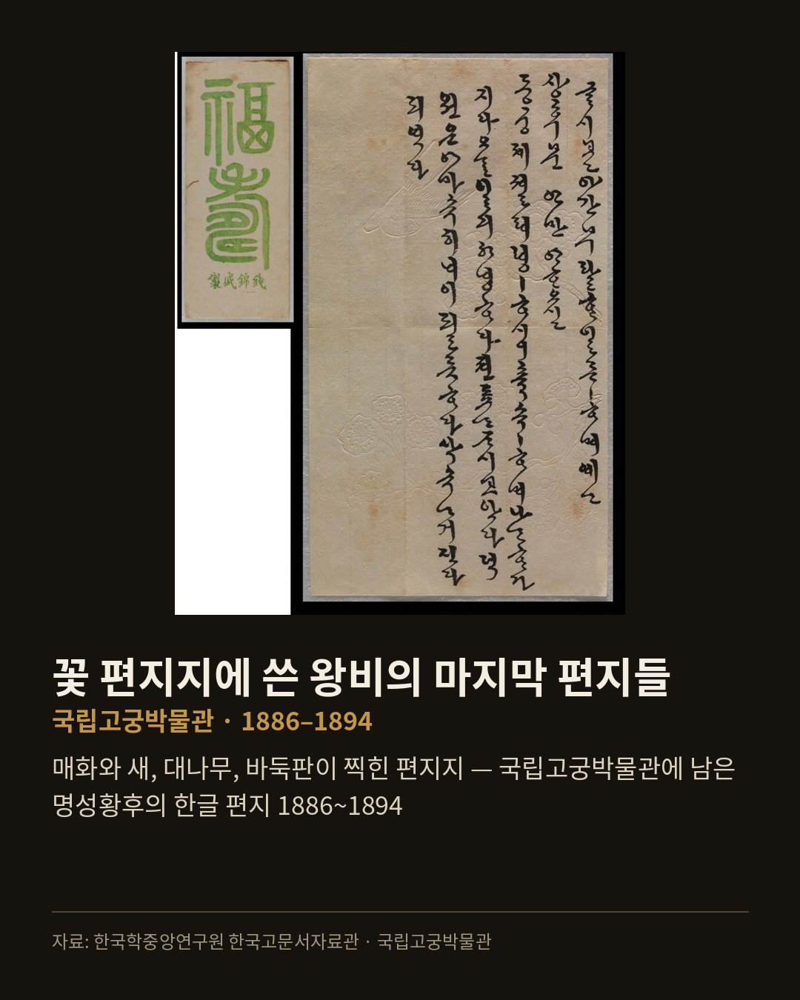
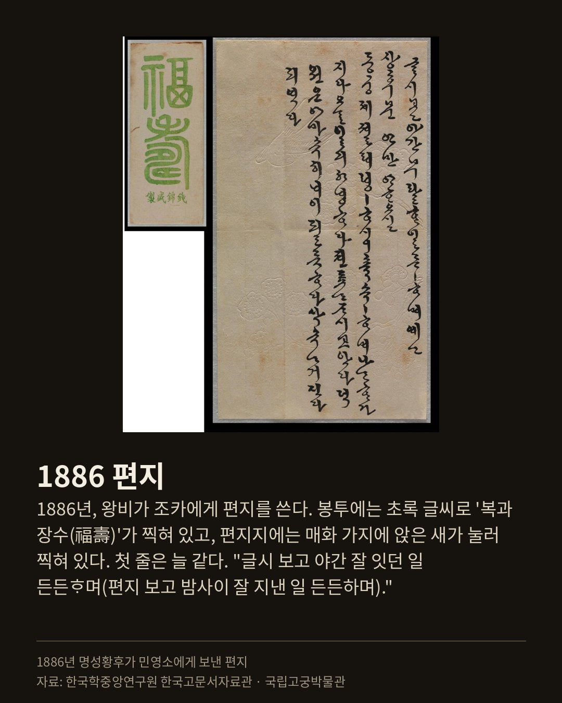
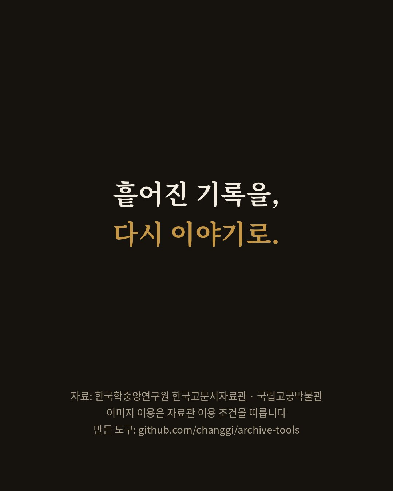

# EP.26 꽃 편지지에 쓴 왕비의 마지막 편지들

국립고궁박물관 (박물관) · 매화와 새, 대나무, 바둑판이 찍힌 편지지 — 국립고궁박물관에 남은 명성황후의 한글 편지 1886~1894

- 🌐 [전시 웹페이지](https://changgi.github.io/archive-tools/examples/queen-min-letters-2/exhibit.html) (한자 위 한글 독음 · 원문 해석) · [수업 활동지](https://changgi.github.io/archive-tools/examples/queen-min-letters-2/handout.html)
- 🎬 영상: [릴스 9:16](https://changgi.github.io/archive-tools/examples/media/ep26-gogung_reel.mp4) · [가로 16:9](https://changgi.github.io/archive-tools/examples/media/ep26-gogung_wide.mp4) · 홍보 글: [`promo.md`](promo.md)
- 카드뉴스: [`cards/`](cards/) · SNS 글: [`sns.txt`](sns.txt) · 판독·해석 표: [`selection.csv`](selection.csv)


<!-- DELIVERY -->
## 전달 에디팅 — 이 기록을 이렇게 전합니다

- **핵심 정서** — 아름다움과 마지막
- **한 문장** — 편지는 글만이 아니라 종이와 무늬로도 마음을 전했다는 것.
- **열기** — 왕비는 어떤 편지지에 편지를 썼을까요?
- **펼치기** — 명성황후가 민영소에게 보낸 편지 → 명성황후가 민영소에게 보낸 편지－ (1886–1894년) — 매화와 새, 대나무, 바둑판과 찻잔 — 편지지의 그림을 시간순으로 보여 주며 마지막 해(1894)로 이어 갔습니다.
- **절정** — "샹후 문안 만안ᄒᆞ옵시고, 동궁 졔졀 ᄐᆡ평ᄒᆞ시니 … 나ᄂᆞᆫ ᄒᆞᆫ가지다(임금은 평안하시고 세자도 태평하니 … 나는 그대로다)" — 화면·공간에서 이 한 줄만 크게, 소리를 줄여 집중
- **여운** — 흩어진 편지를 한자리에 모은다면 어떤 이야기가 더 보일까요? — 질문으로 끝내고 답은 보는 사람에게
- **감각과 물질** — 매화·대나무·바둑판 편지지 무늬를 큰 직물로, 1894년 편지는 마지막 방에 홀로 · 손바닥 크기 복제를 직접 들고 읽기, 낭독 음성
- **통로와 매개** — 온라인: 릴스(열기) → 카드뉴스(펼치기) → 전시 웹페이지(절정·원문) → 비하인드 카드(여운) / 오프라인: 원본 크기 복제·낭독·참여 벽 / 남기기: 활동지·질문 카드
- **여운 장치** — 편지지 무늬 스탬프로 엽서 만들기
- **전달 에디팅 전** — 4건의 문서를 1886–1894년 연대순으로 놓고 문서명 · 유형 · 해설을 붙인다 — 정확하지만, 지나가면 잊힌다.
- **전달 에디팅 후** — 핵심 정서는 「아름다움과 마지막」. 「왕비는 어떤 편지지에 편지를 썼을까요?」로 열고, 문서를 대비와 순서로 펼친 뒤, "샹후 문안 만안ᄒᆞ옵시고, 동궁 졔졀 ᄐᆡ평ᄒᆞ시니 … 나ᄂᆞᆫ ᄒᆞᆫ가지다(임금은 평안하시고 세자도 태평하니 … 나는 그대로다)"에서 멈춘다. 매화·대나무·바둑판 편지지 무늬를 큰 직물로, 1894년 편지는 마지막 방에 홀로. 마지막엔 「편지지 무늬 스탬프로 엽서 만들기」로 보는 사람이 자기 이야기를 남기고 떠나게 한다.

전문: [`delivery.md`](delivery.md)
<!-- /DELIVERY -->

<!-- CURATOR -->
## 비하인드 — 큐레이터 노트

- **왜 이 문서들인가** — EP.06에서 본 명성황후의 편지가 다른 기관(국립고궁박물관)에도 남아 있었고, 이번에는 편지지의 무늬가 눈에 띄었습니다.
- **전하고 싶은 것** — 편지는 글만이 아니라 종이와 무늬로도 마음을 전했다는 것.
- **이렇게 보이길 바랐다** — 매화와 새, 대나무, 바둑판과 찻잔 — 편지지의 그림을 시간순으로 보여 주며 마지막 해(1894)로 이어 갔습니다.
- **이렇게 써 주세요** — 시전지(詩箋紙)와 종이 문화, 근대 왕실사 수업에 쓰세요.
- **만들며 있었던 일** — EP.06과 이어지는 편입니다. 같은 사람의 편지가 여러 기관에 흩어져 있다는 점도 함께 보여 주고 싶었습니다.
- **남겨 둔 질문** — 흩어진 편지를 한자리에 모은다면 어떤 이야기가 더 보일까요?
- **제작 기록** — 문서 4건 · 1886–1894년 · 원본 사진 4면(문서 전체) · 원문 판독 4건 · 번역 4건 · 못 읽은 글자 □ 0 · 불확실 (?) 48 · 해제에 "확인 필요"를 단 문서 1건

전문: [`curator.md`](curator.md)
<!-- /CURATOR -->

## 이야기 — 사료가 말하는 대로

왕비는 어떤 편지지에 편지를 썼을까요?

> **1886 편지** — 1886년, 왕비가 조카에게 편지를 쓴다. 봉투에는 초록 글씨로 '복과 장수(福壽)'가 찍혀 있고, 편지지에는 매화 가지에 앉은 새가 눌러 찍혀 있다. 첫 줄은 늘 같다. "글시 보고 야간 잘 잇던 일 든든ᄒᆞ며(편지 보고 밤사이 잘 지낸 일 든든하며)."
> **1891 편지** — 1891년의 편지는 단 두 줄이다. 대나무가 눌린 넓은 종이 오른쪽 끝에, "글시 보니 든든ᄒᆞ며(편지 보니 든든하며)"로 시작하는 짧은 안부만 적었다. 매일같이 오간 편지의 한 장이다.
> **1894 편지** — 1894년, 나라가 흔들리던 해에도 편지는 오간다. 이번 종이는 분홍빛, 바둑판과 찻잔이 인쇄되어 있고 구석에 '錦盛'이라는 상점 도장이 찍혀 있다. 8년 전 봉투에 '錢錦盛製'라고 찍혀 있던 바로 그 가게다.
> **1894 편지** — 같은 해의 또 다른 편지. 초록 종이 위에 붉은 매화와 새가 피어 있다. 첫 줄은 8년 전과 똑같다. "샹후 문안 만안ᄒᆞ옵시고, 동궁 졔졀 ᄐᆡ평ᄒᆞ시니 … 나ᄂᆞᆫ ᄒᆞᆫ가지다(임금은 평안하시고 세자도 태평하니 … 나는 그대로다)." 이듬해 가을, 그녀는 경복궁에서 생을 마친다.

| 표지 | 1번 카드 | 마무리 |
|---|---|---|
|  |  |  |

## 선별 문서 (4점)

| # | 연도 | 유형 | 문서명 | 원본 |
|---|---|---|---|---|
| 1 | 1886 | 편지 | 1886년 명성황후가 민영소에게 보낸 편지 | [원본 보기](https://archive.aks.ac.kr/viewer/viewer.do#imgnode.do?itemId=book&gubun=booktree&depth=6&upPath=03%5E0311%5EL031119%5EL031119F02%5EL031119F0206&dataId=G002%2BLET%2BKSM-XF.1886.0000-20140430.A0005_075&itemType=) |
| 2 | 1891 | 편지 | 1891년 명성황후가 민영소에게 보낸 편지－1 | [원본 보기](https://archive.aks.ac.kr/viewer/viewer.do#imgnode.do?itemId=book&gubun=booktree&depth=6&upPath=03%5E0311%5EL031119%5EL031119F02%5EL031119F0206&dataId=G002%2BLET%2BKSM-XF.1891.0000-20140430.A0005_054&itemType=) |
| 3 | 1894 | 편지 | 1894년 명성황후가 민영소에게 보낸 편지－3 | [원본 보기](https://archive.aks.ac.kr/viewer/viewer.do#imgnode.do?itemId=book&gubun=booktree&depth=6&upPath=03%5E0311%5EL031119%5EL031119F02%5EL031119F0206&dataId=G002%2BLET%2BKSM-XF.1894.0000-20140430.A0005_080&itemType=) |
| 4 | 1894 | 편지 | 1894년 명성황후가 민영소에게 보낸 편지－7 | [원본 보기](https://archive.aks.ac.kr/viewer/viewer.do#imgnode.do?itemId=book&gubun=booktree&depth=6&upPath=03%5E0311%5EL031119%5EL031119F02%5EL031119F0206&dataId=G002%2BLET%2BKSM-XF.1894.0000-20140430.A0005_101&itemType=) |

## 원문 판독과 해석

### 1. 1886년 명성황후가 민영소에게 보낸 편지

**원문 판독**

```
(왼쪽 봉투 — 초록 인쇄) 福壽 / 錢錦盛製
(본문 — 매화와 새가 눌러 찍힌 편지지)
글시 보고 야간 잘 잇던 일 든든ᄒᆞ며 예ᄂᆞᆫ
샹후 문안 만안ᄒᆞ옵시고
동궁 졔졀 ᄐᆡ평ᄒᆞ시니 축슈ᄒᆞ며 나ᄂᆞᆫ ᄒᆞᆫ가지다
지야(?) 오ᄂᆞᆯ 일긔 화(?)창(?)ᄒᆞ다 졀(?)툭(?)ᄂᆞᆫ 조시(?) 보아라 덕
원은 어ᄯᅥᄒᆞ니(?) 이리 되(?)을(?) ᄒᆞ다 ᄉᆞ(?)촉(?) 거(?)진(?)
되엿다
(옛 한글 흘림 — 4줄 이하 판독 불확실)
```

**원문 해석** 편지 보고 밤사이 잘 지낸 일 든든하며, 여기는 임금(상후)께서 문안 평안하시고 세자(동궁)도 태평하시니 축수하며, 나는 늘 한가지(그대로)다. … 오늘 날씨가 화창하다. … 덕원은 어떠하냐 … 거의 되었다. (4줄 이하는 판독 불확실)

**해제** 1886년(고종 23) 명성황후(1851~1895)가 친정 조카뻘인 민영소(1852~1917)에게 보낸 한글 편지입니다. 봉투에는 초록색으로 '福壽(복과 장수)'와 '錢錦盛製(전금성 제작)'가 인쇄되어 있고, 편지지에는 매화 가지와 새가 눌러 찍힌(엠보싱) 무늬가 있습니다. 이런 장식 편지지를 시전지(詩箋紙)라 합니다. 첫 세 줄은 명성황후 편지의 정해진 안부 문구로 또렷이 읽히지만, 뒷부분은 흘림이 심해 판독 확인이 필요합니다.

### 2. 1891년 명성황후가 민영소에게 보낸 편지－1

**원문 판독**

```
(대나무가 눌러 찍힌 편지지)
글시 보니 든든ᄒᆞ며 야간(?) 무(?)ᄉᆞ(?)이 지내ᄂᆞᆫ 일 깃(?)브(?)다 졔
브(?)ᄉᆞ(?) ᄉᆡᆼ각ᄒᆞ여 너도 보고 시(?)퍼(?)ᄒᆞᆫ다
(옛 한글 흘림 — 판독 불확실)
```

**원문 해석** 편지 보니 든든하며, 밤사이 무사히 지낸 일 기쁘다. … 생각하여, 너도 보고 싶어 한다(?). (판독 불확실)

**해제** 1891년(고종 28) 명성황후가 민영소에게 보낸 두 줄짜리 짧은 편지입니다. 편지지에 대나무 그림이 눌러 찍혀 있고, 아래쪽에 제작처 표시로 보이는 흐린 글씨가 있습니다. 흘림이 심해 둘째 줄은 판독이 불확실합니다.

### 3. 1894년 명성황후가 민영소에게 보낸 편지－3

**원문 판독**

```
(붉은 줄이 있는 분홍 편지지 — 바둑판·책갑·찻잔·주머니 그림이 인쇄됨, 왼쪽 아래 '錦盛' 도장)
야간 잘 잇ᄂᆞᆫ 일 든든ᄒᆞ다 동영(?) 비장(?) 기ᄋᆞ(?)된(?)
회(?) … (가운데 붉은 인쇄 한자, 판독 불확실) … ᄉᆞ(?)이 일ᄒᆞᆫ 거ᄉᆞᆯ 누(?)구(?)에(?) 의(?)지(?)ᄒᆞ여 촉(?)ᄒᆞ게
ᄒᆞ엿(?)다
(옛 한글 흘림 — 판독 불확실)
```

**원문 해석** 밤사이 잘 있는 일 든든하다. … (판독 불확실)

**해제** 1894년(고종 31) 명성황후가 민영소에게 보낸 편지입니다. 붉은 세로줄이 그어진 분홍 편지지에 바둑판·책갑(書匣)·찻잔·꽃무늬 주머니 그림과 붉은 한자 글귀가 인쇄되어 있고, 왼쪽 아래에 '錦盛'이라는 제작처 도장이 찍혀 있습니다. 1886년 봉투의 '錢錦盛製'와 같은 곳에서 만든 편지지로 보입니다. 1894년은 동학농민운동과 청일전쟁, 갑오개혁이 일어난 해입니다. 본문은 흘림이 심해 대부분 판독이 불확실합니다.

### 4. 1894년 명성황후가 민영소에게 보낸 편지－7

**원문 판독**

```
(왼쪽 봉투 — 붉은 종이에 나비와 꽃 인쇄)
(본문 — 초록 편지지에 매화 가지와 새가 붉게 인쇄됨, '錦盛' 도장)
글시 보고 야간 잘 잇ᄂᆞᆫ 일 든든ᄒᆞ며 예ᄂᆞᆫ
샹후 문안 만안ᄒᆞ옵시고
동궁 졔졀 ᄐᆡ평ᄒᆞ시니 축슈ᄒᆞ며 나ᄂᆞᆫ ᄒᆞᆫ가지다
지야(?) 오ᄂᆞᆯ 일긔 회(?)화(?)ᄒᆞ다 ᄎᆡ(?)ᄌᆞ(?)ᄂᆞᆫ 오ᄂᆞᆯ
보(?)니 일(?)이 즉(?)ᄌᆞ(?) ᄒᆞᆫ(?) ᄂᆡ(?)ᄋᆡ(?) 이(?) ᄒᆞ게
다
(옛 한글 흘림 — 4줄 이하 판독 불확실)
```

**원문 해석** 편지 보고 밤사이 잘 있는 일 든든하며, 여기는 임금께서 문안 평안하시고 세자도 태평하시니 축수하며, 나는 그대로다. … 오늘 날씨가 … (4줄 이하 판독 불확실)

**해제** 1894년(고종 31) 명성황후가 민영소에게 보낸 편지입니다. 붉은 바탕에 나비와 꽃이 인쇄된 봉투, 초록 바탕에 매화 가지와 새가 붉게 인쇄된 편지지가 함께 남았고, 편지지에 '錦盛' 도장이 있습니다. 첫 세 줄의 안부 문구는 1886년 편지와 거의 같습니다. 명성황후는 이듬해(1895) 10월 경복궁에서 시해되었습니다.

판독·해석·이야기는 이미지에 근거한 초안이며(검토 전 "초안" 표시), 정확한 판독은 원문 확인이 필요합니다. □는 읽지 못한 글자, (?)는 불확실한 글자입니다.
이미지: 한국학중앙연구원 한국고문서자료관 소장·제공. "원본" 링크를 누르면 자료관 뷰어에서 그 문서가 열립니다. 재사용은 자료관에 문의하세요(소장처 동의 필요).
