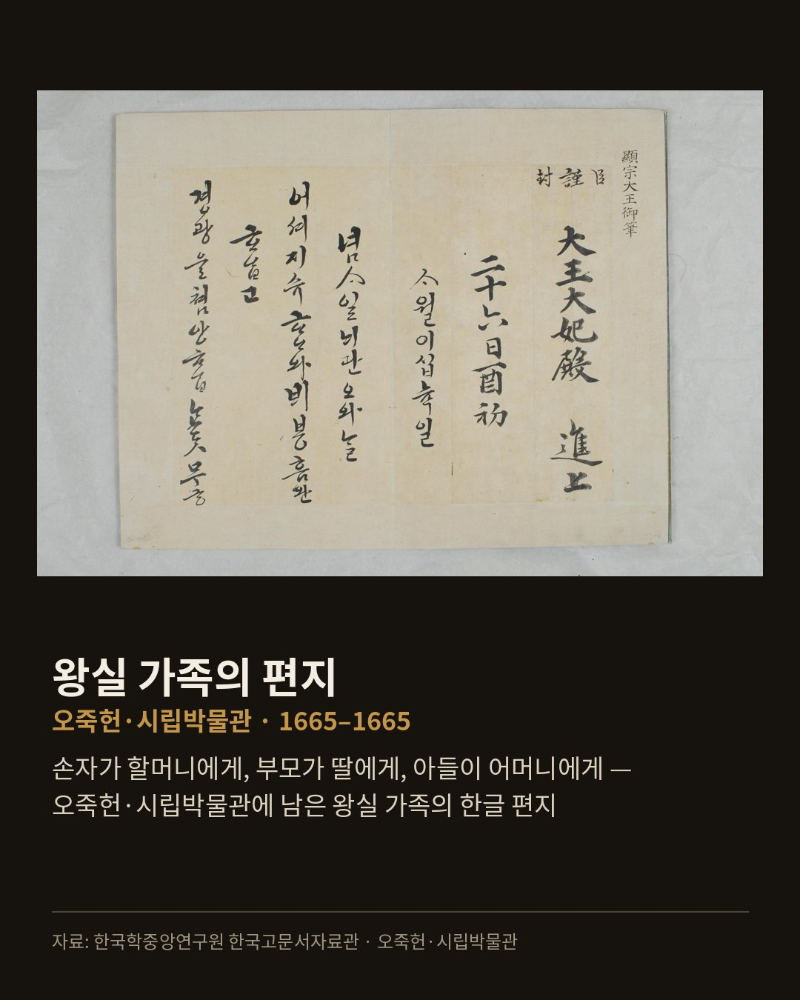
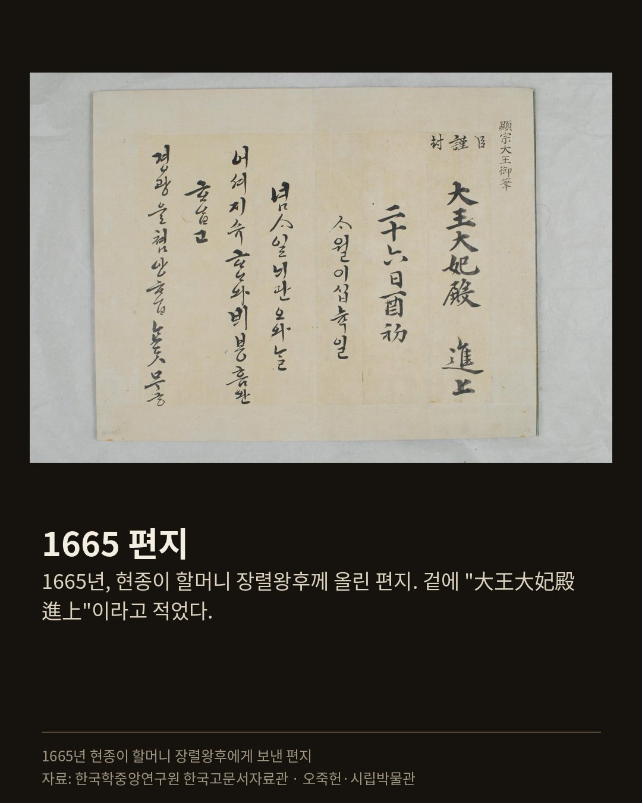
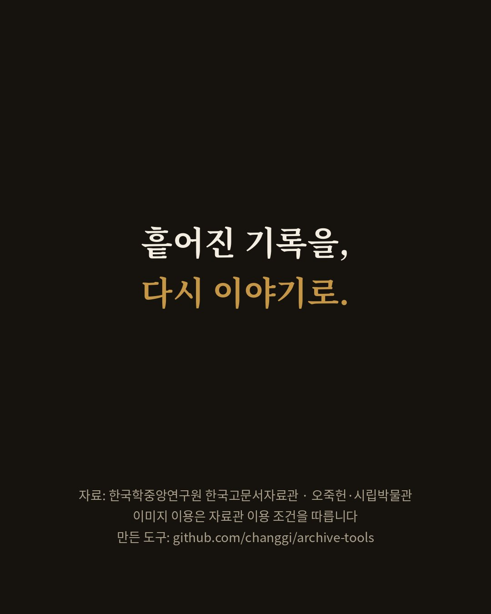

# EP.7 왕실 가족의 편지

오죽헌·시립박물관 (박물관) · 손자가 할머니에게, 부모가 딸에게, 아들이 어머니에게 — 오죽헌·시립박물관에 남은 왕실 가족의 한글 편지

- 🌐 [전시 웹페이지](https://changgi.github.io/archive-tools/examples/royal-letters/exhibit.html) · [수업 활동지](https://changgi.github.io/archive-tools/examples/royal-letters/handout.html)
- 🎬 영상: [릴스 9:16](https://changgi.github.io/archive-tools/examples/media/ep7-royal-letters_reel.mp4) · [가로 16:9](https://changgi.github.io/archive-tools/examples/media/ep7-royal-letters_wide.mp4) · 홍보 글: [`promo.md`](promo.md)
- 카드뉴스: [`cards/`](cards/) · SNS 글: [`sns.txt`](sns.txt) · 에디팅 결과: [`selection.csv`](selection.csv)

## 이야기 (영상 내레이션)

> 임금도 할머니에게 편지를 썼을까요?
> 1665년, 현종은 할머니 장렬왕후께 편지를 올립니다.
> 또 한 통의 겉봉엔 "온양 온천"이라는 글자가 함께 적혀 있습니다.
> 같은 임금은 딸 명안공주에게도 편지를 씁니다. 한 통에는 꽃 그림까지 곁들였죠.
> 어머니 명성왕후도 딸에게 한글 편지를 보냈고,
> 아들 숙종은 "밤사이 평안하신지" 안부를 여쭙습니다.
> 손자가 할머니에게, 부모가 딸에게, 아들이 어머니에게.

| 표지 | 1번 카드 | 마무리 |
|---|---|---|
|  |  |  |

## 선별 문서 (7점)

| # | 연도 | 유형 | 문서명 | 원본 |
|---|---|---|---|---|
| 1 | 1665 | 편지 | 1665년 현종이 할머니 장렬왕후에게 보낸 편지 | [원본 보기](https://archive.aks.ac.kr/viewer/viewer.do#imgnode.do?itemId=book&gubun=booktree&depth=6&upPath=03%5E0378%5EL037801%5EL037801F02%5EL037801F0206&dataId=G002%2BLET%2BKSM-XF.1665.0000-20140430.B0002_01&itemType=) |
| 2 | — | 편지 | 현종이 할머니 장렬왕후에게 보낸 편지－1 | [원본 보기](https://archive.aks.ac.kr/viewer/viewer.do#imgnode.do?itemId=book&gubun=booktree&depth=6&upPath=03%5E0378%5EL037801%5EL037801F02%5EL037801F0206&dataId=G002%2BLET%2BKSM-XF.0000.0000-20140430.B0002_02&itemType=) |
| 3 | — | 편지 | 현종이 딸 명안공주에게 보낸 편지－1 | [원본 보기](https://archive.aks.ac.kr/viewer/viewer.do#imgnode.do?itemId=book&gubun=booktree&depth=6&upPath=03%5E0378%5EL037801%5EL037801F02%5EL037801F0206&dataId=G002%2BLET%2BKSM-XF.0000.0000-20140430.B0002_05&itemType=) |
| 4 | — | 편지 | 현종이 딸 명안공주에게 보낸 편지－3 | [원본 보기](https://archive.aks.ac.kr/viewer/viewer.do#imgnode.do?itemId=book&gubun=booktree&depth=6&upPath=03%5E0378%5EL037801%5EL037801F02%5EL037801F0206&dataId=G002%2BLET%2BKSM-XF.0000.0000-20140430.B0002_07&itemType=) |
| 5 | — | 편지 | 명성왕후가 딸 명안공주에게 보낸 편지－1 | [원본 보기](https://archive.aks.ac.kr/viewer/viewer.do#imgnode.do?itemId=book&gubun=booktree&depth=6&upPath=03%5E0378%5EL037801%5EL037801F02%5EL037801F0206&dataId=G002%2BLET%2BKSM-XF.0000.0000-20140430.B0002_08&itemType=) |
| 6 | — | 편지 | 명성왕후가 딸 명안공주에게 보낸 편지－3 | [원본 보기](https://archive.aks.ac.kr/viewer/viewer.do#imgnode.do?itemId=book&gubun=booktree&depth=6&upPath=03%5E0378%5EL037801%5EL037801F02%5EL037801F0206&dataId=G002%2BLET%2BKSM-XF.0000.0000-20140430.B0002_10&itemType=) |
| 7 | — | 편지 | 숙종이 모후 명성왕후에게 보낸 편지 | [원본 보기](https://archive.aks.ac.kr/viewer/viewer.do#imgnode.do?itemId=book&gubun=booktree&depth=6&upPath=03%5E0378%5EL037801%5EL037801F02%5EL037801F0206&dataId=G002%2BLET%2BKSM-XF.0000.0000-20140430.B0002_12&itemType=) |

이야기는 문서명과 이미지에서 보이는 것에 근거한 초안이며(검토 전 "초안" 표시), 판독·해석은 원문 확인이 필요합니다.
이미지: 한국학중앙연구원 한국고문서자료관 소장·제공. "원본" 링크를 누르면 자료관 뷰어에서 그 문서가 열립니다. 재사용은 자료관에 문의하세요(소장처 동의 필요).
