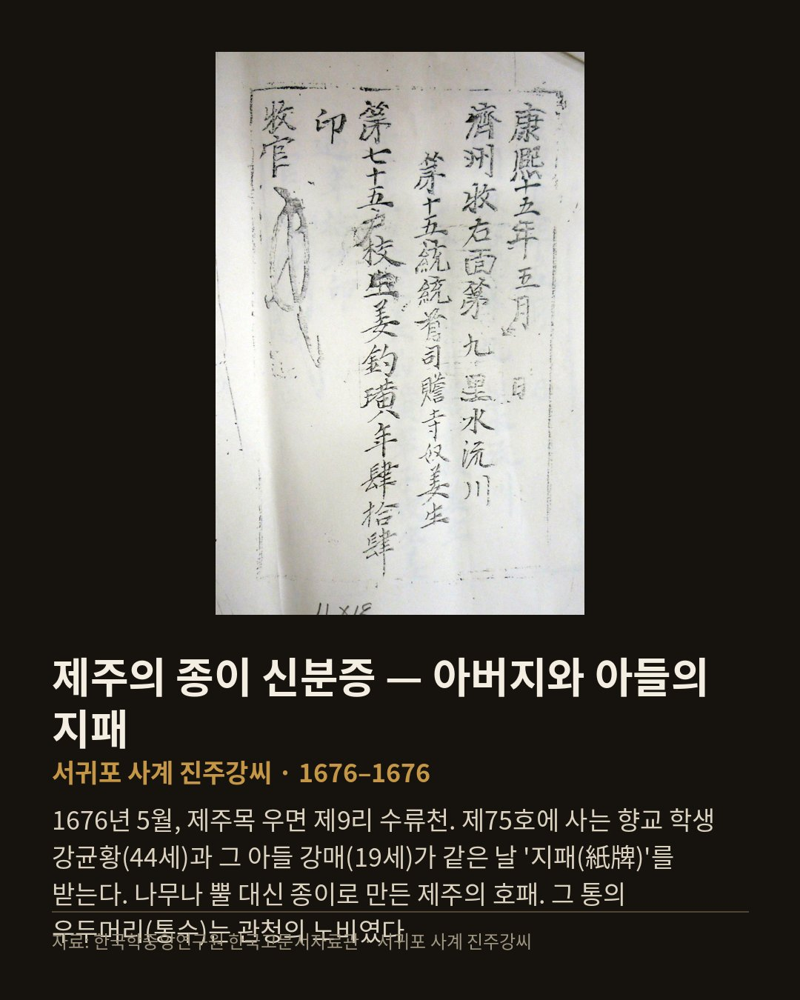
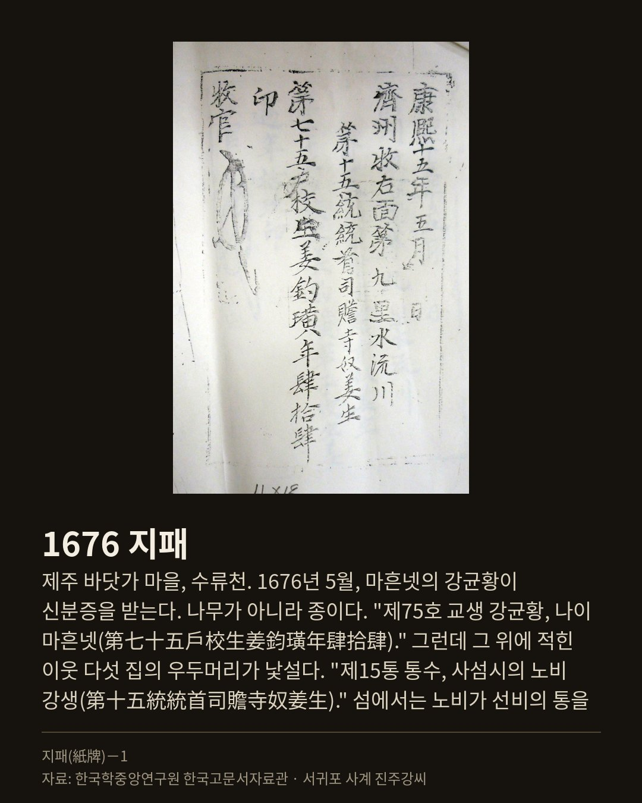
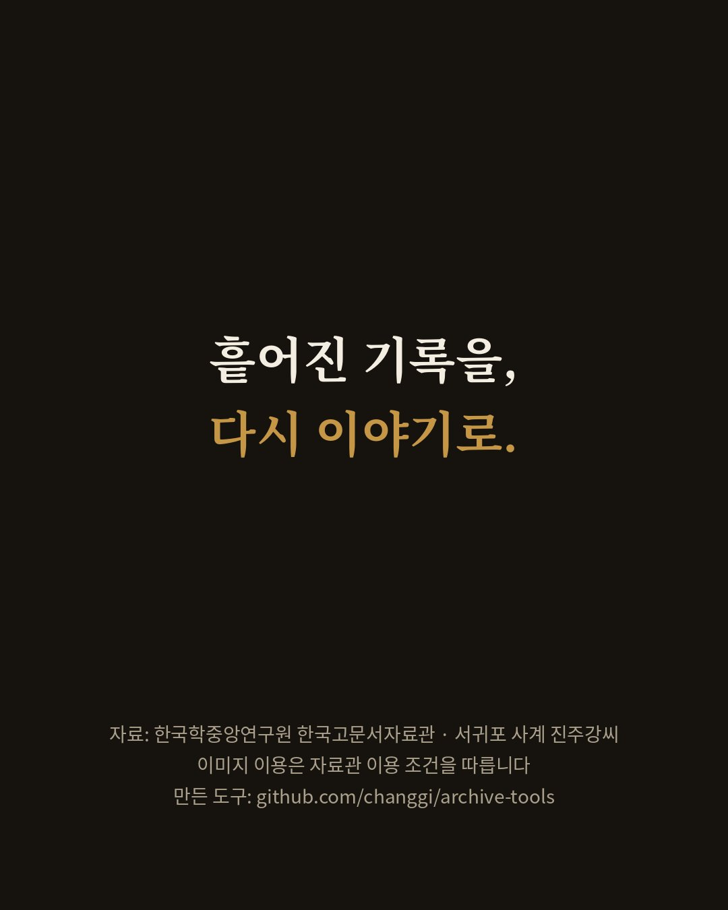

# EP.79 제주의 종이 신분증 — 아버지와 아들의 지패

서귀포 사계 진주강씨 (문중) · 1676년 5월, 제주목 우면 제9리 수류천. 제75호에 사는 향교 학생 강균황(44세)과 그 아들 강매(19세)가 같은 날 '지패(紙牌)'를 받는다. 나무나 뿔 대신 종이로 만든 제주의 호패. 그 통의 우두머리(통수)는 관청의 노비였다

- 🌐 [전시 웹페이지](https://changgi.github.io/archive-tools/examples/sagye-kang/exhibit.html) (한자 위 한글 독음 · 원문 해석) · [수업 활동지](https://changgi.github.io/archive-tools/examples/sagye-kang/handout.html)
- 🎬 영상: [릴스 9:16](https://changgi.github.io/archive-tools-next/media/ep79-sagye-kang_reel.mp4) · [가로 16:9](https://changgi.github.io/archive-tools-next/media/ep79-sagye-kang_wide.mp4) · 홍보 글: [`promo.md`](promo.md)
- 카드뉴스: [`cards/`](cards/) · SNS 글: [`sns.txt`](sns.txt) · 판독·해석 표: [`selection.csv`](selection.csv)


<!-- DELIVERY -->
## 전달 에디팅 — 이 기록을 이렇게 전합니다

- **핵심 정서** — 섬의 신분
- **한 문장** — 섬의 신분증은 종이였고, 그 종이에는 노비가 선비의 통을 이끄는 모습까지 적혀 있었다는 것.
- **열기** — 350년 전 제주 사람들의 신분증은 종이였습니다.
- **펼치기** — 지패－1 → 지패－2 (1676년) — 아버지와 아들의 지패를 나란히 놓고, '통수 사섬시 노 강생'이라는 한 줄을 반전으로 썼습니다.
- **절정** — "강균황이 거느린 아들, 교생 강매, 나이 열아홉(姜鈞璜率子校生姜邁年拾玖)" — 화면·공간에서 이 한 줄만 크게, 소리를 줄여 집중
- **여운** — 오늘의 주민등록증에는 무엇이 적혀 있고, 무엇이 빠졌을까요? — 질문으로 끝내고 답은 보는 사람에게
- **감각과 물질** — 아버지와 아들의 지패를 체험 카드로 — 관람객도 자기 지패 만들기 · 나의 신분증 만들기 체험 카드
- **통로와 매개** — 온라인: 릴스(열기) → 카드뉴스(펼치기) → 전시 웹페이지(절정·원문) → 비하인드 카드(여운) / 오프라인: 원본 크기 복제·낭독·참여 벽 / 남기기: 활동지·질문 카드
- **여운 장치** — "내 신분증에 빠진 것"
- **전달 에디팅 전** — 2건의 문서를 1676년 연대순으로 놓고 문서명 · 유형 · 해설을 붙인다 — 정확하지만, 지나가면 잊힌다.
- **전달 에디팅 후** — 핵심 정서는 「섬의 신분」. 「350년 전 제주 사람들의 신분증은 종이였습니다.」로 열고, 문서를 대비와 순서로 펼친 뒤, "강균황이 거느린 아들, 교생 강매, 나이 열아홉(姜鈞璜率子校生姜邁年拾玖)"에서 멈춘다. 아버지와 아들의 지패를 체험 카드로 — 관람객도 자기 지패 만들기. 마지막엔 「"내 신분증에 빠진 것"」로 보는 사람이 자기 이야기를 남기고 떠나게 한다.

전문: [`delivery.md`](delivery.md)
<!-- /DELIVERY -->

<!-- CURATOR -->
## 비하인드 — 큐레이터 노트

- **왜 이 문서들인가** — 1676년 제주에서 아버지와 아들이 같은 날 받은 종이 호패(지패)가 나란히 남아 있었습니다.
- **전하고 싶은 것** — 섬의 신분증은 종이였고, 그 종이에는 노비가 선비의 통을 이끄는 모습까지 적혀 있었다는 것.
- **이렇게 보이길 바랐다** — 아버지와 아들의 지패를 나란히 놓고, '통수 사섬시 노 강생'이라는 한 줄을 반전으로 썼습니다.
- **이렇게 써 주세요** — 제주 지역사, 신분제와 호적 제도, '신분증의 역사' 전시에 쓰세요.
- **만들며 있었던 일** — 아버지의 지패는 원본이 아니라 사진 복사본으로 보입니다.
- **남겨 둔 질문** — 오늘의 주민등록증에는 무엇이 적혀 있고, 무엇이 빠졌을까요?
- **제작 기록** — 문서 2건 · 1676년 · 원본 사진 2면(문서 전체) · 원문 판독 2건 · 번역 2건

전문: [`curator.md`](curator.md)
<!-- /CURATOR -->

## 이야기 — 사료가 말하는 대로

350년 전 제주 사람들의 신분증은 종이였습니다.

> **1676 지패** — 제주 바닷가 마을, 수류천. 1676년 5월, 마흔넷의 강균황이 신분증을 받는다. 나무가 아니라 종이다. "제75호 교생 강균황, 나이 마흔넷(第七十五戶校生姜鈞璜年肆拾肆)." 그런데 그 위에 적힌 이웃 다섯 집의 우두머리가 낯설다. "제15통 통수, 사섬시의 노비 강생(第十五統統首司贍寺奴姜生)." 섬에서는 노비가 선비의 통을 이끌기도 했다.
> **1676 지패** — 같은 날, 열아홉 살 아들의 이름도 종이에 오른다. "강균황이 거느린 아들, 교생 강매, 나이 열아홉(姜鈞璜率子校生姜邁年拾玖)." 아버지와 아들, 두 장의 종이 신분증. 350년 동안 집안은 그것을 함께 간직했다.

| 표지 | 1번 카드 | 마무리 |
|---|---|---|
|  |  |  |

## 선별 문서 (2점)

| # | 연도 | 유형 | 문서명 | 원본 |
|---|---|---|---|---|
| 1 | 1676 | 지패 | 지패(紙牌)－1 | [원본 보기](https://archive.aks.ac.kr/viewer/viewer.do#imgnode.do?itemId=book&gubun=booktree&depth=6&upPath=01%5E0168%5EL016821%5EL016821F02%5EL016821F0204&dataId=G002%2BAKS%2BKSM-XD.1676.5013-20220125.B081a_114_00592_XXX&itemType=) |
| 2 | 1676 | 지패 | 지패(紙牌)－2 | [원본 보기](https://archive.aks.ac.kr/viewer/viewer.do#imgnode.do?itemId=book&gubun=booktree&depth=6&upPath=01%5E0168%5EL016821%5EL016821F02%5EL016821F0204&dataId=G002%2BAKS%2BKSM-XD.1676.5013-20220125.B081a_114_00593_XXX&itemType=) |

## 원문 판독과 해석

### 1. 지패(紙牌)－1

**원문 판독**

```
康熙十五年五月　日
濟州牧右面第九里水流川
第十五統統首司贍寺奴姜生
第七十五戶校生姜鈞璜年肆拾肆
印
牧官 [수결]
(사진 복사본 · 테두리 인쇄 서식)
```

**원문 해석** 강희 15년(1676) 5월 일. 제주목 우면 제9리 수류천. 제15통 통수 사섬시 노 강생. 제75호 교생 강균황, 나이 44세. [관인] 목관 [서명].

**해제** 조선 후기 제주에서 호패 대신 발급한 종이 신분증 '지패(紙牌)'입니다. 테두리가 인쇄된 서식에 주소(목·면·리·마을), 소속 통과 통수(統首), 호(戶) 번호, 신분·이름·나이를 적고 제주목 관인을 찍은 뒤 목사가 서명했습니다. 1675년 오가작통법이 정비되며 다섯 집을 한 통으로 묶었는데, 통의 우두머리 통수가 사섬시(司贍寺)에 속한 노비 '강생'이라는 점이 눈길을 끕니다. 교생(校生)은 향교 학생 신분입니다. 이 장은 원본이 아닌 사진 복사본으로 보입니다.

### 2. 지패(紙牌)－2

**원문 판독**

```
康熙十五年五月　日
濟州牧右面第九里水流川
第十五統統首司贍寺奴姜生
第七十五戶校生姜鈞璜率子校生姜
邁年拾玖
印
牧官 [수결]
(제주목 관인 1과)
```

**원문 해석** 강희 15년(1676) 5월 일. 제주목 우면 제9리 수류천. 제15통 통수 사섬시 노 강생. 제75호 교생 강균황이 거느린 아들 교생 강매, 나이 19세. [관인] 목관 [서명].

**해제** 같은 날 같은 집의 아들 강매(姜邁, 19세)에게 발급한 지패 원본입니다. '솔자(率子)'는 호주가 거느린 아들이라는 뜻으로, 지패에 호주와의 관계까지 적었음을 보여 줍니다. 붉은 제주목 관인이 또렷하게 남아 있습니다. 앞의 아버지 지패와 서식이 똑같아, 한 호(戶)의 남자들에게 한꺼번에 지패를 나누어 준 과정을 짐작할 수 있습니다.

판독·해석·이야기는 이미지에 근거한 초안이며(검토 전 "초안" 표시), 정확한 판독은 원문 확인이 필요합니다. □는 읽지 못한 글자, (?)는 불확실한 글자입니다.
이미지: 한국학중앙연구원 한국고문서자료관 소장·제공. "원본" 링크를 누르면 자료관 뷰어에서 그 문서가 열립니다. 재사용은 자료관에 문의하세요(소장처 동의 필요).
