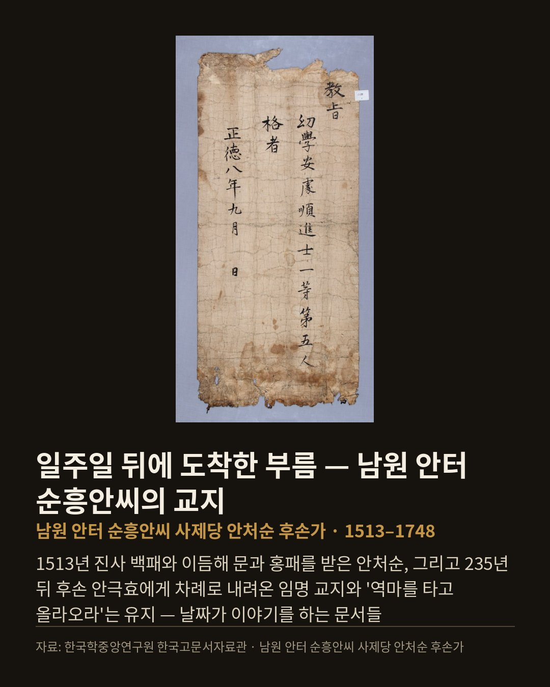
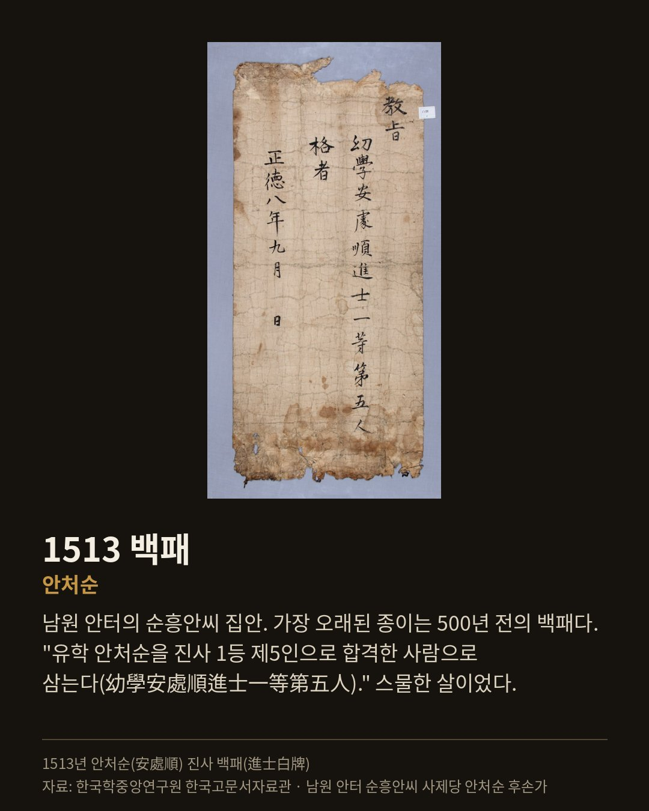
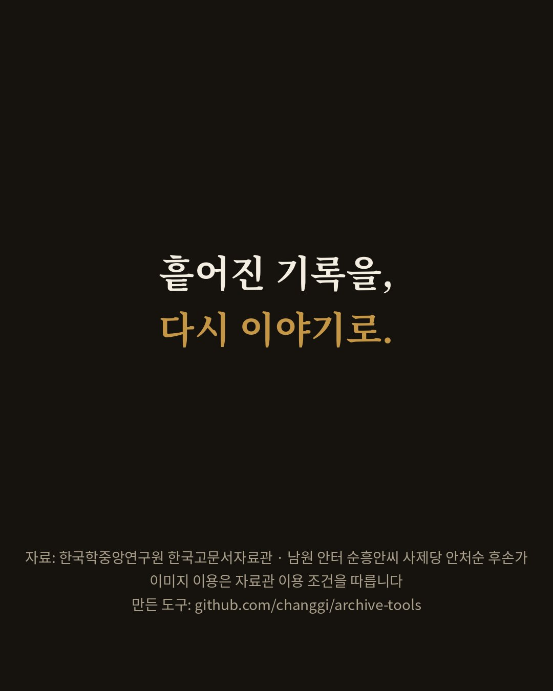

# EP.40 일주일 뒤에 도착한 부름 — 남원 안터 순흥안씨의 교지

남원 안터 순흥안씨 사제당 안처순 후손가 (문중) · 1513년 진사 백패와 이듬해 문과 홍패를 받은 안처순, 그리고 235년 뒤 후손 안극효에게 차례로 내려온 임명 교지와 '역마를 타고 올라오라'는 유지 — 날짜가 이야기를 하는 문서들

- 🌐 [전시 웹페이지](https://changgi.github.io/archive-tools/examples/sajedang/exhibit.html) (한자 위 한글 독음 · 원문 해석) · [수업 활동지](https://changgi.github.io/archive-tools/examples/sajedang/handout.html)
- 🎬 영상: [릴스 9:16](https://changgi.github.io/archive-tools-next/media/ep40-sajedang_reel.mp4) · [가로 16:9](https://changgi.github.io/archive-tools-next/media/ep40-sajedang_wide.mp4) · 홍보 글: [`promo.md`](promo.md)
- 카드뉴스: [`cards/`](cards/) · SNS 글: [`sns.txt`](sns.txt) · 판독·해석 표: [`selection.csv`](selection.csv)


<!-- DELIVERY -->
## 전달 에디팅 — 이 기록을 이렇게 전합니다

- **핵심 정서** — 조급함
- **한 문장** — 500년 전 종이에도 '빨리 와 달라'는 조급함이 담겨 있었다는 것.
- **열기** — 임명장을 받고 일주일 뒤, 또 한 장이 왔습니다. "서둘러 올라오라."
- **펼치기** — 안처순 진사 백패 → 안처순 문과 홍패 → 안극효 고신－1 → 안극효 유지 → 안극효 고신－3 (1513–1748년) — 1513–1514년의 합격증으로 집안의 시작을 보여 주고, 234년 뒤 일주일 간격의 두 문서로 긴장을 만들었습니다.
- **절정** — "안극효를 어모장군 행 충무위 부사과로 삼는다(安克孝爲禦侮將軍行忠武衛副司果者)" — 화면·공간에서 이 한 줄만 크게, 소리를 줄여 집중
- **여운** — 일주일 사이에 조정에는 무슨 일이 있었을까요? — 질문으로 끝내고 답은 보는 사람에게
- **감각과 물질** — 7일 간격 두 문서를 달력에 표시, 시계 초침 소리 · 흰 종이 한 장에 조명 하나 · 붉은 종이를 실물 크기로 복제해 벽에 거는 연출 · 어보·관인 탁본 스탬프를 찍어 보는 체험
- **통로와 매개** — 온라인: 릴스(열기) → 카드뉴스(펼치기) → 전시 웹페이지(절정·원문) → 비하인드 카드(여운) / 오프라인: 원본 크기 복제·낭독·참여 벽 / 남기기: 활동지·질문 카드
- **여운 장치** — "일주일 사이 무슨 일이?" 추리 카드
- **전달 에디팅 전** — 5건의 문서를 1513–1748년 연대순으로 놓고 문서명 · 유형 · 해설을 붙인다 — 정확하지만, 지나가면 잊힌다.
- **전달 에디팅 후** — 핵심 정서는 「조급함」. 「임명장을 받고 일주일 뒤, 또 한 장이 왔습니다. "서둘러 올라오라."」로 열고, 문서를 대비와 순서로 펼친 뒤, "안극효를 어모장군 행 충무위 부사과로 삼는다(安克孝爲禦侮將軍行忠武衛副司果者)"에서 멈춘다. 7일 간격 두 문서를 달력에 표시, 시계 초침 소리. 마지막엔 「"일주일 사이 무슨 일이?" 추리 카드」로 보는 사람이 자기 이야기를 남기고 떠나게 한다.

전문: [`delivery.md`](delivery.md)
<!-- /DELIVERY -->

<!-- CURATOR -->
## 비하인드 — 큐레이터 노트

- **왜 이 문서들인가** — 사헌부 지평 임명장을 받고 일주일 뒤 '서둘러 올라오라'는 유지가 또 왔습니다.
- **전하고 싶은 것** — 500년 전 종이에도 '빨리 와 달라'는 조급함이 담겨 있었다는 것.
- **이렇게 보이길 바랐다** — 1513–1514년의 합격증으로 집안의 시작을 보여 주고, 234년 뒤 일주일 간격의 두 문서로 긴장을 만들었습니다.
- **이렇게 써 주세요** — 조선 관료의 임용 절차, 문서 날짜 읽기 활동에 쓰세요.
- **남겨 둔 질문** — 일주일 사이에 조정에는 무슨 일이 있었을까요?
- **제작 기록** — 문서 5건 · 1513–1748년 · 원본 사진 7면(문서 전체) · 원문 판독 5건 · 번역 5건 · 해제에 "확인 필요"를 단 문서 2건

전문: [`curator.md`](curator.md)
<!-- /CURATOR -->

## 이야기 — 사료가 말하는 대로

임명장을 받고 일주일 뒤, 또 한 장이 왔습니다. '서둘러 올라오라.'

> **1513 백패** — 남원 안터의 순흥안씨 집안. 가장 오래된 종이는 500년 전의 백패다. "유학 안처순을 진사 1등 제5인으로 합격한 사람으로 삼는다(幼學安處順進士一等第五人)." 스물한 살이었다.
> **1514 홍패** — 이듬해 가을, 그는 문과에 붙는다. 이름 앞 두 글자가 한 해 사이 바뀌었다. "성균관 진사 안처순을 문과 병과 제16인으로(成均進士安處順文科丙科第十六人)."
> **1748 고신** — 234년 뒤 1748년 10월 11일, 후손 안극효가 사헌부 지평에 임명된다. "안극효를 통훈대부 행 사헌부 지평으로 삼는다(安克孝爲通訓大夫行司憲府持平者)." 그러나 그는 서울에 있지 않았다.
> **1748 유지** — 일주일 뒤 10월 18일, 남원으로 또 한 장이 내려온다. "너는 서둘러 역마를 타고 올라오라(爾其斯速乘馹上來事)." 임명장 다음에 부름장, 두 날짜 사이에 서울과 남원의 거리가 있다.
> **1748 고신** — 그해 겨울, 그의 이름은 다시 다른 교지에 오른다. 이번에는 군직이다. "안극효를 어모장군 행 충무위 부사과로 삼는다(安克孝爲禦侮將軍行忠武衛副司果者)." 두 달 사이 세 장, 날짜를 따라가면 한 사람의 겨울이 보인다.

| 표지 | 1번 카드 | 마무리 |
|---|---|---|
|  |  |  |

## 선별 문서 (5점)

| # | 연도 | 유형 | 문서명 | 원본 |
|---|---|---|---|---|
| 1 | 1513 | 백패 | 1513년 안처순(安處順) 진사 백패(進士白牌) | [원본 보기](https://archive.aks.ac.kr/viewer/viewer.do#imgnode.do?itemId=book&gubun=booktree&depth=6&upPath=01%5E0147%5EL014731%5EL014731F02%5EL014731F0201&dataId=G002%2BAKS%2BKSM-XA.1513.1111-20101008.B067a_098_00002_XXX&itemType=) |
| 2 | 1514 | 홍패 | 1514년 안처순(安處順) 문과 홍패(文科紅牌) | [원본 보기](https://archive.aks.ac.kr/viewer/viewer.do#imgnode.do?itemId=book&gubun=booktree&depth=6&upPath=01%5E0147%5EL014731%5EL014731F02%5EL014731F0201&dataId=G002%2BAKS%2BKSM-XA.1514.1111-20101008.B067a_098_00004_XXX&itemType=) |
| 3 | 1748 | 고신 | 1748년 안극효(安克孝) 고신(告身)－1 | [원본 보기](https://archive.aks.ac.kr/viewer/viewer.do#imgnode.do?itemId=book&gubun=booktree&depth=6&upPath=01%5E0147%5EL014731%5EL014731F02%5EL014731F0201&dataId=G002%2BAKS%2BKSM-XA.1748.1111-20101008.B067a_098_00024_XXX&itemType=) |
| 4 | 1748 | 유지 | 1748년 안극효(安克孝) 유지(有旨) | [원본 보기](https://archive.aks.ac.kr/viewer/viewer.do#imgnode.do?itemId=book&gubun=booktree&depth=6&upPath=01%5E0147%5EL014731%5EL014731F02%5EL014731F0201&dataId=G002%2BAKS%2BKSM-XA.1748.1111-20101008.B067a_098_00001_XXX&itemType=) |
| 5 | 1748 | 고신 | 1748년 안극효(安克孝) 고신(告身)－3 | [원본 보기](https://archive.aks.ac.kr/viewer/viewer.do#imgnode.do?itemId=book&gubun=booktree&depth=6&upPath=01%5E0147%5EL014731%5EL014731F02%5EL014731F0201&dataId=G002%2BAKS%2BKSM-XA.1748.1111-20101008.B067a_098_00026_XXX&itemType=) |

## 원문 판독과 해석

### 1. 1513년 안처순(安處順) 진사 백패(進士白牌)

**원문 판독**

```
敎旨
幼學安處順進士一等第五人
[入]格者 (훼손)
正德八年九月 日 (도장)
```

**원문 해석** 교지. 유학 안처순을 진사시 1등 제5인으로 합격한 사람으로 삼는다. 정덕 8년(1513) 9월 일.

**해제** 1513년(중종 8) 9월, 사제당 안처순(安處順, 1493~1534)이 진사시에 1등 5인으로 합격하고 받은 백패입니다. 500년이 넘은 문서라 가장자리가 많이 해졌습니다.

### 2. 1514년 안처순(安處順) 문과 홍패(文科紅牌)

**원문 판독**

```
[敎]旨
成均進士安處順文科
丙科第十六人及第出
身者
正德九年十月 日 (도장)
```

**원문 해석** 교지. 성균관 진사 안처순을 문과 병과 제16인으로 급제하여 출신한 사람으로 삼는다. 정덕 9년(1514) 10월 일.

**해제** 1514년(중종 9) 10월, 안처순이 문과에 급제하고 받은 홍패입니다. 1년 전 백패에서 '幼學'이던 신분이 '成均進士(성균관 진사)'로 바뀌어 있습니다. 안처순은 뒤에 기묘사화(1519)와 관련해 벼슬을 그만두고 남원에 물러난 것으로 알려져 있습니다(문서 밖 사실 — 확인 필요).

### 3. 1748년 안극효(安克孝) 고신(告身)－1

**원문 판독**

```
敎旨
安克孝爲通訓
大夫行司憲府
持平者
乾隆十三年十月十一日 (도장)
```

**원문 해석** 교지. 안극효를 통훈대부 행 사헌부 지평으로 삼는다. 건륭 13년(1748) 10월 11일.

**해제** 234년 뒤인 1748년(영조 24) 10월 11일, 후손 안극효(安克孝)를 사헌부 지평(정5품)에 임명한 교지입니다. 안극효는 1741년 문과에 급제했습니다.

### 4. 1748년 안극효(安克孝) 유지(有旨)

**원문 판독**

```
左副承旨金(押)
今以爾爲司憲府持
平 爾其斯速乘馹上
來事 有
旨
乾隆十三年十月十八日 (도장)
```

**원문 해석** 좌부승지 김(金)이 씀. 이제 너를 사헌부 지평으로 삼으니, 너는 서둘러 역마를 타고 올라오라는 유지. 건륭 13년(1748) 10월 18일.

**해제** 임명 교지보다 일주일 늦은 10월 18일 자 유지입니다. 지방(남원)에 있는 사람을 임명하면 이렇게 따로 유지를 보내 역마를 타고 올라오게 했습니다. 두 문서의 날짜 차이(10월 11일 → 18일)가 임명과 소환의 순서를 보여 줍니다.

### 5. 1748년 안극효(安克孝) 고신(告身)－3

**원문 판독**

```
敎旨
安克孝爲
禦侮將軍
行忠武衛
副司果者
乾隆十三年十二月 日 (도장)
```

**원문 해석** 교지. 안극효를 어모장군 행 충무위 부사과로 삼는다. 건륭 13년(1748) 12월 일.

**해제** 같은 해 12월, 안극효를 충무위 부사과(종6품 군직)로 삼은 교지입니다. 같은 달 용양위 부사직 교지도 함께 전합니다. 실무가 없는 군직에 이름을 올려 녹봉을 받게 하는 일이 흔했는데, 지평 부임과 어떤 관계인지는 문서만으로 알 수 없어 확인이 필요합니다.

판독·해석·이야기는 이미지에 근거한 초안이며(검토 전 "초안" 표시), 정확한 판독은 원문 확인이 필요합니다. □는 읽지 못한 글자, (?)는 불확실한 글자입니다.
이미지: 한국학중앙연구원 한국고문서자료관 소장·제공. "원본" 링크를 누르면 자료관 뷰어에서 그 문서가 열립니다. 재사용은 자료관에 문의하세요(소장처 동의 필요).
