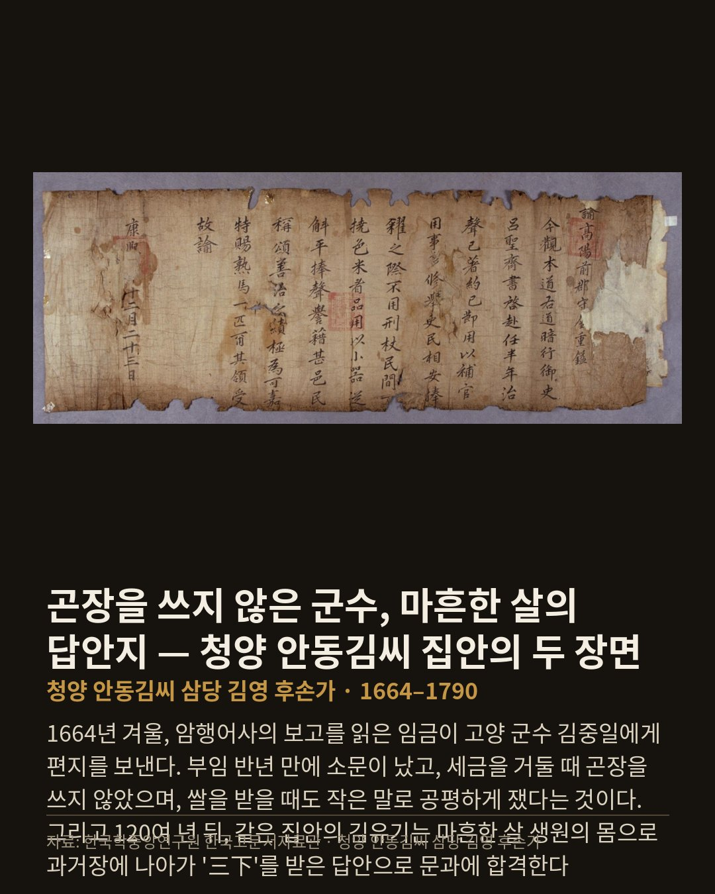
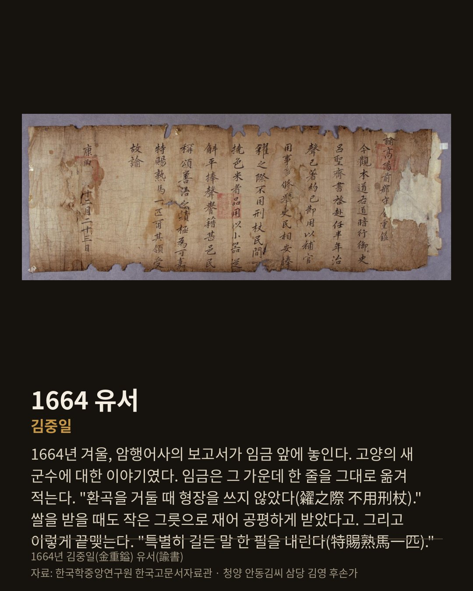
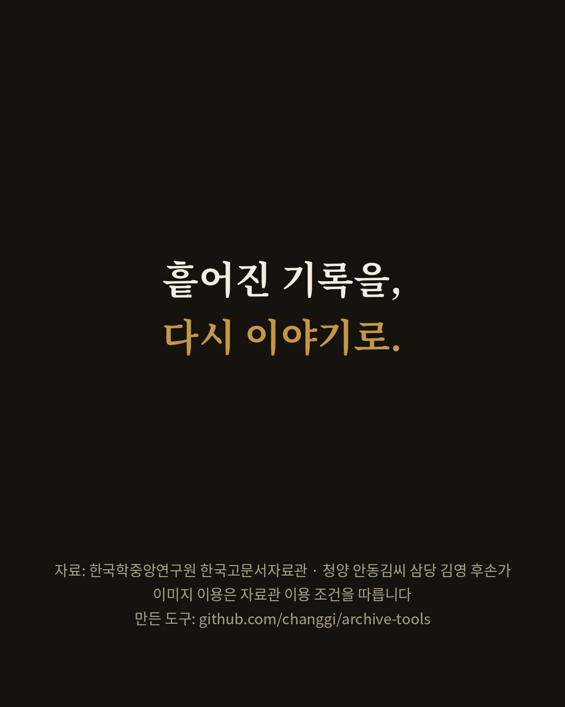

# EP.117 곤장을 쓰지 않은 군수, 마흔한 살의 답안지 — 청양 안동김씨 집안의 두 장면

청양 안동김씨 삼당 김영 후손가 (문중) · 1664년 겨울, 암행어사의 보고를 읽은 임금이 고양 군수 김중일에게 편지를 보낸다. 부임 반년 만에 소문이 났고, 세금을 거둘 때 곤장을 쓰지 않았으며, 쌀을 받을 때도 작은 말로 공평하게 쟀다는 것이다. 그리고 120여 년 뒤, 같은 집안의 김유기는 마흔한 살 생원의 몸으로 과거장에 나아가 '三下'를 받은 답안으로 문과에 합격한다

- 🌐 [전시 웹페이지](https://changgi.github.io/archive-tools/examples/samdang/exhibit.html) (한자 위 한글 독음 · 원문 해석) · [수업 활동지](https://changgi.github.io/archive-tools/examples/samdang/handout.html)
- 🎬 영상: [릴스 9:16](https://changgi.github.io/archive-tools-next/media/ep117-samdang_reel.mp4) · [가로 16:9](https://changgi.github.io/archive-tools-next/media/ep117-samdang_wide.mp4) · 홍보 글: [`promo.md`](promo.md)
- 카드뉴스: [`cards/`](cards/) · SNS 글: [`sns.txt`](sns.txt) · 판독·해석 표: [`selection.csv`](selection.csv)

<!-- DELIVERY -->
## 전달 에디팅 — 이 기록을 이렇게 전합니다

- **핵심 정서** — 따뜻함
- **한 문장** — 잘한 일은 누군가 지켜보고 기록한다 — 곤장 없이 다스린 군수도, 마흔한 살에 붙은 생원도.
- **열기** — 360년 전, 암행어사가 임금에게 보고했습니다. "이 군수는 곤장을 쓰지 않습니다."
- **펼치기** — 김중일 유서 → 김유기 시권 — 합경정시 문과 병 → 김유기 고신 (1664–1790년) — 1664년 포상 유서(김중일) → 합경 정시 시권(김유기, 41세) → 1790년 첫 고신 순으로, 한 집안의 두 시대를 '평가받는 순간'으로 이어 구성했습니다.
- **절정** — "환곡을 거둘 때 형장을 쓰지 않았다(糴之際 不用刑杖)" — 화면·공간에서 이 한 줄만 크게, 소리를 줄여 집중
- **여운** — 곤장 없이 세금을 거둔 군수를, 고양 사람들은 어떻게 기억했을까요? — 질문으로 끝내고 답은 보는 사람에게
- **감각과 물질** — 암행어사의 보고서와 길든 말 한 필, 답안지 위 시험관의 큰 붓 자국 · 역마 방울·말발굽 소리와 함께 펼치는 두루마리 · 시험장 책상과 답안지 체험 · 어보·관인 탁본 스탬프를 찍어 보는 체험
- **통로와 매개** — 온라인: 릴스(열기) → 카드뉴스(펼치기) → 전시 웹페이지(절정·원문) → 비하인드 카드(여운) / 오프라인: 원본 크기 복제·낭독·참여 벽 / 남기기: 활동지·질문 카드
- **여운 장치** — 늦게 시작해 해낸 일 하나를 떠올리기
- **전달 에디팅 전** — 3건의 문서를 1664–1790년 연대순으로 놓고 문서명 · 유형 · 해설을 붙인다 — 정확하지만, 지나가면 잊힌다.
- **전달 에디팅 후** — 핵심 정서는 「따뜻함」. 「360년 전, 암행어사가 임금에게 보고했습니다. "이 군수는 곤장을 쓰지 않습니다."」로 열고, 문서를 대비와 순서로 펼친 뒤, "환곡을 거둘 때 형장을 쓰지 않았다(糴之際 不用刑杖)"에서 멈춘다. 암행어사의 보고서와 길든 말 한 필, 답안지 위 시험관의 큰 붓 자국. 마지막엔 「늦게 시작해 해낸 일 하나를 떠올리기」로 보는 사람이 자기 이야기를 남기고 떠나게 한다.

전문: [`delivery.md`](delivery.md)
<!-- /DELIVERY -->

<!-- CURATOR -->
## 비하인드 — 큐레이터 노트

- **왜 이 문서들인가** — 고신 수십 장 사이에서 암행어사의 보고를 그대로 옮긴 포상 유서가, 그리고 붉은 쪽지가 붙은 합격 답안지가 눈에 걸렸습니다.
- **전하고 싶은 것** — 잘한 일은 누군가 지켜보고 기록한다 — 곤장 없이 다스린 군수도, 마흔한 살에 붙은 생원도.
- **이렇게 보이길 바랐다** — 1664년 포상 유서(김중일) → 합경 정시 시권(김유기, 41세) → 1790년 첫 고신 순으로, 한 집안의 두 시대를 '평가받는 순간'으로 이어 구성했습니다.
- **이렇게 써 주세요** — 암행어사 제도와 지방 행정, 환곡과 조세, 과거 시험의 채점과 합격 표시, 늦은 출발에 대한 이야기에 쓰세요.
- **만들며 있었던 일** — 유서의 연호 숫자와 몇 글자, 시권 아래쪽 글자는 판독이 불확실합니다. 시권의 시험 연도는 고신으로 미루어 본 추정이며, 김중일과 김유기의 가계상 관계는 확인하지 않았습니다. 답안은 앞부분만 읽었습니다.
- **남겨 둔 질문** — 곤장 없이 세금을 거둔 군수를, 고양 사람들은 어떻게 기억했을까요?
- **제작 기록** — 문서 3건 · 1664–1790년 · 원본 사진 6면(문서 전체) · 원문 판독 3건 · 번역 3건 · 못 읽은 글자 □ 2 · 불확실 (?) 6

전문: [`curator.md`](curator.md) · 비하인드 카드: [`behind/`](behind/) · 채널별 홍보안: [`channels.md`](channels.md)
<!-- /CURATOR -->

## 이야기 — 사료가 말하는 대로

360년 전, 암행어사가 임금에게 보고했습니다. "이 군수는 곤장을 쓰지 않습니다."

> **1664 유서** — 1664년 겨울, 암행어사의 보고서가 임금 앞에 놓인다. 고양의 새 군수에 대한 이야기였다. 임금은 그 가운데 한 줄을 그대로 옮겨 적는다. "환곡을 거둘 때 형장을 쓰지 않았다(糴之際 不用刑杖)." 쌀을 받을 때도 작은 그릇으로 재어 공평하게 받았다고. 그리고 이렇게 끝맺는다. "특별히 길든 말 한 필을 내린다(特賜熟馬一匹)."
> ** 시권** — 120여 년 뒤, 같은 집안의 한 생원이 과거장에 앉는다. 피봉에 그는 이렇게 적었다. "생원 신 김유기, 나이 마흔하나(生員臣金裕己年四十一)." 아버지와 생부, 두 이름이 나란히 적혔다. 답안 위에는 시험관의 붓으로 큰 두 글자가 남았다. "三下." 그리고 붉은 쪽지 한 장. "문과 병과 제2인(文科丙科第二人)."
> **1790 고신** — 몇 달 뒤, 마흔이 넘은 새내기 관원에게 첫 교지가 온다. "종사랑 김유기를 승사랑으로 삼는다(從仕郞金裕己爲承仕郞者)." 아래 작은 글씨는 그의 자리를 알려 준다. 승문원의 수습 관원. 마흔한 살, 그의 벼슬길은 거기서 시작되었다.

| 표지 | 1번 카드 | 마무리 |
|---|---|---|
|  |  |  |

## 선별 문서 (3점)

| # | 연도 | 유형 | 문서명 | 원본 |
|---|---|---|---|---|
| 1 | 1664 | 유서 | 1664년 김중일(金重鎰) 유서(諭書) | [원본 보기](https://archive.aks.ac.kr/viewer/viewer.do#imgnode.do?itemId=book&gubun=booktree&depth=6&upPath=01%5E0144%5EL014428%5EL014428F02%5EL014428F0201&dataId=G002%2BAKS%2BKSM-XA.1664.1111-20101008.B042a_064_00001_XXX&itemType=) |
| 2 | — | 시권 | 김유기(金裕己) 시권(試券) — 합경정시 문과 병과 제2인 | [원본 보기](https://archive.aks.ac.kr/viewer/viewer.do#imgnode.do?itemId=book&gubun=booktree&depth=6&upPath=01%5E0144%5EL014428%5EL014428F02%5EL014428F0204&dataId=G002%2BAKS%2BKSM-XD.0000.0000-20101008.B042a_064_00193_XXX&itemType=) |
| 3 | 1790 | 고신 | 1790년 김유기(金裕己) 고신(告身) | [원본 보기](https://archive.aks.ac.kr/viewer/viewer.do#imgnode.do?itemId=book&gubun=booktree&depth=6&upPath=01%5E0144%5EL014428%5EL014428F02%5EL014428F0201&dataId=G002%2BAKS%2BKSM-XA.1790.1111-20101008.B042a_064_00041_XXX&itemType=) |

## 원문 판독과 해석

### 1. 1664년 김중일(金重鎰) 유서(諭書)

**원문 판독**

```
諭高陽前(?)郡守金重鎰
今觀本道右道暗行御史
呂聖齊書啓赴任半年治
聲已著約己節用以補官
用事多修擧吏民相安捧(?)
糴之際不用刑杖民間□(?)
捧色米者品用以小器從
斛平捧聲譽藉甚邑民
稱頌善治實績極爲可嘉
特賜熟馬一匹爾其領受
故諭
康熙□(?)年十二月二十三日
```

**원문 해석** 고양 군수 김중일에게 이른다. 이제 본도 우도 암행어사 여성제(呂聖齊)의 서계(書啓)를 보니, 부임한 지 반년 만에 다스림의 명성이 이미 드러났다. 자신을 단속하고 씀씀이를 아껴 관아의 쓰임을 보태고, 여러 일을 잘 정비하여 아전과 백성이 서로 편안하다. 환곡을 거둘 때 형장(刑杖)을 쓰지 않았고, 백성에게서 색미(色米)를 받을 때는 작은 그릇으로 재어 말(斛)에 맞게 공평하게 받으니, 명성이 자자하고 고을 백성이 칭송한다고 한다. 잘 다스린 실적이 매우 가상하다. 특별히 길든 말(熟馬) 한 필을 내리니 그대는 받으라. 그러므로 이른다. 강희 □년(1664) 12월 23일.

**해제** 1664년(현종 5) 무렵 임금이 고양 군수 김중일(金重鎰)에게 내린 포상 유서(諭書)입니다. 암행어사 여성제(呂聖齊)가 올린 보고(서계)를 근거로, 부임 반년 만에 선정을 베푼 공을 칭찬하고 숙마(熟馬, 길든 말) 한 필을 상으로 내렸습니다. 환곡을 거둘 때 곤장 같은 형벌을 쓰지 않았다는 점, 쌀을 받을 때 작은 그릇으로 재어 공평하게 받았다는 점이 구체적으로 적혀 있습니다. '色米'는 환곡 등을 받을 때 덧붙여 걷던 쌀로 보입니다(추정). 연호 아래 숫자는 판독이 어려워 연도는 자료관 목록(1664)을 따랐습니다. '前' 자로 읽은 글자도 불확실합니다.

### 2. 김유기(金裕己) 시권(試券) — 합경정시 문과 병과 제2인

**원문 판독**

```
今此合慶庭試文科丙科第二人望
(피봉) 生員臣金裕己年四十一本安東居交河
父學生文厚
生父通德郞澤厚
天和斟於兕觥 先祝公於躋堂 …
芳樽映於彩衣 詠黃耇而綏之 …
(채점) 三下
六典(?)
```

**원문 해석** (붙임쪽지) 이번 합경 정시 문과 병과 제2인. (응시자 정보) 생원 신 김유기, 나이 마흔하나, 본관 안동, 교하 거주. 아버지 학생 문후, 생부 통덕랑 택후. (답안 앞부분) 하늘의 화기를 뿔잔에 따르고, 먼저 당에 올라 공의 장수를 빈다 … 향기로운 술동이가 색동옷에 비치고, 늙은이를 노래하며 편안하게 한다 … (채점 표시) 삼하(三下).

**해제** 생원 김유기(金裕己)가 '합경 정시(合慶庭試)'에서 문과 병과 제2인으로 합격한 시권(답안지)입니다. 오른쪽 위에 붙인 붉은 쪽지는 합격자의 등수를 적은 것이고, 큰 먹 글씨 '三下'는 채점 등급입니다. '三下'는 합격선 안의 등급 표시로 시권에서 자주 보입니다. 오른쪽 아래 피봉에는 '나이 마흔하나, 본관 안동, 교하 거주'와 아버지 문후(文厚), 생부(生父) 택후(澤厚)가 적혀 있어, 김유기가 양자로 들어갔음을 알 수 있습니다. 합경은 나라에 경사가 겹친 것을 기념한다는 뜻으로, 답안도 장수와 경사를 축하하는 내용입니다. 시험 연도는 적혀 있지 않으나, 1790년 3월 고신에 '권지승문원부정자'로 나오므로 그 직전에 급제한 것으로 보입니다(추정). 아래쪽 두 글자('六典'?)는 판독이 불확실합니다. 답안은 앞부분만 읽었습니다.

### 3. 1790년 김유기(金裕己) 고신(告身)

**원문 판독**

```
吏曹乾隆五十五年三月
二十六日奉
敎從仕郞金裕己
爲承仕郞者
乾隆五十五年三月 日
權知承文院副正字 庚(?)三別加
```

**원문 해석** 이조에서 건륭 55년(1790) 3월 26일에 받든 교지. 종사랑 김유기를 승사랑으로 삼는다. 건륭 55년 3월 일. (아래 작은 글씨) 권지 승문원 부정자, 경(?)삼 별가.

**해제** 1790년(정조 14, 乾隆 55) 이조에서 발급한 김유기의 고신입니다. 종사랑(정9품)에서 승사랑(종8품)으로 품계를 올렸으며, 아래 작은 글씨에 '권지 승문원 부정자(權知承文院副正字)'라고 적혀 있습니다. 권지는 문과 급제자가 처음 관청에 배치되어 수습하는 자리로, 앞의 시권 합격 이후의 첫 걸음으로 보입니다(추정). '別加'는 정기 인사 외에 특별히 품계를 더해 준 것을 뜻합니다. 이듬해에는 순강원 수봉관에 임명된 고신이 전합니다.

판독·해석·이야기는 이미지에 근거한 초안이며(검토 전 "초안" 표시), 정확한 판독은 원문 확인이 필요합니다. □는 읽지 못한 글자, (?)는 불확실한 글자입니다.
이미지: 한국학중앙연구원 한국고문서자료관 소장·제공. "원본" 링크를 누르면 자료관 뷰어에서 그 문서가 열립니다. 재사용은 자료관에 문의하세요(소장처 동의 필요).
