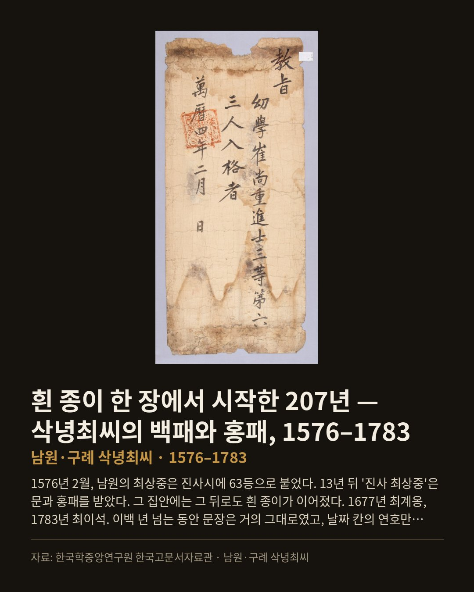
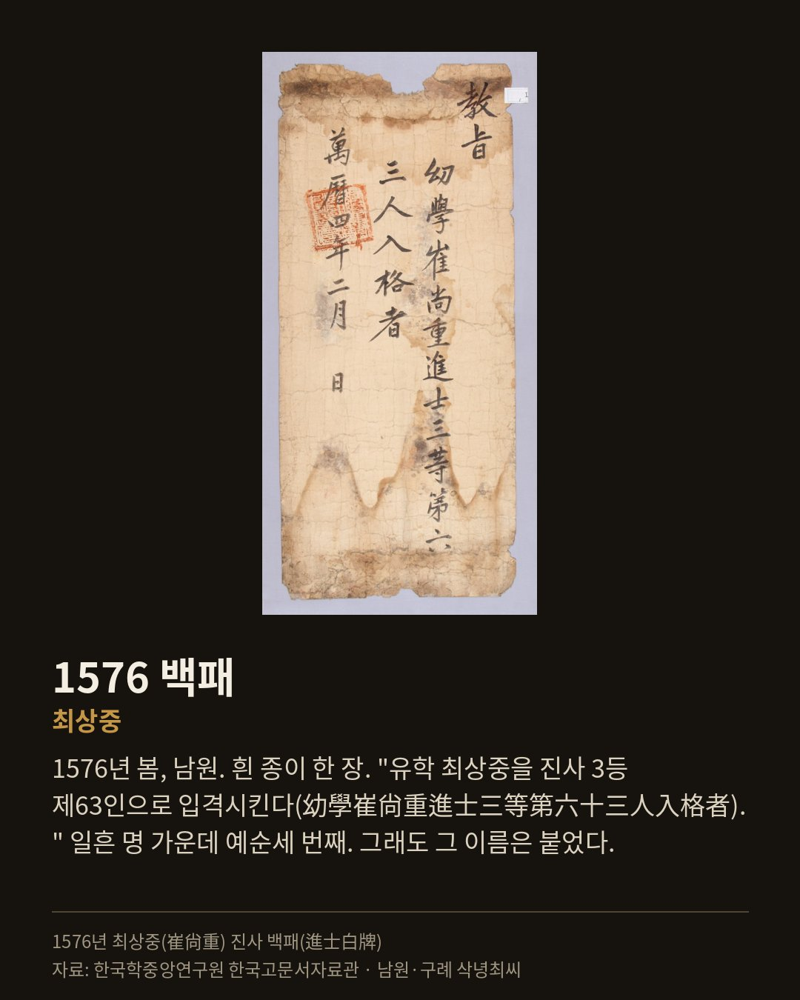
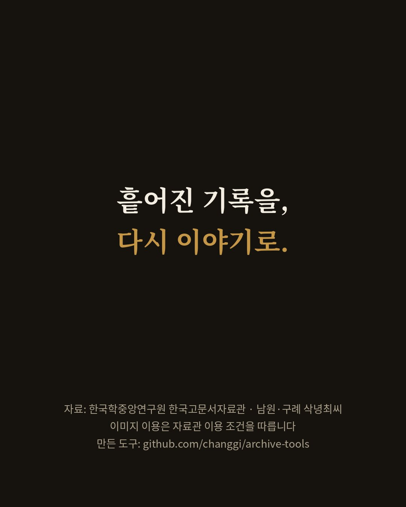

# EP.199 흰 종이 한 장에서 시작한 207년 — 삭녕최씨의 백패와 홍패, 1576–1783

남원·구례 삭녕최씨 (문중) · 1576년 2월, 남원의 최상중은 진사시에 63등으로 붙었다. 13년 뒤 '진사 최상중'은 문과 홍패를 받았다. 그 집안에는 그 뒤로도 흰 종이가 이어졌다. 1677년 최계옹, 1783년 최이석. 이백 년 넘는 동안 문장은 거의 그대로였고, 날짜 칸의 연호만 만력에서 강희, 건륭으로 바뀌었다. 「고문서 한 장」의 이백 번째 이야기는, 그렇게 한 집안이 대를 이어 받은 흰 종이에서 마무리된다

- 🌐 [전시 웹페이지](https://changgi.github.io/archive-tools/examples/sangnyeong-choi-baekhong/exhibit.html) (한자 위 한글 독음 · 원문 해석) · [수업 활동지](https://changgi.github.io/archive-tools/examples/sangnyeong-choi-baekhong/handout.html)
- 🎬 영상: [릴스 9:16](https://changgi.github.io/archive-tools-next/media/ep199-sangnyeong-choi-baekhong_reel.mp4) · [가로 16:9](https://changgi.github.io/archive-tools-next/media/ep199-sangnyeong-choi-baekhong_wide.mp4) · 홍보 글: [`promo.md`](promo.md)
- 카드뉴스: [`cards/`](cards/) · SNS 글: [`sns.txt`](sns.txt) · 판독·해석 표: [`selection.csv`](selection.csv)

<!-- DELIVERY -->
## 전달 에디팅 — 이 기록을 이렇게 전합니다

- **핵심 정서** — 잔잔한 마무리
- **한 문장** — 백패는 서식이 거의 바뀌지 않는 문서라, 한 집안의 백패를 이어 놓으면 바뀐 몇 글자(이름 · 등수 · 연호)가 그 집안의 시간표가 된다 — 같은 사람의 백패와 홍패를 나란히 놓으면 '유학'이 '진사'로 바뀌는 13년이 보인다.
- **열기** — 흰 종이 한 장이, 이백 년 동안 한 집안에 이어졌습니다.
- **펼치기** — 최상중 진사 백패 → 최상중 문과 홍패 → 최계옹 생원 백패 → 최이석 생원 백패 (1576–1783년) — 1576 유학 최상중 진사 백패 → 1589 진사 최상중 문과 홍패 → 1677 유학 최계옹 생원 백패 → 1783 유학 최이석 생원 백패로 놓았습니다.
- **절정** — "진사 최상중을 문과 병과 제21인으로 급제 출신시킨다(進士崔尙重文科丙科第二十一人及第出身者)" — 화면·공간에서 이 한 줄만 크게, 소리를 줄여 집중
- **여운** — 이백 장의 옛 종이 끝에서 — 다음 종이는, 어느 집 서랍에서 나올까요? — 질문으로 끝내고 답은 보는 사람에게
- **감각과 물질** — 네 장 모두의 '敎旨'와 '入格者' · '及第出身者', 그리고 바뀌는 연호 萬曆 · 康熙 · 乾隆 · 흰 종이 한 장에 조명 하나 · 붉은 종이를 실물 크기로 복제해 벽에 거는 연출
- **통로와 매개** — 온라인: 릴스(열기) → 카드뉴스(펼치기) → 전시 웹페이지(절정·원문) → 비하인드 카드(여운) / 오프라인: 원본 크기 복제·낭독·참여 벽 / 남기기: 활동지·질문 카드
- **여운 장치** — 우리 집에서 가장 오래된 종이 한 장 찾아보기
- **전달 에디팅 전** — 4건의 문서를 1576–1783년 연대순으로 놓고 문서명 · 유형 · 해설을 붙인다 — 정확하지만, 지나가면 잊힌다.
- **전달 에디팅 후** — 핵심 정서는 「잔잔한 마무리」. 「흰 종이 한 장이, 이백 년 동안 한 집안에 이어졌습니다.」로 열고, 문서를 대비와 순서로 펼친 뒤, "진사 최상중을 문과 병과 제21인으로 급제 출신시킨다(進士崔尙重文科丙科第二十一人及第出身者)"에서 멈춘다. 네 장 모두의 '敎旨'와 '入格者' · '及第出身者', 그리고 바뀌는 연호 萬曆 · 康熙 · 乾隆. 마지막엔 「우리 집에서 가장 오래된 종이 한 장 찾아보기」로 보는 사람이 자기 이야기를 남기고 떠나게 한다.

전문: [`delivery.md`](delivery.md)
<!-- /DELIVERY -->

<!-- CURATOR -->
## 비하인드 — 큐레이터 노트

- **왜 이 문서들인가** — EP.61 · EP.193–195에서 남원·구례 삭녕최씨 집안의 홍패와 유지를 읽었습니다. 시리즈 이백 번째 편으로, 이 집안에 남은 흰 종이(백패) 세 장과 그 가운데 한 사람이 13년 뒤 받은 붉은 종이(홍패) 한 장을 골랐습니다.
- **전하고 싶은 것** — 백패는 서식이 거의 바뀌지 않는 문서라, 한 집안의 백패를 이어 놓으면 바뀐 몇 글자(이름 · 등수 · 연호)가 그 집안의 시간표가 된다 — 같은 사람의 백패와 홍패를 나란히 놓으면 '유학'이 '진사'로 바뀌는 13년이 보인다.
- **이렇게 보이길 바랐다** — 1576 유학 최상중 진사 백패 → 1589 진사 최상중 문과 홍패 → 1677 유학 최계옹 생원 백패 → 1783 유학 최이석 생원 백패로 놓았습니다.
- **이렇게 써 주세요** — 생원 · 진사시와 문과, 백패와 홍패, 이름 앞 신분 표기(유학 · 진사), 등수 체계, 조선이 쓴 연호의 변화(만력 · 강희 · 건륭), 한 문중의 과거 이력을 연표로 만드는 수업에 쓰세요.
- **만들며 있었던 일** — 1783년 백패의 이름 가운데 글자는 자료관 목록(頤錫)을 따랐으나, 종이 위 글자는 '順'에 가깝게도 보여 확정하지 않았습니다. 1576년 백패의 등수 끝자리는 종이가 상해 '第六十三'으로 읽었습니다. 네 사람의 혈연 관계는 이 문서들로 확인하지 않았습니다. 1681년 최계옹의 문과 홍패는 EP.61에서 다뤘습니다.
- **남겨 둔 질문** — 이백 장의 옛 종이 끝에서 — 다음 종이는, 어느 집 서랍에서 나올까요?
- **제작 기록** — 문서 4건 · 1576–1783년 · 원본 사진 8면(문서 전체) · 원문 판독 4건 · 번역 4건

전문: [`curator.md`](curator.md) · 비하인드 카드: [`behind/`](behind/) · 채널별 홍보안: [`channels.md`](channels.md)
<!-- /CURATOR -->

## 이야기 — 사료가 말하는 대로

흰 종이 한 장이, 이백 년 동안 한 집안에 이어졌습니다.

> **1576 백패** — 1576년 봄, 남원. 흰 종이 한 장. "유학 최상중을 진사 3등 제63인으로 입격시킨다(幼學崔尙重進士三等第六十三人入格者)." 일흔 명 가운데 예순세 번째. 그래도 그 이름은 붙었다.
> **1589 홍패** — 열세 해 뒤, 1589년. 이번에는 붉은 종이다. "진사 최상중을 문과 병과 제21인으로 급제 출신시킨다(進士崔尙重文科丙科第二十一人及第出身者)." 이름 앞 두 글자가 '진사'로 바뀌었다. 흰 종이에서 붉은 종이까지, 열세 해.
> **1677 백패** — 팔십팔 년 뒤, 1677년 봄. 같은 집에 또 흰 종이. "유학 최계옹을 생원 3등 제7인으로 입격시킨다(幼學崔啓翁生員三等第七人入格者)." 날짜 칸의 연호는 강희. 네 해 뒤, 그도 붉은 종이를 받는다.
> **1783 백패** — 그리고 1783년 봄. 이백일곱 해 전과 같은 문장의 흰 종이. "유학 최이석을 생원 3등 제52인으로 입격시킨다(幼學崔頤錫生員三等第五十二人入格者)." 연호만 바뀌었다. 만력, 강희, 건륭. 한 집안의 서랍 속에서, 종이 한 장은 이렇게 이백 년을 건넜다. 그리고 우리는, 이백 번째 종이를 읽었다.

| 표지 | 1번 카드 | 마무리 |
|---|---|---|
|  |  |  |

## 선별 문서 (4점)

| # | 연도 | 유형 | 문서명 | 원본 |
|---|---|---|---|---|
| 1 | 1576 | 백패 | 1576년 최상중(崔尙重) 진사 백패(進士白牌) | [원본 보기](https://archive.aks.ac.kr/viewer/viewer.do#imgnode.do?itemId=book&gubun=booktree&depth=6&upPath=01%5E0147%5EL014722%5EL014722F02%5EL014722F0201&dataId=G002%2BAKS%2BKSM-XA.1576.1111-20101008.B049a_072_00017_XXX&itemType=) |
| 2 | 1589 | 홍패 | 1589년 최상중(崔尙重) 문과 홍패(文科紅牌) | [원본 보기](https://archive.aks.ac.kr/viewer/viewer.do#imgnode.do?itemId=book&gubun=booktree&depth=6&upPath=01%5E0147%5EL014722%5EL014722F02%5EL014722F0201&dataId=G002%2BAKS%2BKSM-XA.1589.1111-20101008.B049a_072_00014_XXX&itemType=) |
| 3 | 1677 | 백패 | 1677년 최계옹(崔啓翁) 생원 백패(生員白牌) | [원본 보기](https://archive.aks.ac.kr/viewer/viewer.do#imgnode.do?itemId=book&gubun=booktree&depth=6&upPath=01%5E0147%5EL014722%5EL014722F02%5EL014722F0201&dataId=G002%2BAKS%2BKSM-XA.1677.1111-20101008.B049a_072_00020_XXX&itemType=) |
| 4 | 1783 | 백패 | 1783년 최이석(崔頤錫) 생원 백패(生員白牌) | [원본 보기](https://archive.aks.ac.kr/viewer/viewer.do#imgnode.do?itemId=book&gubun=booktree&depth=6&upPath=01%5E0147%5EL014722%5EL014722F02%5EL014722F0201&dataId=G002%2BAKS%2BKSM-XA.1783.1111-20101008.B049a_072_00021_XXX&itemType=) |

## 원문 판독과 해석

### 1. 1576년 최상중(崔尙重) 진사 백패(進士白牌)

**원문 판독**

```
敎旨
幼學崔尙重進士三等第六十
三人入格者
萬曆四年二月 日
```

**원문 해석** 교지. 유학 최상중을 진사 3등 제63인으로 입격시킨다. 만력 4년(1576) 2월 일.

**해제** 1576년(선조 9) 2월, 남원의 최상중(崔尙重)이 진사시에 3등 제63인으로 입격하고 받은 백패입니다. 진사 3등은 70명이므로 거의 끝자리에 가까운 등수입니다. 연호 위에 과거 관인이 찍혔고, 아래쪽이 물결 모양으로 상했습니다. 최상중은 13년 뒤 문과에 급제합니다.

### 2. 1589년 최상중(崔尙重) 문과 홍패(文科紅牌)

**원문 판독**

```
敎旨
進士崔尙重文科丙科第二十
一人及第出身者
萬曆十七年五月初七日
```

**원문 해석** 교지. 진사 최상중을 문과 병과 제21인으로 급제 출신시킨다. 만력 17년(1589) 5월 7일.

**해제** 13년 뒤인 1589년(선조 22) 5월, 최상중이 문과 병과 제21인으로 급제하고 받은 홍패입니다. 이름 앞이 '유학'에서 '진사'로 바뀌어, 1576년의 백패가 이 홍패로 이어졌음을 보여 줍니다(EP.189 참조). 붉은 종이가 갈색으로 짙게 바랬고 금이 많이 갔습니다. 3년 뒤 임진왜란이 일어납니다.

### 3. 1677년 최계옹(崔啓翁) 생원 백패(生員白牌)

**원문 판독**

```
敎旨
幼學崔啓翁生員三等第七人
入格者
康熙十六年二月十八日
```

**원문 해석** 교지. 유학 최계옹을 생원 3등 제7인으로 입격시킨다. 강희 16년(1677) 2월 18일.

**해제** 88년 뒤인 1677년(숙종 3) 2월, 같은 집안의 최계옹(崔啓翁)이 생원시에 3등 제7인으로 입격하고 받은 백패입니다. 최상중은 진사, 최계옹은 생원입니다. 연호가 청의 강희(康熙)로 바뀌었습니다. 최계옹은 4년 뒤인 1681년 문과에 급제했고, 그 홍패는 EP.61에서 읽었습니다.

### 4. 1783년 최이석(崔頤錫) 생원 백패(生員白牌)

**원문 판독**

```
敎旨
幼學崔頤錫生員三等第五
十二人入格者
乾隆四十八年四月十一日
```

**원문 해석** 교지. 유학 최이석을 생원 3등 제52인으로 입격시킨다. 건륭 48년(1783) 4월 11일.

**해제** 1783년(정조 7) 4월, 같은 집안의 최이석(崔頤錫)이 생원시에 3등 제52인으로 입격하고 받은 백패로, 이 네 장 가운데 가장 늦은 것입니다. 이름의 가운데 글자는 자료관 목록을 따랐으나 종이 위 글자는 '順'에 가깝게도 보입니다. 1576년 최상중의 백패부터 207년 동안, 문장은 '교지 · 유학 아무개 · 생원(진사) 몇 등 제 몇 인 · 입격자'로 거의 바뀌지 않았고, 날짜 칸의 연호만 만력 · 강희 · 건륭으로 바뀌었습니다. 이 집안에는 그 뒤 1894년, 조선의 마지막 과거에서 받은 최병직의 문과 홍패까지 남아 있습니다(EP.61).

판독·해석·이야기는 이미지에 근거한 초안이며(검토 전 "초안" 표시), 정확한 판독은 원문 확인이 필요합니다. □는 읽지 못한 글자, (?)는 불확실한 글자입니다.
이미지: 한국학중앙연구원 한국고문서자료관 소장·제공. "원본" 링크를 누르면 자료관 뷰어에서 그 문서가 열립니다. 재사용은 자료관에 문의하세요(소장처 동의 필요).
