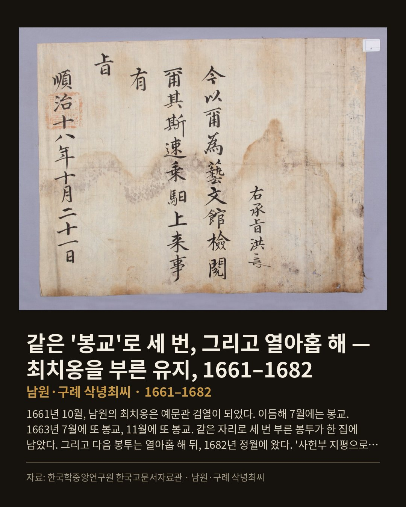
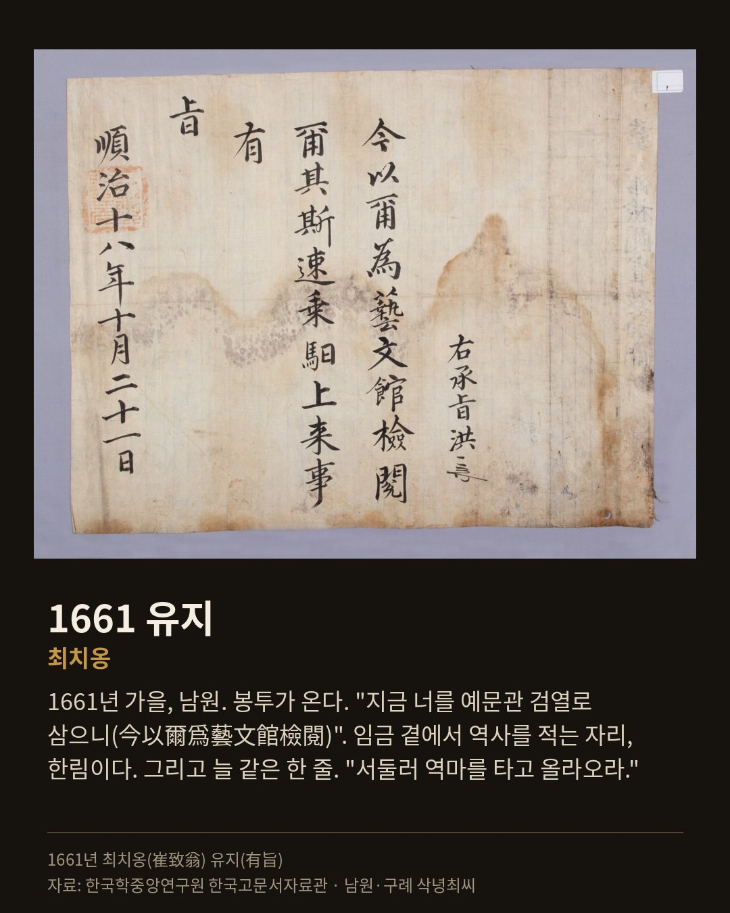
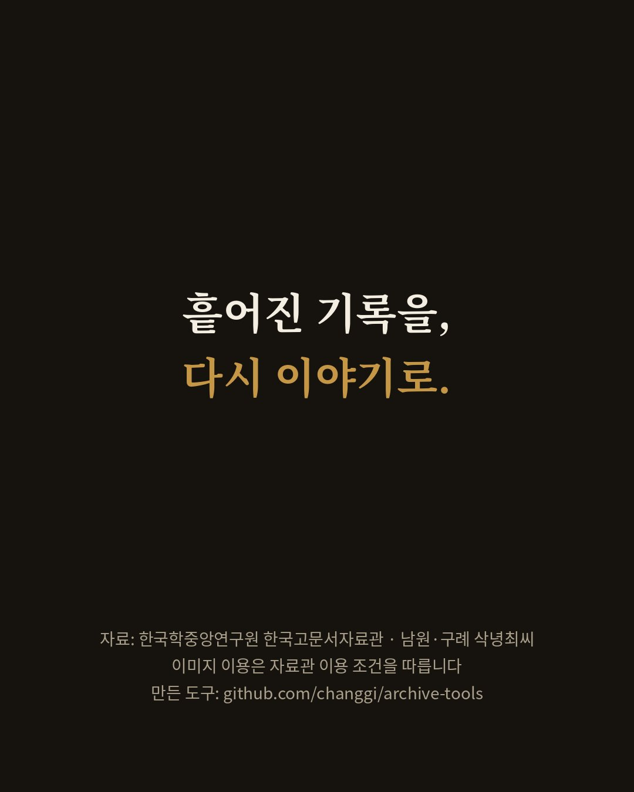

# EP.195 같은 '봉교'로 세 번, 그리고 열아홉 해 — 최치옹을 부른 유지, 1661–1682

남원·구례 삭녕최씨 (문중) · 1661년 10월, 남원의 최치옹은 예문관 검열이 되었다. 이듬해 7월에는 봉교. 1663년 7월에 또 봉교, 11월에 또 봉교. 같은 자리로 세 번 부른 봉투가 한 집에 남았다. 그리고 다음 봉투는 열아홉 해 뒤, 1682년 정월에 왔다. '사헌부 지평으로 삼는다.' 문장은 그대로였다. '서둘러 역마를 타고 올라오라'

- 🌐 [전시 웹페이지](https://changgi.github.io/archive-tools/examples/sangnyeong-choi-chiong/exhibit.html) (한자 위 한글 독음 · 원문 해석) · [수업 활동지](https://changgi.github.io/archive-tools/examples/sangnyeong-choi-chiong/handout.html)
- 🎬 영상: [릴스 9:16](https://changgi.github.io/archive-tools-next/media/ep195-sangnyeong-choi-chiong_reel.mp4) · [가로 16:9](https://changgi.github.io/archive-tools-next/media/ep195-sangnyeong-choi-chiong_wide.mp4) · 홍보 글: [`promo.md`](promo.md)
- 카드뉴스: [`cards/`](cards/) · SNS 글: [`sns.txt`](sns.txt) · 판독·해석 표: [`selection.csv`](selection.csv)

<!-- DELIVERY -->
## 전달 에디팅 — 이 기록을 이렇게 전합니다

- **핵심 정서** — 잔잔한 기다림
- **한 문장** — 예문관의 검열 · 봉교 · 대교는 '한림'이라 불린 사관 자리로, 젊은 문신이 거치는 영예로운 길이었다 — 그러나 같은 자리로 거듭 부른 유지와, 그 뒤 열아홉 해의 공백은 한 사람의 경력이 늘 곧게 이어지지 않았음을 보여 준다.
- **열기** — 같은 자리로 세 번 부른 뒤, 다음 부름은 열아홉 해 뒤에 왔습니다.
- **펼치기** — 최치옹 유지 → 최치옹 유지－2 (1661–1682년) — 1661 예문관 검열 → 1662 봉교 → 1663년 11월 다시 봉교 → 1682 사헌부 지평으로 놓았습니다.
- **절정** — "예문관 봉교로 삼으니(爲藝文館奉敎)" — 화면·공간에서 이 한 줄만 크게, 소리를 줄여 집중
- **여운** — 열아홉 해 만에 같은 문장을 다시 받은 사람은, 처음 봉투를 받던 날을 기억했을까요? — 질문으로 끝내고 답은 보는 사람에게
- **감각과 물질** — 네 장 모두의 '爾其斯速乘馹上來事', 그리고 날짜 칸의 順治 · 康熙 元年 · 二年 · 二十一年 · 역마 방울·말발굽 소리와 함께 펼치는 두루마리
- **통로와 매개** — 온라인: 릴스(열기) → 카드뉴스(펼치기) → 전시 웹페이지(절정·원문) → 비하인드 카드(여운) / 오프라인: 원본 크기 복제·낭독·참여 벽 / 남기기: 활동지·질문 카드
- **여운 장치** — 오랜만에 온 연락 · 초대장을 받았던 순간 떠올리기
- **전달 에디팅 전** — 4건의 문서를 1661–1682년 연대순으로 놓고 문서명 · 유형 · 해설을 붙인다 — 정확하지만, 지나가면 잊힌다.
- **전달 에디팅 후** — 핵심 정서는 「잔잔한 기다림」. 「같은 자리로 세 번 부른 뒤, 다음 부름은 열아홉 해 뒤에 왔습니다.」로 열고, 문서를 대비와 순서로 펼친 뒤, "예문관 봉교로 삼으니(爲藝文館奉敎)"에서 멈춘다. 네 장 모두의 '爾其斯速乘馹上來事', 그리고 날짜 칸의 順治 · 康熙 元年 · 二年 · 二十一年. 마지막엔 「오랜만에 온 연락 · 초대장을 받았던 순간 떠올리기」로 보는 사람이 자기 이야기를 남기고 떠나게 한다.

전문: [`delivery.md`](delivery.md)
<!-- /DELIVERY -->

<!-- CURATOR -->
## 비하인드 — 큐레이터 노트

- **왜 이 문서들인가** — EP.193에서 최연을 부른 유지를 읽었습니다. 같은 집안에 한 세대 뒤 최치옹을 부른 유지 다섯 장이 남아 있어, 그 가운데 네 장을 골랐습니다. 1663년 7월의 봉교 유지는 해제에서 함께 다룹니다.
- **전하고 싶은 것** — 예문관의 검열 · 봉교 · 대교는 '한림'이라 불린 사관 자리로, 젊은 문신이 거치는 영예로운 길이었다 — 그러나 같은 자리로 거듭 부른 유지와, 그 뒤 열아홉 해의 공백은 한 사람의 경력이 늘 곧게 이어지지 않았음을 보여 준다.
- **이렇게 보이길 바랐다** — 1661 예문관 검열 → 1662 봉교 → 1663년 11월 다시 봉교 → 1682 사헌부 지평으로 놓았습니다.
- **이렇게 써 주세요** — 유지의 형식, 예문관 한림(검열 · 대교 · 봉교)의 사관 직무, 같은 직으로 거듭 임명하는 관행(사직과 재임명), 사헌부 지평, 문서 사이의 '공백' 읽기 수업에 쓰세요.
- **만들며 있었던 일** — 1661년 유지는 날짜로 보아 '順治十八年'(1661)입니다. 1663년 두 장과 1662년 장이 모두 '봉교'인 까닭(사직 · 체직 · 재임명)은 이 문서들로 알 수 없습니다. 1663년부터 1682년 사이 최치옹의 행적도 이 집안 유지만으로는 알 수 없어, '이 집안에 남은 유지가 없다'고만 적었습니다. 승지의 이름은 성만 적혀 있어 성까지만 옮겼습니다.
- **남겨 둔 질문** — 열아홉 해 만에 같은 문장을 다시 받은 사람은, 처음 봉투를 받던 날을 기억했을까요?
- **제작 기록** — 문서 4건 · 1661–1682년 · 원본 사진 8면(문서 전체) · 원문 판독 4건 · 번역 4건 · 못 읽은 글자 □ 1 · 불확실 (?) 0

전문: [`curator.md`](curator.md) · 비하인드 카드: [`behind/`](behind/) · 채널별 홍보안: [`channels.md`](channels.md)
<!-- /CURATOR -->

## 이야기 — 사료가 말하는 대로

같은 자리로 세 번 부른 뒤, 다음 부름은 열아홉 해 뒤에 왔습니다.

> **1661 유지** — 1661년 가을, 남원. 봉투가 온다. "지금 너를 예문관 검열로 삼으니(今以爾爲藝文館檢閱)". 임금 곁에서 역사를 적는 자리, 한림이다. 그리고 늘 같은 한 줄. "서둘러 역마를 타고 올라오라."
> **1662 유지** — 이듬해 여름. 또 봉투. "예문관 봉교로 삼으니(爲藝文館奉敎)". 한림 가운데 가장 위 자리다. 날짜 칸의 연호는 강희 원년.
> **1663 유지** — 그리고 1663년 겨울. 또 봉투. 또 "예문관 봉교로 삼으니". 넉 달 전에도, 그 전해에도 같은 자리였다. 같은 이름, 같은 자리, 같은 문장. 세 번째다.
> **1682 유지** — 그리고 열아홉 해 뒤, 1682년 정월. 다시 봉투가 온다. "사헌부 지평으로 삼으니(爲司憲府持平)". 그 사이의 봉투는 이 집에 남지 않았다. 문장은 똑같다. "너는 서둘러 역마를 타고 올라오라(爾其斯速乘馹上來事)."

| 표지 | 1번 카드 | 마무리 |
|---|---|---|
|  |  |  |

## 선별 문서 (4점)

| # | 연도 | 유형 | 문서명 | 원본 |
|---|---|---|---|---|
| 1 | 1661 | 유지 | 1661년 최치옹(崔致翁) 유지(有旨) | [원본 보기](https://archive.aks.ac.kr/viewer/viewer.do#imgnode.do?itemId=book&gubun=booktree&depth=6&upPath=01%5E0147%5EL014722%5EL014722F02%5EL014722F0201&dataId=G002%2BAKS%2BKSM-XA.1661.1111-20101008.B049a_072_00008_XXX&itemType=) |
| 2 | 1662 | 유지 | 1662년 최치옹(崔致翁) 유지(有旨) | [원본 보기](https://archive.aks.ac.kr/viewer/viewer.do#imgnode.do?itemId=book&gubun=booktree&depth=6&upPath=01%5E0147%5EL014722%5EL014722F02%5EL014722F0201&dataId=G002%2BAKS%2BKSM-XA.1662.1111-20101008.B049a_072_00009_XXX&itemType=) |
| 3 | 1663 | 유지 | 1663년 최치옹(崔致翁) 유지(有旨)－2 | [원본 보기](https://archive.aks.ac.kr/viewer/viewer.do#imgnode.do?itemId=book&gubun=booktree&depth=6&upPath=01%5E0147%5EL014722%5EL014722F02%5EL014722F0201&dataId=G002%2BAKS%2BKSM-XA.1663.1111-20101008.B049a_072_00011_XXX&itemType=) |
| 4 | 1682 | 유지 | 1682년 최치옹(崔致翁) 유지(有旨) | [원본 보기](https://archive.aks.ac.kr/viewer/viewer.do#imgnode.do?itemId=book&gubun=booktree&depth=6&upPath=01%5E0147%5EL014722%5EL014722F02%5EL014722F0201&dataId=G002%2BAKS%2BKSM-XA.1682.1111-20101008.B049a_072_00012_XXX&itemType=) |

## 원문 판독과 해석

### 1. 1661년 최치옹(崔致翁) 유지(有旨)

**원문 판독**

```
今以爾爲藝文館檢閱
爾其斯速乘馹上來事
有
旨
右承旨洪(서명)
順治十八年十月二十一日
```

**원문 해석** 지금 너를 예문관 검열로 삼으니, 너는 서둘러 역마를 타고 올라오라는 유지가 있었다. 우승지 홍(서명). 순치 18년(1661) 10월 21일.

**해제** 1661년(현종 2) 10월, 남원 삭녕최씨 집안의 최치옹(崔致翁)을 예문관 검열(정9품)로 삼아 부른 유지입니다. 검열은 임금 곁에서 사초(史草)를 쓰는 사관으로, 대교 · 봉교와 함께 '한림'이라 불렸습니다. 문장은 EP.174 김훤의 1763년 검열 유지와 같은 틀입니다. 아래쪽에 물결 모양의 얼룩이 이 집안 유지 다섯 장에 똑같이 번져 있어, 오랫동안 한 묶음으로 포개어 보관했음을 보여 줍니다.

### 2. 1662년 최치옹(崔致翁) 유지(有旨)

**원문 판독**

```
今以爾爲藝文館奉敎爾其斯
速乘馹上來事有
旨
右承旨李(서명)
康熙元年七月二十□日
```

**원문 해석** 지금 너를 예문관 봉교로 삼으니, 너는 서둘러 역마를 타고 올라오라는 유지가 있었다. 우승지 이(서명). 강희 원년(1662) 7월 2□일.

**해제** 이듬해 1662년(현종 3) 7월, 최치옹을 예문관 봉교(정7품)로 삼아 부른 유지입니다. 검열에서 대교를 건너 봉교로 올랐습니다. 연호가 청의 강희(康熙) 원년으로 바뀌었습니다. 오른쪽 끝에 겉봉의 글씨 '藝文館奉敎 …'가 비쳐 보입니다. 날짜의 끝 글자는 얼룩에 가려 확정하지 못했습니다.

### 3. 1663년 최치옹(崔致翁) 유지(有旨)－2

**원문 판독**

```
今以爾爲藝文館奉敎爾其
斯速乘馹上來事有
旨
右承旨吳(서명)
康熙二年十一月初八日
```

**원문 해석** 지금 너를 예문관 봉교로 삼으니, 너는 서둘러 역마를 타고 올라오라는 유지가 있었다. 우승지 오(서명). 강희 2년(1663) 11월 8일.

**해제** 1663년(현종 4) 11월, 최치옹을 다시 예문관 봉교로 삼아 부른 유지입니다. 이 집안에는 넉 달 전인 같은 해 7월 4일에도 그를 봉교로 부른 유지가 남아 있어, 1662년 7월부터 1663년 11월까지 1년 4개월 사이에 같은 '봉교'로 세 번 부름을 받았습니다. 그 사이 자리에서 물러났다가(사직 · 체직) 다시 임명되기를 되풀이한 것으로 보이나, 이 문서들로는 사정을 알 수 없습니다.

### 4. 1682년 최치옹(崔致翁) 유지(有旨)

**원문 판독**

```
今以爾爲司憲府持平爾
其斯速乘馹上來事有
旨
同副承旨安(서명)
康熙二十一年正月初十日
```

**원문 해석** 지금 너를 사헌부 지평으로 삼으니, 너는 서둘러 역마를 타고 올라오라는 유지가 있었다. 동부승지 안(서명). 강희 21년(1682) 정월 10일.

**해제** 19년 뒤인 1682년(숙종 8) 정월, 최치옹을 사헌부 지평(정5품)으로 삼아 부른 유지입니다. 사헌부 지평은 관리를 감찰하는 대간의 자리입니다. 1663년 봉교 유지와 이 유지 사이에는 이 집안에 남은 유지가 없습니다. 그 사이 그가 다른 자리에 있었는지, 향리에 머물렀는지는 이 문서로 알 수 없습니다. 같은 문장, 같은 크기의 종이, 같은 물결 얼룩이 19년의 간격을 이어 줍니다.

판독·해석·이야기는 이미지에 근거한 초안이며(검토 전 "초안" 표시), 정확한 판독은 원문 확인이 필요합니다. □는 읽지 못한 글자, (?)는 불확실한 글자입니다.
이미지: 한국학중앙연구원 한국고문서자료관 소장·제공. "원본" 링크를 누르면 자료관 뷰어에서 그 문서가 열립니다. 재사용은 자료관에 문의하세요(소장처 동의 필요).
