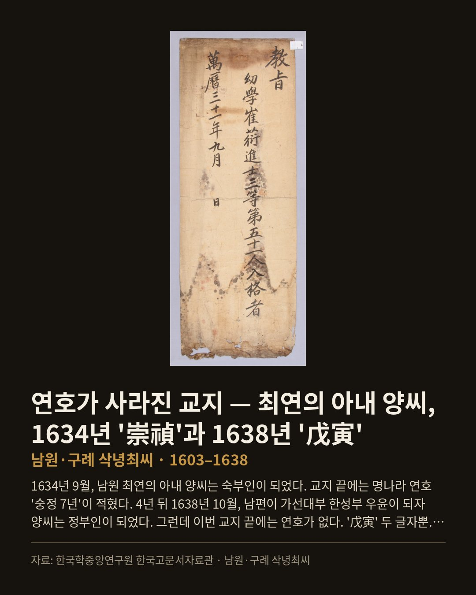
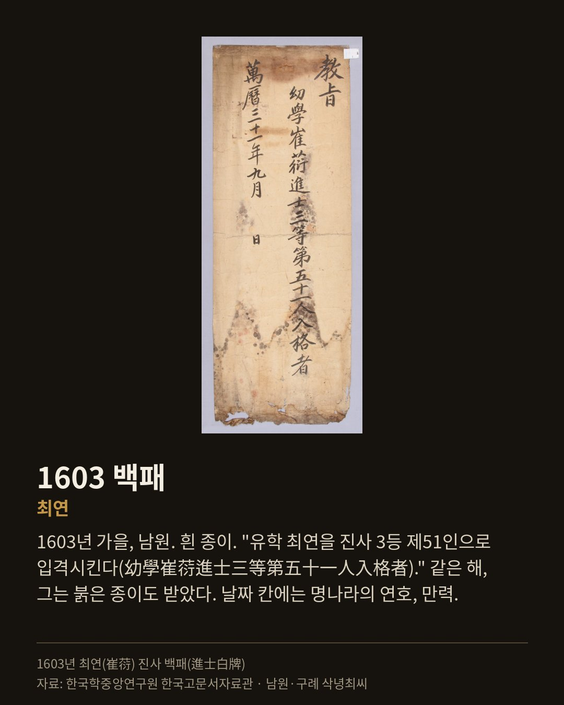
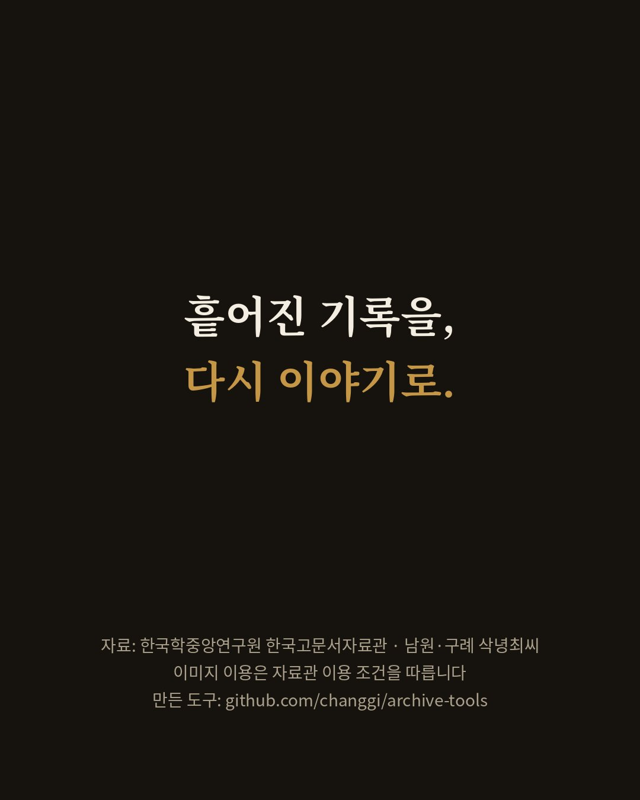

# EP.194 연호가 사라진 교지 — 최연의 아내 양씨, 1634년 '崇禎'과 1638년 '戊寅'

남원·구례 삭녕최씨 (문중) · 1634년 9월, 남원 최연의 아내 양씨는 숙부인이 되었다. 교지 끝에는 명나라 연호 '숭정 7년'이 적혔다. 4년 뒤 1638년 10월, 남편이 가선대부 한성부 우윤이 되자 양씨는 정부인이 되었다. 그런데 이번 교지 끝에는 연호가 없다. '戊寅' 두 글자뿐. 그 사이 1637년 정월, 임금은 남한산성에서 내려와 삼전도에서 청 태종에게 절했다

- 🌐 [전시 웹페이지](https://changgi.github.io/archive-tools/examples/sangnyeong-choi-yangssi/exhibit.html) (한자 위 한글 독음 · 원문 해석) · [수업 활동지](https://changgi.github.io/archive-tools/examples/sangnyeong-choi-yangssi/handout.html)
- 🎬 영상: [릴스 9:16](https://changgi.github.io/archive-tools-next/media/ep194-sangnyeong-choi-yangssi_reel.mp4) · [가로 16:9](https://changgi.github.io/archive-tools-next/media/ep194-sangnyeong-choi-yangssi_wide.mp4) · 홍보 글: [`promo.md`](promo.md)
- 카드뉴스: [`cards/`](cards/) · SNS 글: [`sns.txt`](sns.txt) · 판독·해석 표: [`selection.csv`](selection.csv)

<!-- DELIVERY -->
## 전달 에디팅 — 이 기록을 이렇게 전합니다

- **핵심 정서** — 서늘함
- **한 문장** — 조선 공문서의 날짜 칸은 나라 사이의 관계를 비추는 거울이었다 — 명의 연호를 쓰던 교지가 병자호란 직후에는 간지만 적고, 몇 해 뒤에는 청의 연호를 쓰게 된다. 1638년 '戊寅'은 그 틈의 흔적이다.
- **열기** — 1638년의 교지에는, 연호 대신 간지 두 글자만 적혀 있었습니다.
- **펼치기** — 최연 진사 백패 → 최휘지 진사 백패 → 양씨 추증교지 (1603–1638년) — 1603 최연 진사 백패(만력) → 1624 최휘지 진사 백패(천계) → 1634 양씨 숙부인(숭정) → 1638 양씨 정부인(간지 무인)으로 놓았습니다.
- **절정** — "양씨를 숙부인으로 삼는다(梁氏爲淑夫人者)" — 화면·공간에서 이 한 줄만 크게, 소리를 줄여 집중
- **여운** — 날짜 칸에서 사라진 두 글자, 그 자리를 채운 간지는 무엇을 말하려 했을까요? — 질문으로 끝내고 답은 보는 사람에게
- **감각과 물질** — 1634년 교지의 '崇禎七年'과 1638년 교지의 '戊寅' — 같은 자리, 다른 글자 · 흰 종이 한 장에 조명 하나 · 어보·관인 탁본 스탬프를 찍어 보는 체험
- **통로와 매개** — 온라인: 릴스(열기) → 카드뉴스(펼치기) → 전시 웹페이지(절정·원문) → 비하인드 카드(여운) / 오프라인: 원본 크기 복제·낭독·참여 벽 / 남기기: 활동지·질문 카드
- **여운 장치** — 우리가 쓰는 연도 표기(서기 · 단기 · 연호) 떠올리기
- **전달 에디팅 전** — 4건의 문서를 1603–1638년 연대순으로 놓고 문서명 · 유형 · 해설을 붙인다 — 정확하지만, 지나가면 잊힌다.
- **전달 에디팅 후** — 핵심 정서는 「서늘함」. 「1638년의 교지에는, 연호 대신 간지 두 글자만 적혀 있었습니다.」로 열고, 문서를 대비와 순서로 펼친 뒤, "양씨를 숙부인으로 삼는다(梁氏爲淑夫人者)"에서 멈춘다. 1634년 교지의 '崇禎七年'과 1638년 교지의 '戊寅' — 같은 자리, 다른 글자. 마지막엔 「우리가 쓰는 연도 표기(서기 · 단기 · 연호) 떠올리기」로 보는 사람이 자기 이야기를 남기고 떠나게 한다.

전문: [`delivery.md`](delivery.md)
<!-- /DELIVERY -->

<!-- CURATOR -->
## 비하인드 — 큐레이터 노트

- **왜 이 문서들인가** — EP.193에서 최연을 부른 유지를 읽었습니다. 같은 집안에 그가 1603년 받은 진사 백패, 1624년 최휘지의 진사 백패, 그리고 그의 아내 양씨가 받은 교지 두 장이 남아 있어 함께 놓았습니다.
- **전하고 싶은 것** — 조선 공문서의 날짜 칸은 나라 사이의 관계를 비추는 거울이었다 — 명의 연호를 쓰던 교지가 병자호란 직후에는 간지만 적고, 몇 해 뒤에는 청의 연호를 쓰게 된다. 1638년 '戊寅'은 그 틈의 흔적이다.
- **이렇게 보이길 바랐다** — 1603 최연 진사 백패(만력) → 1624 최휘지 진사 백패(천계) → 1634 양씨 숙부인(숭정) → 1638 양씨 정부인(간지 무인)으로 놓았습니다.
- **이렇게 써 주세요** — 외명부 봉작과 '종부직', 생원 · 진사 백패, 조선이 쓴 연호와 병자호란(1636–1637) 뒤 연호 표기의 변화, 문서 날짜를 읽는 법 수업에 쓰세요.
- **만들며 있었던 일** — 1624년 백패의 등수는 '第八人'으로 읽었습니다. 최휘지와 최연의 관계(부자 여부)는 이 문서들로 확인하지 않았습니다. 1638년 교지에 연호를 쓰지 않은 까닭은 교지에 적혀 있지 않으며, 병자호란 직후 명 연호를 쓸 수 없고 청 연호도 아직 쓰지 않던 시기의 관행으로 해석했습니다. 양씨의 두 교지는 자료관 목록에 '추증교지'로 되어 있으나, 본문이 '爲'(삼는다)여서 생존 시의 봉작으로 보았습니다.
- **남겨 둔 질문** — 날짜 칸에서 사라진 두 글자, 그 자리를 채운 간지는 무엇을 말하려 했을까요?
- **제작 기록** — 문서 4건 · 1603–1638년 · 원본 사진 6면(문서 전체) · 원문 판독 4건 · 번역 4건 · 못 읽은 글자 □ 3 · 불확실 (?) 0 · 해제에 "확인 필요"를 단 문서 1건

전문: [`curator.md`](curator.md) · 비하인드 카드: [`behind/`](behind/) · 채널별 홍보안: [`channels.md`](channels.md)
<!-- /CURATOR -->

## 이야기 — 사료가 말하는 대로

1638년의 교지에는, 연호 대신 간지 두 글자만 적혀 있었습니다.

> **1603 백패** — 1603년 가을, 남원. 흰 종이. "유학 최연을 진사 3등 제51인으로 입격시킨다(幼學崔葕進士三等第五十一人入格者)." 같은 해, 그는 붉은 종이도 받았다. 날짜 칸에는 명나라의 연호, 만력.
> **1624 백패** — 스물한 해 뒤, 1624년. 같은 집에 또 흰 종이. "유학 최휘지를 진사 3등 제8인으로 입격시킨다(幼學崔徽之進士三等第八人入格者)." 날짜 칸의 연호는 천계. 아직 명나라의 이름이다.
> **1634 추증교지** — 1634년 가을. 이번 교지는 아내 양씨에게 온다. "양씨를 숙부인으로 삼는다(梁氏爲淑夫人者)." 왼쪽 작은 글씨가 이유를 댄다. 남편이 승지가 되었다. 날짜 칸에는 여전히 명나라의 연호, "숭정 7년(崇禎七年)".
> **1638 추증교지** — 네 해 뒤, 1638년 가을. 남편이 또 올랐다. 양씨에게 두 번째 교지가 온다. "숙부인 양씨를 정부인으로 삼는다(淑夫人梁氏爲貞夫人者)." 그런데 날짜 칸이 이상하다. 연호가 없다. "무인 10월 6일(戊寅十月初六日)." 한 해 전, 임금은 삼전도에서 무릎을 꿇었다. 종이는 그날 이후를 이렇게 적었다.

| 표지 | 1번 카드 | 마무리 |
|---|---|---|
|  |  |  |

## 선별 문서 (4점)

| # | 연도 | 유형 | 문서명 | 원본 |
|---|---|---|---|---|
| 1 | 1603 | 백패 | 1603년 최연(崔葕) 진사 백패(進士白牌) | [원본 보기](https://archive.aks.ac.kr/viewer/viewer.do#imgnode.do?itemId=book&gubun=booktree&depth=6&upPath=01%5E0147%5EL014722%5EL014722F02%5EL014722F0201&dataId=G002%2BAKS%2BKSM-XA.1603.1111-20101008.B049a_072_00018_XXX&itemType=) |
| 2 | 1624 | 백패 | 1624년 최휘지(崔徽之) 진사 백패(進士白牌) | [원본 보기](https://archive.aks.ac.kr/viewer/viewer.do#imgnode.do?itemId=book&gubun=booktree&depth=6&upPath=01%5E0147%5EL014722%5EL014722F02%5EL014722F0201&dataId=G002%2BAKS%2BKSM-XA.1624.1111-20101008.B049a_072_00019_XXX&itemType=) |
| 3 | 1634 | 추증교지 | 1634년 양씨(梁氏) 추증교지(追贈敎旨) | [원본 보기](https://archive.aks.ac.kr/viewer/viewer.do#imgnode.do?itemId=book&gubun=booktree&depth=6&upPath=01%5E0147%5EL014722%5EL014722F02%5EL014722F0201&dataId=G002%2BAKS%2BKSM-XA.1634.1111-20101008.B049a_072_00128_XXX&itemType=) |
| 4 | 1638 | 추증교지 | 1638년 양씨(梁氏) 추증교지(追贈敎旨) | [원본 보기](https://archive.aks.ac.kr/viewer/viewer.do#imgnode.do?itemId=book&gubun=booktree&depth=6&upPath=01%5E0147%5EL014722%5EL014722F02%5EL014722F0201&dataId=G002%2BAKS%2BKSM-XA.1652.1111-20101008.B049a_072_00129_XXX&itemType=) |

## 원문 판독과 해석

### 1. 1603년 최연(崔葕) 진사 백패(進士白牌)

**원문 판독**

```
敎旨
幼學崔葕進士三等第五十一人入格者
萬曆三十一年九月 日
```

**원문 해석** 교지. 유학 최연을 진사 3등 제51인으로 입격시킨다. 만력 31년(1603) 9월 일.

**해제** 1603년(선조 36) 9월, 최연(崔葕)이 진사시에 3등 제51인으로 입격하고 받은 백패입니다. 같은 해 그는 문과에도 급제했고, 그 홍패는 EP.61에서 읽었습니다. 한 해에 소과와 대과를 모두 통과한 셈입니다. 명나라 연호 만력(萬曆)을 썼고, 연호 위에 붉은 관인이 찍혔습니다. 아래쪽에 물결 모양의 얼룩이 있습니다.

### 2. 1624년 최휘지(崔徽之) 진사 백패(進士白牌)

**원문 판독**

```
敎旨
幼學崔徽之進士三等第八人入格者
天啓四年八月二十□日
```

**원문 해석** 교지. 유학 최휘지를 진사 3등 제8인으로 입격시킨다. 천계 4년(1624) 8월 2□일.

**해제** 21년 뒤인 1624년(인조 2) 8월, 같은 집안의 최휘지(崔徽之)가 진사시에 입격하고 받은 백패입니다. 최연의 백패와 크기 · 글씨 배치가 거의 같습니다. 연호는 명의 천계(天啓)입니다. 날짜의 끝 글자는 얼룩에 가려 확정하지 못했습니다. 최휘지와 최연의 관계는 이 문서로 확인하지 않았습니다.

### 3. 1634년 양씨(梁氏) 추증교지(追贈敎旨)

**원문 판독**

```
敎旨
梁氏爲
淑夫人
者
崇禎七年九月二十一日
(작은 글씨) 通政大夫承政院同副承旨兼經筵參贊官春秋
修撰官崔葕妻依大典從夫職
```

**원문 해석** 교지. 양씨를 숙부인으로 삼는다. 숭정 7년(1634) 9월 21일. (작은 글씨) 통정대부 승정원 동부승지 겸 경연참찬관 춘추관 수찬관 최연의 아내이므로 『대전』에 따라 남편의 직에 따른다.

**해제** 1634년(인조 12) 9월, 최연의 아내 양씨(梁氏)를 숙부인(淑夫人)으로 삼은 교지입니다. 왼쪽 작은 글씨에 따르면 이때 최연은 통정대부(정3품 당상) 승정원 동부승지였습니다. EP.193의 유지들을 쓰던 승지의 자리에 그 자신이 오른 것입니다. 남편이 당상관이 되자 아내도 당상관 아내의 칭호 숙부인이 되었습니다. '爲(삼는다)'를 써서 살아 있는 양씨에게 내린 봉작임을 알 수 있습니다. 날짜 칸에는 명나라 연호 숭정(崇禎)이 적혔습니다.

### 4. 1638년 양씨(梁氏) 추증교지(追贈敎旨)

**원문 판독**

```
敎旨
淑夫人梁
氏爲貞夫
人者
戊寅十月初六日
(작은 글씨) 嘉善大夫□□漢城府右尹崔葕妻依大典從
夫職
```

**원문 해석** 교지. 숙부인 양씨를 정부인으로 삼는다. 무인년(1638) 10월 6일. (작은 글씨) 가선대부 … 한성부 우윤 최연의 아내이므로 『대전』에 따라 남편의 직에 따른다.

**해제** 4년 뒤인 1638년(인조 16) 10월, 남편 최연이 가선대부(종2품) 한성부 우윤이 되자 양씨를 정부인(貞夫人)으로 삼은 교지입니다. 이 교지의 날짜 칸에는 연호가 없고 간지 '戊寅'만 적혔습니다. 1637년 정월 병자호란에서 조선이 청에 항복한 뒤, 명의 연호를 더 이상 쓸 수 없었으나 청의 연호(숭덕)를 공문서에 쓰기 시작하기 전, 간지로 해를 적은 것으로 보입니다. 4년 사이 같은 사람에게 온 두 교지의 날짜 칸이, 나라가 겪은 변화를 보여 줍니다. 날짜 위에 붉은 관인이 크게 찍혔습니다.

판독·해석·이야기는 이미지에 근거한 초안이며(검토 전 "초안" 표시), 정확한 판독은 원문 확인이 필요합니다. □는 읽지 못한 글자, (?)는 불확실한 글자입니다.
이미지: 한국학중앙연구원 한국고문서자료관 소장·제공. "원본" 링크를 누르면 자료관 뷰어에서 그 문서가 열립니다. 재사용은 자료관에 문의하세요(소장처 동의 필요).
