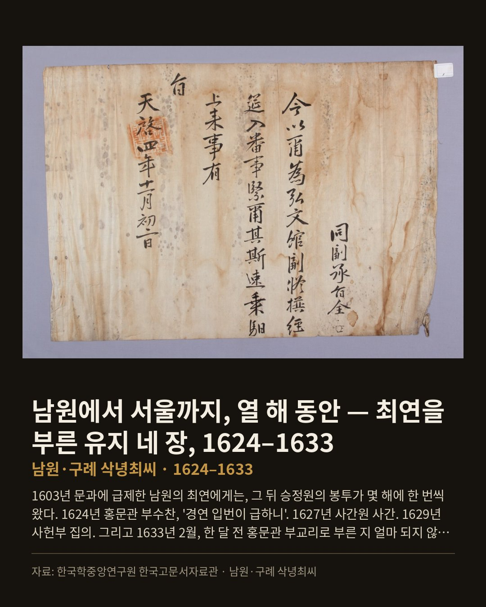
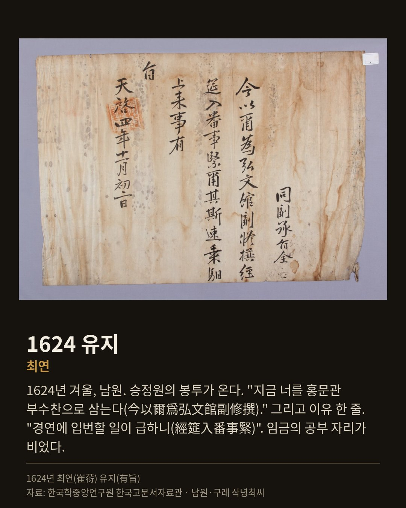
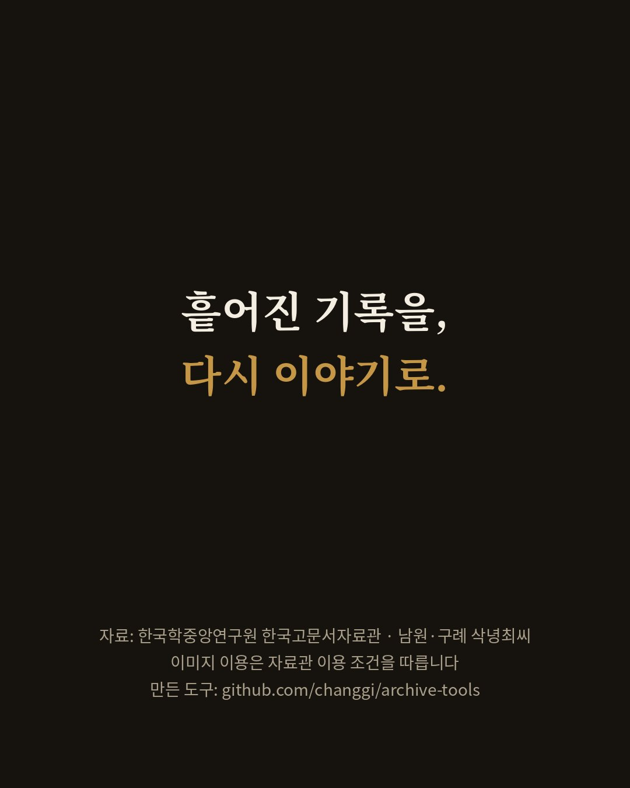

# EP.193 남원에서 서울까지, 열 해 동안 — 최연을 부른 유지 네 장, 1624–1633

남원·구례 삭녕최씨 (문중) · 1603년 문과에 급제한 남원의 최연에게는, 그 뒤 승정원의 봉투가 몇 해에 한 번씩 왔다. 1624년 홍문관 부수찬, '경연 입번이 급하니'. 1627년 사간원 사간. 1629년 사헌부 집의. 그리고 1633년 2월, 한 달 전 홍문관 부교리로 부른 지 얼마 되지 않아 다시 '세자시강원 보덕으로 삼는다, 서연 입번이 급하니'. 임금의 공부와 세자의 공부가, 남원의 한 선비를 거듭 불렀다

- 🌐 [전시 웹페이지](https://changgi.github.io/archive-tools/examples/sangnyeong-choi-yuji/exhibit.html) (한자 위 한글 독음 · 원문 해석) · [수업 활동지](https://changgi.github.io/archive-tools/examples/sangnyeong-choi-yuji/handout.html)
- 🎬 영상: [릴스 9:16](https://changgi.github.io/archive-tools-next/media/ep193-sangnyeong-choi-yuji_reel.mp4) · [가로 16:9](https://changgi.github.io/archive-tools-next/media/ep193-sangnyeong-choi-yuji_wide.mp4) · 홍보 글: [`promo.md`](promo.md)
- 카드뉴스: [`cards/`](cards/) · SNS 글: [`sns.txt`](sns.txt) · 판독·해석 표: [`selection.csv`](selection.csv)

<!-- DELIVERY -->
## 전달 에디팅 — 이 기록을 이렇게 전합니다

- **핵심 정서** — 조용한 긴박함
- **한 문장** — 유지의 정해진 문장 사이에 끼어든 한 구절 — '경연 입번이 급하니', '서연 입번이 급하니' — 은 조정이 왜 지금 이 사람이 필요한지를 말해 준다. 임금과 세자의 공부 자리를 채울 학자가, 지방에서 불려 올라왔다.
- **열기** — 임금의 공부가 급하다며, 남원의 선비를 서울로 불렀습니다.
- **펼치기** — 최연 유지 → 최연 유지－2 (1624–1633년) — 1624 홍문관 부수찬(경연 입번 급) → 1627 사간원 사간 → 1629 사헌부 집의 → 1633 세자시강원 보덕(서연 입번 급)으로 놓았습니다.
- **절정** — "경연에 입번할 일이 급하니(經筵入番事緊)" — 화면·공간에서 이 한 줄만 크게, 소리를 줄여 집중
- **여운** — 열 해 동안 같은 문장으로 불린 사람에게, 남원에서 서울까지의 길은 몇 번째에 익숙해졌을까요? — 질문으로 끝내고 답은 보는 사람에게
- **감각과 물질** — 1624년의 '經筵入番事緊'과 1633년의 '書筵入番事緊' — 정해진 문장 사이의 한 구절 · 역마 방울·말발굽 소리와 함께 펼치는 두루마리
- **통로와 매개** — 온라인: 릴스(열기) → 카드뉴스(펼치기) → 전시 웹페이지(절정·원문) → 비하인드 카드(여운) / 오프라인: 원본 크기 복제·낭독·참여 벽 / 남기기: 활동지·질문 카드
- **여운 장치** — 출장 · 호출 메일에 붙은 '급히'라는 말 떠올리기
- **전달 에디팅 전** — 4건의 문서를 1624–1633년 연대순으로 놓고 문서명 · 유형 · 해설을 붙인다 — 정확하지만, 지나가면 잊힌다.
- **전달 에디팅 후** — 핵심 정서는 「조용한 긴박함」. 「임금의 공부가 급하다며, 남원의 선비를 서울로 불렀습니다.」로 열고, 문서를 대비와 순서로 펼친 뒤, "경연에 입번할 일이 급하니(經筵入番事緊)"에서 멈춘다. 1624년의 '經筵入番事緊'과 1633년의 '書筵入番事緊' — 정해진 문장 사이의 한 구절. 마지막엔 「출장 · 호출 메일에 붙은 '급히'라는 말 떠올리기」로 보는 사람이 자기 이야기를 남기고 떠나게 한다.

전문: [`delivery.md`](delivery.md)
<!-- /DELIVERY -->

<!-- CURATOR -->
## 비하인드 — 큐레이터 노트

- **왜 이 문서들인가** — EP.61에서 이 집안의 1603년 최연 문과 홍패를 읽었습니다. 같은 집안에 그 뒤 최연을 서울로 부른 유지가 여섯 장 남아 있어, 직함이 다른 네 장을 날짜 순서대로 골랐습니다.
- **전하고 싶은 것** — 유지의 정해진 문장 사이에 끼어든 한 구절 — '경연 입번이 급하니', '서연 입번이 급하니' — 은 조정이 왜 지금 이 사람이 필요한지를 말해 준다. 임금과 세자의 공부 자리를 채울 학자가, 지방에서 불려 올라왔다.
- **이렇게 보이길 바랐다** — 1624 홍문관 부수찬(경연 입번 급) → 1627 사간원 사간 → 1629 사헌부 집의 → 1633 세자시강원 보덕(서연 입번 급)으로 놓았습니다.
- **이렇게 써 주세요** — 유지의 형식과 승지의 서명, 경연(임금의 공부)과 서연(세자의 공부), 홍문관 · 사간원 · 사헌부 · 세자시강원의 역할, 지방 출신 문신의 출사 수업에 쓰세요.
- **만들며 있었던 일** — 1624년 유지의 날짜는 '十一月初□日'의 둘째 글자가 '二'로 보이나 확정하지 않았습니다. 1633년 1월 3일 홍문관 부교리로 부른 유지와 1630년 홍문관 교리 유지는 해제에서 다룹니다. 최연이 매번 실제로 올라갔는지는 이 유지들로 알 수 없습니다. 승지의 이름은 성만 적혀 있어 성까지만 옮겼습니다.
- **남겨 둔 질문** — 열 해 동안 같은 문장으로 불린 사람에게, 남원에서 서울까지의 길은 몇 번째에 익숙해졌을까요?
- **제작 기록** — 문서 4건 · 1624–1633년 · 원본 사진 8면(문서 전체) · 원문 판독 4건 · 번역 4건 · 못 읽은 글자 □ 1 · 불확실 (?) 0

전문: [`curator.md`](curator.md) · 비하인드 카드: [`behind/`](behind/) · 채널별 홍보안: [`channels.md`](channels.md)
<!-- /CURATOR -->

## 이야기 — 사료가 말하는 대로

임금의 공부가 급하다며, 남원의 선비를 서울로 불렀습니다.

> **1624 유지** — 1624년 겨울, 남원. 승정원의 봉투가 온다. "지금 너를 홍문관 부수찬으로 삼는다(今以爾爲弘文館副修撰)." 그리고 이유 한 줄. "경연에 입번할 일이 급하니(經筵入番事緊)". 임금의 공부 자리가 비었다.
> **1627 유지** — 세 해 뒤, 1627년 섣달. 전쟁이 지나간 해다. 또 봉투. "사간원 사간으로 삼으니(爲司諫院司諫)". 이번에는 임금에게 바른말을 하는 자리다.
> **1629 유지** — 다시 두 해, 1629년 가을. 이번에는 사헌부다. "사헌부 집의로 삼으니(爲司憲府執義)". 관리들을 살피는 자리. 남원의 선비는 이렇게 대간의 자리를 오갔다.
> **1633 유지** — 그리고 1633년 이른 봄. 한 달 전 홍문관으로 부른 봉투가 왔는데, 또 한 통이 온다. "세자시강원 보덕으로 삼는다(爲世子侍講院輔德)." 이번 이유는 이렇다. "서연에 입번할 일이 급하니(書筵入番事緊)". 열 해 전에는 임금의 공부, 이제는 세자의 공부. 남원의 선비는 또 길을 나선다.

| 표지 | 1번 카드 | 마무리 |
|---|---|---|
|  |  |  |

## 선별 문서 (4점)

| # | 연도 | 유형 | 문서명 | 원본 |
|---|---|---|---|---|
| 1 | 1624 | 유지 | 1624년 최연(崔葕) 유지(有旨) | [원본 보기](https://archive.aks.ac.kr/viewer/viewer.do#imgnode.do?itemId=book&gubun=booktree&depth=6&upPath=01%5E0147%5EL014722%5EL014722F02%5EL014722F0201&dataId=G002%2BAKS%2BKSM-XA.1624.1111-20101008.B049a_072_00002_XXX&itemType=) |
| 2 | 1627 | 유지 | 1627년 최연(崔葕) 유지(有旨) | [원본 보기](https://archive.aks.ac.kr/viewer/viewer.do#imgnode.do?itemId=book&gubun=booktree&depth=6&upPath=01%5E0147%5EL014722%5EL014722F02%5EL014722F0201&dataId=G002%2BAKS%2BKSM-XA.1627.1111-20101008.B049a_072_00003_XXX&itemType=) |
| 3 | 1629 | 유지 | 1629년 최연(崔葕) 유지(有旨) | [원본 보기](https://archive.aks.ac.kr/viewer/viewer.do#imgnode.do?itemId=book&gubun=booktree&depth=6&upPath=01%5E0147%5EL014722%5EL014722F02%5EL014722F0201&dataId=G002%2BAKS%2BKSM-XA.1629.1111-20101008.B049a_072_00004_XXX&itemType=) |
| 4 | 1633 | 유지 | 1633년 최연(崔葕) 유지(有旨)－2 | [원본 보기](https://archive.aks.ac.kr/viewer/viewer.do#imgnode.do?itemId=book&gubun=booktree&depth=6&upPath=01%5E0147%5EL014722%5EL014722F02%5EL014722F0201&dataId=G002%2BAKS%2BKSM-XA.1633.1111-20101008.B049a_072_00007_XXX&itemType=) |

## 원문 판독과 해석

### 1. 1624년 최연(崔葕) 유지(有旨)

**원문 판독**

```
今以爾爲弘文館副修撰經
筵入番事緊爾其斯速乘馹
上來事有
旨
同副承旨金(서명)
天啓四年十一月初□日
```

**원문 해석** 지금 너를 홍문관 부수찬으로 삼는다. 경연에 입번할 일이 급하니, 너는 서둘러 역마를 타고 올라오라는 유지가 있었다. 동부승지 김(서명). 천계 4년(1624) 11월 초□일.

**해제** 1624년(인조 2) 11월, 남원의 최연(崔葕)을 홍문관 부수찬(종6품)으로 삼아 부른 유지입니다. 최연은 1603년 문과에 급제했습니다(EP.61). 정해진 문장 사이에 '경연에 입번할 일이 급하니(經筵入番事緊)'가 들어가, 임금의 경연에 들어갈 홍문관원이 급히 필요했음을 보여 줍니다(EP.187의 1737년 김성탁 유지와 같은 구절). 이해 정월 이괄의 난으로 임금이 공주까지 피난했다가 돌아온 해입니다. 연호 위에 승정원 관인이 찍혔습니다.

### 2. 1627년 최연(崔葕) 유지(有旨)

**원문 판독**

```
今以爾爲司諫院司諫爾其
斯速乘馹上來事有
旨
左副承旨金(서명)
天啓七年十二月二十日
```

**원문 해석** 지금 너를 사간원 사간으로 삼으니, 너는 서둘러 역마를 타고 올라오라는 유지가 있었다. 좌부승지 김(서명). 천계 7년(1627) 12월 20일.

**해제** 3년 뒤인 1627년(인조 5) 12월, 최연을 사간원 사간(종3품)으로 삼아 부른 유지입니다. 이해 정월에는 정묘호란이 일어났습니다. 사간은 대사간 다음 자리로, 임금에게 간언하는 사간원의 중심 관원입니다. 홍문관(학문)에서 사간원(간언)으로 길이 옮겨 갔습니다. 문장은 정해진 틀 그대로이고, 오른쪽 위에 겉봉의 글씨가 비쳐 보입니다.

### 3. 1629년 최연(崔葕) 유지(有旨)

**원문 판독**

```
今以爾爲司憲府
執義爾其乘馹斯
速上來事有
旨
左副承旨李(서명)
崇禎二年八月二十六日
```

**원문 해석** 지금 너를 사헌부 집의로 삼으니, 너는 역마를 타고 서둘러 올라오라는 유지가 있었다. 좌부승지 이(서명). 숭정 2년(1629) 8월 26일.

**해제** 1629년(인조 7) 8월, 최연을 사헌부 집의(종3품)로 삼아 부른 유지입니다. 사헌부는 관리를 감찰하는 대간 기관이고, 집의는 대사헌 다음 자리입니다. 이 장은 '斯速乘馹' 대신 '乘馹斯速'으로 글자 순서를 바꿔 썼습니다. 연호가 명나라 숭정(崇禎)으로 바뀌었습니다. 이듬해 1630년 정월에는 그를 홍문관 교리로 부른 유지도 남아 있습니다.

### 4. 1633년 최연(崔葕) 유지(有旨)－2

**원문 판독**

```
今以爾爲世子侍講
院輔德書筵入番事
緊爾其斯速乘馹上
來事有
旨
同副承旨崔(서명)
崇禎六年二月初五日
```

**원문 해석** 지금 너를 세자시강원 보덕으로 삼는다. 서연에 입번할 일이 급하니, 너는 서둘러 역마를 타고 올라오라는 유지가 있었다. 동부승지 최(서명). 숭정 6년(1633) 2월 5일.

**해제** 1633년(인조 11) 2월 5일, 최연을 세자시강원 보덕(종3품)으로 삼아 부른 유지입니다. 한 달 전인 1월 3일에는 그를 홍문관 부교리로 부른 유지가 따로 남아 있어, 한 달 사이에 자리가 바뀌었습니다. 이번에는 '서연에 입번할 일이 급하니(書筵入番事緊)'라는 구절이 붙었습니다. 서연(書筵)은 세자의 공부 자리로, 임금의 경연에 해당합니다. 1624년 첫 장의 '경연'이 열 해 뒤 '서연'으로 바뀌어, 임금과 세자의 공부가 모두 그를 불렀음을 보여 줍니다. 네 장 가운데 글씨가 가장 크고 힘찹니다.

판독·해석·이야기는 이미지에 근거한 초안이며(검토 전 "초안" 표시), 정확한 판독은 원문 확인이 필요합니다. □는 읽지 못한 글자, (?)는 불확실한 글자입니다.
이미지: 한국학중앙연구원 한국고문서자료관 소장·제공. "원본" 링크를 누르면 자료관 뷰어에서 그 문서가 열립니다. 재사용은 자료관에 문의하세요(소장처 동의 필요).
