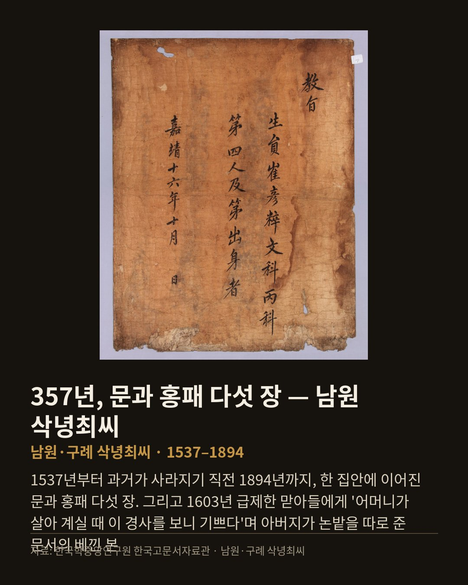
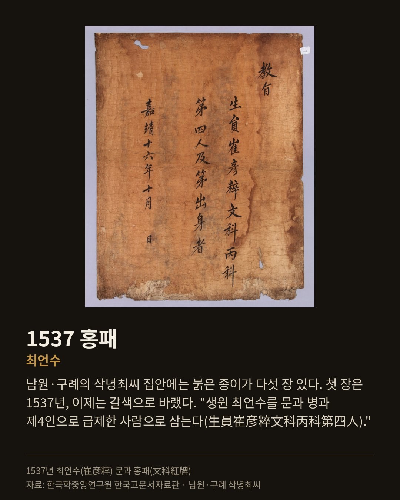
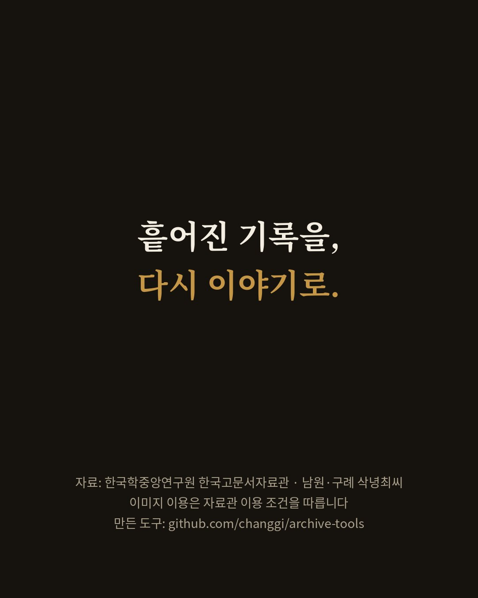

# EP.61 357년, 문과 홍패 다섯 장 — 남원 삭녕최씨

남원·구례 삭녕최씨 (문중) · 1537년부터 과거가 사라지기 직전 1894년까지, 한 집안에 이어진 문과 홍패 다섯 장. 그리고 1603년 급제한 맏아들에게 '어머니가 살아 계실 때 이 경사를 보니 기쁘다'며 아버지가 논밭을 따로 준 문서의 베낀 본

- 🌐 [전시 웹페이지](https://changgi.github.io/archive-tools/examples/sangnyeong-choi/exhibit.html) (한자 위 한글 독음 · 원문 해석) · [수업 활동지](https://changgi.github.io/archive-tools/examples/sangnyeong-choi/handout.html)
- 🎬 영상: [릴스 9:16](https://changgi.github.io/archive-tools-next/media/ep61-sangnyeong-choi_reel.mp4) · [가로 16:9](https://changgi.github.io/archive-tools-next/media/ep61-sangnyeong-choi_wide.mp4) · 홍보 글: [`promo.md`](promo.md)
- 카드뉴스: [`cards/`](cards/) · SNS 글: [`sns.txt`](sns.txt) · 판독·해석 표: [`selection.csv`](selection.csv)


<!-- DELIVERY -->
## 전달 에디팅 — 이 기록을 이렇게 전합니다

- **핵심 정서** — 357년
- **한 문장** — '어머니 살아 계실 때 이 경사를 보니 기쁘다'는 아버지의 한 문장이, 합격의 의미를 가족의 언어로 바꿔 준다는 것.
- **열기** — 한 집안에 문과 홍패가 다섯 장. 첫 장과 마지막 장 사이가 357년입니다.
- **펼치기** — 최언수 문과 홍패 → 최연 문과 홍패 → 대 장자 보 유서등초 → 최계옹 문과 홍패 → 최병직 문과 홍패 (1537–1894년) — 다섯 장의 홍패로 357년의 뼈대를 세우고, 아버지의 문서로 온기를 더했습니다.
- **절정** — "어머님이 살아 계시고 사또가 오셔서 이 경사 잔치를 여니, 기쁜 마음을 나타낼 길이 없다(母主在堂 城主榮臨 設此慶席 喜悅之情 無以爲表)" — 화면·공간에서 이 한 줄만 크게, 소리를 줄여 집중
- **여운** — 1894년 마지막 홍패를 받은 사람은 과거가 사라진다는 것을 알았을까요? — 질문으로 끝내고 답은 보는 사람에게
- **감각과 물질** — 홍패 다섯 장을 357cm 띠에 연도 비례로 · 붉은 종이를 실물 크기로 복제해 벽에 거는 연출 · 역마 방울·말발굽 소리와 함께 펼치는 두루마리
- **통로와 매개** — 온라인: 릴스(열기) → 카드뉴스(펼치기) → 전시 웹페이지(절정·원문) → 비하인드 카드(여운) / 오프라인: 원본 크기 복제·낭독·참여 벽 / 남기기: 활동지·질문 카드
- **여운 장치** — "어머니께 보여 드리고 싶은 경사"
- **전달 에디팅 전** — 5건의 문서를 1537–1894년 연대순으로 놓고 문서명 · 유형 · 해설을 붙인다 — 정확하지만, 지나가면 잊힌다.
- **전달 에디팅 후** — 핵심 정서는 「357년」. 「한 집안에 문과 홍패가 다섯 장. 첫 장과 마지막 장 사이가 357년입니다.」로 열고, 문서를 대비와 순서로 펼친 뒤, "어머님이 살아 계시고 사또가 오셔서 이 경사 잔치를 여니, 기쁜 마음을 나타낼 길이 없다(母主在堂 城主榮臨 設此慶席 喜悅之情 無以爲表)"에서 멈춘다. 홍패 다섯 장을 357cm 띠에 연도 비례로. 마지막엔 「"어머니께 보여 드리고 싶은 경사"」로 보는 사람이 자기 이야기를 남기고 떠나게 한다.

전문: [`delivery.md`](delivery.md)
<!-- /DELIVERY -->

<!-- CURATOR -->
## 비하인드 — 큐레이터 노트

- **왜 이 문서들인가** — 1537년부터 과거가 없어지기 직전 1894년까지 357년 동안 문과 홍패 다섯 장이 한 집안에 이어졌습니다.
- **전하고 싶은 것** — '어머니 살아 계실 때 이 경사를 보니 기쁘다'는 아버지의 한 문장이, 합격의 의미를 가족의 언어로 바꿔 준다는 것.
- **이렇게 보이길 바랐다** — 다섯 장의 홍패로 357년의 뼈대를 세우고, 아버지의 문서로 온기를 더했습니다.
- **이렇게 써 주세요** — 과거 제도의 시작과 끝, 가족사 연표 만들기 활동에 쓰세요.
- **만들며 있었던 일** — 1603년 문서는 원본이 아니라 베낀 본입니다.
- **남겨 둔 질문** — 1894년 마지막 홍패를 받은 사람은 과거가 사라진다는 것을 알았을까요?
- **제작 기록** — 문서 5건 · 1537–1894년 · 원본 사진 7면(문서 전체) · 원문 판독 5건 · 번역 5건 · 못 읽은 글자 □ 1 · 불확실 (?) 1 · 해제에 "확인 필요"를 단 문서 1건

전문: [`curator.md`](curator.md)
<!-- /CURATOR -->

## 이야기 — 사료가 말하는 대로

한 집안에 문과 홍패가 다섯 장. 첫 장과 마지막 장 사이가 357년입니다.

> **1537 홍패** — 남원·구례의 삭녕최씨 집안에는 붉은 종이가 다섯 장 있다. 첫 장은 1537년, 이제는 갈색으로 바랬다. "생원 최언수를 문과 병과 제4인으로 급제한 사람으로 삼는다(生員崔彦粹文科丙科第四人)."
> **1603 홍패** — 1603년의 홍패는 이상하다. 본문이 비어 있다. 남은 것은 오른쪽의 좁은 띠뿐이다. "진사 최연, 문과 병과 제20인(進士崔葕文科丙科第二十人)." 그런데 그해의 기쁨을 적은 종이가 따로 남아 있다.
> **1603 유서등초** — 같은 해 2월, 아버지가 아들에게 쓴 글이다. "어머님이 살아 계시고 사또가 오셔서 이 경사 잔치를 여니, 기쁜 마음을 나타낼 길이 없다(母主在堂 城主榮臨 設此慶席 喜悅之情 無以爲表)." 그래서 노비와 논과 정자 터를 따로 주었다. 홍패의 본문은 사라졌지만, 기쁨은 베껴 적혀 남았다.
> **1681 홍패** — 78년 뒤, 네 번째 붉은 종이. "통덕랑 최계옹을 문과 병과 제1인으로(通德郞崔啓翁文科丙科第一人)."
> **1894 홍패** — 그리고 1894년 5월, 다섯 번째. 가장 붉다. "유학 최병직을 문과 갑과 제2인으로(幼學崔炳直文科甲科第二人)." 두 달 뒤 갑오개혁으로 과거가 없어진다. 357년 동안 이어진 붉은 종이의 마지막 장이었다.

| 표지 | 1번 카드 | 마무리 |
|---|---|---|
|  |  |  |

## 선별 문서 (5점)

| # | 연도 | 유형 | 문서명 | 원본 |
|---|---|---|---|---|
| 1 | 1537 | 홍패 | 1537년 최언수(崔彦粹) 문과 홍패(文科紅牌) | [원본 보기](https://archive.aks.ac.kr/viewer/viewer.do#imgnode.do?itemId=book&gubun=booktree&depth=6&upPath=01%5E0147%5EL014722%5EL014722F02%5EL014722F0201&dataId=G002%2BAKS%2BKSM-XA.1537.1111-20101008.B049a_072_00013_XXX&itemType=) |
| 2 | 1603 | 홍패 | 1603년 최연(崔葕) 문과 홍패(文科紅牌) | [원본 보기](https://archive.aks.ac.kr/viewer/viewer.do#imgnode.do?itemId=book&gubun=booktree&depth=6&upPath=01%5E0147%5EL014722%5EL014722F02%5EL014722F0201&dataId=G002%2BAKS%2BKSM-XA.1603.1111-20101008.B049a_072_00015_XXX&itemType=) |
| 3 | 1603 | 유서등초 | 1850년대 장자(長子) 보(𣼑) 유서등초(遺書謄抄) | [원본 보기](https://archive.aks.ac.kr/viewer/viewer.do#imgnode.do?itemId=book&gubun=booktree&depth=6&upPath=01%5E0147%5EL014722%5EL014722F02%5EL014722F0201&dataId=G002%2BAKS%2BKSM-XA.0000.4519-20101008.B049a_072_00187_XXX&itemType=) |
| 4 | 1681 | 홍패 | 1681년 최계옹(崔啓翁) 문과 홍패(文科紅牌) | [원본 보기](https://archive.aks.ac.kr/viewer/viewer.do#imgnode.do?itemId=book&gubun=booktree&depth=6&upPath=01%5E0147%5EL014722%5EL014722F02%5EL014722F0201&dataId=G002%2BAKS%2BKSM-XA.1681.1111-20101008.B049a_072_00016_XXX&itemType=) |
| 5 | 1894 | 홍패 | 1894년 최병직(崔炳直) 문과 홍패(文科紅牌) | [원본 보기](https://archive.aks.ac.kr/viewer/viewer.do#imgnode.do?itemId=book&gubun=booktree&depth=6&upPath=01%5E0147%5EL014722%5EL014722F02%5EL014722F0201&dataId=G002%2BAKS%2BKSM-XA.1894.1111-20101008.B049b_075_00001_XXX&itemType=) |

## 원문 판독과 해석

### 1. 1537년 최언수(崔彦粹) 문과 홍패(文科紅牌)

**원문 판독**

```
敎旨
生員崔彦粹文科丙科
第四人及第出身者
嘉靖十六年十月 日 (도장)
```

**원문 해석** 교지. 생원 최언수를 문과 병과 제4인으로 급제하여 출신한 사람으로 삼는다. 가정 16년(1537) 10월 일.

**해제** 1537년(중종 32), 생원 최언수(崔彦粹)가 문과에 급제하고 받은 홍패입니다. 이 집안 홍패 가운데 가장 오래된 것으로, 490년 가까이 된 종이가 갈색으로 바래고 가장자리가 해졌습니다.

### 2. 1603년 최연(崔葕) 문과 홍패(文科紅牌)

**원문 판독**

```
(오른쪽 붙인 띠) 進士崔葕文科丙科第二十人
(본문 자리 — 글씨가 지워졌거나 뒷면 배접, 판독 불가)
```

**원문 해석** (띠) 진사 최연, 문과 병과 제20인.

**해제** 1603년(선조 36), 최연(崔葕)의 문과 홍패입니다. 본문 면은 글씨가 보이지 않고 덧댄 종이가 붙어 있어, 오른쪽 위의 띠에 적힌 '進士崔葕文科丙科第二十人'으로 내용을 알 수 있습니다. 이 해의 급제를 축하해 아버지가 쓴 별급 문서가 따로 전합니다(다음 문서).

### 3. 1850년대 장자(長子) 보(𣼑) 유서등초(遺書謄抄)

**원문 판독**

```
遺書謄抄
萬曆三十一年(작은 글씨: 癸卯)二月初六日 新及第長子葕處 別給
汝亦不凡才器 竟得□(?)榜 本非所望 而
母主在堂 城主榮臨 設此慶席 喜悅之情
無以爲表 以奴彦忠 庚申生 婢九月 辛酉生
婢禮紅 己丑生 奴會靈 婢千玉 二所生 奴千
陪 及比德元水坪 細岐畓七斗落 溝入畓四
斗落 孔橋隅內畓九斗落 江亭前畓四斗落
只中方里洗心亭基地及親家 父母主祭位
余中方庵亭子畓八斗落 蓬洞 山所四山
局內外 孫奉祀次 竝以別給 永世耕食守
護者
```

**원문 해석** 유서를 베껴 적음. 만력 31년 계묘(1603) 2월 6일, 새로 급제한 맏아들 연(葕)에게 따로 준다. 너 또한 범상치 않은 재주와 그릇으로 마침내 급제하였으니 본래 바라던 바가 아니었는데, 어머님께서 살아 계시고 사또께서 영광스럽게 오셔서 이 경사 잔치를 베푸니, 기쁜 마음을 나타낼 길이 없다. 그래서 노 언충(경신생), 비 구월(신유생), 비 예홍(기축생), 노 회령, 비 천옥의 둘째 소생 노 천배, 그리고 비덕원 수평의 세기 논 7두락, 구입 논 4두락, 공교 모퉁이 안 논 9두락, 강정 앞 논 4두락, 중방리 세심정 터와 친가, 부모님 제위(祭位)인 여중방 암정자 논 8두락, 봉동 산소 사방 산 안팎을 손자가 제사 받들 몫으로 함께 따로 주니, 영세토록 경작해 먹고 지킬 것.

**해제** 1603년(선조 36) 2월 6일, 맏아들 최연이 문과에 급제하자 아버지가 노비와 논, 정자 터, 산소를 따로 준 별급 문서를 뒷날 베껴 적은 것(謄抄)입니다. 문서명에는 1850년대로 되어 있어, 원본을 그 무렵 옮겨 적은 것으로 보입니다. '어머님께서 살아 계신데(母主在堂) 사또가 와서 잔치를 열어 주었다'는 구절에서 급제 축하연(慶席) 풍경이 보입니다. 해서로 또렷해 전문을 판독했고, '竟得□榜'의 한 글자는 확인이 필요합니다.

### 4. 1681년 최계옹(崔啓翁) 문과 홍패(文科紅牌)

**원문 판독**

```
敎旨
通德郞崔啓翁文科丙科
第一人及第出身者
康熙二十年十二月十一日 (도장)
```

**원문 해석** 교지. 통덕랑 최계옹을 문과 병과 제1인으로 급제하여 출신한 사람으로 삼는다. 강희 20년(1681) 12월 11일.

**해제** 1681년(숙종 7), 최계옹(崔啓翁)의 문과 홍패입니다. 이미 통덕랑(정5품 품계)을 띠고 있었습니다. 같은 집안의 최치옹(崔致翁)이 받은 유지도 여러 점 전합니다.

### 5. 1894년 최병직(崔炳直) 문과 홍패(文科紅牌)

**원문 판독**

```
(띠) 幼學崔炳直文科甲科第二人
敎旨
幼學崔炳直文科甲科
第二人及第出身者
光緖二十年五月 日 (도장)
```

**원문 해석** 교지. 유학 최병직을 문과 갑과 제2인으로 급제하여 출신한 사람으로 삼는다. 광서 20년(1894) 5월 일.

**해제** 1894년(고종 31) 5월, 최병직(崔炳直)의 문과 홍패입니다. 갑과 2등(방안)으로 높은 순위입니다. 이 해 여름 갑오개혁으로 과거제가 폐지되어, 이 홍패는 마지막 무렵의 문과 홍패 가운데 하나입니다. 붉은 물이 가장 선명하게 남아 있습니다.

판독·해석·이야기는 이미지에 근거한 초안이며(검토 전 "초안" 표시), 정확한 판독은 원문 확인이 필요합니다. □는 읽지 못한 글자, (?)는 불확실한 글자입니다.
이미지: 한국학중앙연구원 한국고문서자료관 소장·제공. "원본" 링크를 누르면 자료관 뷰어에서 그 문서가 열립니다. 재사용은 자료관에 문의하세요(소장처 동의 필요).
