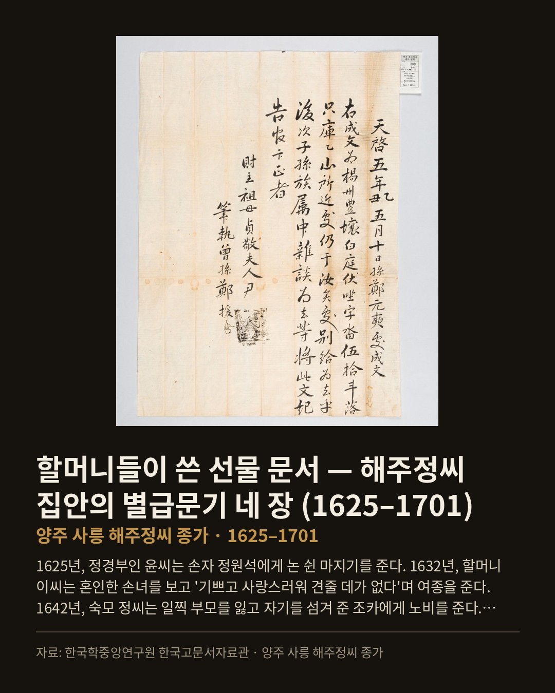
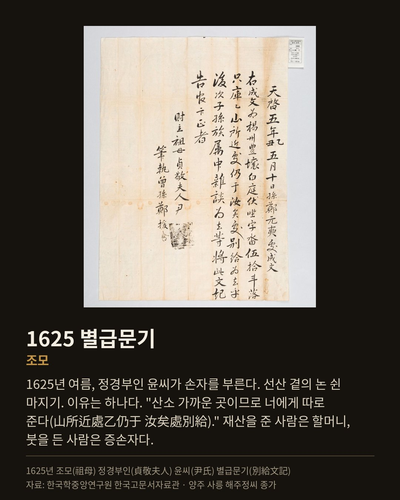
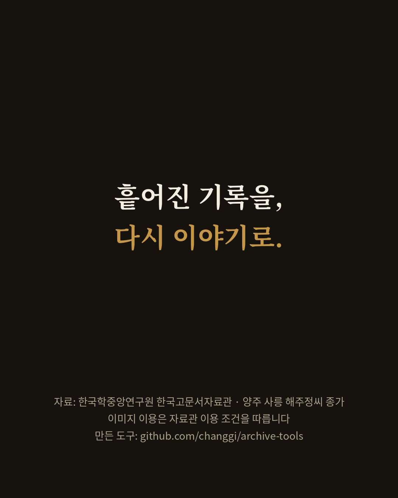

# EP.162 할머니들이 쓴 선물 문서 — 해주정씨 집안의 별급문기 네 장 (1625–1701)

양주 사릉 해주정씨 종가 (문중) · 1625년, 정경부인 윤씨는 손자 정원석에게 논 쉰 마지기를 준다. 1632년, 할머니 이씨는 혼인한 손녀를 보고 '기쁘고 사랑스러워 견줄 데가 없다'며 여종을 준다. 1642년, 숙모 정씨는 일찍 부모를 잃고 자기를 섬겨 준 조카에게 노비를 준다. 1701년, 양어머니 경씨는 '너를 얻은 뒤로 늘 정을 생각했다'며 양아들에게 노비 셋을 준다. 붓을 든 사람은 모두 다른 사람이었다

- 🌐 [전시 웹페이지](https://changgi.github.io/archive-tools/examples/sareung-byeolgeup/exhibit.html) (한자 위 한글 독음 · 원문 해석) · [수업 활동지](https://changgi.github.io/archive-tools/examples/sareung-byeolgeup/handout.html)
- 🎬 영상: [릴스 9:16](https://changgi.github.io/archive-tools-next/media/ep162-sareung-byeolgeup_reel.mp4) · [가로 16:9](https://changgi.github.io/archive-tools-next/media/ep162-sareung-byeolgeup_wide.mp4) · 홍보 글: [`promo.md`](promo.md)
- 카드뉴스: [`cards/`](cards/) · SNS 글: [`sns.txt`](sns.txt) · 판독·해석 표: [`selection.csv`](selection.csv)

<!-- DELIVERY -->
## 전달 에디팅 — 이 기록을 이렇게 전합니다

- **핵심 정서** — 다정함
- **한 문장** — 재산을 주는 사람은 여성, 문서를 쓰는 사람은 증손자 · 아들 · 조카 · 생부 — 조선 여성은 자기 이름(성)과 도장으로 재산을 나누었고, 그 까닭을 문서에 남겼다.
- **열기** — 재산을 준 사람은 할머니였고, 붓을 든 사람은 손자였습니다.
- **펼치기** — 조모 정경부인 윤씨 별급문기 → 조모 오익 처 이씨 별급문기 → 유여직 처 정씨 별급문기 → 정이녕 처 청주경씨 별급문기 (1625–1701년) — 정경부인 윤씨(손자에게, 증손자가 씀) → 할머니 이씨(손녀에게, 아들이 씀) → 숙모 정씨(고아가 된 조카에게, 조카가 씀) → 양어머니 경씨(양아들에게, 생부가 씀)로, 주는 사이가 점점 '핏줄 밖'으로 넓어지게 놓았습니다.
- **절정** — "너를 얻은 뒤로 늘 내 정을 드러내고자 생각했다(一自得汝以來 每思表我情)" — 화면·공간에서 이 한 줄만 크게, 소리를 줄여 집중
- **여운** — 할머니가 '기쁘고 사랑스럽다'고 쓴 그 문장을, 손녀는 몇 번이나 다시 읽었을까요? — 질문으로 끝내고 답은 보는 사람에게
- **감각과 물질** — 네 장 모두 끝에 '財主'와 여성의 성 · 도장, 그리고 다른 사람의 '筆執'
- **통로와 매개** — 온라인: 릴스(열기) → 카드뉴스(펼치기) → 전시 웹페이지(절정·원문) → 비하인드 카드(여운) / 오프라인: 원본 크기 복제·낭독·참여 벽 / 남기기: 활동지·질문 카드
- **여운 장치** — 가족에게 받은 물건 하나와 그때 들은 말을 함께 적어 보기
- **전달 에디팅 전** — 4건의 문서를 1625–1701년 연대순으로 놓고 문서명 · 유형 · 해설을 붙인다 — 정확하지만, 지나가면 잊힌다.
- **전달 에디팅 후** — 핵심 정서는 「다정함」. 「재산을 준 사람은 할머니였고, 붓을 든 사람은 손자였습니다.」로 열고, 문서를 대비와 순서로 펼친 뒤, "너를 얻은 뒤로 늘 내 정을 드러내고자 생각했다(一自得汝以來 每思表我情)"에서 멈춘다. 네 장 모두 끝에 '財主'와 여성의 성 · 도장, 그리고 다른 사람의 '筆執'. 마지막엔 「가족에게 받은 물건 하나와 그때 들은 말을 함께 적어 보기」로 보는 사람이 자기 이야기를 남기고 떠나게 한다.

전문: [`delivery.md`](delivery.md)
<!-- /DELIVERY -->

<!-- CURATOR -->
## 비하인드 — 큐레이터 노트

- **왜 이 문서들인가** — EP.143에서 제주의 '계모 고씨'가 의붓아들의 손을 빌려 손주들에게 땅을 준 것을 보았습니다. 양주 사릉 해주정씨 종가에도 여성이 재주(財主)인 별급문기가 여럿 남아 있어, 할머니 · 숙모 · 양어머니의 네 장을 골랐습니다.
- **전하고 싶은 것** — 재산을 주는 사람은 여성, 문서를 쓰는 사람은 증손자 · 아들 · 조카 · 생부 — 조선 여성은 자기 이름(성)과 도장으로 재산을 나누었고, 그 까닭을 문서에 남겼다.
- **이렇게 보이길 바랐다** — 정경부인 윤씨(손자에게, 증손자가 씀) → 할머니 이씨(손녀에게, 아들이 씀) → 숙모 정씨(고아가 된 조카에게, 조카가 씀) → 양어머니 경씨(양아들에게, 생부가 씀)로, 주는 사이가 점점 '핏줄 밖'으로 넓어지게 놓았습니다.
- **이렇게 써 주세요** — 조선 여성의 재산권과 분재 관행, 별급의 사유(혼인 · 효행 · 양자), 도장 · 수결 · 필집의 역할, 입양과 가족 관계 수업에 쓰세요.
- **만들며 있었던 일** — 1625 · 1701년 장은 해서로 또렷하나, 1632 · 1642년 장은 큰 행초서라 노비 이름 · 나이 · 땅 위치 일부를 확정하지 못해 …로 두었습니다. 1625년의 '孫 鄭元爽'은 첫 글자 판독에 따랐고, 1642년 재주 유여직 처 정씨를 '숙모'로 본 것은 문서의 '同姓叔姪(?)'과 자료관 목록 제목에 따른 판단입니다.
- **남겨 둔 질문** — 할머니가 '기쁘고 사랑스럽다'고 쓴 그 문장을, 손녀는 몇 번이나 다시 읽었을까요?
- **제작 기록** — 문서 4건 · 1625–1701년 · 원본 사진 6면(문서 전체) · 원문 판독 4건 · 번역 4건

전문: [`curator.md`](curator.md) · 비하인드 카드: [`behind/`](behind/) · 채널별 홍보안: [`channels.md`](channels.md)
<!-- /CURATOR -->

## 이야기 — 사료가 말하는 대로

재산을 준 사람은 할머니였고, 붓을 든 사람은 손자였습니다.

> **1625 별급문기** — 1625년 여름, 정경부인 윤씨가 손자를 부른다. 선산 곁의 논 쉰 마지기. 이유는 하나다. "산소 가까운 곳이므로 너에게 따로 준다(山所近處乙仍于 汝矣處別給)." 재산을 준 사람은 할머니, 붓을 든 사람은 증손자다.
> **1632 별급문기** — 7년 뒤, 다른 집의 다른 할머니. 이번에는 손녀다. 붓이 크고 빠르다. 첫 줄에 할머니의 마음이 그대로 적힌다. "네가 태어나면서부터 영리하여, 기쁘고 사랑스러움이 견줄 데가 없다(汝生而穎悟 喜愛無比)." 손녀에게 준 것은 여종 한 사람. 그러나 남은 것은 그 문장이다.
> **1642 별급문기** — 10년 뒤, 이번에는 숙모다. 문장이 무겁게 시작한다. "한 해 사이에 두 아들을 잇달아 잃었다(一年之間 連喪二子)." 의지할 데 없던 그를 돌본 사람은 조카 정식. 그날 조카가 진사에 붙었다. 숙모는 적는다. 비록 조카이나, 내 자식 같다.
> **1701 별급문기** — 그리고 1701년, 양어머니. 첫 줄에 마음이 있다. "너를 얻은 뒤로 늘 내 정을 드러내고자 생각했다(一自得汝以來 每思表我情)." 맨 아래 필집 칸에는 '생부'라는 두 글자. 아들을 낳은 아버지가, 아들을 기른 어머니의 문장을 받아 적었다.

| 표지 | 1번 카드 | 마무리 |
|---|---|---|
|  |  |  |

## 선별 문서 (4점)

| # | 연도 | 유형 | 문서명 | 원본 |
|---|---|---|---|---|
| 1 | 1625 | 별급문기 | 1625년 조모(祖母) 정경부인(貞敬夫人) 윤씨(尹氏) 별급문기(別給文記) | [원본 보기](https://archive.aks.ac.kr/viewer/viewer.do#imgnode.do?itemId=book&gubun=booktree&depth=6&upPath=01%5E0141%5EL014168%5EL014168F02%5EL014168F0205&dataId=G002%2BKHD%2BKSM-XE.1625.0000-20181030.C1003_002_00388_XXX&itemType=) |
| 2 | 1632 | 별급문기 | 1632년 조모(祖母) 오익(吳翊) 처(妻) 이씨(李氏) 별급문기(別給文記) | [원본 보기](https://archive.aks.ac.kr/viewer/viewer.do#imgnode.do?itemId=book&gubun=booktree&depth=6&upPath=01%5E0141%5EL014168%5EL014168F02%5EL014168F0205&dataId=G002%2BKHD%2BKSM-XE.1632.0000-20181030.C1003_002_00390_XXX&itemType=) |
| 3 | 1642 | 별급문기 | 1642년 유여직(兪汝稷) 처(妻) 정씨(鄭氏) 별급문기(別給文記) | [원본 보기](https://archive.aks.ac.kr/viewer/viewer.do#imgnode.do?itemId=book&gubun=booktree&depth=6&upPath=01%5E0141%5EL014168%5EL014168F02%5EL014168F0205&dataId=G002%2BKHD%2BKSM-XE.1642.0000-20181030.C1003_002_00394_XXX&itemType=) |
| 4 | 1701 | 별급문기 | 1701년 정이녕(鄭以寧) 처(妻) 청주경씨(淸州慶氏) 별급문기(別給文記) | [원본 보기](https://archive.aks.ac.kr/viewer/viewer.do#imgnode.do?itemId=book&gubun=booktree&depth=6&upPath=01%5E0141%5EL014168%5EL014168F02%5EL014168F0205&dataId=G002%2BKHD%2BKSM-XE.1701.0000-20181030.C1003_002_00405_XXX&itemType=) |

## 원문 판독과 해석

### 1. 1625년 조모(祖母) 정경부인(貞敬夫人) 윤씨(尹氏) 별급문기(別給文記)

**원문 판독**

```
天啓五年乙丑五月十日 孫鄭元奭處成文
右成文爲 楊州豐壤白庭伏坐字畓伍拾斗落
只庫乙 山所近處乙仍于 汝矣處別給爲去乎
後次子孫族屬中雜談爲去等 將此文記
告官卞正者
財主 祖母貞敬夫人尹 (인)
筆執 曾孫鄭援 (수결)
```

**원문 해석** 천계 5년 을축(1625) 5월 10일, 손자 정원석에게 써 주는 문서. 이 문서는, 양주 풍양 백정 … 자 논 쉰 마지기가 산소(묘) 가까운 곳이므로 너에게 따로 준다. 뒷날 자손 · 친족 가운데 딴말하는 자가 있거든 이 문서를 가지고 관에 고하여 바로잡을 것. 재주 할머니 정경부인 윤씨 (도장). 필집 증손 정원 (수결).

**해제** 1625년(인조 3) 5월 10일, 정경부인(貞敬夫人, 정 · 종1품 관원의 아내 칭호) 윤씨가 손자 정원석(鄭元奭, 첫 글자 판독)에게 양주 풍양 백정의 논 쉰 마지기를 준 별급문기(別給文記)입니다. 별급의 까닭은 '산소 가까운 곳(山所近處)', 곧 선산 곁의 논이어서 묘를 돌볼 손자에게 맡긴다는 것입니다. 재주(財主)는 할머니 윤씨이고 이름 대신 성과 도장(印)을 썼으며, 문서는 증손 정원(鄭援)이 받아 적었습니다. 조선 전 · 중기 여성이 자기 몫의 재산을 스스로 나누었음을 보여 주는 문서입니다. 사릉(단종비 정순왕후의 능)을 지킨 해주정씨 집안의 문서입니다.

### 2. 1632년 조모(祖母) 오익(吳翊) 처(妻) 이씨(李氏) 별급문기(別給文記)

**원문 판독**

```
崇禎五年壬申正月二十七日 孫女哲嬉處別給
右文 汝生而穎悟 喜愛無比
爲孫況是 … 自 … 之初度
… 用 … 婢 … 伊
一所生婢命推年 … 生婢
… 孝 … 年 … 生 …
… 永永許給爲去乎 …
… 雜談 … 侍此 …
財主 祖母李 (인)
筆執 子吳挺奎 (수결)
```

**원문 해석** 숭정 5년 임신(1632) 정월 27일, 손녀 철희에게 따로 주는 문서. 이 문서는, 네가 태어나면서부터 영리하고 깨우침이 빨라 기쁘고 사랑스러움이 견줄 데가 없었는데, 손녀가 되어 … 하물며 … (혼인의) 첫날을 맞아 … 여종 …이의 첫째 소생 여종 명추(?) … 와 … 를 영원히 허락하여 준다. … 딴말이 있거든 이 문서를 … 재주 할머니 이씨 (도장). 필집 아들 오정규 (수결).

**해제** 1632년(인조 10) 정월 27일, 오익(吳翊)의 아내인 할머니 이씨가 손녀 철희(哲嬉)에게 여종을 준 별급문기입니다. 첫머리가 이 문서의 마음을 그대로 담고 있습니다. '네가 태어나면서부터 영리하고 깨우침이 빨라 기쁘고 사랑스러움이 견줄 데가 없다(汝生而穎悟 喜愛無比).' 혼인이나 성년 같은 계기를 맞아 준 것으로 보이나 그 구절은 큰 행초서라 확정하지 못했습니다. 재주는 할머니 이씨(도장), 문서는 그 아들 오정규(吳挺奎)가 썼습니다. 오정규는 뒤에 정씨 집안(정효준)과 사돈이 되는 사람으로, 이 문서가 해주정씨 종가에 전하는 까닭으로 보입니다(1657년 오정규 처 이씨 별급문기가 같은 집안에 있음).

### 3. 1642년 유여직(兪汝稷) 처(妻) 정씨(鄭氏) 별급문기(別給文記)

**원문 판독**

```
壬午五月初四日 同姓三寸姪進士鄭植前成文
右文事段 余老年不幸 一年之間 連喪二子 零
丁孤苦 子子無依 汝亦事 … 顧見眷我 至誠盡義
雖姪 … 似己出 … 表意 況此今日 … 進士
喜悅之情 無量 … 母子 茲將 …
一所生婢仁春 年十 … 又 … 一所生奴 …
… 永永許給 … 後所生幷以 永永 …
… 子孫中如有雜談者 … 告官卞正事
財主 同姓三寸叔母 故學生兪汝稷妻鄭 (인)
筆執 …
```

**원문 해석** 임오년(1642) 5월 4일, 동성 삼촌 조카 진사 정식에게 써 주는 문서. 이 문서의 일은, 내가 늘그막에 불행하여 한 해 사이에 두 아들을 잇달아 잃고 외롭고 괴롭게 의지할 데가 없었는데, 너 또한 … 나를 돌아보고 보살펴 정성과 의리를 다하였으니, 비록 조카이나 내 배로 낳은 자식과 같다. … 마음을 드러내려 하던 차에, 하물며 오늘 진사에 합격하였으니 기쁜 마음이 헤아릴 수 없다. … 이에 여종 …의 첫째 소생 여종 인춘(열 … 살)과 … 의 첫째 소생 사내종 … 를 뒤에 낳을 자식까지 아울러 영원히 허락하여 준다. 자손 가운데 딴말하는 자가 있거든 관에 고하여 바로잡을 것. 재주 동성 삼촌 숙모 고 학생 유여직의 아내 정씨 (도장). 필집 ….

**해제** 임오년(1642, 인조 20) 5월 4일, 고(故) 유여직(兪汝稷)의 아내 정씨가 친정 조카 정식(鄭植)에게 노비를 준 별급문기입니다. 그는 '늘그막에 한 해 사이에 두 아들을 잇달아 잃고(一年之間 連喪二子)' 외로웠는데, 조카가 지성으로 자기를 돌보아 '비록 조카이나 내 자식 같다(雖姪 … 似己出)'고 적었습니다. 마침 정식이 진사에 합격한 날이어서 '기쁜 마음이 헤아릴 수 없다(喜悅之情無量)'고 했습니다. 정식은 EP.118에서 시권 · 백패가 남은 해주정씨의 그 정식입니다. 큰 행초서라 노비 이름 · 나이와 필집 이름 일부는 확정하지 못했습니다.

### 4. 1701년 정이녕(鄭以寧) 처(妻) 청주경씨(淸州慶氏) 별급문기(別給文記)

**원문 판독**

```
康熙四十年辛巳二月二十七日 養子運熙處別給
右文 一自得汝以來 每思表我情 而奠遑未果矣 今
將祖先傳來金化接婢莫禮一所生奴天奉年
戊申生 二所生奴善後年壬子生 三所生奴善海
年戊午生 三口乙 許與 以表子情 鎭長使喚
者
財主 養母慶 (인)
筆執 生父前參奉鄭 (수결)
```

**원문 해석** 강희 40년 신사(1701) 2월 27일, 양아들 운희에게 따로 주는 문서. 이 문서는, 너를 얻은 뒤로 늘 내 정을 드러내고자 생각했으나 겨를이 없어 이루지 못했다. 이제 조상 때부터 전해 오는 금화(金化)에 사는 여종 막례의 첫째 소생 사내종 천봉(무신생), 둘째 소생 사내종 선후(임자생), 셋째 소생 사내종 선해(무오생) 세 사람을 허락하여 주어, 자식에 대한 정을 드러내니 길이 부리도록 할 것. 재주 양어머니 경씨 (도장). 필집 생부 전 참봉 정 (수결).

**해제** 1701년(숙종 27) 2월 27일, 정이녕(鄭以寧)의 아내 청주경씨가 양아들 운희(運熙)에게 노비 세 사람을 준 별급문기입니다. '너를 얻은 뒤로 늘 내 정을 드러내고자 생각했다(一自得汝以來 每思表我情)', 그리고 '자식에 대한 정을 드러낸다(以表子情)'는 말에 양어머니의 마음이 담겼습니다. 가장 눈에 띄는 것은 필집(筆執)이 '생부(生父) 전 참봉 정'이라는 점입니다. 양아들을 낳은 아버지가 그 아들을 기른 어머니의 선물 문서를 받아 적었습니다. 같은 경씨의 별급문기가 1708 · 1720년에도 남아 있습니다. 운희는 뒤에 해주정씨 종가를 잇는 정운희입니다.

판독·해석·이야기는 이미지에 근거한 초안이며(검토 전 "초안" 표시), 정확한 판독은 원문 확인이 필요합니다. □는 읽지 못한 글자, (?)는 불확실한 글자입니다.
이미지: 한국학중앙연구원 한국고문서자료관 소장·제공. "원본" 링크를 누르면 자료관 뷰어에서 그 문서가 열립니다. 재사용은 자료관에 문의하세요(소장처 동의 필요).
