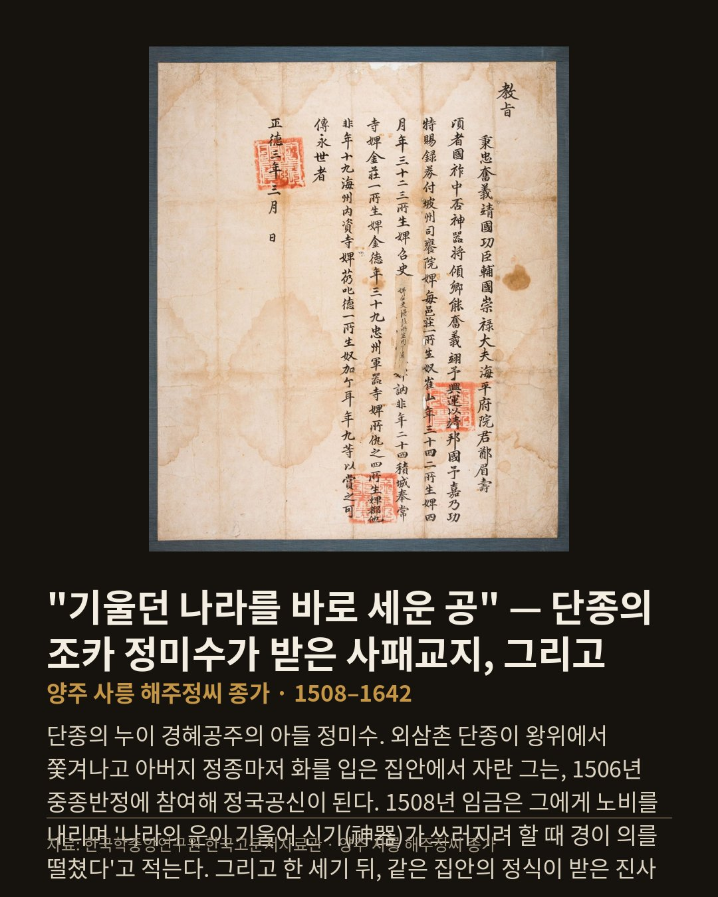
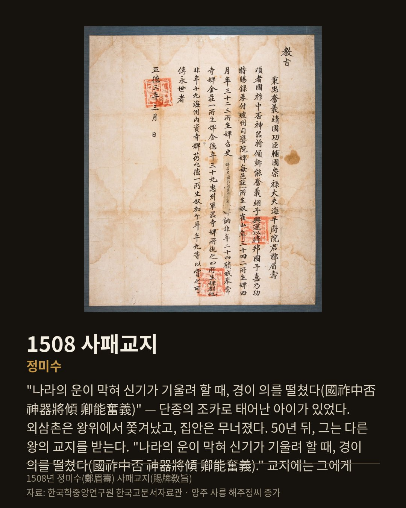
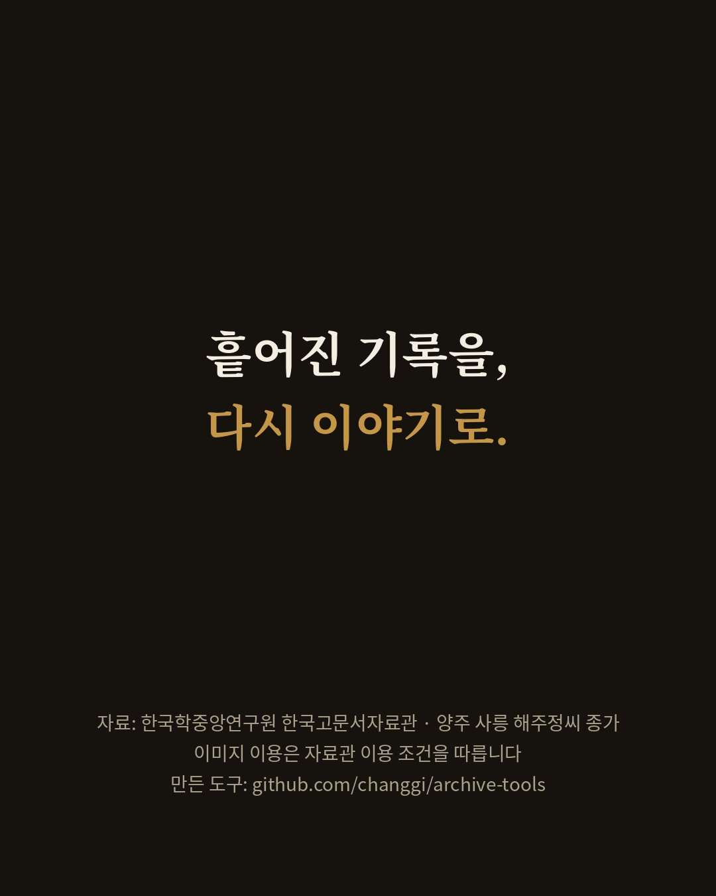

# EP.118 "기울던 나라를 바로 세운 공" — 단종의 조카 정미수가 받은 사패교지, 그리고 연호 없는 합격증

양주 사릉 해주정씨 종가 (문중) · 단종의 누이 경혜공주의 아들 정미수. 외삼촌 단종이 왕위에서 쫓겨나고 아버지 정종마저 화를 입은 집안에서 자란 그는, 1506년 중종반정에 참여해 정국공신이 된다. 1508년 임금은 그에게 노비를 내리며 '나라의 운이 기울어 신기(神器)가 쓰러지려 할 때 경이 의를 떨쳤다'고 적는다. 그리고 한 세기 뒤, 같은 집안의 정식이 받은 진사 합격증에는 연호 대신 간지 '壬午'만 적혀 있다

- 🌐 [전시 웹페이지](https://changgi.github.io/archive-tools/examples/sareung/exhibit.html) (한자 위 한글 독음 · 원문 해석) · [수업 활동지](https://changgi.github.io/archive-tools/examples/sareung/handout.html)
- 🎬 영상: [릴스 9:16](https://changgi.github.io/archive-tools/examples/media/ep118-sareung_reel.mp4) · [가로 16:9](https://changgi.github.io/archive-tools/examples/media/ep118-sareung_wide.mp4) · 홍보 글: [`promo.md`](promo.md)
- 카드뉴스: [`cards/`](cards/) · SNS 글: [`sns.txt`](sns.txt) · 판독·해석 표: [`selection.csv`](selection.csv)

<!-- DELIVERY -->
## 전달 에디팅 — 이 기록을 이렇게 전합니다

- **핵심 정서** — 먹먹함
- **한 문장** — 공적의 기록 아래에는 다른 이들의 삶이 함께 적혀 있다 — 상으로 주어진 사람들도, 이름으로 남았다.
- **열기** — 500년 전, 공신이 받은 상은 사람이었습니다. 최산, 사월, 그리고 아홉 살 가을이.
- **펼치기** — 정미수 사패교지 → 정식 시권－1 → 정식 진사 백패 (1508–1642년) — 1508년 정미수의 사패교지(공신과 노비들) → 1641년 정식의 시권 피봉(이름만 남은 답안) → 1642년 연호 없는 백패 순으로, '무엇이 기록되고 무엇이 비어 있는가'를 따라가게 구성했습니다.
- **절정** — "나라의 운이 막혀 신기가 기울려 할 때, 경이 의를 떨쳤다(國祚中否 神器將傾 卿能奮義)" — 화면·공간에서 이 한 줄만 크게, 소리를 줄여 집중
- **여운** — 아홉 살 가을이는, 그 뒤 어떻게 살았을까요? — 질문으로 끝내고 답은 보는 사람에게
- **감각과 물질** — 붉은 어보 사이에 적힌 사람들의 이름과 나이, 접혀 봉해진 피봉 · 어보·관인 탁본 스탬프를 찍어 보는 체험 · 시험장 책상과 답안지 체험 · 흰 종이 한 장에 조명 하나
- **통로와 매개** — 온라인: 릴스(열기) → 카드뉴스(펼치기) → 전시 웹페이지(절정·원문) → 비하인드 카드(여운) / 오프라인: 원본 크기 복제·낭독·참여 벽 / 남기기: 활동지·질문 카드
- **여운 장치** — 기록에 이름만 남은 사람을 한 명 기억하기
- **전달 에디팅 전** — 3건의 문서를 1508–1642년 연대순으로 놓고 문서명 · 유형 · 해설을 붙인다 — 정확하지만, 지나가면 잊힌다.
- **전달 에디팅 후** — 핵심 정서는 「먹먹함」. 「500년 전, 공신이 받은 상은 사람이었습니다. 최산, 사월, 그리고 아홉 살 가을이.」로 열고, 문서를 대비와 순서로 펼친 뒤, "나라의 운이 막혀 신기가 기울려 할 때, 경이 의를 떨쳤다(國祚中否 神器將傾 卿能奮義)"에서 멈춘다. 붉은 어보 사이에 적힌 사람들의 이름과 나이, 접혀 봉해진 피봉. 마지막엔 「기록에 이름만 남은 사람을 한 명 기억하기」로 보는 사람이 자기 이야기를 남기고 떠나게 한다.

전문: [`delivery.md`](delivery.md)
<!-- /DELIVERY -->

<!-- CURATOR -->
## 비하인드 — 큐레이터 노트

- **왜 이 문서들인가** — 공신의 포상 문서인데, 정작 눈에 들어온 것은 이름과 나이가 하나하나 적힌 노비들이었습니다. 아홉 살 아이도 있었습니다.
- **전하고 싶은 것** — 공적의 기록 아래에는 다른 이들의 삶이 함께 적혀 있다 — 상으로 주어진 사람들도, 이름으로 남았다.
- **이렇게 보이길 바랐다** — 1508년 정미수의 사패교지(공신과 노비들) → 1641년 정식의 시권 피봉(이름만 남은 답안) → 1642년 연호 없는 백패 순으로, '무엇이 기록되고 무엇이 비어 있는가'를 따라가게 구성했습니다.
- **이렇게 써 주세요** — 중종반정과 공신 제도, 조선의 노비 제도, 과거 답안지의 피봉, 병자호란 뒤의 연호 문제에 쓰세요. 노비를 '상'으로 주던 제도는 오늘의 인권 관점에서 함께 이야기해 주세요.
- **만들며 있었던 일** — 사패교지 가운데 몇 글자와 붙은 쪽지는 판독이 불확실합니다. 정미수와 경혜공주 · 정순왕후의 관계는 일반적으로 알려진 내용이며, 정식과 정미수의 가계상 관계는 확인하지 않았습니다. 백패의 간지 표기 이유는 추정입니다.
- **남겨 둔 질문** — 아홉 살 가을이는, 그 뒤 어떻게 살았을까요?
- **제작 기록** — 문서 3건 · 1508–1642년 · 원본 사진 3면(문서 전체) · 원문 판독 3건 · 번역 3건 · 못 읽은 글자 □ 0 · 불확실 (?) 1

전문: [`curator.md`](curator.md) · 비하인드 카드: [`behind/`](behind/) · 채널별 홍보안: [`channels.md`](channels.md)
<!-- /CURATOR -->

## 이야기 — 사료가 말하는 대로

500년 전, 공신이 받은 상은 사람이었습니다. 최산, 사월, 그리고 아홉 살 가을이.

> **1508 사패교지** — 단종의 조카로 태어난 아이가 있었다. 외삼촌은 왕위에서 쫓겨났고, 집안은 무너졌다. 50년 뒤, 그는 다른 왕의 교지를 받는다. "나라의 운이 막혀 신기가 기울려 할 때, 경이 의를 떨쳤다(國祚中否 神器將傾 卿能奮義)." 교지에는 그에게 내린 사람들의 이름이 이어진다. 최산, 사월, 금덕, 도타비, 그리고 아홉 살 가을이. 공신의 상은, 사람이었다.
> **1641 시권** — 한 세기가 지나, 같은 집안의 젊은이가 과거장에 이름을 적는다. "유학 정식, 나이 스물일곱, 본관 해주, 서울에 산다(幼學鄭植年二十七本海州居京)." 그 아래로 아버지, 할아버지, 증조부, 외할아버지. 채점관이 보지 못하도록 이 부분은 접혀 봉해졌다. 답안은 사라지고, 이름만 남았다.
> **1642 백패** — 그리고 이듬해 봄, 흰 종이가 온다. "유학 정식은 진사 3등 제2인으로 입격하였다(幼學鄭植進士三等第二人入格者)." 날짜는 이렇게만 적혀 있다. "임오년 2월 24일(壬午二月二十四日)." 황제의 연호가 있어야 할 자리에, 간지 두 글자뿐이었다.

| 표지 | 1번 카드 | 마무리 |
|---|---|---|
|  |  |  |

## 선별 문서 (3점)

| # | 연도 | 유형 | 문서명 | 원본 |
|---|---|---|---|---|
| 1 | 1508 | 사패교지 | 1508년 정미수(鄭眉壽) 사패교지(賜牌敎旨) | [원본 보기](https://archive.aks.ac.kr/viewer/viewer.do#imgnode.do?itemId=book&gubun=booktree&depth=6&upPath=01%5E0141%5EL014168%5EL014168F02%5EL014168F0201&dataId=G002%2BKHD%2BKSM-XA.1508.0000-20181030.C1003_002_00180_XXX&itemType=) |
| 2 | 1641 | 시권 | 1641년 정식(鄭植) 시권(試券)－1 | [원본 보기](https://archive.aks.ac.kr/viewer/viewer.do#imgnode.do?itemId=book&gubun=booktree&depth=6&upPath=01%5E0141%5EL014168%5EL014168F02%5EL014168F0204&dataId=G002%2BKHD%2BKSM-XD.1641.0000-20181030.C1003_002_00324_XXX&itemType=) |
| 3 | 1642 | 백패 | 1642년 정식(鄭植) 진사 백패(進士白牌) | [원본 보기](https://archive.aks.ac.kr/viewer/viewer.do#imgnode.do?itemId=book&gubun=booktree&depth=6&upPath=01%5E0141%5EL014168%5EL014168F02%5EL014168F0201&dataId=G002%2BKHD%2BKSM-XA.1642.0000-20181030.C1003_002_00001_XXX&itemType=) |

## 원문 판독과 해석

### 1. 1508년 정미수(鄭眉壽) 사패교지(賜牌敎旨)

**원문 판독**

```
敎旨
秉忠奮義靖國功臣輔國崇祿大夫海平府院君鄭眉壽
頃者國祚中否神器將傾卿能奮義翊予興運以靖
邦國予嘉乃功特賜錄券付坡州司饔院婢每邑莊一所生奴崔山年三十四二所生婢四
月年三十二三所生婢召史 …
… 婢訥非年二十四積城奉常
寺婢金莊一所生婢金德年三十九忠州軍器寺婢所仇之四所生婢都他
非年十九海州內資寺婢莎叱德一所生奴加乙(?)耳年九等以賞之可
傳永世者
正德三年三月 日
```

**원문 해석** 교지. 병충분의정국공신 보국숭록대부 해평부원군 정미수에게. 지난번 나라의 운이 중간에 막혀 신기(神器, 왕위)가 기울려 할 때, 경이 의를 떨쳐 내가 일어나는 운을 도와 나라를 안정시켰다. 나는 그 공을 가상히 여겨 특별히 녹권을 내리고, 파주 사옹원 계집종 매읍장의 첫째 소생 사내종 최산(34세), 둘째 소생 계집종 사월(32세), 셋째 소생 계집종 소사 … 계집종 눌비(24세), 적성 봉상시 계집종 금장의 첫째 소생 계집종 금덕(39세), 충주 군기시 계집종 소구지의 넷째 소생 계집종 도타비(19세), 해주 내자시 계집종 사질덕의 첫째 소생 사내종 가을이(?, 9세) 등을 상으로 주니, 영원히 전할 것이다. 정덕 3년(1508) 3월 일.

**해제** 1508년(중종 3, 正德 3) 정국공신(靖國功臣) 해평부원군 정미수(鄭眉壽)에게 공신 포상으로 노비를 내린 사패교지(賜牌敎旨)입니다. 정국공신은 1506년 연산군을 몰아내고 중종을 세운 반정에 공을 세운 신하들입니다. 교지는 '나라의 운이 막혀 왕위가 기울려 할 때 의를 떨쳐 나를 도왔다'고 공을 밝히고, 여러 관청(사옹원 · 봉상시 · 군기시 · 내자시)에 속한 공노비를 이름 · 나이와 함께 지정해 내립니다. 노비의 어머니와 몇째 소생인지까지 적은 것이 특징입니다. 가운데 붙은 작은 쪽지는 노비 한 사람의 정보를 고친 것으로 보입니다(추정). 정미수는 단종의 누이 경혜공주의 아들로 알려져 있으며, 단종비 정순왕후가 그를 후사로 삼았다고 전합니다. 이 집안이 정순왕후의 능인 사릉과 이어지는 까닭입니다.

### 2. 1641년 정식(鄭植) 시권(試券)－1

**원문 판독**

```
幼學鄭植 年二十七 本海州 居京
父 通訓大夫前行典牲署奉事 孝俊
祖 通訓大夫行敦寧府判官 欽
曾祖 通訓大夫行司憲府監察 元禧
外祖 折衝將軍守慶尙右道兵馬節度使 李眞卿 本全義
```

**원문 해석** 유학 정식, 나이 스물일곱, 본관 해주, 서울 거주. 아버지 통훈대부 전 행 전생서봉사 효준. 할아버지 통훈대부 행 돈녕부판관 흠. 증조부 통훈대부 행 사헌부감찰 원희. 외할아버지 절충장군 수 경상우도병마절도사 이진경(본관 전의).

**해제** 1641년(인조 19) 정식(鄭植)이 과거에 낸 시권(답안지)의 피봉(皮封) 부분입니다. 피봉에는 응시자의 이름 · 나이 · 본관 · 거주지와 아버지 · 할아버지 · 증조부 · 외할아버지의 관직과 이름을 적고, 채점 동안에는 접어서 봉해 누구의 답안인지 모르게 했습니다. 이 자료는 답안 본문이 없이 피봉만 남았습니다. 연도는 자료관 목록을 따랐습니다. 이듬해 같은 사람의 진사 백패가 전합니다.

### 3. 1642년 정식(鄭植) 진사 백패(進士白牌)

**원문 판독**

```
敎旨
幼學鄭植進士三等第二人
入格者
壬午二月二十四日
```

**원문 해석** 교지. 유학 정식은 진사시에 3등 제2인으로 입격한 자이다. 임오년(1642) 2월 24일.

**해제** 1642년(인조 20) 정식이 진사시에 3등 제2인으로 합격하고 받은 백패입니다. 날짜에 연호 없이 간지 '壬午'만 적은 것이 눈에 띕니다. 병자호란(1636–1637) 뒤 청의 연호를 쓰기 꺼려 간지만 적은 문서들이 있는데, 이 백패도 그런 예로 보입니다(추정). 간지 위에 어보가 찍혀 있습니다. 앞의 시권 피봉에서 스물일곱이던 그는 이때 스물여덟 무렵입니다.

판독·해석·이야기는 이미지에 근거한 초안이며(검토 전 "초안" 표시), 정확한 판독은 원문 확인이 필요합니다. □는 읽지 못한 글자, (?)는 불확실한 글자입니다.
이미지: 한국학중앙연구원 한국고문서자료관 소장·제공. "원본" 링크를 누르면 자료관 뷰어에서 그 문서가 열립니다. 재사용은 자료관에 문의하세요(소장처 동의 필요).
