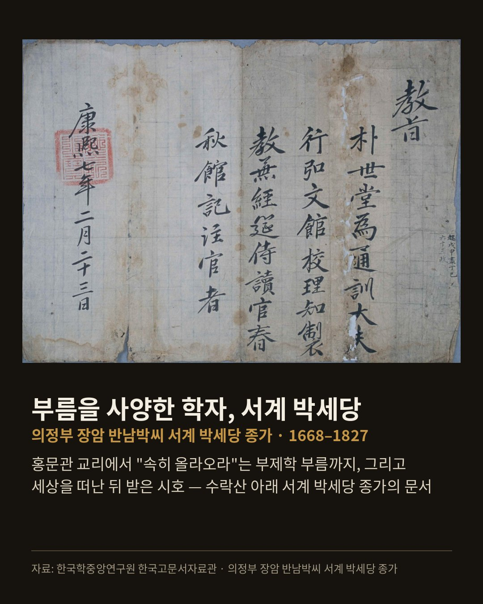
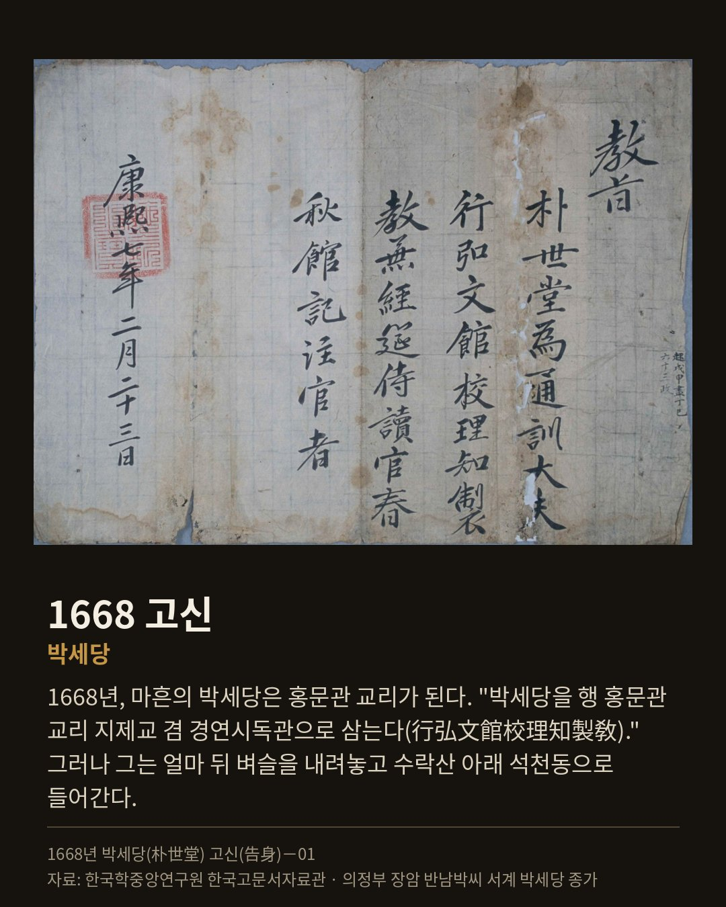
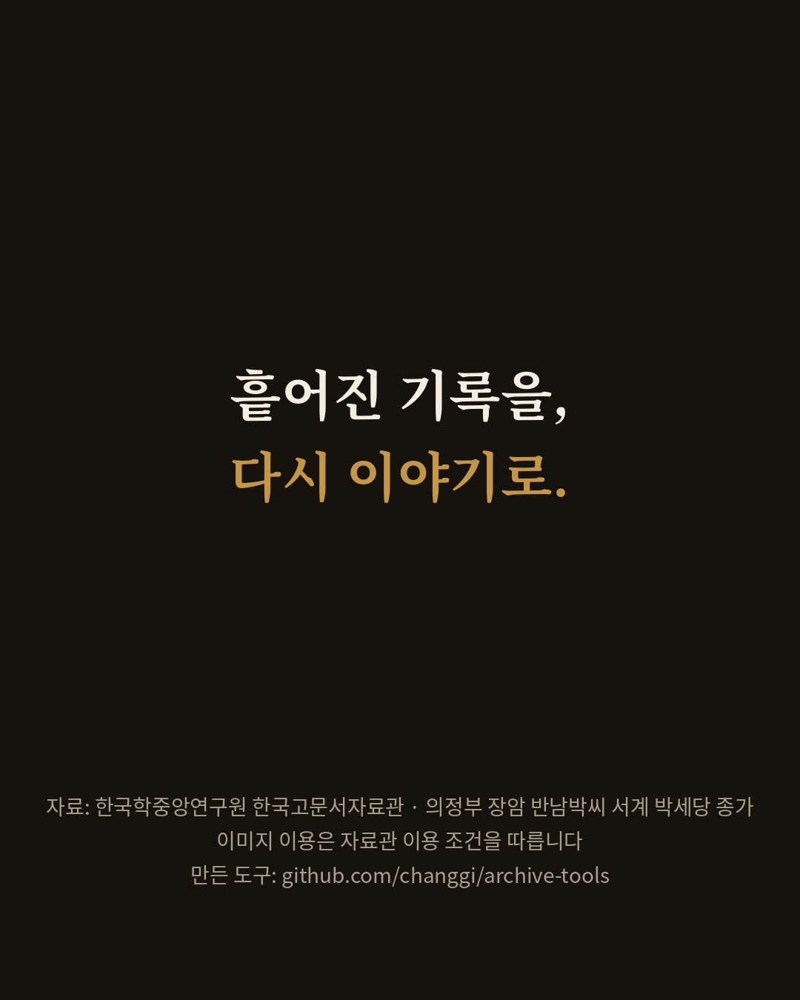

# EP.22 부름을 사양한 학자, 서계 박세당

의정부 장암 반남박씨 서계 박세당 종가 (문중) · 홍문관 교리에서 "속히 올라오라"는 부제학 부름까지, 그리고 세상을 떠난 뒤 받은 시호 — 수락산 아래 서계 박세당 종가의 문서

- 🌐 [전시 웹페이지](https://changgi.github.io/archive-tools/examples/segye/exhibit.html) (한자 위 한글 독음 · 원문 해석) · [수업 활동지](https://changgi.github.io/archive-tools/examples/segye/handout.html)
- 🎬 영상: [릴스 9:16](https://changgi.github.io/archive-tools-next/media/ep22-segye_reel.mp4) · [가로 16:9](https://changgi.github.io/archive-tools-next/media/ep22-segye_wide.mp4) · 홍보 글: [`promo.md`](promo.md)
- 카드뉴스: [`cards/`](cards/) · SNS 글: [`sns.txt`](sns.txt) · 판독·해석 표: [`selection.csv`](selection.csv)


<!-- DELIVERY -->
## 전달 에디팅 — 이 기록을 이렇게 전합니다

- **핵심 정서** — 고요한 거절
- **한 문장** — 벼슬을 내려놓는 것도 하나의 길이었다는 것.
- **열기** — 임금이 "속히 올라오라"고 불렀지만, 산을 나서지 않은 학자가 있습니다.
- **펼치기** — 박세당 고신－01 → 박세당 유지 → 남씨 추증교지 → 사헌부 시호서경완의－2 → 박종길 문과 홍패 (1668–1827년) — 임명 → 거듭된 부름 → 사후의 시호로, 거절과 기억을 함께 보여 주었습니다.
- **절정** — "박종길, 문과 병과 제1인(文科丙科第一人)" — 화면·공간에서 이 한 줄만 크게, 소리를 줄여 집중
- **여운** — 수락산의 박세당은 그 유지를 받고 어떤 답을 썼을까요? — 질문으로 끝내고 답은 보는 사람에게
- **감각과 물질** — 수락산 숲 소리 속에 임명장 한 장만 조명 · 어보·관인 탁본 스탬프를 찍어 보는 체험 · 역마 방울·말발굽 소리와 함께 펼치는 두루마리 · 붉은 종이를 실물 크기로 복제해 벽에 거는 연출
- **통로와 매개** — 온라인: 릴스(열기) → 카드뉴스(펼치기) → 전시 웹페이지(절정·원문) → 비하인드 카드(여운) / 오프라인: 원본 크기 복제·낭독·참여 벽 / 남기기: 활동지·질문 카드
- **여운 장치** — "부름을 사양한 이유" 상상해 쓰기
- **전달 에디팅 전** — 5건의 문서를 1668–1827년 연대순으로 놓고 문서명 · 유형 · 해설을 붙인다 — 정확하지만, 지나가면 잊힌다.
- **전달 에디팅 후** — 핵심 정서는 「고요한 거절」. 「임금이 "속히 올라오라"고 불렀지만, 산을 나서지 않은 학자가 있습니다.」로 열고, 문서를 대비와 순서로 펼친 뒤, "박종길, 문과 병과 제1인(文科丙科第一人)"에서 멈춘다. 수락산 숲 소리 속에 임명장 한 장만 조명. 마지막엔 「"부름을 사양한 이유" 상상해 쓰기」로 보는 사람이 자기 이야기를 남기고 떠나게 한다.

전문: [`delivery.md`](delivery.md)
<!-- /DELIVERY -->

<!-- CURATOR -->
## 비하인드 — 큐레이터 노트

- **왜 이 문서들인가** — 임금이 '속히 올라오라'고 불러도 산을 나서지 않은 학자 박세당의 문서가 남아 있었습니다.
- **전하고 싶은 것** — 벼슬을 내려놓는 것도 하나의 길이었다는 것.
- **이렇게 보이길 바랐다** — 임명 → 거듭된 부름 → 사후의 시호로, 거절과 기억을 함께 보여 주었습니다.
- **이렇게 써 주세요** — 조선 후기 학자의 출처관, 『사변록』 논쟁과 함께 쓰세요.
- **만들며 있었던 일** — 세로 영상 글자 맞춤 문제로 다시 만들었습니다(v0.5.0).
- **남겨 둔 질문** — 수락산의 박세당은 그 유지를 받고 어떤 답을 썼을까요?
- **제작 기록** — 문서 5건 · 1668–1827년 · 원본 사진 7면(문서 전체) · 원문 판독 5건 · 번역 5건 · 못 읽은 글자 □ 0 · 불확실 (?) 2 · 해제에 "확인 필요"를 단 문서 1건

전문: [`curator.md`](curator.md)
<!-- /CURATOR -->

## 이야기 — 사료가 말하는 대로

임금이 "속히 올라오라"고 불렀지만, 산을 나서지 않은 학자가 있습니다.

> **1668 고신** — 1668년, 마흔의 박세당은 홍문관 교리가 된다. "박세당을 행 홍문관 교리 지제교 겸 경연시독관으로 삼는다(行弘文館校理知製敎)." 그러나 그는 얼마 뒤 벼슬을 내려놓고 수락산 아래 석천동으로 들어간다.
> **1684 유지** — 16년 뒤, 임금의 부름이 수락산까지 온다. "너를 홍문관 부제학으로 삼으니, 경연의 일이 긴요하다. 서둘러 역마를 타고 올라오라(經筵事緊 爾其斯速乘馹上來)." 그는 끝내 산을 나서지 않았다고 전한다.
> **1700 추증교지** — 1700년, 일흔둘의 박세당은 1품의 대우를 받는다. 그리고 먼저 떠난 아내에게도 교지가 내려진다. "정부인 남씨를 정경부인으로 추증한다(贈貞夫人南氏贈貞敬夫人者)."
> **1723 시호서경완의** — 1703년, 그는 주자를 비판했다는 이유로 '사문난적'으로 몰린 채 세상을 떠난다. 20년 뒤 사간원이 그의 시호를 정한다. "부지런히 배우고 묻기를 좋아함을 문이라 하고, 청렴하고 절개를 지킴을 정이라 한다(勤學好問曰文 淸白守節曰貞)."
> **1827 홍패** — 그리고 100여 년 뒤, 후손 박종길이 문과에 급제한다. 붉은 홍패 한 장이 서계의 집안에 다시 놓였다. "박종길, 문과 병과 제1인(文科丙科第一人)."

| 표지 | 1번 카드 | 마무리 |
|---|---|---|
|  |  |  |

## 선별 문서 (5점)

| # | 연도 | 유형 | 문서명 | 원본 |
|---|---|---|---|---|
| 1 | 1668 | 고신 | 1668년 박세당(朴世堂) 고신(告身)－01 | [원본 보기](https://archive.aks.ac.kr/viewer/viewer.do#imgnode.do?itemId=book&gubun=booktree&depth=6&upPath=01%5E0141%5EL014167%5EL014167F02%5EL014167F0201&dataId=G002%2BAKS%2BKSM-XA.1668.1111-20101008.B070a_A01_00184_XXX&itemType=) |
| 2 | 1684 | 유지 | 1684년 박세당(朴世堂) 유지(有旨) | [원본 보기](https://archive.aks.ac.kr/viewer/viewer.do#imgnode.do?itemId=book&gubun=booktree&depth=6&upPath=01%5E0141%5EL014167%5EL014167F02%5EL014167F0201&dataId=G002%2BAKS%2BKSM-XA.1684.1111-20101008.B070a_A01_00007_XXX&itemType=) |
| 3 | 1700 | 추증교지 | 1700년 남씨(南氏) 추증교지(追增敎旨) | [원본 보기](https://archive.aks.ac.kr/viewer/viewer.do#imgnode.do?itemId=book&gubun=booktree&depth=6&upPath=01%5E0141%5EL014167%5EL014167F02%5EL014167F0201&dataId=G002%2BAKS%2BKSM-XA.1700.1111-20101008.B070a_A01_00116_XXX&itemType=) |
| 4 | 1723 | 시호서경완의 | 1723년 사헌부(司憲府) 시호서경완의(諡號署經完議)－2 | [원본 보기](https://archive.aks.ac.kr/viewer/viewer.do#imgnode.do?itemId=book&gubun=booktree&depth=6&upPath=01%5E0141%5EL014167%5EL014167F02%5EL014167F0204&dataId=G002%2BAKS%2BKSM-XD.1723.0000-20101008.B070a_A01_00306_XXX&itemType=) |
| 5 | 1827 | 홍패 | 1827년 박종길(朴宗吉) 문과 홍패(文科紅牌) | [원본 보기](https://archive.aks.ac.kr/viewer/viewer.do#imgnode.do?itemId=book&gubun=booktree&depth=6&upPath=01%5E0141%5EL014167%5EL014167F02%5EL014167F0201&dataId=G002%2BAKS%2BKSM-XA.1827.1111-20101008.B070a_A01_00011_XXX&itemType=) |

## 원문 판독과 해석

### 1. 1668년 박세당(朴世堂) 고신(告身)－01

**원문 판독**

```
敎旨
朴世堂爲通訓大夫
行弘文館校理知製
敎兼經筵侍讀官春
秋館記注官者
康熙七年二月二十三日 (도장)
(오른쪽 끝 작은 글씨) 起戊申(?)盡丁巳 六十三政 (판독 불확실)
```

**원문 해석** 교지. 박세당을 통훈대부 행 홍문관 교리 지제교 겸 경연시독관·춘추관기주관으로 삼는다. 강희 7년(1668) 2월 23일.

**해제** 1668년(현종 9, 康熙 7) 2월 23일 박세당(1629~1703)을 홍문관 교리로 임명한 고신입니다. 홍문관은 궁중 도서를 관리하고 임금의 자문에 응하던 학문 기관으로, 교리는 정5품입니다. 지제교(교서 작성), 경연시독관(임금의 공부 자리), 춘추관기주관(실록 기록)을 함께 맡았습니다. 오른쪽 작은 글씨는 문서 정리 때 덧붙인 메모로 보입니다.

### 2. 1684년 박세당(朴世堂) 유지(有旨)

**원문 판독**

```
今以爾爲弘文館副提
學經筵事緊爾其斯
速乘馹上來事有
旨
康熙二十三年六月二十四日 (도장)
同副承旨成 (수결)
```

**원문 해석** 이제 너를 홍문관 부제학으로 삼는다. 경연의 일이 긴요하니 너는 서둘러 역마를 타고 올라오라는 유지이다. 강희 23년(1684) 6월 24일. 동부승지 성(成) (서명)

**해제** 1684년(숙종 10) 6월 24일 승정원 동부승지가 왕명을 받들어 박세당에게 보낸 유지입니다. 부제학은 홍문관의 실질적 책임자(정3품 당상)이고, '經筵事緊'은 임금의 공부 자리에 꼭 필요하다는 뜻입니다. 오른쪽 위 흐린 글씨는 겉봉 쪽 기록으로 보입니다.

### 3. 1700년 남씨(南氏) 추증교지(追增敎旨)

**원문 판독**

```
敎旨
贈貞夫人南
氏贈貞敬夫
人者
康熙三十九年六月 (도장)
崇政大夫判中樞府事朴世堂妻依法典從夫職 (작은 글씨)
```

**원문 해석** 교지. 정부인으로 추증된 남씨를 정경부인으로 추증한다. 강희 39년(1700) 6월. (근거) 숭정대부 판중추부사 박세당의 아내이므로 법전에 따라 남편의 직급을 따른다.

**해제** 1700년(숙종 26) 6월, 박세당이 숭정대부(종1품) 판중추부사가 되자 먼저 세상을 떠난 아내 남씨를 정경부인(1품 관원 아내의 작호)으로 높인 추증교지입니다. '贈'은 죽은 뒤에 내린 작호를 뜻합니다.

### 4. 1723년 사헌부(司憲府) 시호서경완의(諡號署經完議)－2

**원문 판독**

```
完議
卒判府事朴世堂諡號文貞(?)公
勤學好問曰文 (작은 글씨)
淸白守節曰貞 (작은 글씨)
雍正元年十一月 日出 (도장: 署經)
大司諫 (수결)
司諫
獻納 (수결)
正言 (수결)
正言
```

**원문 해석** 완의(合議 결과). 세상을 떠난 판중추부사 박세당의 시호는 문정공(文貞公)으로 한다. 부지런히 배우고 묻기를 좋아함을 '문(文)'이라 하고, 청렴결백하고 절개를 지킴을 '정(貞)'이라 한다. 옹정 원년(1723) 11월 일. 대사간·사간·헌납·정언(서명).

**해제** 1723년(경종 3, 雍正 元年) 11월, 사간원이 박세당의 시호를 심의해 동의(서경)한 결과를 적은 시호서경완의입니다. 시호 글자마다 뜻풀이(諡法)를 작은 글씨로 달았고, 끝에 사간원 관원들이 서명했습니다. 박세당은 『사변록』으로 주자의 해석을 비판했다 하여 1703년 '사문난적'으로 몰려 삭탈관직되었다가 뒤에 복권되었습니다. 그의 시호는 흔히 '문절(文節)'로 알려져 있으나, 이 문서의 글자는 '文貞'과 '淸白守節曰貞'으로 보여 원문 확인이 필요합니다.

### 5. 1827년 박종길(朴宗吉) 문과 홍패(文科紅牌)

**원문 판독**

```
敎旨
通訓大夫行新寧縣監兼大丘鎭管兵馬節制
都尉朴宗吉文科丙科第一人及第出身者
道光七年十月 日
```

**원문 해석** 교지. 통훈대부 행 신녕현감 겸 대구진관 병마절제도위 박종길을 문과 병과 제1인으로 급제시켜 출신을 준다. 도광 7년(1827) 10월 일.

**해제** 1827년(순조 27, 道光 7) 10월 박세당의 후손 박종길에게 내린 문과 홍패입니다. 이미 신녕현감(지금의 경북 영천 신녕)으로 있으면서 문과에 급제했음을 보여 줍니다.

판독·해석·이야기는 이미지에 근거한 초안이며(검토 전 "초안" 표시), 정확한 판독은 원문 확인이 필요합니다. □는 읽지 못한 글자, (?)는 불확실한 글자입니다.
이미지: 한국학중앙연구원 한국고문서자료관 소장·제공. "원본" 링크를 누르면 자료관 뷰어에서 그 문서가 열립니다. 재사용은 자료관에 문의하세요(소장처 동의 필요).
