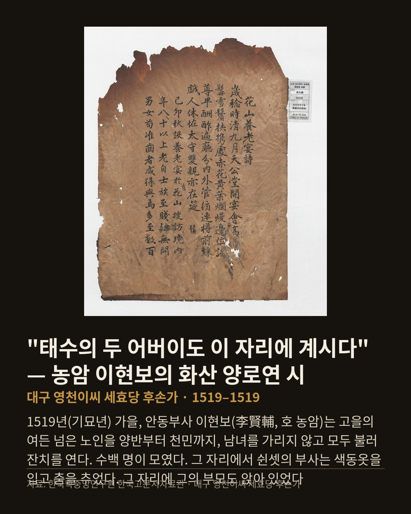
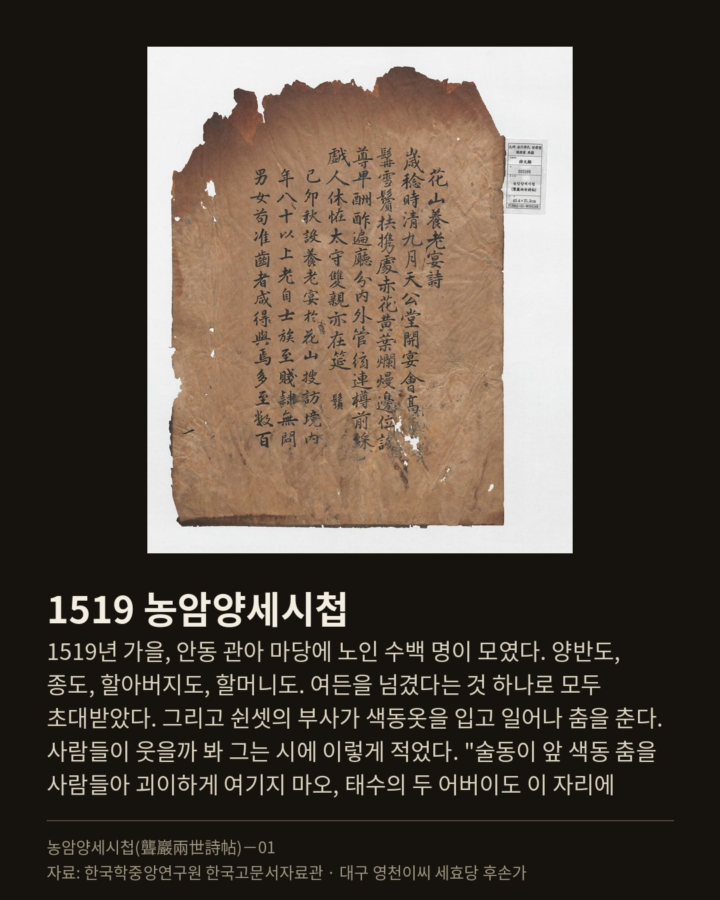
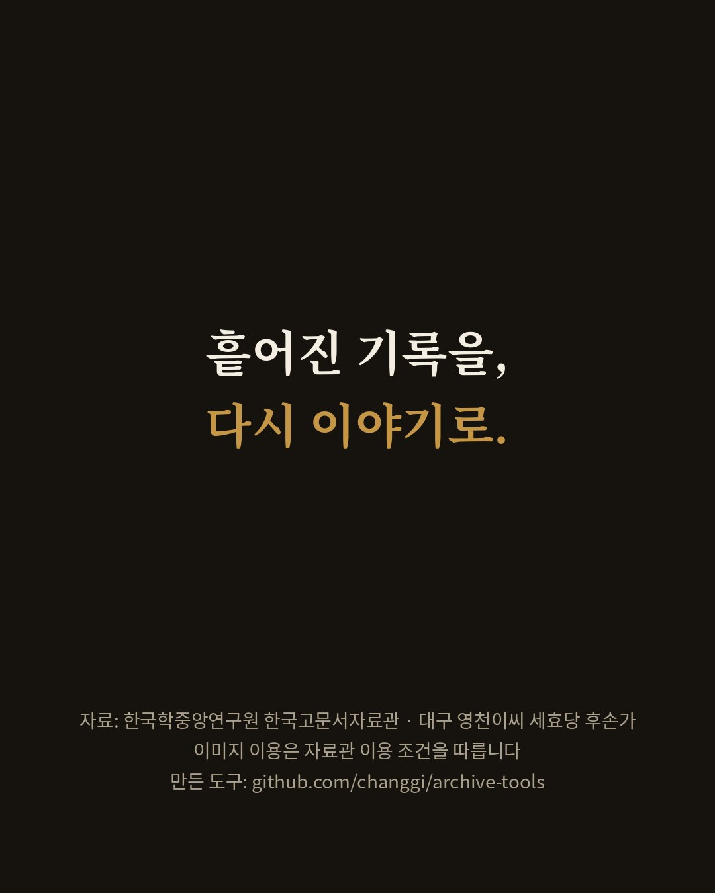

# EP.97 "태수의 두 어버이도 이 자리에 계시다" — 농암 이현보의 화산 양로연 시

대구 영천이씨 세효당 후손가 (문중) · 1519년(기묘년) 가을, 안동부사 이현보(李賢輔, 호 농암)는 고을의 여든 넘은 노인을 양반부터 천민까지, 남녀를 가리지 않고 모두 불러 잔치를 연다. 수백 명이 모였다. 그 자리에서 쉰셋의 부사는 색동옷을 입고 춤을 추었다. 그 자리에 그의 부모도 앉아 있었다

- 🌐 [전시 웹페이지](https://changgi.github.io/archive-tools/examples/sehyodang/exhibit.html) (한자 위 한글 독음 · 원문 해석) · [수업 활동지](https://changgi.github.io/archive-tools/examples/sehyodang/handout.html)
- 🎬 영상: [릴스 9:16](https://changgi.github.io/archive-tools/examples/media/ep97-sehyodang_reel.mp4) · [가로 16:9](https://changgi.github.io/archive-tools/examples/media/ep97-sehyodang_wide.mp4) · 홍보 글: [`promo.md`](promo.md)
- 카드뉴스: [`cards/`](cards/) · SNS 글: [`sns.txt`](sns.txt) · 판독·해석 표: [`selection.csv`](selection.csv)


<!-- CURATOR -->
## 비하인드 — 큐레이터 노트

- **왜 이 문서들인가** — 농암 이현보가 신분·남녀를 가리지 않고 여든 넘은 노인 수백 명을 초대한 1519년 양로연의 시가 남아 있었습니다.
- **전하고 싶은 것** — 효와 공경은 집 안에 머물지 않고 고을 전체로 넓혀질 수 있다는 것.
- **이렇게 보이길 바랐다** — 색동옷 춤(노래자 고사) 장면을 중심에 두고, '태수의 두 어버이도 이 자리에 계시다네'로 마무리했습니다.
- **이렇게 써 주세요** — 효 문화, 노인 복지의 역사, 한시 감상 수업에 쓰세요.
- **만들며 있었던 일** — 3구의 넷째 글자는 손상으로 판독하지 못했습니다. 시첩은 후대에 정서한 것으로 보입니다.
- **남겨 둔 질문** — 오늘 우리 동네에서 '양로연'을 연다면 어떤 모습일까요?
- **제작 기록** — 문서 1건 · 1519년 · 원본 사진 2면(문서 전체) · 원문 판독 1건 · 번역 1건 · 못 읽은 글자 □ 1 · 불확실 (?) 0

전문: [`curator.md`](curator.md)
<!-- /CURATOR -->

## 이야기 — 사료가 말하는 대로

쉰셋의 부사가, 부모 앞에서 색동옷을 입고 춤을 췄습니다.

> **1519 농암양세시첩** — 1519년 가을, 안동 관아 마당에 노인 수백 명이 모였다. 양반도, 종도, 할아버지도, 할머니도. 여든을 넘겼다는 것 하나로 모두 초대받았다. 그리고 쉰셋의 부사가 색동옷을 입고 일어나 춤을 춘다. 사람들이 웃을까 봐 그는 시에 이렇게 적었다. "술동이 앞 색동 춤을 사람들아 괴이하게 여기지 마오, 태수의 두 어버이도 이 자리에 계시다네(樽前綵戲人休怪 太守雙親亦在筵)."

| 표지 | 1번 카드 | 마무리 |
|---|---|---|
|  |  |  |

## 선별 문서 (1점)

| # | 연도 | 유형 | 문서명 | 원본 |
|---|---|---|---|---|
| 1 | 1519 | 농암양세시첩 | 농암양세시첩(聾巖兩世詩帖)－01 | [원본 보기](https://archive.aks.ac.kr/viewer/viewer.do#imgnode.do?itemId=book&gubun=booktree&depth=6&upPath=01%5E0169%5EL016909%5EL016909F02%5EL016909F0208&dataId=G002%2BAKS%2BKSM-XI.0000.2714-20231031.F15601-01-W000168&itemType=) |

## 원문 판독과 해석

### 1. 농암양세시첩(聾巖兩世詩帖)－01

**원문 판독**

```
花山養老宴詩
歲稔時淸九月天 公堂開宴會高
年 鬚雪鬢□扶携處 赤花黃葉爛熳邊 位設
尊卑酬酢遍 廳分內外管絃連 樽前綵
戲人休怪 太守雙親亦在筵　(聾巖)
己卯秋 設養老宴於花山 搜訪境內
年八十以上老 自士族至賤隸 無問
男女 苟准齒者 咸得與焉 多至數百
…(이하 다음 면)
```

**원문 해석** 화산(안동) 양로연 시. 풍년 들고 세상 맑은 구월 하늘, 관아 마당에 잔치 열어 노인들을 모셨네. 흰 수염 흰 귀밑머리 서로 붙들고 오는 곳, 붉은 꽃 누런 잎 흐드러진 가. 자리는 높고 낮음을 갈라 두루 술잔을 주고받고, 대청은 안팎을 나누어 풍악이 이어지네. 술동이 앞 색동옷 춤을 사람들아 괴이하게 여기지 마오, 태수의 두 어버이도 이 자리에 계시다네. — 기묘년(1519) 가을, 화산(안동)에서 양로연을 베풀었다. 고을 안의 여든 살 넘은 노인을 찾아, 사족에서 천한 종에 이르기까지 남녀를 가리지 않고 나이만 차면 모두 참여하게 하니, 많게는 수백 명에 이르렀다. …

**해제** 농암 이현보(李賢輔, 1467–1555)가 안동부사로 있던 1519년 가을에 베푼 양로연(養老宴)에서 지은 칠언율시와 그 경위를 적은 글로, 후손가에 전하는 『농암양세시첩(聾巖兩世詩帖)』의 첫 장입니다. 신분과 남녀를 가리지 않고 80세 이상 노인 수백 명을 초대한 것이 특징이며, 시의 끝 구절 '술동이 앞 색동 춤(綵戲)'은 늙은 부모를 기쁘게 하려고 색동옷을 입고 춤추었다는 중국 노래자(老萊子)의 고사를 빌려, 이현보 자신이 부모 앞에서 춤춘 일을 가리킵니다. 그는 이 일로 효자의 상징이 되었고, 훗날 '애일당(愛日堂)'을 짓고 부모를 모셨습니다. 3구의 넷째 글자는 손상으로 판독하지 못했습니다. 시첩은 후대에 정서한 것으로 보입니다.

판독·해석·이야기는 이미지에 근거한 초안이며(검토 전 "초안" 표시), 정확한 판독은 원문 확인이 필요합니다. □는 읽지 못한 글자, (?)는 불확실한 글자입니다.
이미지: 한국학중앙연구원 한국고문서자료관 소장·제공. "원본" 링크를 누르면 자료관 뷰어에서 그 문서가 열립니다. 재사용은 자료관에 문의하세요(소장처 동의 필요).
