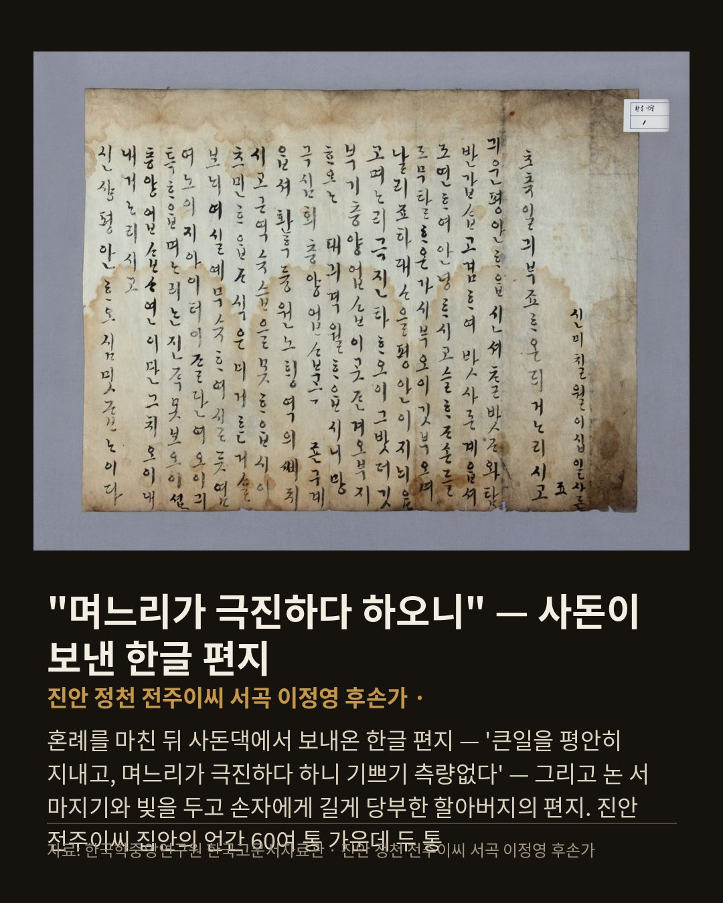
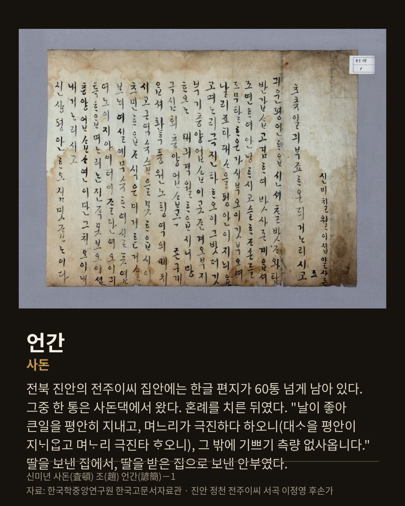
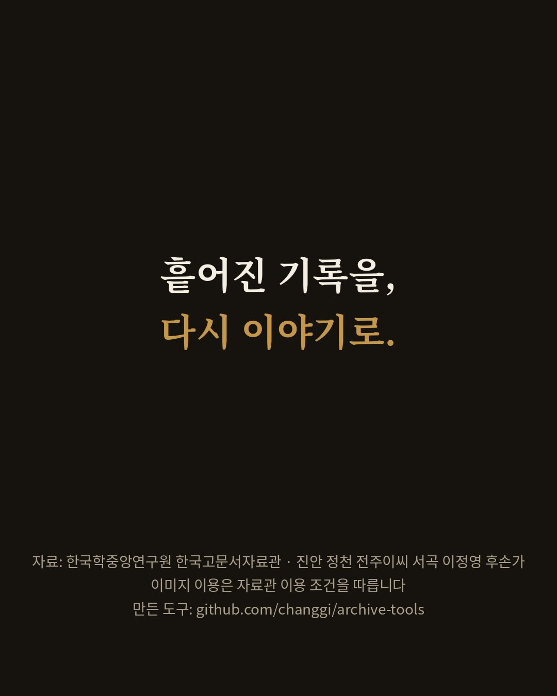

# EP.60 "며느리가 극진하다 하오니" — 사돈이 보낸 한글 편지

진안 정천 전주이씨 서곡 이정영 후손가 (문중) · 혼례를 마친 뒤 사돈댁에서 보내온 한글 편지 — '큰일을 평안히 지내고, 며느리가 극진하다 하니 기쁘기 측량없다' — 그리고 논 서 마지기와 빚을 두고 손자에게 길게 당부한 할아버지의 편지. 진안 전주이씨 집안의 언간 60여 통 가운데 두 통

- 🌐 [전시 웹페이지](https://changgi.github.io/archive-tools/examples/seogok/exhibit.html) (한자 위 한글 독음 · 원문 해석) · [수업 활동지](https://changgi.github.io/archive-tools/examples/seogok/handout.html)
- 🎬 영상: [릴스 9:16](https://changgi.github.io/archive-tools/examples/media/ep60-seogok_reel.mp4) · [가로 16:9](https://changgi.github.io/archive-tools/examples/media/ep60-seogok_wide.mp4) · 홍보 글: [`promo.md`](promo.md)
- 카드뉴스: [`cards/`](cards/) · SNS 글: [`sns.txt`](sns.txt) · 판독·해석 표: [`selection.csv`](selection.csv)


<!-- CURATOR -->
## 비하인드 — 큐레이터 노트

- **왜 이 문서들인가** — 사돈이 보낸 '며느리가 극진하다 하니 기쁘기 측량없다'는 한글 편지가, 혼인의 뒷이야기를 따뜻하게 들려주었습니다.
- **전하고 싶은 것** — 옛 편지에도 오늘 우리와 같은 기쁨과 걱정이 담겨 있었다는 것.
- **이렇게 보이길 바랐다** — 언간의 옛 말투를 살린 인용으로, 읽는 사람이 목소리를 듣는 느낌이 들게 했습니다.
- **이렇게 써 주세요** — 한글 편지(언간) 읽기, 가족 문화 수업에 쓰세요.
- **만들며 있었던 일** — 언간 60여 통 가운데 두 통만 골랐습니다. 옛 한글 표기는 고치지 않았습니다.
- **남겨 둔 질문** — 할아버지가 손자에게 당부한 '빚'은 결국 갚았을까요?
- **제작 기록** — 문서 2건 · 원본 사진 2면(문서 전체) · 원문 판독 2건 · 번역 2건 · 못 읽은 글자 □ 0 · 불확실 (?) 8 · 해제에 "확인 필요"를 단 문서 2건

전문: [`curator.md`](curator.md)
<!-- /CURATOR -->

## 이야기 — 사료가 말하는 대로

혼례가 끝난 뒤, 사돈댁에서 한글 편지가 왔습니다. 무엇이라고 썼을까요?

> ** 언간** — 전북 진안의 전주이씨 집안에는 한글 편지가 60통 넘게 남아 있다. 그중 한 통은 사돈댁에서 왔다. 혼례를 치른 뒤였다. "날이 좋아 큰일을 평안히 지내고, 며느리가 극진하다 하오니(대ᄉᆞ을 평안이 지ᄂᆡᄋᆞᆸ고 며ᄂᆞ리 극진타 ᄒᆞ오니), 그 밖에 기쁘기 측량 없사옵니다." 딸을 보낸 집에서, 딸을 받은 집으로 보낸 안부였다.
> ** 언간** — 같은 집안의 또 한 통은 할아버지가 손자에게 쓴 것이다. 글씨가 빠르고 급하다. 종이가 모자라 위쪽 여백에 거꾸로 이어 썼다. 내용은 살림 걱정이다. "논 서 마지기 … 봄에 빌린 빚과 담보(봄 초동에 ᄲᅡᆫ 빗과 담) … 두 섬 값이 사십여 냥이라." 기쁜 편지도, 걱정하는 편지도 한글로 오갔다.

| 표지 | 1번 카드 | 마무리 |
|---|---|---|
|  |  |  |

## 선별 문서 (2점)

| # | 연도 | 유형 | 문서명 | 원본 |
|---|---|---|---|---|
| 1 | — | 언간 | 신미년 사돈(査頓) 조(趙) 언간(諺簡)－1 | [원본 보기](https://archive.aks.ac.kr/viewer/viewer.do#imgnode.do?itemId=book&gubun=booktree&depth=6&upPath=01%5E0147%5EL014719%5EL014719F02%5EL014719F0206&dataId=G002%2BAKS%2BKSM-XF.0000.0000-20101008.B034a_053_00079_XXX&itemType=) |
| 2 | — | 언간 | 조부(祖父) 언간(諺簡)－1 | [원본 보기](https://archive.aks.ac.kr/viewer/viewer.do#imgnode.do?itemId=book&gubun=booktree&depth=6&upPath=01%5E0147%5EL014719%5EL014719F02%5EL014719F0206&dataId=G002%2BAKS%2BKSM-XF.0000.0000-20101008.B034a_053_00088_XXX&itemType=) |

## 원문 판독과 해석

### 1. 신미년 사돈(査頓) 조(趙) 언간(諺簡)－1

**원문 판독**

```
신미 칠월 이십일 사돈
조
초츄 일긔 부조ᄒᆞ온ᄃᆡ 거ᄂᆞ리시고
긔운 평안ᄒᆞ옵신 셔찰 반ᄉᆞ와 탐(?)
반갑ᄉᆞᆸ고 겸ᄒᆞ여 반ᄉᆞ 오며 계옵셔
조연ᄒᆞ여 안녕ᄒᆞ시고 슬ᄒᆞ ᄌᆞ손들
무탈ᄒᆞ온가 시부오니 깃부오며
날리 조하 대ᄉᆞ을 평안이 지ᄂᆡᄋᆞᆸ고
며ᄂᆞ리 극진타 ᄒᆞ오니 그밧ᄃᆡ 깃
부기 측량 업ᄉᆞᆸ이 굿 즌여오부지
ᄒᆞ오ᄂᆞᆫ 대긔(?)ᄯᅥᆨ 원ᄒᆞ옵 시니 망
극 시(?)회 측량 업ᄉᆞ 오ᄂᆞᆫ구계
운셔 확(?) 동원ᄂᆞ 횡 역의 쎄 ᄌᆡ(?)
(…) (왼쪽 절반 — 이어지는 사연, 판독 필요)
```

**원문 해석** 신미년 7월 20일, 사돈 조(趙)씨. 초가을 날씨가 고르지 못한데, [식구들을] 거느리시고 기운이 평안하시다는 편지를 받으니 반갑고, 겸하여 받자오며 [사돈께서] 자연히 안녕하시고 슬하의 자손들도 무탈하신가 싶으니 기쁘오며, 날이 좋아 큰일(혼례)을 평안히 치르고, 며느리가 극진하다 하오니 그 밖에 더 기쁘기 측량할 수 없사옵니다. … 망극하고 … 측량할 수 없사온 … (판독 불확실 다수, 이하 판독 필요)

**해제** 신미년 7월 20일, 사돈 조(趙)씨가 진안 전주이씨 집안에 보낸 한글 편지(언간)입니다. 혼례(大事)를 무사히 치르고 시집간 딸(이 집 며느리)이 '극진하다'는 소식에 기뻐하는 내용으로 시작합니다. 사돈 사이의 편지는 서로 높여 '-ᄉᆞᆸ-', '-ᄋᆞᆸ-' 같은 겸양 표현을 많이 씁니다. 신미년은 1871년 또는 1811년으로 볼 수 있어 확인이 필요합니다. 오른쪽 절반을 읽었고, 아래아(ᆞ) 등 옛 표기는 그대로 두었습니다.

### 2. 조부(祖父) 언간(諺簡)－1

**원문 판독**

```
(오른쪽 큰 글씨) 신원도ᄉᆞ 젹확ᄒᆞ거ᄌᆔ ᄒᆞ여 보ᄂᆡᆫ다
칠월 회일 글시 찰 월초일 보아 ᄌᆞ셰 잇ᄂᆞᆫ
줄 아니 깃브다 여긔ᄂᆞᆫ 다 ᄒᆞᆫ 모양이니다 ᄒᆞᆫ
일 다 돈 칠 환을 보니 다 ᄒᆞ여 손들 변통 ᄒᆞᆯ ᄀᆞᆯ
유ᄉᆞ니 못보번(?)다 논 셔마지기 오 창(?)닉에게
안ᄉᆞᆸ 갑스로 송도ᄒᆡ 져 ᄲᅢᆨ기여 버리고 논 셔마지기
슈라의 ᄃᆡ 도읍셔 저고 며음도 못 두고 논ᄉᆞ 지을 거시
도읍셔 논ᄉᆞ도 못ᄒᆞ고 봄 초동에 ᄲᅡᆫ 빗과 담 밧나
락 갑슨 웃지 ᄒᆞ여 밧슬 ᄌᆞᆸ혀 드야 그리 ᄒᆞ여 시면
말도 아니 ᄒᆞ여 도다 가만이 두어서다 가을 봄에 길미
병ᄒᆞ여 두 셤 갑시 사십여 양이라 밧슬 아나(?)
(…) (왼쪽 — 이어지는 사연과 끝의 '祖父', 판독 필요)
(위 여백에 거꾸로 이어 쓴 글 — 판독 필요)
```

**원문 해석** (겉머리) 신원도사 ○○가 확실하거든 하여 보낸다(?). 7월 그믐에 쓴 편지를 초하루에 보아 자세히 있는 줄 아니 기쁘다. 여기는 다 한 모양이다. … 돈 칠 환을 보니 … 손[자]들이 변통할 … 논 서 마지기는 … 값으로 송도해 저 빼앗겨 버리고, 논 서 마지기는 … 논사(농사) 지을 것이 … 농사도 못하고 봄 초동에 빌린 빚과 담보 받나 … 값은 어찌하여 밭을 잡혀 드려야 … 그리하였으면 말도 아니 하고 가만히 두었을 텐데 … 가을 봄에 길미(이자)가 … 두 섬 값이 사십여 냥이라 … (판독 불확실 다수, 이하 판독 필요)

**해제** 할아버지(祖父)가 손자에게 보낸 한글 편지입니다. 앞의 사돈 편지가 반듯한 궁체에 가깝다면 이 편지는 빠른 흘림이고, 위 여백에 거꾸로 이어 쓰기까지 했습니다. 논 서 마지기, 빚(빗)과 담보, 이자(길미), 두 섬 값 40여 냥 같은 살림 이야기가 이어집니다. '환(圜)'이라는 돈 단위가 나와 1900년대 이후의 편지로 보이나 확인이 필요합니다. 오른쪽 일부만 읽었습니다.

판독·해석·이야기는 이미지에 근거한 초안이며(검토 전 "초안" 표시), 정확한 판독은 원문 확인이 필요합니다. □는 읽지 못한 글자, (?)는 불확실한 글자입니다.
이미지: 한국학중앙연구원 한국고문서자료관 소장·제공. "원본" 링크를 누르면 자료관 뷰어에서 그 문서가 열립니다. 재사용은 자료관에 문의하세요(소장처 동의 필요).
