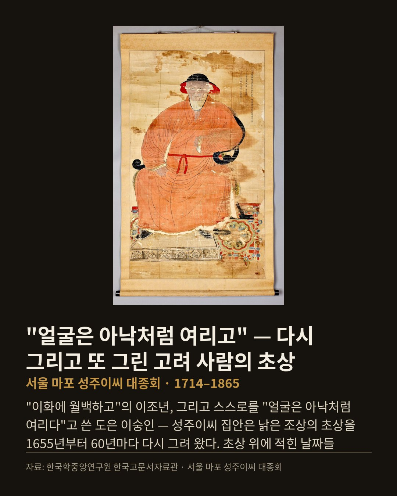
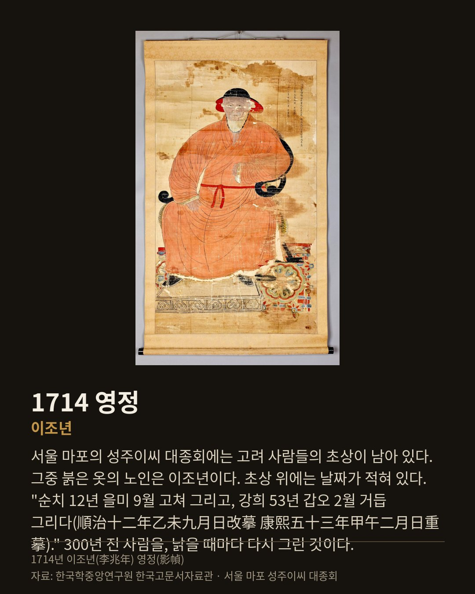
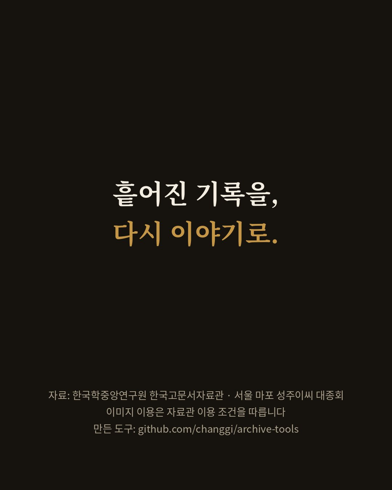

# EP.53 "얼굴은 아낙처럼 여리고" — 다시 그리고 또 그린 고려 사람의 초상

서울 마포 성주이씨 대종회 (문중) · "이화에 월백하고"의 이조년, 그리고 스스로를 "얼굴은 아낙처럼 여리다"고 쓴 도은 이숭인 — 성주이씨 집안은 낡은 조상의 초상을 1655년부터 60년마다 다시 그려 왔다. 초상 위에 적힌 날짜들

- 🌐 [전시 웹페이지](https://changgi.github.io/archive-tools/examples/seongju-lee/exhibit.html) (한자 위 한글 독음 · 원문 해석) · [수업 활동지](https://changgi.github.io/archive-tools/examples/seongju-lee/handout.html)
- 🎬 영상: [릴스 9:16](https://changgi.github.io/archive-tools/examples/media/ep53-seongju-lee_reel.mp4) · [가로 16:9](https://changgi.github.io/archive-tools/examples/media/ep53-seongju-lee_wide.mp4) · 홍보 글: [`promo.md`](promo.md)
- 카드뉴스: [`cards/`](cards/) · SNS 글: [`sns.txt`](sns.txt) · 판독·해석 표: [`selection.csv`](selection.csv)

## 이야기 — 사료가 말하는 대로

600년 전 고려 사람의 초상. 이 집안은 그 얼굴을 다섯 번이나 다시 그렸습니다.

> **1714 영정** — 서울 마포의 성주이씨 대종회에는 고려 사람들의 초상이 남아 있다. 그중 붉은 옷의 노인은 이조년이다. 초상 위에는 날짜가 적혀 있다. "순치 12년 을미 9월 고쳐 그리고, 강희 53년 갑오 2월 거듭 그리다(順治十二年乙未九月日改摹 康熙五十三年甲午二月日重摹)." 300년 전 사람을, 낡을 때마다 다시 그린 것이다.
> **1865 영정** — 초록 비단 테두리의 또 한 장. 고려의 학자 이숭인이 스스로 쓴 글이 얼굴 옆에 있다. "얼굴 생김은 낮고 여려 아낙네 같고(狀貌卑柔 婦人之儔), 글을 다듬는 것은 아이 공부 같다." 그리고 오른쪽에는 다섯 줄의 날짜. 1655, 1714, 1746, 1825, 그리고 을축년. 600년 전 얼굴은 이렇게 다섯 번 다시 태어났다.

| 표지 | 1번 카드 | 마무리 |
|---|---|---|
|  |  |  |

## 선별 문서 (2점)

| # | 연도 | 유형 | 문서명 | 원본 |
|---|---|---|---|---|
| 1 | 1714 | 영정 | 1714년 이조년(李兆年) 영정(影幀) | [원본 보기](https://archive.aks.ac.kr/viewer/viewer.do#imgnode.do?itemId=book&gubun=booktree&depth=6&upPath=01%5E0111%5EL011143%5EL011143F02%5EL011143F0210&dataId=G002%2BAKS%2BKSM-XZ.1714.1144-20250415.F11301-01-W000002&itemType=) |
| 2 | 1865 | 영정 | 1865년 이숭인(李崇仁) 영정(影幀) | [원본 보기](https://archive.aks.ac.kr/viewer/viewer.do#imgnode.do?itemId=book&gubun=booktree&depth=6&upPath=01%5E0111%5EL011143%5EL011143F02%5EL011143F0210&dataId=G002%2BAKS%2BKSM-XZ.1865.1144-20250415.F11301-01-W000013&itemType=) |

## 원문 판독과 해석

### 1. 1714년 이조년(李兆年) 영정(影幀)

**원문 판독**

```
誠勤翊贊勁節功臣重大匡星山君 贈諡文烈公李公諱兆年眞
順治十二年乙未九月 日改摹
康熙五十三年甲午二月 日重摹
(전신 좌상 — 붉은 옷, 붉은 띠, 의자와 꽃무늬 깔개)
```

**원문 해석** 성근익찬경절공신 중대광 성산군, 시호 문열공 이공(이름 조년)의 참모습. 순치 12년 을미(1655) 9월 일 고쳐 그림. 강희 53년 갑오(1714) 2월 일 거듭 그림.

**해제** 고려 말의 문신 이조년(李兆年, 1269~1343)의 초상입니다. 시조 '이화(梨花)에 월백(月白)하고…'의 지은이로 알려진 사람입니다. 오른쪽 위에 공신호와 시호, 그리고 그린 날짜가 두 줄로 적혀 있습니다. 1655년에 처음 '고쳐 그리고(改摹)', 1714년에 '거듭 그렸다(重摹)'는 뜻이니, 지금 남은 그림은 1714년의 것입니다. 고려 사람의 초상이 원본이 낡을 때마다 후손 손으로 다시 옮겨 그려져 전한 것입니다.

### 2. 1865년 이숭인(李崇仁) 영정(影幀)

**원문 판독**

```
(오른쪽)
奉翊大夫簽書密直司事兼都評議使司(…)
崇禎二十八年乙未九月 日改摹
崇禎八十七年甲午二月 日重摹
崇禎一百十九年丙寅三月 日重摹
崇禎一百九十八年乙酉二月 日重摹
夏曆乙丑十一月 日重摹
(왼쪽)
自讚
狀貌卑柔 婦人之儔 章句彫刻
童子之學 若擬諸 達可之卓越
子虛之縝(?)□ 天民之精敏 臨之
俊逸 可遠之溫雅 宗之之詼諧 所
謂碔砆之與美玉也 雖然托迹於
東國 喜談於中原 或塡壑海之
濱 而無所加感 或遊巖廊之上 而
無所加欣 惟其惕然而自修 庶
幾不欺於心 君子 陶隱題
```

**원문 해석** (오른쪽) 봉익대부 첨서밀직사사 겸 도평의사사 … 숭정 28년 을미(1655) 9월 고쳐 그림. 숭정 87년 갑오(1714) 2월 거듭 그림. 숭정 119년 병인(1746) 3월 거듭 그림. 숭정 198년 을유(1825) 2월 거듭 그림. 하력 을축년 11월 거듭 그림.
(왼쪽) 스스로 쓴 찬. 얼굴 생김은 낮고 여려 아낙네 무리 같고, 글귀를 다듬는 것은 아이들 공부 같다. 만약 [벗들에] 견준다면 달가(정몽주)의 뛰어남, 자허의 … , 천민의 정밀하고 민첩함, 임지의 빼어남, 가원(권근)의 온화하고 우아함, 종지의 익살스러움에 비하면, 이른바 옥돌 비슷한 돌(碔砆)과 아름다운 옥 같은 것이다. 그렇지만 동국에 자취를 두고 중원에서 즐겨 이야기하며, 혹은 바닷가 구렁에 던져져도 더 슬퍼하지 않고, 혹은 조정의 높은 곳에서 노닐어도 더 기뻐하지 않았다. 오직 두려워하며 스스로를 닦아, 거의 마음을 속이지 않기를 바라니, 군자여. 도은이 쓰다.

**해제** 고려 말의 학자 도은(陶隱) 이숭인(李崇仁, 1347~1392)의 초상입니다. 왼쪽에 이숭인이 스스로 지은 찬(自讚)이 있는데, 자기 얼굴을 '아낙네 같다'고 낮추고, 벗들 — 달가(達可, 정몽주의 자), 가원(可遠, 권근의 자) 등 — 에 견주면 옥 곁의 돌이라고 겸손하게 썼습니다. 다른 벗들의 자(子虛·天民·臨之·宗之)가 누구인지는 확인이 필요합니다. 오른쪽에는 1655년부터 1714·1746·1825년까지 다시 그린 날짜가 이어지고, 마지막 '夏曆乙丑'이 이 그림을 그린 해입니다. 문서명은 1865년이나, '夏曆(음력)'이라는 표기는 1910년 이후에 흔해 1925년일 가능성도 있어 확인이 필요합니다.

판독·해석·이야기는 이미지에 근거한 초안이며(검토 전 "초안" 표시), 정확한 판독은 원문 확인이 필요합니다. □는 읽지 못한 글자, (?)는 불확실한 글자입니다.
이미지: 한국학중앙연구원 한국고문서자료관 소장·제공. "원본" 링크를 누르면 자료관 뷰어에서 그 문서가 열립니다. 재사용은 자료관에 문의하세요(소장처 동의 필요).
