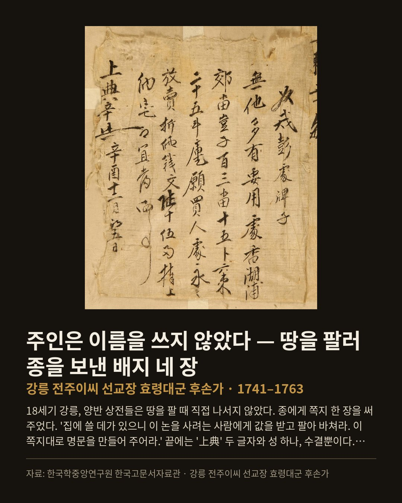
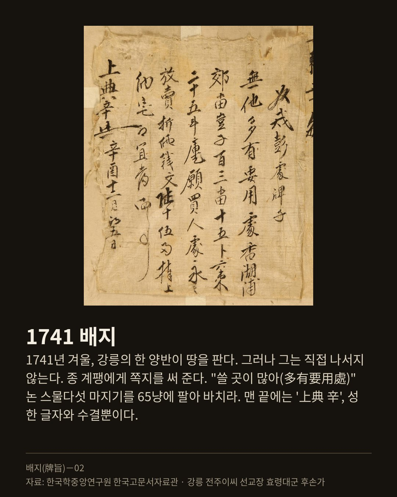
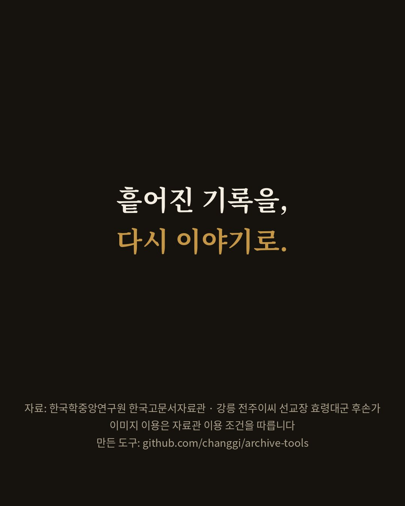

# EP.160 주인은 이름을 쓰지 않았다 — 땅을 팔러 종을 보낸 배지 네 장

강릉 전주이씨 선교장 효령대군 후손가 (문중) · 18세기 강릉, 양반 상전들은 땅을 팔 때 직접 나서지 않았다. 종에게 쪽지 한 장을 써 주었다. '집에 쓸 데가 있으니 이 논을 사려는 사람에게 값을 받고 팔아 바쳐라. 이 쪽지대로 명문을 만들어 주어라.' 끝에는 '上典' 두 글자와 성 하나, 수결뿐이다. 신씨, 조씨, 김씨 — 이름을 감춘 주인들의 쪽지가, 그 땅을 산 선교장에 쌓였다

- 🌐 [전시 웹페이지](https://changgi.github.io/archive-tools/examples/seongyojang-baeji/exhibit.html) (한자 위 한글 독음 · 원문 해석) · [수업 활동지](https://changgi.github.io/archive-tools/examples/seongyojang-baeji/handout.html)
- 🎬 영상: [릴스 9:16](https://changgi.github.io/archive-tools-next/media/ep160-seongyojang-baeji_reel.mp4) · [가로 16:9](https://changgi.github.io/archive-tools-next/media/ep160-seongyojang-baeji_wide.mp4) · 홍보 글: [`promo.md`](promo.md)
- 카드뉴스: [`cards/`](cards/) · SNS 글: [`sns.txt`](sns.txt) · 판독·해석 표: [`selection.csv`](selection.csv)

<!-- DELIVERY -->
## 전달 에디팅 — 이 기록을 이렇게 전합니다

- **핵심 정서** — 씁쓸함
- **한 문장** — 양반은 직접 흥정하지 않았다 — 종에게 '팔아 바쳐라'는 위임장(배지)을 써 주고, 종이 그 위임장으로 명문을 만들어 주었다. 산 쪽은 두 종이를 함께 받아 두었다.
- **열기** — 땅을 판 양반들은, 계약서에 이름 대신 성 한 글자만 남겼습니다.
- **펼치기** — 배지－02 → 배지－03 → 배지－07 → 배지－11 (1741–1763년) — 1741(상전 신씨, 종 계팽) → 1753(상전 조씨, 종 해금) → 1756(상전 조씨, 종 축이, '상전 댁에 쓸 데가 있어') → 1763(상전 김씨)으로, 성만 남은 서로 다른 주인과 이름이 남은 종을 나란히 놓았습니다.
- **절정** — "이 쪽지대로 명문을 만들어 주어라(此牌子導良 明文成給)" — 화면·공간에서 이 한 줄만 크게, 소리를 줄여 집중
- **여운** — 이름은 감추고 성만 남긴 주인과, 이름이 남은 종 — 기록은 누구를 더 기억하게 되었을까요? — 질문으로 끝내고 답은 보는 사람에게
- **감각과 물질** — 쪽지 왼쪽 끝 '上典 辛 · 曹 · 金'과 큰 수결 — 이름 대신 성 한 글자
- **통로와 매개** — 온라인: 릴스(열기) → 카드뉴스(펼치기) → 전시 웹페이지(절정·원문) → 비하인드 카드(여운) / 오프라인: 원본 크기 복제·낭독·참여 벽 / 남기기: 활동지·질문 카드
- **여운 장치** — 위임장 · 대리 서명을 써 본 경험, 혹은 받은 경험 떠올리기
- **전달 에디팅 전** — 4건의 문서를 1741–1763년 연대순으로 놓고 문서명 · 유형 · 해설을 붙인다 — 정확하지만, 지나가면 잊힌다.
- **전달 에디팅 후** — 핵심 정서는 「씁쓸함」. 「땅을 판 양반들은, 계약서에 이름 대신 성 한 글자만 남겼습니다.」로 열고, 문서를 대비와 순서로 펼친 뒤, "이 쪽지대로 명문을 만들어 주어라(此牌子導良 明文成給)"에서 멈춘다. 쪽지 왼쪽 끝 '上典 辛 · 曹 · 金'과 큰 수결 — 이름 대신 성 한 글자. 마지막엔 「위임장 · 대리 서명을 써 본 경험, 혹은 받은 경험 떠올리기」로 보는 사람이 자기 이야기를 남기고 떠나게 한다.

전문: [`delivery.md`](delivery.md)
<!-- /DELIVERY -->

<!-- CURATOR -->
## 비하인드 — 큐레이터 노트

- **왜 이 문서들인가** — EP.27에서 선교장의 땅 문서 480장을 '계약서로 쌓은 집'으로 읽었습니다. 그 명문들 곁에 배지가 55장 붙어 있어, 매매의 '앞 장'을 따로 보기로 했습니다.
- **전하고 싶은 것** — 양반은 직접 흥정하지 않았다 — 종에게 '팔아 바쳐라'는 위임장(배지)을 써 주고, 종이 그 위임장으로 명문을 만들어 주었다. 산 쪽은 두 종이를 함께 받아 두었다.
- **이렇게 보이길 바랐다** — 1741(상전 신씨, 종 계팽) → 1753(상전 조씨, 종 해금) → 1756(상전 조씨, 종 축이, '상전 댁에 쓸 데가 있어') → 1763(상전 김씨)으로, 성만 남은 서로 다른 주인과 이름이 남은 종을 나란히 놓았습니다.
- **이렇게 써 주세요** — 조선 후기 토지 매매의 절차(배지 → 명문), 양반의 대리 거래와 노비의 역할, 두락 · 결부(卜束) 표기, 문서로 쌓은 지주 가문의 형성 수업에 쓰세요.
- **만들며 있었던 일** — 네 장 모두 행초서 쪽지라 땅 이름(자호 · 지번), 결부 수, 값의 일부는 확정하지 못해 …로 두었습니다. 상전의 성은 서명 위의 글자를 따랐고 이름은 문서에 없습니다. 연도는 간지와 자료관 목록 연도를 맞추어 적었습니다. 각 배지와 짝이 되는 명문은 이번에 찾지 않았습니다.
- **남겨 둔 질문** — 이름은 감추고 성만 남긴 주인과, 이름이 남은 종 — 기록은 누구를 더 기억하게 되었을까요?
- **제작 기록** — 문서 4건 · 1741–1763년 · 원본 사진 4면(문서 전체) · 원문 판독 4건 · 번역 4건 · 못 읽은 글자 □ 2 · 불확실 (?) 0

전문: [`curator.md`](curator.md) · 비하인드 카드: [`behind/`](behind/) · 채널별 홍보안: [`channels.md`](channels.md)
<!-- /CURATOR -->

## 이야기 — 사료가 말하는 대로

땅을 판 양반들은, 계약서에 이름 대신 성 한 글자만 남겼습니다.

> **1741 배지** — 1741년 겨울, 강릉의 한 양반이 땅을 판다. 그러나 그는 직접 나서지 않는다. 종 계팽에게 쪽지를 써 준다. "쓸 곳이 많아(多有要用處)" 논 스물다섯 마지기를 65냥에 팔아 바치라. 맨 끝에는 '上典 辛', 성 한 글자와 수결뿐이다.
> **1753 배지** — 12년 뒤, 다른 주인. 이번에는 조씨, 종의 이름은 해금. 쪽지의 끝에서 두 번째 줄이 이 종이의 쓸모를 말한다. "이 쪽지대로 명문을 만들어 주어라(此牌子導良 明文成給)." 종이 한 장이 다른 종이 한 장을 만든다.
> **1756 배지** — 3년 뒤, 같은 조씨. 이번 종은 축이. 팔 땅의 이름이 낯익다. "선교 우자 57번 논(船橋 羽字 五十七畓)." 선교, 이 문서를 간직한 집의 이름이다. 땅을 판 사람의 쪽지는, 그 땅을 산 집의 궤짝으로 들어갔다.
> **1763 배지** — 그리고 1763년 겨울, 또 다른 주인. 이번엔 김씨. 문장은 앞의 쪽지들과 거의 같다. "상전 댁에 쓸 데가 있어(此上典宅以要用所致)." 신씨, 조씨, 김씨. 이름을 감춘 주인들이 내놓은 땅이, 한 집에 모였다.

| 표지 | 1번 카드 | 마무리 |
|---|---|---|
|  |  |  |

## 선별 문서 (4점)

| # | 연도 | 유형 | 문서명 | 원본 |
|---|---|---|---|---|
| 1 | 1741 | 배지 | 배지(牌旨)－02 | [원본 보기](https://archive.aks.ac.kr/viewer/viewer.do#imgnode.do?itemId=book&gubun=booktree&depth=6&upPath=01%5E0171%5EL017101%5EL017101F02%5EL017101F0205&dataId=G002%2BAKS%2BKSM-XE.1741.4215-20250324.C1005_129_00703_XXX&itemType=) |
| 2 | 1753 | 배지 | 배지(牌旨)－03 | [원본 보기](https://archive.aks.ac.kr/viewer/viewer.do#imgnode.do?itemId=book&gubun=booktree&depth=6&upPath=01%5E0171%5EL017101%5EL017101F02%5EL017101F0205&dataId=G002%2BAKS%2BKSM-XE.1753.4215-20250324.C1005_129_00704_XXX&itemType=) |
| 3 | 1756 | 배지 | 배지(牌旨)－07 | [원본 보기](https://archive.aks.ac.kr/viewer/viewer.do#imgnode.do?itemId=book&gubun=booktree&depth=6&upPath=01%5E0171%5EL017101%5EL017101F02%5EL017101F0205&dataId=G002%2BAKS%2BKSM-XE.1756.4215-20250324.C1005_129_00708_XXX&itemType=) |
| 4 | 1763 | 배지 | 배지(牌旨)－11 | [원본 보기](https://archive.aks.ac.kr/viewer/viewer.do#imgnode.do?itemId=book&gubun=booktree&depth=6&upPath=01%5E0171%5EL017101%5EL017101F02%5EL017101F0205&dataId=G002%2BAKS%2BKSM-XE.1763.4215-20250324.C1005_129_00712_XXX&itemType=) |

## 원문 판독과 해석

### 1. 배지(牌旨)－02

**원문 판독**

```
奴戒彭處牌子
無他 多有要用處 香湖浦 …
… 畓 … 百三畓 十五卜六束
二十五斗落 願買人處 永永
放賣 折价錢文陸十伍兩 捧上
納宅 … 宜當向事
上典辛 (수결)
辛酉十一月念五日
```

**원문 해석** 종 계팽에게 주는 패지. 다름이 아니라 쓸 곳이 많아, 향호포 … 의 논(… 15부 6속, 스물다섯 마지기)을 사려는 사람에게 영원히 팔되, 값을 돈 65냥으로 쳐서 받아 댁에 바치는 것이 마땅하다. 상전 신 (수결). 신유년(1741) 11월 25일.

**해제** 신유년(자료관 목록 1741, 영조 17) 11월 25일 상전 신(辛)씨가 종 계팽(戒彭)에게 써 준 배지(牌旨)입니다. 배지(패지 · 패자)는 양반 상전이 자기 땅이나 노비를 팔 때 직접 나서지 않고 종에게 매매를 맡기는 위임 문서로, '奴某處牌子(종 아무개에게 주는 패지)'로 시작해 '上典 某(성) 수결'로 끝납니다. 종은 이 배지를 근거로 사는 사람에게 명문(매매 증서)을 만들어 주고, 산 사람은 배지와 명문을 함께 보관했습니다. 그래서 이 문서가 땅을 산 선교장에 남았습니다. 논 스물다섯 마지기를 65냥에 팔라는 내용이며, 땅 이름과 결부 수 일부는 확정하지 못했습니다.

### 2. 배지(牌旨)－03

**원문 판독**

```
養奴海金處
無他 要用所致 下洞 潛 …
字 … 二畓 一石落只 四卜 …
… 字 … 求同 … 人 准 … 捧上後
此牌子 導良 明文成給
宜當事
上典曹 (수결)
癸酉五月 日
```

**원문 해석** 양노 해금에게. 다름이 아니라 쓸 데가 있어서, 하동 … 의 논(한 섬지기, 4부 …)을 … 사려는 사람에게 값을 받은 뒤, 이 패지대로 명문을 만들어 주는 것이 마땅하다. 상전 조 (수결). 계유년(1753) 5월 일.

**해제** 계유년(자료관 목록 1753) 5월 상전 조(曹)씨가 양노(養奴) 해금(海金)에게 써 준 배지입니다. 양노는 양자로 들이거나 거두어 기른 종을 가리키는 것으로 보입니다. 이 배지에는 '이 패지대로 명문을 만들어 주라(此牌子導良 明文成給)'는 구절이 또렷하여, 배지가 명문 작성의 근거 문서임을 직접 보여 줍니다. '導良(-대로, 이두)'은 '따라서'의 뜻입니다. 논 한 섬지기를 파는 내용이며 땅 이름과 값은 행초서라 확정하지 못했습니다.

### 3. 배지(牌旨)－07

**원문 판독**

```
奴丑伊處牌子
無他 上典宅 有要用之處
船橋 羽字 五十七畓 五卜五束 五斗落
只 五十九畓 四卜 … 石五斗落
只 爲 … 願買人處 依價
捧納宅後 去牌子 導良 明文
成給事
上典曹 (수결)
丙子三月 日
```

**원문 해석** 종 축이에게 주는 패지. 다름이 아니라 상전 댁에 쓸 데가 있어, 선교 우(羽)자 57번 논(5부 5속, 닷 마지기)과 59번 논(4부 …, … 섬 닷 마지기)을 사려는 사람에게 값대로 받아 댁에 바친 뒤, 이 패지대로 명문을 만들어 줄 것. 상전 조 (수결). 병자년(1756) 3월 일.

**해제** 병자년(자료관 목록 1756) 3월 상전 조(曹)씨가 종 축이(丑伊)에게 써 준 배지입니다. 3년 전 해금에게 배지를 써 준 조씨와 같은 집으로 보이나 확정하지 않았습니다. 땅은 '船橋 羽字 五十七畓 · 五十九畓'으로, 양안(토지대장)의 자호(羽字)와 지번(57 · 59)을 그대로 적었습니다. '船橋'는 선교장(船橋莊)의 그 '선교'로, 선교장이 바로 그 일대의 땅을 사들였음을 보여 줍니다. 결부(卜 · 束)와 두락(斗落)을 함께 적어 세금 기준과 면적을 모두 밝혔습니다.

### 4. 배지(牌旨)－11

**원문 판독**

```
養奴□□處
此上典宅以要用所致 … 川 … 字
二十畓 … 下 … 二十二畓 三卜六束
二十五斗落 …
願買人處 依准價 捧上納宅後
此牌子 導良 明文以給事
上典金 (수결)
癸未十二月初四日
```

**원문 해석** 양노 ○○에게. 이는 상전 댁에 쓸 데가 있어서이니, … 천 … 자 20번 논, … 22번 논(3부 6속, 스물다섯 마지기) …을 사려는 사람에게 값대로 받아 댁에 바친 뒤, 이 패지대로 명문을 만들어 줄 것. 상전 김 (수결). 계미년(1763) 12월 4일.

**해제** 계미년(자료관 목록 1763) 12월 4일 상전 김(金)씨가 양노에게 써 준 배지입니다. 앞의 세 장과 형식이 거의 같아, 18세기 강릉 일대 양반들이 같은 서식으로 종에게 매매를 맡겼음을 보여 줍니다. 신 · 조 · 김, 서로 다른 성의 상전이 선교장에 땅을 팔았고, 그 쪽지가 모두 산 쪽에 모였습니다. EP.27에서 본 '계약서로 쌓은 집'은 이렇게 여러 집안이 내놓은 땅 위에 섰습니다. 종의 이름과 땅 이름 일부는 확정하지 못했습니다.

판독·해석·이야기는 이미지에 근거한 초안이며(검토 전 "초안" 표시), 정확한 판독은 원문 확인이 필요합니다. □는 읽지 못한 글자, (?)는 불확실한 글자입니다.
이미지: 한국학중앙연구원 한국고문서자료관 소장·제공. "원본" 링크를 누르면 자료관 뷰어에서 그 문서가 열립니다. 재사용은 자료관에 문의하세요(소장처 동의 필요).
