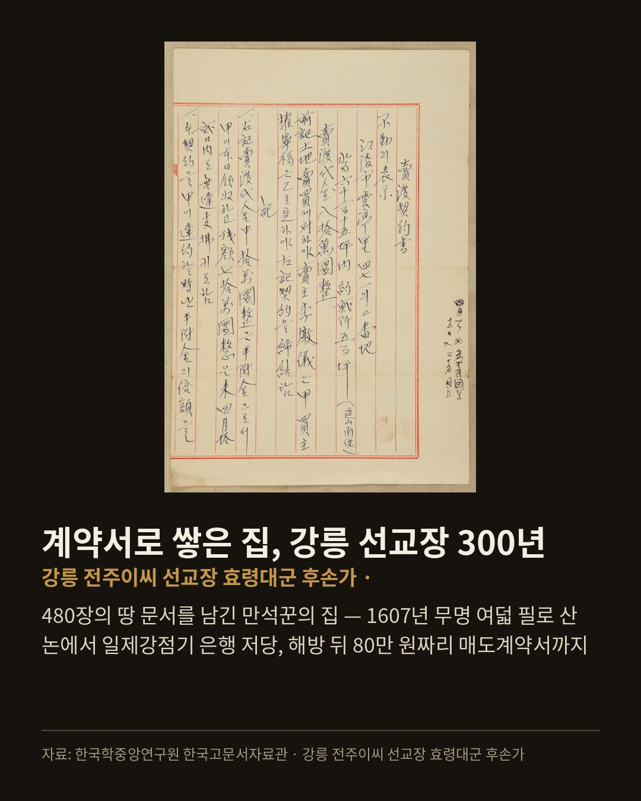
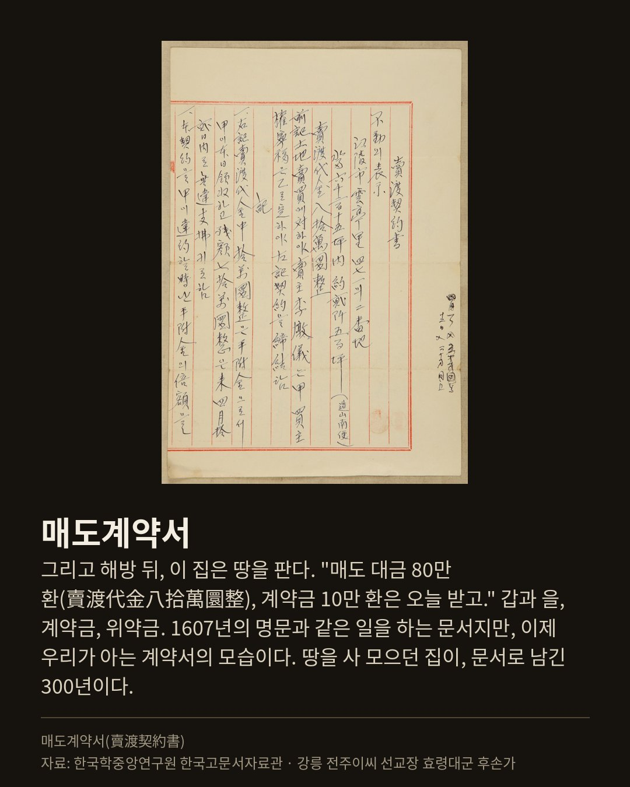
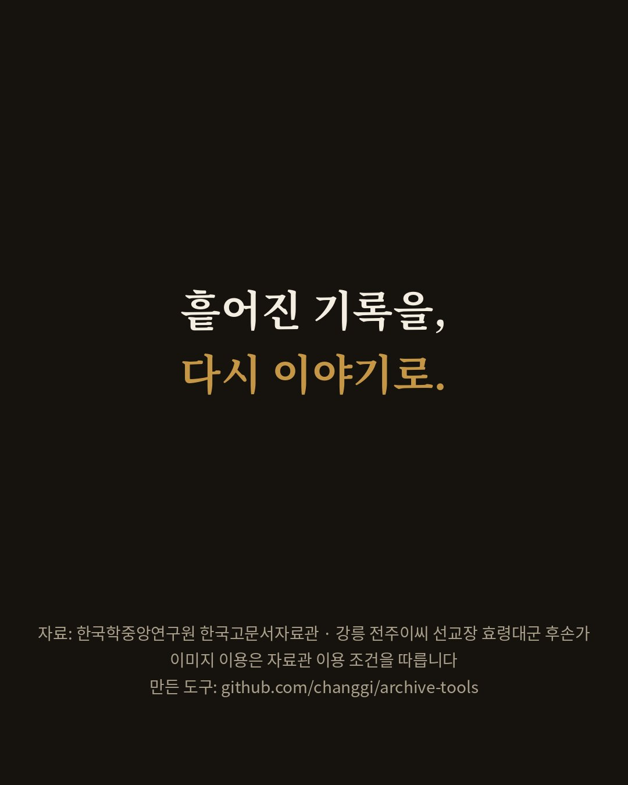

# EP.27 계약서로 쌓은 집, 강릉 선교장 300년

강릉 전주이씨 선교장 효령대군 후손가 (문중) · 480장의 땅 문서를 남긴 만석꾼의 집 — 1607년 무명 여덟 필로 산 논에서 일제강점기 은행 저당, 해방 뒤 80만 원짜리 매도계약서까지

- 🌐 [전시 웹페이지](https://changgi.github.io/archive-tools/examples/seongyojang/exhibit.html) (한자 위 한글 독음 · 원문 해석) · [수업 활동지](https://changgi.github.io/archive-tools/examples/seongyojang/handout.html)
- 🎬 영상: [릴스 9:16](https://changgi.github.io/archive-tools/examples/media/ep27-seongyojang_reel.mp4) · [가로 16:9](https://changgi.github.io/archive-tools/examples/media/ep27-seongyojang_wide.mp4) · 홍보 글: [`promo.md`](promo.md)
- 카드뉴스: [`cards/`](cards/) · SNS 글: [`sns.txt`](sns.txt) · 판독·해석 표: [`selection.csv`](selection.csv)


<!-- DELIVERY -->
## 전달 에디팅 — 이 기록을 이렇게 전합니다

- **핵심 정서** — 값의 무게
- **한 문장** — 큰 집안의 부는 수백 장의 계약서로 쌓였고, 시대마다 계약의 언어가 바뀌었다는 것.
- **열기** — 무명 여덟 필로 사던 땅은, 300년 뒤 어떤 계약서에 적혔을까요?
- **펼치기** — 매도계약서 → 명문－001 → 저당권일부포기증서 → 차용증－1 (연대 미상) — 계약서에 적힌 '값'을 따라가며 350년을 보여 주었습니다.
- **절정** — "강릉에 있는 논밭 2,000석 추수 문서를 저당으로 잡힌다(江陵所在田畓貳千石秋收文券을典執)" — 화면·공간에서 이 한 줄만 크게, 소리를 줄여 집중
- **여운** — 다 갚은 차용증에 그은 큰 X 표시는 어떤 마음이었을까요? — 질문으로 끝내고 답은 보는 사람에게
- **감각과 물질** — 무명 여덟 필·벼 여섯 섬을 실물로 쌓아 계약서 옆에 · 값(무명·냥·원)을 오늘의 물건으로 바꿔 옆에 놓기, 수결 따라 그리기
- **통로와 매개** — 온라인: 릴스(열기) → 카드뉴스(펼치기) → 전시 웹페이지(절정·원문) → 비하인드 카드(여운) / 오프라인: 원본 크기 복제·낭독·참여 벽 / 남기기: 활동지·질문 카드
- **여운 장치** — "350년 뒤 우리 계약서는 어떻게 읽힐까"
- **전달 에디팅 전** — 4건의 문서를 연대 미상 연대순으로 놓고 문서명 · 유형 · 해설을 붙인다 — 정확하지만, 지나가면 잊힌다.
- **전달 에디팅 후** — 핵심 정서는 「값의 무게」. 「무명 여덟 필로 사던 땅은, 300년 뒤 어떤 계약서에 적혔을까요?」로 열고, 문서를 대비와 순서로 펼친 뒤, "강릉에 있는 논밭 2,000석 추수 문서를 저당으로 잡힌다(江陵所在田畓貳千石秋收文券을典執)"에서 멈춘다. 무명 여덟 필·벼 여섯 섬을 실물로 쌓아 계약서 옆에. 마지막엔 「"350년 뒤 우리 계약서는 어떻게 읽힐까"」로 보는 사람이 자기 이야기를 남기고 떠나게 한다.

전문: [`delivery.md`](delivery.md)
<!-- /DELIVERY -->

<!-- CURATOR -->
## 비하인드 — 큐레이터 노트

- **왜 이 문서들인가** — 땅 문서가 480장 넘게 남은 선교장에서, 1607년 무명 여덟 필의 계약서부터 해방 뒤 매도계약서까지 고를 수 있었습니다.
- **전하고 싶은 것** — 큰 집안의 부는 수백 장의 계약서로 쌓였고, 시대마다 계약의 언어가 바뀌었다는 것.
- **이렇게 보이길 바랐다** — 계약서에 적힌 '값'을 따라가며 350년을 보여 주었습니다.
- **이렇게 써 주세요** — 경제사(화폐·담보), 계약 문서 읽기 수업에 쓰세요.
- **만들며 있었던 일** — '원문으로 읽는 이야기 24편 더(EP.27–50)'의 첫 편이며, 세로 영상 글자 맞춤 문제로 다시 만들었습니다(v0.5.0).
- **남겨 둔 질문** — 다 갚은 차용증에 그은 큰 X 표시는 어떤 마음이었을까요?
- **제작 기록** — 문서 4건 · 원본 사진 4면(문서 전체) · 원문 판독 4건 · 번역 4건 · 못 읽은 글자 □ 5 · 불확실 (?) 30 · 해제에 "확인 필요"를 단 문서 1건

전문: [`curator.md`](curator.md)
<!-- /CURATOR -->

## 이야기 — 사료가 말하는 대로

만석꾼의 집에는, 어떤 계약서들이 남아 있을까요?

> ** 매도계약서** — 그리고 해방 뒤, 이 집은 땅을 판다. "매도 대금 80만 환(賣渡代金八拾萬圜整), 계약금 10만 환은 오늘 받고." 갑과 을, 계약금, 위약금. 1607년의 명문과 같은 일을 하는 문서지만, 이제 우리가 아는 계약서의 모습이다. 땅을 사 모으던 집이, 문서로 남긴 300년이다.
> ** 명문** — 강릉 선교장에는 땅 문서가 480장 넘게 남아 있다. 그중 하나, 1607년의 계약서는 이렇게 시작한다. "제가 가난하고 추운 탓에(矣身貧寒所致)" 논을 판다. 값은 돈이 아니라 무명 여덟 필과 벼 여섯 섬이었다.
> ** 저당권일부포기증서** — 1938년에는 상대가 바뀌어 있다. 조선식산은행 강릉지점이 보낸 일본어 증서다. "좌기 부동산에 대한 저당권을 포기합니다(左記不動産ニ對スル抵當權ヲ抛棄候也)." 무명 여덟 필로 사던 땅이, 이제 은행과 등기소의 장부 속에 있다.
> ** 차용증** — 300년 뒤, 이 집은 땅을 담보로 돈을 빌린다. 1906년(?)의 차용증에는 "강릉에 있는 논밭 2,000석 추수 문서를 저당으로 잡힌다(江陵所在田畓貳千石秋收文券을典執)"고 적혀 있다. 그리고 문서 위에는 큰 X가 그어져 있다. 빚을 다 갚았다는 표시다.

| 표지 | 1번 카드 | 마무리 |
|---|---|---|
|  |  |  |

## 선별 문서 (4점)

| # | 연도 | 유형 | 문서명 | 원본 |
|---|---|---|---|---|
| 1 | — | 매도계약서 | 매도계약서(賣渡契約書) | [원본 보기](https://archive.aks.ac.kr/viewer/viewer.do#imgnode.do?itemId=book&gubun=booktree&depth=6&upPath=01%5E0171%5EL017101%5EL017101F02%5EL017101F0205&dataId=G002%2BAKS%2BKSM-XE.1959.4215-20250324.C1005_129_00701_XXX&itemType=) |
| 2 | — | 명문 | 명문(明文)－001 | [원본 보기](https://archive.aks.ac.kr/viewer/viewer.do#imgnode.do?itemId=book&gubun=booktree&depth=6&upPath=01%5E0171%5EL017101%5EL017101F02%5EL017101F0205&dataId=G002%2BAKS%2BKSM-XE.1607.4215-20250324.C1005_129_00221_XXX&itemType=) |
| 3 | — | 저당권일부포기증서 | 저당권일부포기증서(抵當權一部抛棄證書) | [원본 보기](https://archive.aks.ac.kr/viewer/viewer.do#imgnode.do?itemId=book&gubun=booktree&depth=6&upPath=01%5E0171%5EL017101%5EL017101F02%5EL017101F0204&dataId=G002%2BAKS%2BKSM-XD.1937.4215-20250324.C1005_129_00214_XXX&itemType=) |
| 4 | — | 차용증 | 차용증(借用證)－1 | [원본 보기](https://archive.aks.ac.kr/viewer/viewer.do#imgnode.do?itemId=book&gubun=booktree&depth=6&upPath=01%5E0171%5EL017101%5EL017101F02%5EL017101F0204&dataId=G002%2BAKS%2BKSM-XD.1916.4215-20250324.C1005_129_00212_XXX&itemType=) |

## 원문 판독과 해석

### 1. 매도계약서(賣渡契約書)

**원문 판독**

```
賣渡契約書
不動産의表示
江陵市雲亭里(?) 四一의二番地
畓 六千三百十五坪內約貳仟五百坪 (造山南便)
賣渡代金八拾萬圜整
前記土地賣買에對하야賣主李○儀(?)는甲 買主
權○○(?)은乙로하야左記契約을締結함
記
一 右記賣渡代金中拾萬圜整은手附金으로서
甲이本日領收하고殘額七拾萬圜整은來四月拾
五日內로無違支拂키로함
一 本契約은甲이違約할時는手附金의倍額을
(…다음 장)
(오른쪽 여백 메모) 四月十□日 … 五十萬圜 … (판독 불확실)
```

**원문 해석** 매도 계약서. 부동산의 표시 — 강릉시 운정리(?) 41의 2번지, 논 6,315평 가운데 약 2,500평(조산 남쪽). 매도 대금 80만 환. 위 토지 매매에 대하여 판 사람 이○의(?)를 갑, 산 사람 권○○(?)을 을로 하여 아래 계약을 맺음. 아래. 하나, 매도 대금 가운데 10만 환은 계약금으로 갑이 오늘 받고, 나머지 70만 환은 오는 4월 15일 안에 틀림없이 치르기로 함. 하나, 이 계약은 갑이 어기는 때에는 계약금의 두 배를 … (이하 다음 장)

**해제** 해방 뒤 선교장이 땅을 판 매도계약서의 첫 장입니다. '江陵市'는 1955년에 생긴 이름이고, 화폐 단위 '圜(환)'은 1953~1962년에 쓰였으므로 1955~1962년 사이의 문서로 보입니다. 갑·을, 계약금(手附金), 위약 시 배액 같은 오늘날 부동산 계약서의 틀이 그대로 보입니다. 판 사람·산 사람 이름과 지명 일부는 판독이 불확실합니다.

### 2. 명문(明文)－001

**원문 판독**

```
萬曆三十五年丁未九月二十日私奴雲成(?)處明文
右明爲臥乎事段矣身貧寒所致以奧(?)過除(?)
爲在柭(?)句里負(?)夢(?)西斗落只九卜三束庫乙價(?)皐(?)
雖(?)此(?)一首(?)折價木八疋正租陸石木綿陸疋等物乙依
數捧上爲遣夲文爲始永永放賣爲去乎子孫傳繼鎭
長耕食爲乎矣後次吾矣子孫同生族類亦相爭(?)談
計(?)爲去等持此文告官卞正事
畓主 寺奴 渾年 (수촌: 同人左寸)
證人 私奴 古邑金 (수촌: 同人左寸)
筆執 啓功郞 河應淸 (수결)
(오른쪽 아래 붙은 번호표) 256
```

**원문 해석** 만력 35년 정미(1607) 9월 20일, 사노 운성(?) 앞으로 써 주는 매매 문서. 이 문서를 만드는 까닭은, 제가 가난하고 추운 탓에 … 박구(?)리에 있는 서쪽 ○두락 9부 3속짜리 논을, 값으로 무명 8필, 벼 6섬, 면포 6필 등의 물건을 그 수대로 받고, 본래 문서까지 함께 영원히 판다. 자손에게 전해 길이 갈아먹되, 뒷날 제 자손이나 친족이 다투는 말을 하거든 이 문서를 가지고 관에 고하여 바로잡을 일이다. 논 주인 시노(관청 노비) 혼년(왼손 마디 그림), 증인 사노 고읍금(왼손 마디 그림), 쓴 사람 계공랑 하응청(서명).

**해제** 1607년(선조 40, 萬曆 35) 9월 20일, 관청 노비 혼년이 논을 판 매매 명문입니다. 선교장에 남은 명문 480여 장 가운데 하나로, 값을 돈이 아니라 무명(木)·벼(租)·면포 같은 물건으로 치렀습니다. 임진왜란 직후라 동전이 거의 쓰이지 않던 때입니다. 산 사람(○○處)은 사노 운성(?)으로, 노비 명의로 땅을 사들이는 것은 양반가의 흔한 방식이었습니다. 이 문서가 선교장에 들어온 것은 뒷날 땅이 이 집안으로 넘어오며 이전 문서(本文記)를 함께 받았기 때문으로 보입니다. 땅 이름 등 몇 글자는 판독이 불확실합니다.

### 3. 저당권일부포기증서(抵當權一部抛棄證書)

**원문 판독**

```
抵當權一部抛棄證書 (인지)
昭和拾貳年貳月八日受附第壹〇貳號ヲ以テ登記ニ係ル
抵當物件中左記不動産ニ對スル抵當權ヲ抛棄候也
昭和拾參年壹月貳拾八日
京城府南大門通貳丁目壹百拾壹番地ノ壹
抵當權者 株式會社朝鮮殖産銀行
江原道江陵郡江陵邑本町八番地 江陵支店支配人 平野井喜助(?) (도장)
李慶儀 殿
不動産ノ表示
江陵郡江陵邑校柏(?)里壹百六拾壹番地 (…坪)
一 畓 壹千九拾四坪(?)
江陵郡沙川面沙川里(?)五拾參番地
一 畓 八百貳拾(?)六坪
(왼쪽 붉은 도장) 登記濟 昭和拾參年貳月壹日 … / 江陵登記所
```

**원문 해석** 저당권 일부 포기 증서. 쇼와 12년(1937) 2월 8일 접수 제102호로 등기된 저당물 가운데, 아래 적은 부동산에 대한 저당권을 포기합니다. 쇼와 13년(1938) 1월 28일. 경성부 남대문통 2정목 111번지의 1, 저당권자 주식회사 조선식산은행. 강원도 강릉군 강릉읍 본정 8번지, 강릉지점 지배인 히라노이 기스케(?). 이경의 님께. 부동산의 표시 — 강릉군 강릉읍 교백(?)리 161번지 논 1,094평(?), 강릉군 사천면 사천리(?) 53번지 논 826평(?). (도장) 등기 완료, 쇼와 13년 2월 1일, 강릉등기소.

**해제** 1938년(쇼와 13) 1월 28일, 조선식산은행 강릉지점이 선교장의 이경의에게 발급한 저당권 일부 포기 증서입니다. 1937년 은행에 땅을 담보로 맡기고 돈을 빌렸다가, 일부를 갚자 해당 논 두 필지의 저당을 풀어 준 문서입니다. 일본어 공문 서식(候也, 殿)과 인지, '登記濟(등기 완료)' 도장에서 근대 등기 제도로 넘어간 땅의 모습이 보입니다. 지번·평수는 판독 확인이 필요합니다.

### 4. 차용증(借用證)－1

**원문 판독**

```
借用證
一金七千五百參拾五元(?)貳錢(?)也
右金은確實히借用흠으로左記
條項을履行흘事
左記
一 利子ᄂᆞᆫ每朔每円에壹分式(?)
이며
一 還報期限은□年□月로定ᄒᆞ되但違約時ᄂᆞᆫ流質(?)로處理(?)
흠事
一 江陵所在田畓貳千石秋收文券을典執(?)이되
先償(?)하면若干이라도還送(?)
大□(연호 판독 불확실) 丙午九月初□日
債務人 李根宇 (도장)
金奎燮(?) 前
(전체에 큰 X 표 — 갚은 뒤 무효 표시로 보임)
```

**원문 해석** 차용증. 일금 7,535원(?) 2전(?). 위 돈을 확실히 빌렸으므로 아래 조항을 이행할 일. 아래. 하나, 이자는 매달 1원에 1푼씩(?)이며, 하나, 갚을 기한은 ○년 ○월로 정하되, 어기면 저당물로 처리할 일. 하나, 강릉에 있는 논밭 2,000석 추수분의 문권(땅 문서)을 저당으로 잡히되, 먼저 갚으면 얼마라도 돌려보낼 것. 병오년(1906?) 9월 초○일. 채무인 이근우(도장). 김규섭(?) 앞.

**해제** 병오년(1906년으로 보임) 선교장 집안의 이근우가 김규섭(?)에게 돈을 빌리며 써 준 국한문 혼용 차용증입니다. 화폐 단위 '元(원)'은 1905년 화폐정리 뒤의 대한제국 원으로 보입니다. 저당으로 '강릉에 있는 논밭 2,000석 추수분의 문서'를 잡혔는데, 한 해 2,000석을 거두는 땅은 선교장이 대지주였음을 보여 줍니다. 문서 전체에 큰 X가 그어져 있어 빚을 갚은 뒤 무효로 표시한 것으로 보입니다. 연호와 금액 일부는 판독이 불확실합니다.

판독·해석·이야기는 이미지에 근거한 초안이며(검토 전 "초안" 표시), 정확한 판독은 원문 확인이 필요합니다. □는 읽지 못한 글자, (?)는 불확실한 글자입니다.
이미지: 한국학중앙연구원 한국고문서자료관 소장·제공. "원본" 링크를 누르면 자료관 뷰어에서 그 문서가 열립니다. 재사용은 자료관에 문의하세요(소장처 동의 필요).
