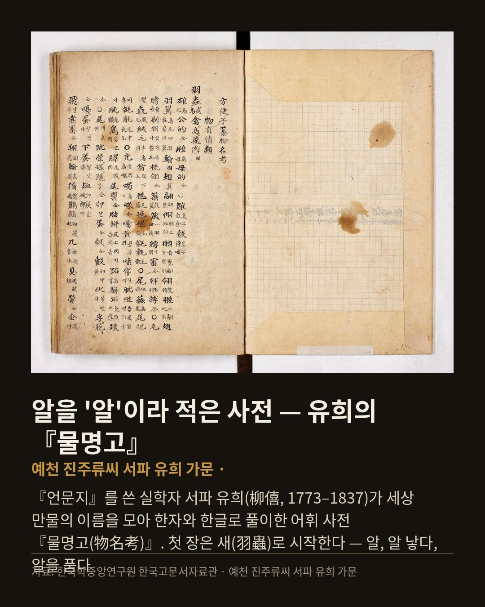
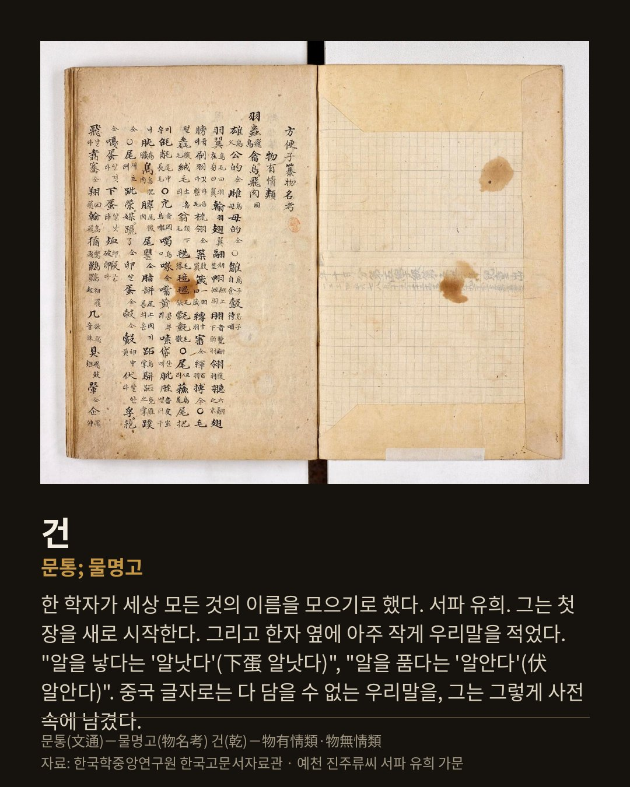
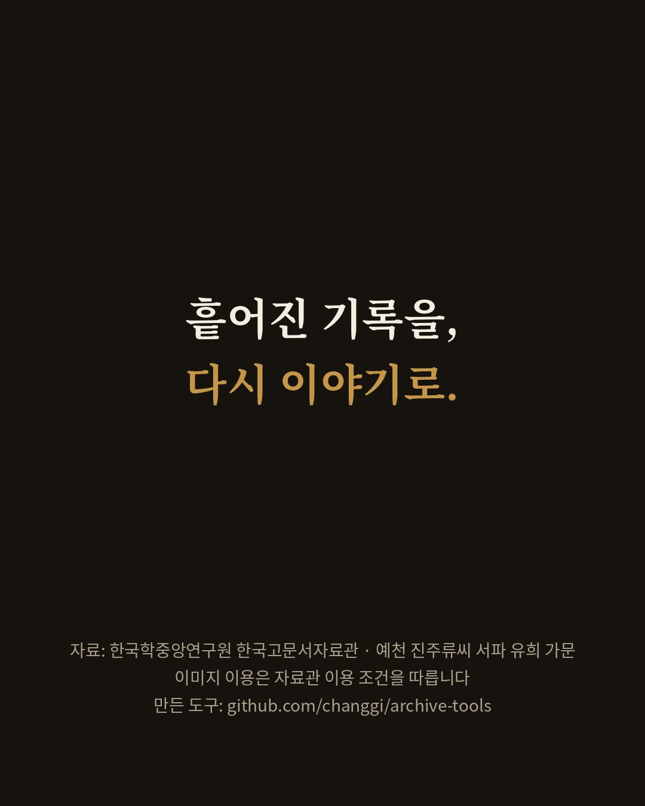

# EP.74 알을 '알'이라 적은 사전 — 유희의 『물명고』

예천 진주류씨 서파 유희 가문 (문중) · 『언문지』를 쓴 실학자 서파 유희(柳僖, 1773–1837)가 세상 만물의 이름을 모아 한자와 한글로 풀이한 어휘 사전 『물명고(物名考)』. 첫 장은 새(羽蟲)로 시작한다 — 알, 알 낳다, 알을 품다

- 🌐 [전시 웹페이지](https://changgi.github.io/archive-tools/examples/seopa/exhibit.html) (한자 위 한글 독음 · 원문 해석) · [수업 활동지](https://changgi.github.io/archive-tools/examples/seopa/handout.html)
- 🎬 영상: [릴스 9:16](https://changgi.github.io/archive-tools/examples/media/ep74-seopa_reel.mp4) · [가로 16:9](https://changgi.github.io/archive-tools/examples/media/ep74-seopa_wide.mp4) · 홍보 글: [`promo.md`](promo.md)
- 카드뉴스: [`cards/`](cards/) · SNS 글: [`sns.txt`](sns.txt) · 판독·해석 표: [`selection.csv`](selection.csv)


<!-- DELIVERY -->
## 전달 에디팅 — 이 기록을 이렇게 전합니다

- **핵심 정서** — 말의 생명
- **한 문장** — 우리말은 한자 문헌의 여백에서도 살아남았다는 것.
- **열기** — 200년 전 사전에 '알을 품다'는 이렇게 적혀 있었습니다.
- **펼치기** — 문통－물명고 건－物有情類·物無情類 (연대 미상) — '알낫다', '알안다' 같은 옛 우리말을 크게 보여 주어 200년 전 말소리가 들리게 했습니다.
- **절정** — "알을 품다는 '알안다'(伏 알안다)" — 화면·공간에서 이 한 줄만 크게, 소리를 줄여 집중
- **여운** — 지금 우리말 사전에서 사라질 것 같은 낱말은 무엇일까요? — 질문으로 끝내고 답은 보는 사람에게
- **감각과 물질** — "알낫다, 알안다" 옛말을 소리로 들려주고, 관람객이 사라질 낱말을 적어 사전에 꽂기
- **통로와 매개** — 온라인: 릴스(열기) → 카드뉴스(펼치기) → 전시 웹페이지(절정·원문) → 비하인드 카드(여운) / 오프라인: 원본 크기 복제·낭독·참여 벽 / 남기기: 활동지·질문 카드
- **여운 장치** — 우리말 낱말 기증 상자
- **전달 에디팅 전** — 1건의 문서를 연대 미상 연대순으로 놓고 문서명 · 유형 · 해설을 붙인다 — 정확하지만, 지나가면 잊힌다.
- **전달 에디팅 후** — 핵심 정서는 「말의 생명」. 「200년 전 사전에 '알을 품다'는 이렇게 적혀 있었습니다.」로 열고, 문서를 한 장의 집중로 펼친 뒤, "알을 품다는 '알안다'(伏 알안다)"에서 멈춘다. "알낫다, 알안다" 옛말을 소리로 들려주고, 관람객이 사라질 낱말을 적어 사전에 꽂기. 마지막엔 「우리말 낱말 기증 상자」로 보는 사람이 자기 이야기를 남기고 떠나게 한다.

전문: [`delivery.md`](delivery.md)
<!-- /DELIVERY -->

<!-- CURATOR -->
## 비하인드 — 큐레이터 노트

- **왜 이 문서들인가** — 『언문지』의 유희가 만든 어휘 사전 『물명고』에서, 한자 옆에 작게 적은 한글 낱말을 발견했습니다.
- **전하고 싶은 것** — 우리말은 한자 문헌의 여백에서도 살아남았다는 것.
- **이렇게 보이길 바랐다** — '알낫다', '알안다' 같은 옛 우리말을 크게 보여 주어 200년 전 말소리가 들리게 했습니다.
- **이렇게 써 주세요** — 국어사·한글 수업, 사전의 역사를 다루는 전시에 쓰세요.
- **만들며 있었던 일** — 51면짜리 책 가운데 첫 장 일부만 판독했습니다. 작은 주석 글자는 판독이 불확실합니다(원본 묶음에는 51면 전체).
- **남겨 둔 질문** — 지금 우리말 사전에서 사라질 것 같은 낱말은 무엇일까요?
- **제작 기록** — 문서 1건 · 원본 사진 51면(문서 전체) · 원문 판독 1건 · 번역 1건 · 못 읽은 글자 □ 0 · 불확실 (?) 1

전문: [`curator.md`](curator.md)
<!-- /CURATOR -->

## 이야기 — 사료가 말하는 대로

200년 전 사전에 '알을 품다'는 이렇게 적혀 있었습니다.

> ** 건** — 한 학자가 세상 모든 것의 이름을 모으기로 했다. 서파 유희. 그는 첫 장을 새로 시작한다. 그리고 한자 옆에 아주 작게 우리말을 적었다. "알을 낳다는 '알낫다'(下蛋 알낫다)", "알을 품다는 '알안다'(伏 알안다)". 중국 글자로는 다 담을 수 없는 우리말을, 그는 그렇게 사전 속에 남겼다.

| 표지 | 1번 카드 | 마무리 |
|---|---|---|
|  |  |  |

## 선별 문서 (1점)

| # | 연도 | 유형 | 문서명 | 원본 |
|---|---|---|---|---|
| 1 | — | 건 | 문통(文通)－물명고(物名考) 건(乾)－物有情類·物無情類 | [원본 보기](https://archive.aks.ac.kr/viewer/viewer.do#imgnode.do?itemId=book&gubun=booktree&depth=6&upPath=01%5E0167%5EL016780%5EL016780F01%5EL016780F0103&dataId=G002%2BAKS%2BKSM-WC.0000.4146-20240610.F10201-01-X000082&itemType=) |

## 원문 판독과 해석

### 1. 문통(文通)－물명고(物名考) 건(乾)－物有情類·物無情類

**원문 판독**

```
(1면 · 권두 · 부분 판독)
方便子纂物名考
物有情類
羽蟲 飛鳥　禽 鳥　飛肉 同
雄 父鳥　公的 仝　雌 母鳥　母的 仝
○雛 鳥子自食　鷇 待哺鳥子
羽翼 鳥毛曰羽 在旁曰翼　翰 羽　翅 翼　翮 羽莖　翖　翎 …
… 嗉 멱산(?)　嘴 부리 …
○尾 … 卵 알　蛋 仝　下蛋 알낫다(알 낳다)　嘎蛋 …
伏 알안다(알을 품다)　毈 곯다(곯은 알)
飛 나다(날다)　翔 回飛　翰 高飛　矯 …
(2·3면 — 鳳凰·鸞·鶴·鷄 등 새 이름 표제어, 세부 판독 필요)
```

**원문 해석** 방편자(유희의 호)가 엮은 『물명고』. [제1부] 정(情)이 있는 것들(동물). 우충(깃 달린 벌레 = 새): 나는 새, 날짐승. 수컷은 '아비새', 암컷은 '어미새'. 스스로 먹는 새끼를 '추(雛)', 어미가 먹여 주기를 기다리는 새끼를 '구(鷇)'라 한다. 새의 털을 '우(羽)', 옆에 붙은 것을 '익(翼, 날개)'이라 한다. … 난(卵)은 '알', 하단(下蛋)은 '알 낳다', 복(伏)은 '알 안다(품다)' … 비(飛)는 '날다'.

**해제** 『언문지(諺文志)』로 유명한 조선 후기 실학자 서파 유희(柳僖)가 사물의 이름을 분류해 한자 표제어 아래 뜻풀이와 한글 고유어를 단 어휘집 『물명고』의 권두입니다. 크게 유정류(有情類, 동물)·무정류(無情類, 식물)·부동류·부정류(광물·자연·인공물) 등으로 나누었고, 이 책(乾)은 유정류의 첫 항목인 새(羽蟲)부터 시작합니다. 작은 글씨로 단 한글 풀이('알', '알 낳다', '알 안다', '날다' 등)는 19세기 초 우리말 어휘를 보여 주는 귀중한 자료입니다. 필사본이라 작은 주석 글자 일부는 판독이 불확실합니다.

판독·해석·이야기는 이미지에 근거한 초안이며(검토 전 "초안" 표시), 정확한 판독은 원문 확인이 필요합니다. □는 읽지 못한 글자, (?)는 불확실한 글자입니다.
이미지: 한국학중앙연구원 한국고문서자료관 소장·제공. "원본" 링크를 누르면 자료관 뷰어에서 그 문서가 열립니다. 재사용은 자료관에 문의하세요(소장처 동의 필요).
