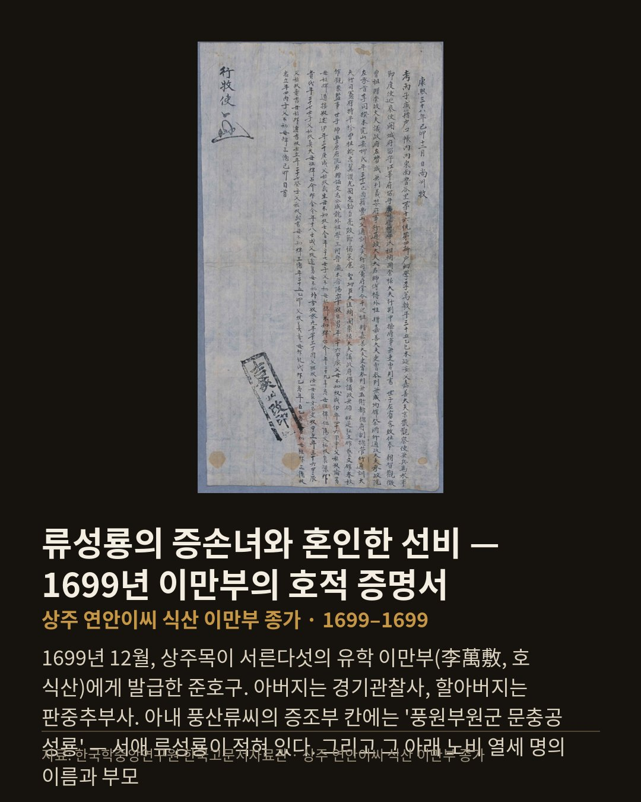
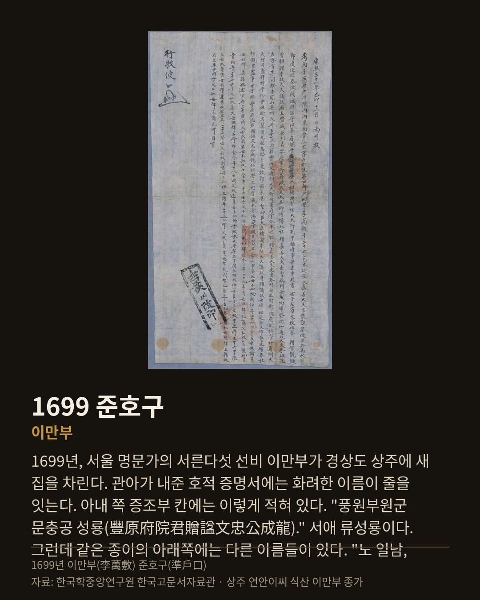
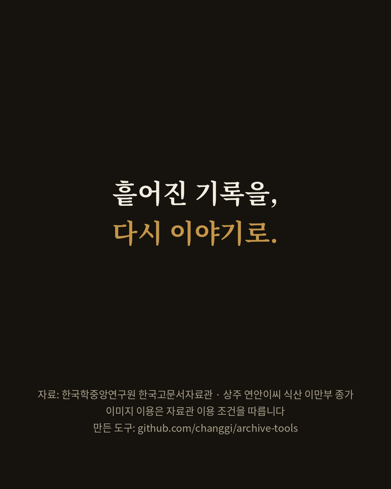

# EP.98 류성룡의 증손녀와 혼인한 선비 — 1699년 이만부의 호적 증명서

상주 연안이씨 식산 이만부 종가 (문중) · 1699년 12월, 상주목이 서른다섯의 유학 이만부(李萬敷, 호 식산)에게 발급한 준호구. 아버지는 경기관찰사, 할아버지는 판중추부사. 아내 풍산류씨의 증조부 칸에는 '풍원부원군 문충공 성룡' — 서애 류성룡이 적혀 있다. 그리고 그 아래 노비 열세 명의 이름과 부모

- 🌐 [전시 웹페이지](https://changgi.github.io/archive-tools/examples/siksan/exhibit.html) (한자 위 한글 독음 · 원문 해석) · [수업 활동지](https://changgi.github.io/archive-tools/examples/siksan/handout.html)
- 🎬 영상: [릴스 9:16](https://changgi.github.io/archive-tools/examples/media/ep98-siksan_reel.mp4) · [가로 16:9](https://changgi.github.io/archive-tools/examples/media/ep98-siksan_wide.mp4) · 홍보 글: [`promo.md`](promo.md)
- 카드뉴스: [`cards/`](cards/) · SNS 글: [`sns.txt`](sns.txt) · 판독·해석 표: [`selection.csv`](selection.csv)

## 이야기 — 사료가 말하는 대로

이 호적에는 류성룡의 이름과, 부모를 모르는 노비의 이름이 함께 적혀 있습니다.

> **1699 준호구** — 1699년, 서울 명문가의 서른다섯 선비 이만부가 경상도 상주에 새 집을 차린다. 관아가 내준 호적 증명서에는 화려한 이름이 줄을 잇는다. 아내 쪽 증조부 칸에는 이렇게 적혀 있다. "풍원부원군 문충공 성룡(豐原府院君贈諡文忠公成龍)." 서애 류성룡이다. 그런데 같은 종이의 아래쪽에는 다른 이름들이 있다. "노 일남, 서른여섯, 부모를 모름(奴日男 年三十六甲辰 父母不知)." 한 장의 호적 안에, 영의정의 후손과 부모를 모르는 노비가 함께 살고 있었다.

| 표지 | 1번 카드 | 마무리 |
|---|---|---|
|  |  |  |

## 선별 문서 (1점)

| # | 연도 | 유형 | 문서명 | 원본 |
|---|---|---|---|---|
| 1 | 1699 | 준호구 | 1699년 이만부(李萬敷) 준호구(準戶口) | [원본 보기](https://archive.aks.ac.kr/viewer/viewer.do#imgnode.do?itemId=book&gubun=booktree&depth=6&upPath=01%5E0167%5EL016767%5EL016767F02%5EL016767F0204&dataId=G002%2BAKS%2BKSM-XD.1699.4725-20101008.B069a_A01_00109_XXX&itemType=) |

## 원문 판독과 해석

### 1. 1699년 이만부(李萬敷) 준호구(準戶口)

**원문 판독**

```
康熙三十八年己卯十二月　日 尙州牧
考丙子成籍戶口帳內 內東面魯谷里第十六統第四新戶 幼學李萬敷 年三十五乙巳 本延安 父 嘉善大夫京畿觀察使兼兵馬水軍
節度使巡察使開城府留守江華府留守廣州府留守 沃 祖 輔國崇祿大夫行判中樞府事兼吏曹判書 世子左賓客致仕奉朝賀 觀徵
曾祖 贈崇政大夫議政府左贊成兼判義禁府事行通政大夫大君師傅 禱 外祖 贈嘉善大夫吏曹參判兼成均館祭酒行通政大夫承政院
左承旨 李同揆 本完山 妻 柳氏 年三十一乙酉 籍豐山 父 通訓大夫行司憲府掌令 千之 祖 贈嘉善大夫吏曹參判兼五衛都摠府副摠管行通訓大
夫行司憲府持平 袗 曾祖 輸忠翼謨光國忠勤貞亮效節協策扈聖功臣大匡輔國崇祿大夫議政府領議政兼領經筵弘文館藝文館春秋
館觀象監事 世子師 豐原府院君 贈諡文忠公 成龍 外祖 學生 河晉瀛 本晉陽 率奴 日男 年三十六甲辰 父母不知 奴 戒伊 年四十六甲申 父私奴論男
母私婢道接 奴 述伊 年三十庚戌 父私奴武生 母不知 奴 壬金 年二十七壬子 父不知 母私婢不知 婢 仁介 年二十九辛亥 母班婢仁陽 父私奴良孫
婢 貴代 年二十七壬子 父私奴莫大 母班婢占介 婢 金今 年十八壬戌 父奴述男 母不知 外方奴 承先 年四十三丁酉 父班奴汝一 母良女召史 奴 甲立 年三十六甲辰
父私奴童吉 母私婢連香 奴 壬立 年二十七 父私奴武吉 母不知 婢 三德 年二十五乙卯 父奴莫竜 母婢記代 婢 乙亥 年五乙亥 父不知 母班婢三德 奴
忠立 年四丙子 父不知 母婢三德 己卯自首
行牧使 [수결]
(상주목 관인 여러 과 · 좌하단 후대 장방형 인)
```

**원문 해석** 강희 38년 기묘(1699) 12월 일, 상주목. 병자년(1696) 호적대장을 살펴보니, 내동면 노곡리 제16통 제4호, 새로 든 호(新戶). 유학 이만부, 35세 을사생, 본관 연안. 아버지 가선대부 경기관찰사 겸 병마수군절도사·순찰사·개성부유수·강화부유수·광주부유수 옥(沃). 할아버지 보국숭록대부 행 판중추부사 겸 이조판서·세자좌빈객 치사 봉조하 관징(觀徵). 증조 증 숭정대부 의정부 좌찬성 겸 판의금부사, 행 통정대부 대군사부 도(禱). 외조 증 가선대부 이조참판 겸 성균관 좨주, 행 통정대부 승정원 좌승지 이동규, 본관 완산. 아내 류씨, 31세 을유생, 본관 풍산. [아내의] 아버지 통훈대부 행 사헌부 장령 천지(千之). 할아버지 증 가선대부 이조참판 겸 오위도총부 부총관, 행 통훈대부 사헌부 지평 진(袗). 증조 수충익모광국충근정량효절협책호성공신 대광보국숭록대부 의정부 영의정 … 세자사 풍원부원군 증시 문충공 성룡(成龍). 외조 학생 하진영, 본관 진양. 거느린 노비: 노 일남 36세(부모 모름), 노 계이 46세(아비 사노 논남, 어미 사비 도접), 노 술이 30세, 노 임금 27세, 비 인개 29세, 비 귀대 27세, 비 금금 18세, 외방노 승선 43세(아비 반노 여일, 어미 양녀 소사), 노 갑립 36세, 노 임립 27세, 비 삼덕 25세, 비 을해 5세(어미 반비 삼덕), 노 충립 4세(어미 비 삼덕) — 기묘년 자수(自首). 행 목사 [서명].

**해제** 준호구(準戶口)는 호적대장의 내용을 관에서 베껴 증명해 준 문서로, 오늘의 주민등록등본과 비슷합니다. 1699년 상주목이 1696년(병자) 호적을 근거로 실학자 식산 이만부(李萬敷, 1664–1732)에게 발급했습니다. 4조(四祖, 부·조·증조·외조)를 적는 서식에 따라 아버지 이옥(경기관찰사), 할아버지 이관징(판중추부사) 등 서울 남인 명문가의 이력이 길게 이어지며, 아내 풍산류씨의 증조 칸에 서애 류성룡의 공신호와 '풍원부원군 문충공 성룡'이 적혀 있어 이만부가 류성룡의 증손녀와 혼인했음을 알 수 있습니다. 아래로는 노비 13명의 이름·나이·간지와 부모의 신분(사노·사비·반노·양녀 등)이 적혀, 노비의 신분이 어머니를 따르는 관행과 '父不知(아비 모름)'가 많은 현실이 드러납니다. 마지막 '己卯自首'는 기묘년에 새로 자진 신고한 노비라는 뜻입니다. 서울에서 상주로 내려와 '새로 든 호(新戶)'로 등재된 점도 주목됩니다. 일부 노비 이름과 간지는 판독이 불확실합니다.

판독·해석·이야기는 이미지에 근거한 초안이며(검토 전 "초안" 표시), 정확한 판독은 원문 확인이 필요합니다. □는 읽지 못한 글자, (?)는 불확실한 글자입니다.
이미지: 한국학중앙연구원 한국고문서자료관 소장·제공. "원본" 링크를 누르면 자료관 뷰어에서 그 문서가 열립니다. 재사용은 자료관에 문의하세요(소장처 동의 필요).
