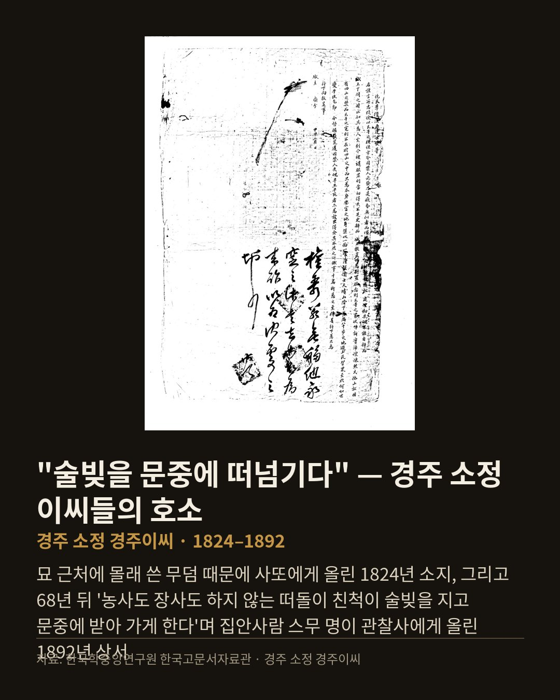
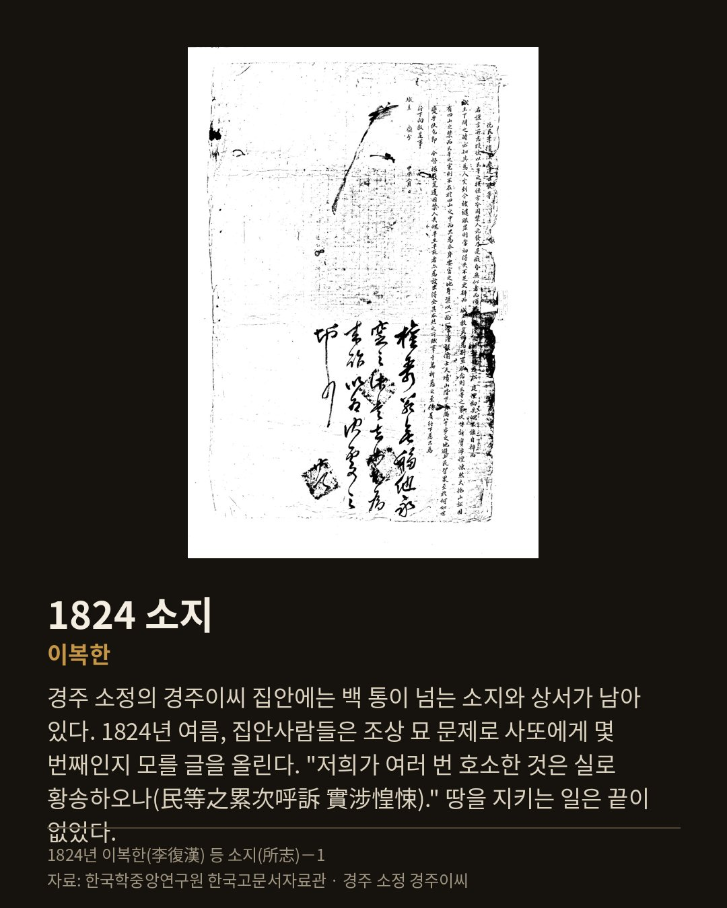
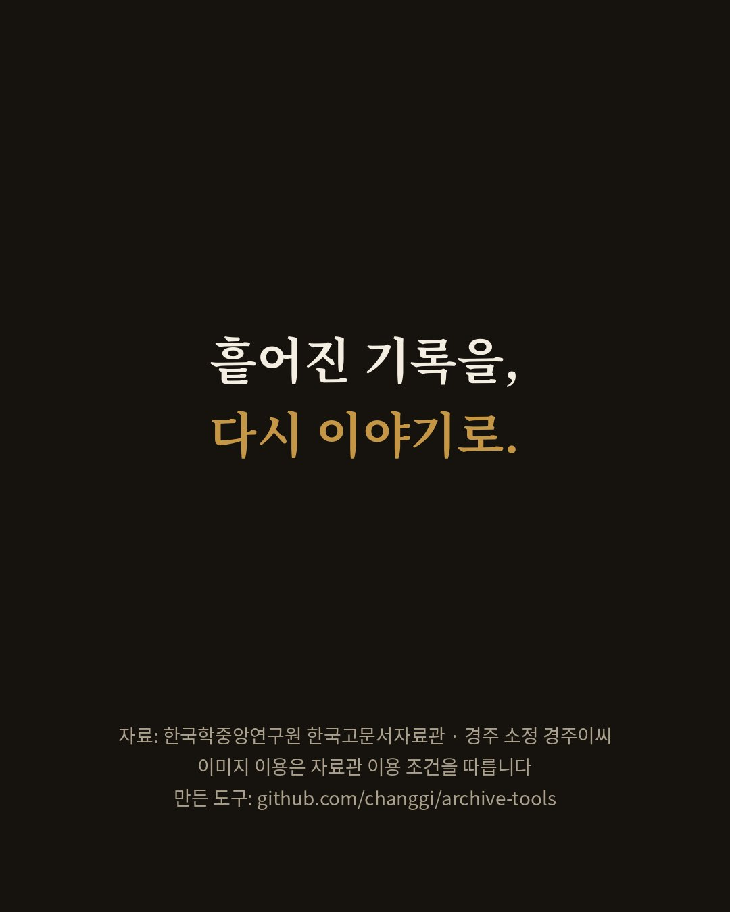

# EP.64 "술빚을 문중에 떠넘기다" — 경주 소정 이씨들의 호소

경주 소정 경주이씨 (문중) · 묘 근처에 몰래 쓴 무덤 때문에 사또에게 올린 1824년 소지, 그리고 68년 뒤 '농사도 장사도 하지 않는 떠돌이 친척이 술빚을 지고 문중에 받아 가게 한다'며 집안사람 스무 명이 관찰사에게 올린 1892년 상서

- 🌐 [전시 웹페이지](https://changgi.github.io/archive-tools/examples/sojeong-lee/exhibit.html) (한자 위 한글 독음 · 원문 해석) · [수업 활동지](https://changgi.github.io/archive-tools/examples/sojeong-lee/handout.html)
- 🎬 영상: [릴스 9:16](https://changgi.github.io/archive-tools-next/media/ep64-sojeong-lee_reel.mp4) · [가로 16:9](https://changgi.github.io/archive-tools-next/media/ep64-sojeong-lee_wide.mp4) · 홍보 글: [`promo.md`](promo.md)
- 카드뉴스: [`cards/`](cards/) · SNS 글: [`sns.txt`](sns.txt) · 판독·해석 표: [`selection.csv`](selection.csv)


<!-- DELIVERY -->
## 전달 에디팅 — 이 기록을 이렇게 전합니다

- **핵심 정서** — 체면과 현실
- **한 문장** — 양반 문중에도 체면과 현실 사이의 갈등이 있었다는 것.
- **열기** — 한 문중이 관찰사에게 친척을 고발했습니다. '말하자니 추하고, 말하지 않자니…'
- **펼치기** — 이복한 등 소지－1 → 이수영 등 상서－1 (1824–1892년) — 투장 소지로 무겁게 시작해, 68년 뒤 집안 내부의 부끄러운 일을 고백하는 상서로 이어 갔습니다.
- **절정** — "말하자니 추하고, 말하지 않자니 어쩔 수 없어(欲言而言之醜 欲不言而事不獲已)" — 화면·공간에서 이 한 줄만 크게, 소리를 줄여 집중
- **여운** — 스무 명이 이름을 적기까지, 문중은 몇 번이나 그 친척을 타일렀을까요? — 질문으로 끝내고 답은 보는 사람에게
- **감각과 물질** — "말하자니 추하고…" 한 줄을 가림막 뒤에 · 연명한 이름을 벽에 길게 나열하고 관아 마당처럼 서서 읽는 동선
- **통로와 매개** — 온라인: 릴스(열기) → 카드뉴스(펼치기) → 전시 웹페이지(절정·원문) → 비하인드 카드(여운) / 오프라인: 원본 크기 복제·낭독·참여 벽 / 남기기: 활동지·질문 카드
- **여운 장치** — "말하기 어려운 집안 이야기" 익명 쪽지
- **전달 에디팅 전** — 2건의 문서를 1824–1892년 연대순으로 놓고 문서명 · 유형 · 해설을 붙인다 — 정확하지만, 지나가면 잊힌다.
- **전달 에디팅 후** — 핵심 정서는 「체면과 현실」. 「한 문중이 관찰사에게 친척을 고발했습니다. '말하자니 추하고, 말하지 않자니…'」로 열고, 문서를 대비와 순서로 펼친 뒤, "말하자니 추하고, 말하지 않자니 어쩔 수 없어(欲言而言之醜 欲不言而事不獲已)"에서 멈춘다. "말하자니 추하고…" 한 줄을 가림막 뒤에. 마지막엔 「"말하기 어려운 집안 이야기" 익명 쪽지」로 보는 사람이 자기 이야기를 남기고 떠나게 한다.

전문: [`delivery.md`](delivery.md)
<!-- /DELIVERY -->

<!-- CURATOR -->
## 비하인드 — 큐레이터 노트

- **왜 이 문서들인가** — '말하자니 추하고, 말하지 않자니…'로 시작하는, 술빚을 문중에 떠넘긴 친척을 고발한 상서가 인간적이었습니다.
- **전하고 싶은 것** — 양반 문중에도 체면과 현실 사이의 갈등이 있었다는 것.
- **이렇게 보이길 바랐다** — 투장 소지로 무겁게 시작해, 68년 뒤 집안 내부의 부끄러운 일을 고백하는 상서로 이어 갔습니다.
- **이렇게 써 주세요** — 향촌 사회와 문중 조직, 갈등 해결 방식을 다루는 수업에 쓰세요.
- **남겨 둔 질문** — 스무 명이 이름을 적기까지, 문중은 몇 번이나 그 친척을 타일렀을까요?
- **제작 기록** — 문서 2건 · 1824–1892년 · 원본 사진 3면(문서 전체) · 원문 판독 2건 · 번역 2건 · 못 읽은 글자 □ 0 · 불확실 (?) 2

전문: [`curator.md`](curator.md)
<!-- /CURATOR -->

## 이야기 — 사료가 말하는 대로

한 문중이 관찰사에게 친척을 고발했습니다. '말하자니 추하고, 말하지 않자니…'

> **1824 소지** — 경주 소정의 경주이씨 집안에는 백 통이 넘는 소지와 상서가 남아 있다. 1824년 여름, 집안사람들은 조상 묘 문제로 사또에게 몇 번째인지 모를 글을 올린다. "저희가 여러 번 호소한 것은 실로 황송하오나(民等之累次呼訴 實涉惶悚)." 땅을 지키는 일은 끝이 없었다.
> **1892 상서** — 68년 뒤, 이번에는 집안 안에서 일이 터졌다. 1892년 겨울, 문중 사람 스무 명이 관찰사에게 한 친척을 고발한다. "말하자니 추하고, 말하지 않자니 어쩔 수 없어(欲言而言之醜 欲不言而事不獲已)." 이방동이라는 자가 "농사도 장사도 하지 않고(不農不商)" 빚을 지고 달아났는데, 그 빚을 문중이 대신 갚게 된 것이다.

| 표지 | 1번 카드 | 마무리 |
|---|---|---|
|  |  |  |

## 선별 문서 (2점)

| # | 연도 | 유형 | 문서명 | 원본 |
|---|---|---|---|---|
| 1 | 1824 | 소지 | 1824년 이복한(李復漢) 등 소지(所志)－1 | [원본 보기](https://archive.aks.ac.kr/viewer/viewer.do#imgnode.do?itemId=book&gubun=booktree&depth=6&upPath=01%5E0167%5EL016722%5EL016722F02%5EL016722F0202&dataId=G002%2BAKS%2BKSM-XB.1824.4713-20101008.B041a_062_00091_XXX&itemType=) |
| 2 | 1892 | 상서 | 1892년 이수영(李壽榮) 등 상서(上書)－1 | [원본 보기](https://archive.aks.ac.kr/viewer/viewer.do#imgnode.do?itemId=book&gubun=booktree&depth=6&upPath=01%5E0167%5EL016722%5EL016722F02%5EL016722F0202&dataId=G002%2BAKS%2BKSM-XB.1892.4713-20101008.B041a_062_00131_XXX&itemType=) |

## 원문 판독과 해석

### 1. 1824년 이복한(李復漢) 등 소지(所志)－1

**원문 판독**

```
化民李復漢 李達世 李致(?)等
右謹言所志段 伏以民等之從任(?) 方今因禁人元發乃是 … (훼손)
城主下問之時 必知其爲人矣 到今被譴 服罪 明當初得失 不足更辨 而 城主教是 始爲 … 則民等之累次呼訴 實涉惶悚 然大抵山訟 固
有四山之禁 而民等之冤 則不在於四山之中 而只爲本身要害之地 身渠以一面一隅 士大夫墳山階下 … 八千步之地 避土民習 果至於何如 世
變乎 伏乞 卽令督掘 是遣 因禁人失 … 半生半死者 亦爲放出 得全其本然之所 賦事 千萬祈懇之至 積善行下爲只爲
行下向敎是事
城主 處分
甲申六月 日
(왼쪽 큰 흘림 — 관의 처분, 판독 필요) (관인)
```

**원문 해석** 교화를 받는 백성 이복한·이달세·이치 등. 삼가 아뢰는 소지. 저희의 … 이제 갇힌 사람이 처음 일을 일으킨 것은 … 사또께서 물어보실 때 그 사람됨을 반드시 아셨을 것이고, 지금 꾸지람을 받아 죄를 인정했으니 당초의 잘잘못은 다시 따질 것이 없습니다. … 저희가 여러 번 호소한 것은 실로 황송하오나, 대저 산송에는 본래 사방 산을 금하는 규정이 있는데, 저희의 억울함은 사방 산 안이 아니라 오직 [조상] 묘의 요해처에 있습니다. … 사대부 묘가 있는 산의 계단 아래 … 엎드려 바라건대 곧 [몰래 쓴 무덤을] 파내도록 독촉하시고, 갇혀 반은 살고 반은 죽은 사람도 풀어 주시어, 본래의 자리를 온전히 얻게 해 주시기를 천만 간절히 빕니다. 사또께서 처분하실 일. 갑신년(1824) 6월 일. (마이크로필름 복사본 — 판독 불확실 다수)

**해제** 1824년(순조 24, 甲申) 6월, 경주 소정의 이복한(李復漢) 등이 경주 부윤에게 올린 산송 소지입니다. 집안 묘의 요해처에 남이 몰래 쓴 무덤을 파내 달라는 청원으로, 이 일로 이복한 등은 1824~1826년 사이 소지와 상서를 열 차례 넘게 올렸습니다. 마이크로필름 복사본이라 잉크가 번지고 훼손된 곳이 많아 판독이 불확실합니다.

### 2. 1892년 이수영(李壽榮) 등 상서(上書)－1

**원문 판독**

```
慶州幼學李壽榮 李增榮 李禧榮等謹齋沐上書于
巡相國閤下 伏以挽近俗習日渝 人心叵測 浮浪子弟之敗家斂族 營門牢令之作弊列邑 不一而足 實所不幸今者 近出吾族 欲
言而言之醜 欲不言而事不獲已 故冒陳顚末 伏乞 垂仁採納焉 所謂李芳洞 賦性浮浪 不農不商 産業蕩敗 靡
室靡家 不孝於父母 不睦於族戚 平生行事 以欺騙爲能事 以官人爲長技 所以年前盜賣無地之畓於本邑蒐官 偸取
下納之錢於孤村酒店 事竟發覺 杖囚獄中者 殆過一年 末乃擅徵於其族近之族戚 … 芳洞之累 … 流離他道 而所謂芳洞 越獄逃躱 不知去處者 今至五六朔矣 …
(가운데 — 술빚·장사 빚을 문중에 징수한 사연, 판독 필요)
巡相國閤下 處分
壬辰十一月 日
李圭憲 李鍾灦 李圭聖 李鍾夏 李圭洪 李鍾河 … (연명 20여 명)
(오른쪽 위 처분: 芳洞 推捉 … 二十八日 巳時 / 왼쪽 처분: 捉入 … 판독 필요)
```

**원문 해석** 경주 유학 이수영·이증영·이희영 등이 삼가 목욕재계하고 관찰사 합하께 글을 올립니다. 엎드려 아뢰건대, 근래 풍속이 날로 나빠지고 사람의 마음을 헤아릴 수 없어, 떠돌이 자제가 집안을 망치고 친족에게서 [빚을] 거두며, 감영의 하례가 여러 고을에서 폐단을 일으키는 일이 한둘이 아닙니다. 실로 불행하게도 지금 저희 집안에서 그런 자가 나왔으니, 말하자니 추하고 말하지 않자니 어쩔 수 없어 감히 앞뒤 사정을 아룁니다. 엎드려 바라건대 어진 마음으로 받아들여 주십시오. 이른바 이방동이란 자는 타고난 성품이 들떠 농사도 장사도 하지 않고 재산을 탕진해 집도 방도 없으며, 부모에게 불효하고 친척과 화목하지 않고, 평생 하는 일이 속임수를 능사로 삼고 관청 사람 노릇을 장기로 삼았습니다. 그래서 몇 해 전 [고을] 관아에 있지도 않은 논을 몰래 팔고, 외딴 마을 주막에서 바쳐야 할 돈을 빼돌렸다가 일이 발각되어 곤장을 맞고 옥에 갇힌 지 한 해가 넘었는데, 끝내는 가까운 친척들에게 멋대로 [빚을] 거두었습니다 … 방동은 옥을 넘어 달아나 간 곳을 모른 지 대여섯 달이 되었습니다. … (가운데 판독 필요) … 관찰사 합하께서 처분하실 일. 임진년(1892) 11월 일. 이규헌·이종현 … 등.

**해제** 1892년(고종 29, 壬辰) 11월, 경주 소정의 이수영(李壽榮) 등 경주이씨 20여 명이 경상도 관찰사에게 올린 연명 상서입니다. 같은 집안의 이방동(李芳洞)이 농사도 장사도 하지 않고, 논을 몰래 팔고 돈을 빼돌려 옥에 갇혔다가 달아났는데, 그가 진 술빚·밥값 등을 친족에게 대신 거두게 하는(族徵) 일이 생기자 이를 막아 달라는 청원입니다. 같은 사건으로 상서가 7건 남아 있습니다. 마이크로필름 복사본이라 가운데 부분은 판독이 필요합니다.

판독·해석·이야기는 이미지에 근거한 초안이며(검토 전 "초안" 표시), 정확한 판독은 원문 확인이 필요합니다. □는 읽지 못한 글자, (?)는 불확실한 글자입니다.
이미지: 한국학중앙연구원 한국고문서자료관 소장·제공. "원본" 링크를 누르면 자료관 뷰어에서 그 문서가 열립니다. 재사용은 자료관에 문의하세요(소장처 동의 필요).
