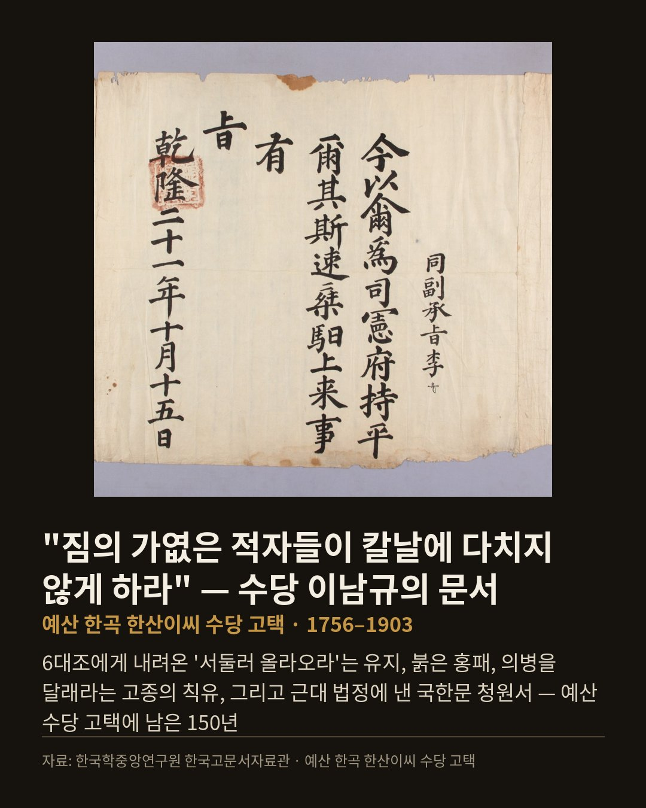
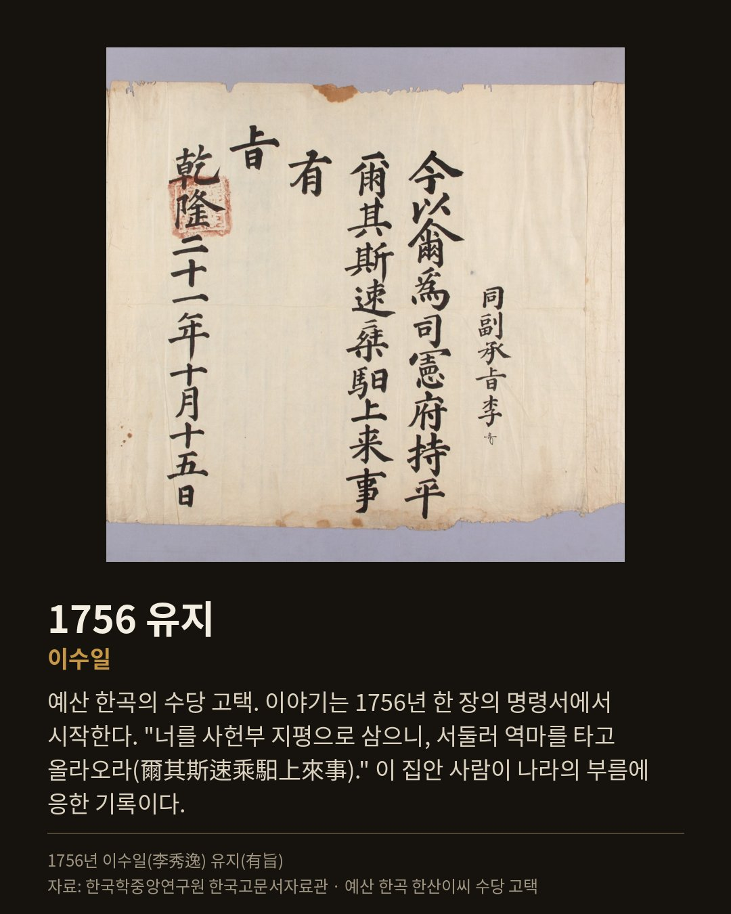
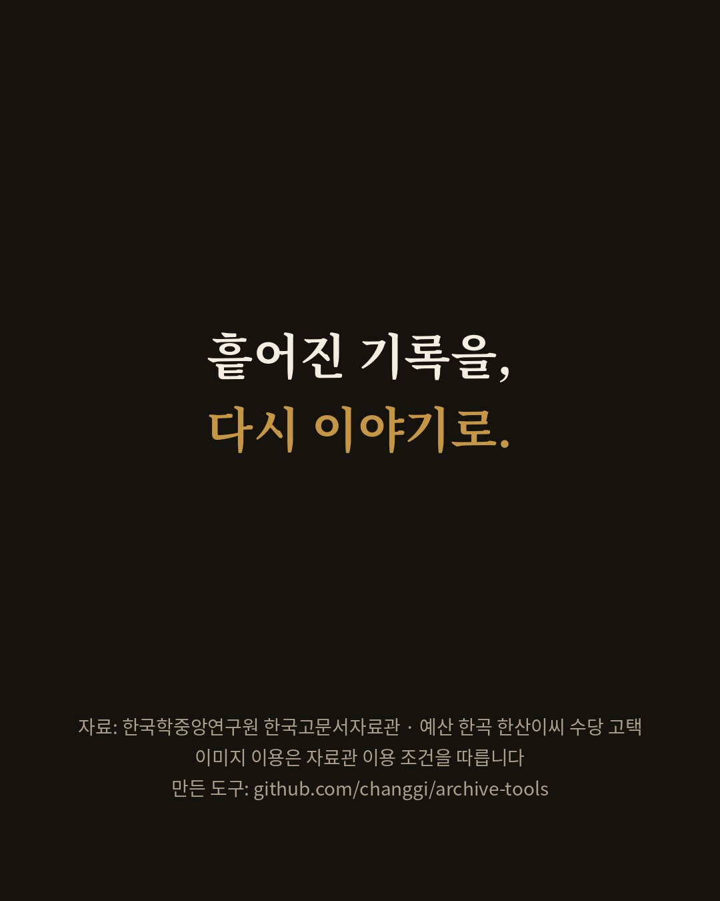

# EP.33 "짐의 가엾은 적자들이 칼날에 다치지 않게 하라" — 수당 이남규의 문서

예산 한곡 한산이씨 수당 고택 (문중) · 6대조에게 내려온 '서둘러 올라오라'는 유지, 붉은 홍패, 의병을 달래라는 고종의 칙유, 그리고 근대 법정에 낸 국한문 청원서 — 예산 수당 고택에 남은 150년

- 🌐 [전시 웹페이지](https://changgi.github.io/archive-tools/examples/sudang/exhibit.html) (한자 위 한글 독음 · 원문 해석) · [수업 활동지](https://changgi.github.io/archive-tools/examples/sudang/handout.html)
- 🎬 영상: [릴스 9:16](https://changgi.github.io/archive-tools-next/media/ep33-sudang_reel.mp4) · [가로 16:9](https://changgi.github.io/archive-tools-next/media/ep33-sudang_wide.mp4) · 홍보 글: [`promo.md`](promo.md)
- 카드뉴스: [`cards/`](cards/) · SNS 글: [`sns.txt`](sns.txt) · 판독·해석 표: [`selection.csv`](selection.csv)


<!-- DELIVERY -->
## 전달 에디팅 — 이 기록을 이렇게 전합니다

- **핵심 정서** — 연민
- **한 문장** — 국가 폭력과 백성 사이에서 고민한 임금과 관리의 목소리가 있었다는 것.
- **열기** — 임금은 의병을 "가엾은 자식"이라 불렀습니다. 그리고 한 관찰사에게 부탁했습니다.
- **펼치기** — 이수일 유지 → 이남규 문과 홍패 → 이남규 칙유 → 이남규 청원서－1 (1756–1903년) — 선대의 유지 → 이남규의 홍패 → 칙유 → 청원서로, 대한제국의 위기를 따라갔습니다.
- **절정** — "남명직의 날조가 드러난 여러 조목 가운데 가장 긴요한 두 조목을 적습니다(南命稷의 誣揑이 綻露한 諸條中 最係緊切한 二條)" — 화면·공간에서 이 한 줄만 크게, 소리를 줄여 집중
- **여운** — 이남규는 그 칙유를 어떻게 실천했을까요? — 질문으로 끝내고 답은 보는 사람에게
- **감각과 물질** — "가엾은 자식" 칙유 낭독, 의병의 짚신 소품 · 역마 방울·말발굽 소리와 함께 펼치는 두루마리 · 붉은 종이를 실물 크기로 복제해 벽에 거는 연출 · 연명한 이름을 벽에 길게 나열하고 관아 마당처럼 서서 읽는 동선
- **통로와 매개** — 온라인: 릴스(열기) → 카드뉴스(펼치기) → 전시 웹페이지(절정·원문) → 비하인드 카드(여운) / 오프라인: 원본 크기 복제·낭독·참여 벽 / 남기기: 활동지·질문 카드
- **여운 장치** — "국가와 시민 사이" 토론 질문
- **전달 에디팅 전** — 4건의 문서를 1756–1903년 연대순으로 놓고 문서명 · 유형 · 해설을 붙인다 — 정확하지만, 지나가면 잊힌다.
- **전달 에디팅 후** — 핵심 정서는 「연민」. 「임금은 의병을 "가엾은 자식"이라 불렀습니다. 그리고 한 관찰사에게 부탁했습니다.」로 열고, 문서를 대비와 순서로 펼친 뒤, "남명직의 날조가 드러난 여러 조목 가운데 가장 긴요한 두 조목을 적습니다(南命稷의 誣揑이 綻露한 諸條中 最係緊切한 二條)"에서 멈춘다. "가엾은 자식" 칙유 낭독, 의병의 짚신 소품. 마지막엔 「"국가와 시민 사이" 토론 질문」로 보는 사람이 자기 이야기를 남기고 떠나게 한다.

전문: [`delivery.md`](delivery.md)
<!-- /DELIVERY -->

<!-- CURATOR -->
## 비하인드 — 큐레이터 노트

- **왜 이 문서들인가** — 고종이 의병을 '가엾은 자식'이라 부르며 관찰사에게 '칼날에 다치지 않게 하라'고 당부한 칙유가 있었습니다.
- **전하고 싶은 것** — 국가 폭력과 백성 사이에서 고민한 임금과 관리의 목소리가 있었다는 것.
- **이렇게 보이길 바랐다** — 선대의 유지 → 이남규의 홍패 → 칙유 → 청원서로, 대한제국의 위기를 따라갔습니다.
- **이렇게 써 주세요** — 을미의병과 대한제국, 국가와 시민의 관계를 다루는 수업에 쓰세요.
- **남겨 둔 질문** — 이남규는 그 칙유를 어떻게 실천했을까요?
- **제작 기록** — 문서 4건 · 1756–1903년 · 원본 사진 6면(문서 전체) · 원문 판독 4건 · 번역 4건 · 못 읽은 글자 □ 0 · 불확실 (?) 1 · 해제에 "확인 필요"를 단 문서 1건

전문: [`curator.md`](curator.md)
<!-- /CURATOR -->

## 이야기 — 사료가 말하는 대로

임금은 의병을 '가엾은 자식'이라 불렀습니다. 그리고 한 관찰사에게 부탁했습니다.

> **1756 유지** — 예산 한곡의 수당 고택. 이야기는 1756년 한 장의 명령서에서 시작한다. "너를 사헌부 지평으로 삼으니, 서둘러 역마를 타고 올라오라(爾其斯速乘馹上來事)." 이 집안 사람이 나라의 부름에 응한 기록이다.
> **1882 홍패** — 126년 뒤, 같은 집안의 이남규가 과거에 급제한다. 붉은 종이에 큰 글씨로. "유학 이남규를 문과 병과 제2인으로 급제한 사람으로 삼는다(幼學李南珪文科丙科第二人)."
> **1896 칙유** — 1896년 봄, 이남규는 안동관찰사로 임금의 칙유를 받는다. 을미의병을 달래라는 명이다. "왕의 군대보다 먼저 가서 성심으로 타일러, 짐의 가엾은 적자들이 칼날에 다치지 않게 하라(俾朕可愛可哀之赤子 毋罹鋒刃溝壑之患)." 임금은 의병을 '사랑스럽고 가엾은 자식'이라 불렀다.
> **1903 청원서** — 1903년, 이남규는 이제 근대 법정에 선다. 붉은 괘선이 인쇄된 소송 용지에, 한자와 한글을 섞어 쓴다. "남명직의 날조가 드러난 여러 조목 가운데 가장 긴요한 두 조목을 적습니다(南命稷의 誣揑이 綻露한 諸條中 最係緊切한 二條)." 유지에서 칙유를 거쳐 청원서까지, 한 집안의 문서가 조선에서 대한제국으로 건너가는 길이다.

| 표지 | 1번 카드 | 마무리 |
|---|---|---|
|  |  |  |

## 선별 문서 (4점)

| # | 연도 | 유형 | 문서명 | 원본 |
|---|---|---|---|---|
| 1 | 1756 | 유지 | 1756년 이수일(李秀逸) 유지(有旨) | [원본 보기](https://archive.aks.ac.kr/viewer/viewer.do#imgnode.do?itemId=book&gubun=booktree&depth=6&upPath=01%5E0144%5EL014427%5EL014427F02%5EL014427F0201&dataId=G002%2BAKS%2BKSM-XA.1756.1111-20101008.B040a_061_00002_XXX&itemType=) |
| 2 | 1882 | 홍패 | 1882년 이남규(李南珪) 문과 홍패(文科紅牌) | [원본 보기](https://archive.aks.ac.kr/viewer/viewer.do#imgnode.do?itemId=book&gubun=booktree&depth=6&upPath=01%5E0144%5EL014427%5EL014427F02%5EL014427F0201&dataId=G002%2BAKS%2BKSM-XA.1882.1111-20101008.B040a_061_00016_XXX&itemType=) |
| 3 | 1896 | 칙유 | 1896년 이남규(李南珪) 칙유(勅諭) | [원본 보기](https://archive.aks.ac.kr/viewer/viewer.do#imgnode.do?itemId=book&gubun=booktree&depth=6&upPath=01%5E0144%5EL014427%5EL014427F02%5EL014427F0201&dataId=G002%2BAKS%2BKSM-XA.1896.1111-20101008.B040a_061_00001_XXX&itemType=) |
| 4 | 1903 | 청원서 | 1903년 이남규(李南珪) 청원서(請願書)－1 | [원본 보기](https://archive.aks.ac.kr/viewer/viewer.do#imgnode.do?itemId=book&gubun=booktree&depth=6&upPath=01%5E0144%5EL014427%5EL014427F02%5EL014427F0202&dataId=G002%2BAKS%2BKSM-XB.1903.0000-20101008.B040a_061_00293_001&itemType=) |

## 원문 판독과 해석

### 1. 1756년 이수일(李秀逸) 유지(有旨)

**원문 판독**

```
同副承旨李(押)
今以爾爲司憲府持平
爾其斯速乘馹上來事
有
旨
乾隆二十一年十月十五日 (도장)
```

**원문 해석** 동부승지 이(李)가 씀. 이제 너를 사헌부 지평으로 삼으니, 너는 서둘러 역마를 타고 올라오라는 유지. 건륭 21년(1756) 10월 15일.

**해제** 1756년(영조 32) 이남규의 선대 이수일(李秀逸)을 사헌부 지평(정5품)에 임명하고 서둘러 올라오라고 부른 유지(有旨)입니다. '爾其斯速乘馹上來(너는 서둘러 역마를 타고 올라오라)'는 지방에 있는 사람을 부를 때 쓰는 정해진 문구로, 200여 년 전 경주 독락당 이언적에게 내린 유지(EP.17)와 같은 구절입니다. 이 집안에는 이수일이 받은 유지가 열두 점 남아 있습니다.

### 2. 1882년 이남규(李南珪) 문과 홍패(文科紅牌)

**원문 판독**

```
敎旨
幼學李南珪文科丙科
第二人及第出身者
光緖八年四月 日 (도장)
```

**원문 해석** 교지. 유학 이남규를 문과 병과 제2인으로 급제하여 출신한 사람으로 삼는다. 광서 8년(1882) 4월 일.

**해제** 1882년(고종 19) 이남규(李南珪, 1855~1907)가 문과에 급제하고 받은 홍패(紅牌)입니다. 붉은 종이에 쓰는 급제 증서로, 이름 앞 '幼學'은 벼슬 없는 선비라는 뜻입니다. 이남규는 이후 영흥부사·안동관찰사 등을 지냈고, 1907년 의병과 관련해 일본군에게 아들과 함께 죽임을 당한 것으로 알려져 있습니다(문서 밖 사실 — 확인 필요).

### 3. 1896년 이남규(李南珪) 칙유(勅諭)

**원문 판독**

```
勅諭
朕惟可愛非朕赤子乎 可哀亦非朕赤子乎 粤逆魁
亂黨連腸結肚 弑國母脅君父 溷亂法令 勒行剃
髮 凡爲朕赤子者 懷憤慨激 忠義處處倡起 豈曰無
名 現亂賊旣已掃蕩 國讎快報 削髮從便 若雲霧
開而天日復明 凡爲朕赤子者 曷不懽忻蹈舞 肆朕屢
降詔勅 敷諭衷曲 乃有用命歸化 各安其業者 是朕可
愛赤子 尙或愚蠢迷惑 聚而不散 往往有戕殺命吏
侵掠閭里者 是逆朕命 貽朕憂 自速罪戾 故朕不得
已命王師前發剿滅 使前日忠義之赤子 以迷愚而被
鋒刃於今日 寧不可哀 嗚呼 不再諭 加威罰 是朕心所
不忍 玆朕命安東府觀察使李南珪 特使布諭 惟卿
體朕如傷若保之意 先期王師前往管下各郡 誠心飭諭
俾朕可愛可哀之赤子 毋罹鋒刃溝壑之患 用慰朕爲
民父母之心
建陽元年三月六日奉 (도장)
```

**원문 해석** 칙유. 짐이 생각건대, 사랑스러운 이들이 짐의 적자(갓난아이 같은 백성)가 아니겠는가, 가엾은 이들 또한 짐의 적자가 아니겠는가. 지난번 역적의 우두머리와 난당이 한통속이 되어 국모를 시해하고 임금을 위협하며 법령을 어지럽히고 억지로 머리를 깎게 하였다. 무릇 짐의 적자 된 자들이 분하고 원통하여 곳곳에서 충의로 일어났으니 어찌 명분이 없다 하겠는가. 이제 난적은 이미 쓸어 없앴고 나라의 원수는 통쾌하게 갚았으며 머리 깎는 일은 편할 대로 하게 하였으니, 구름과 안개가 걷히고 해가 다시 밝아진 것과 같다. 무릇 짐의 적자 된 자들이 어찌 기뻐 춤추지 않겠는가. 이에 짐이 여러 번 조칙을 내려 속마음을 펴 일렀더니, 명을 따라 돌아와 각자 생업에 편히 종사하는 자가 있으니 이들은 짐의 사랑스러운 적자이다. 그런데 아직도 어리석게 미혹되어 모여서 흩어지지 않고, 때때로 나라에서 보낸 관리를 죽이고 마을을 노략하는 자가 있으니, 이는 짐의 명을 거스르고 짐에게 근심을 끼쳐 스스로 죄를 부르는 것이다. 그래서 짐이 부득이 왕의 군대를 먼저 보내 토벌하게 하니, 어제의 충의로운 적자들이 어리석음 때문에 오늘 칼날을 맞게 된다면 어찌 가엾지 않겠는가. 아아, 다시 타이르지 않고 위엄과 벌만 더하는 것은 짐의 마음이 차마 하지 못하는 바이다. 이에 짐이 안동부 관찰사 이남규에게 명하여 특별히 이 뜻을 널리 알리게 하노니, 경은 백성을 다친 사람 보듯, 갓난아이 보살피듯 하는 짐의 뜻을 받들어, 왕의 군대보다 먼저 관할 각 군에 가서 성심으로 타일러, 짐의 사랑스럽고 가엾은 적자들이 칼날에 다치고 구렁에 빠지는 근심을 당하지 않게 하여, 백성의 부모 된 짐의 마음을 위로하라. 건양 원년(1896) 3월 6일 받듦.

**해제** 1896년(건양 원년) 3월 6일, 고종이 안동부 관찰사 이남규에게 내린 칙유(勅諭)입니다. 을미사변(1895, 명성황후 시해)과 단발령에 맞서 일어난 을미의병을 두고, 아관파천 뒤 '난적은 쓸어 없앴고 단발은 편할 대로 하게 했으니' 이제 흩어지라고 타이르도록 명한 글입니다. 의병을 '충의로 일어난 적자'로 인정하면서도, 흩어지지 않으면 관군이 토벌할 수밖에 없으니 그 전에 가서 설득하라는 내용입니다. 반듯한 해서로 전문을 판독했습니다.

### 4. 1903년 이남규(李南珪) 청원서(請願書)－1

**원문 판독**

```
請願書
請願人 宮內府特進官李南珪
代言人金昌鎬
請願人이 南命稷誣訴事件의 對하야 日前裁判하
와 已爲辨晰이오나 供辭가 只載存檔이고 判決이
未有佈明이옵기 南命稷의 誣揑이 綻露한 諸條中
最係緊切한 二條를 左開하와 玆에 請願하오니
照亮하오셔 明白指令하시와 憑考케하시오며 請願
人이 現呈한 南命稷에 前後錄告等紙를 一一出給
하심을 伏望
(붉은 도장: 訴訟紙)
一 南命稷의 所謂外帳記가 印札紙 下半張에 印上
加書한 事
一 南命稷의 所謂見奪當推物이 請願人의게 無干한
다한 事
光武七年三月 日 請願人李南珪 (도장)
平理院裁判長李南熙閣下
(왼쪽 큰 흘림 글씨 — 평리원의 처분(題辭), 판독 필요) 二十七日
(오른쪽 붉은 인쇄: 定價金葉錢壹分五厘(?)式 / 왼쪽 붉은 인쇄: 訴訟人一切費用此紙 …)
```

**원문 해석** 청원서. 청원인 궁내부 특진관 이남규, 대리인 김창호. 청원인이 남명직의 무고 사건에 대하여 일전에 재판을 받아 이미 가려 밝혔으나, 진술만 기록에 남아 있고 판결은 아직 공포되지 않았기에, 남명직의 날조가 드러난 여러 조목 가운데 가장 긴요한 두 조목을 아래에 적어 이에 청원하오니, 살피시어 명백히 지령을 내려 증거로 삼게 하시고, 청원인이 제출한 남명직의 앞뒤 기록·고발 문서들을 하나하나 내어 주시기를 엎드려 바랍니다.
하나, 남명직이 말하는 이른바 '바깥 장부(外帳記)'는 인찰지(괘선 종이) 아래 반 장에 도장을 찍은 위에 글씨를 덧붙여 쓴 일.
하나, 남명직이 말하는 이른바 '빼앗겨서 마땅히 찾아야 할 물건'이 청원인과는 관계없다고 한 일.
광무 7년(1903) 3월 일. 청원인 이남규. 평리원 재판장 이남희 각하.

**해제** 1903년(광무 7) 3월, 궁내부 특진관 이남규가 대리인 김창호를 내세워 최고 법원인 평리원(平理院)에 낸 청원서입니다. 남명직(南命稷)이 자신을 무고한 사건에서 재판은 끝났으나 판결이 공포되지 않자, 상대의 장부가 날조되었다는 두 가지 근거를 들어 판결과 서류 반환을 요청했습니다. 붉은 괘선이 인쇄된 '소송지(訴訟紙)'에 한자와 한글 토씨를 섞은 국한문으로 썼고, 가격(定價)이 인쇄된 공용 양식입니다. 왼쪽 흘림 글씨는 평리원의 처분으로 판독이 필요합니다.

판독·해석·이야기는 이미지에 근거한 초안이며(검토 전 "초안" 표시), 정확한 판독은 원문 확인이 필요합니다. □는 읽지 못한 글자, (?)는 불확실한 글자입니다.
이미지: 한국학중앙연구원 한국고문서자료관 소장·제공. "원본" 링크를 누르면 자료관 뷰어에서 그 문서가 열립니다. 재사용은 자료관에 문의하세요(소장처 동의 필요).
