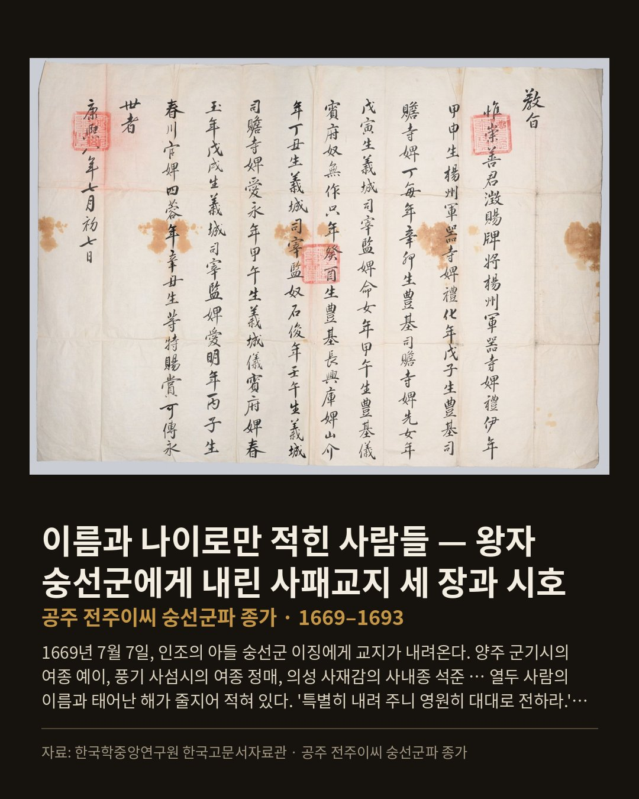
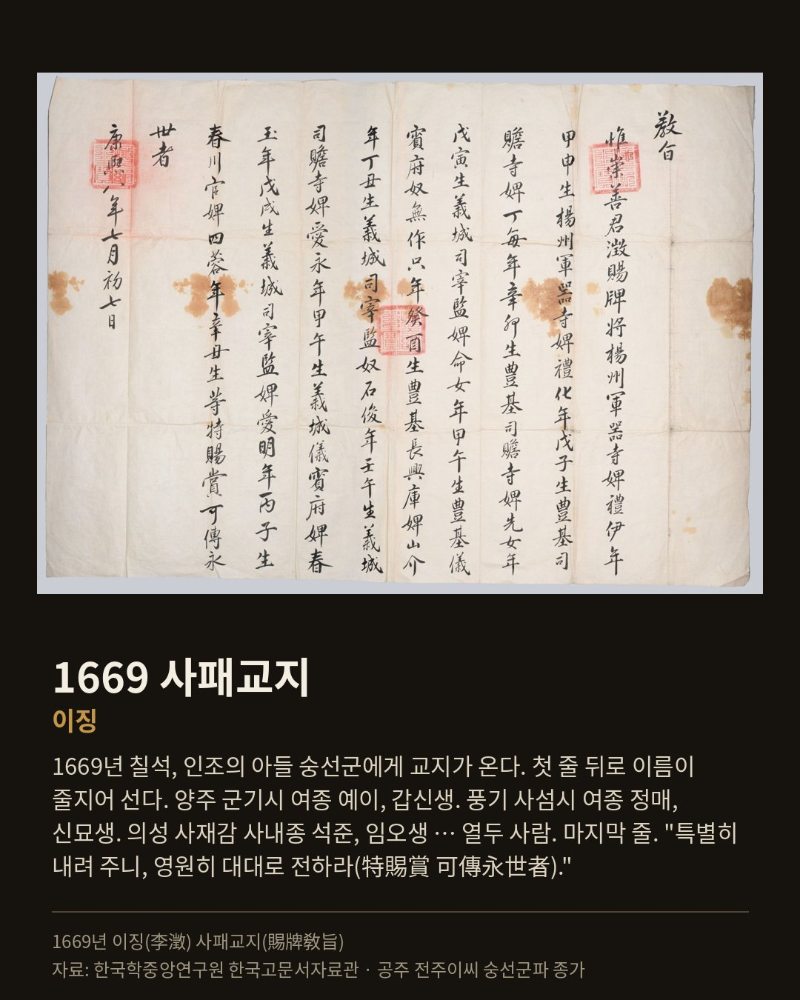
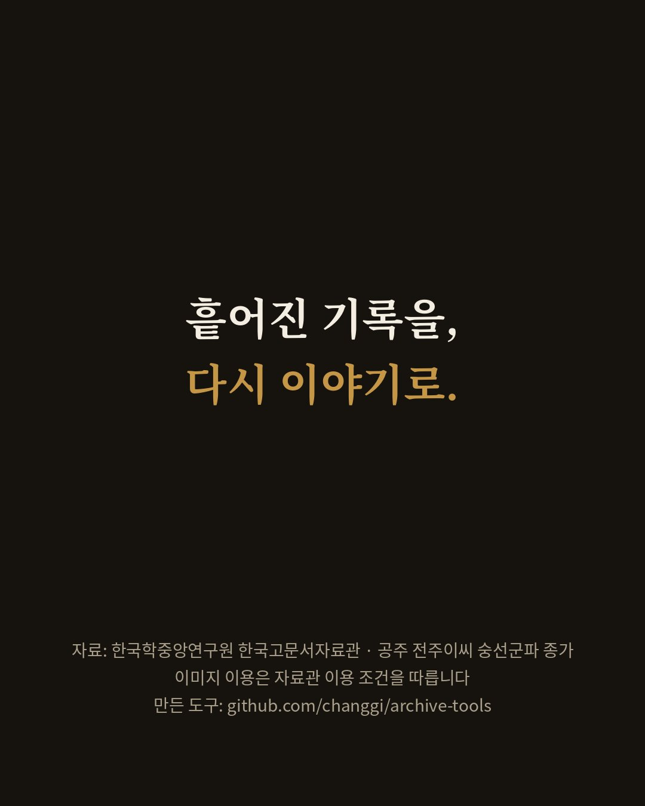

# EP.164 이름과 나이로만 적힌 사람들 — 왕자 숭선군에게 내린 사패교지 세 장과 시호

공주 전주이씨 숭선군파 종가 (문중) · 1669년 7월 7일, 인조의 아들 숭선군 이징에게 교지가 내려온다. 양주 군기시의 여종 예이, 풍기 사섬시의 여종 정매, 의성 사재감의 사내종 석준 … 열두 사람의 이름과 태어난 해가 줄지어 적혀 있다. '특별히 내려 주니 영원히 대대로 전하라.' 2년 뒤 같은 날 열 사람이 더해지고, 다시 5년 뒤 한 사람이 더해진다. 그리고 1693년, 세상을 떠난 숭선군에게 '효경'이라는 시호가 붉은 종이에 내려진다

- 🌐 [전시 웹페이지](https://changgi.github.io/archive-tools/examples/sungseon-sapae/exhibit.html) (한자 위 한글 독음 · 원문 해석) · [수업 활동지](https://changgi.github.io/archive-tools/examples/sungseon-sapae/handout.html)
- 🎬 영상: [릴스 9:16](https://changgi.github.io/archive-tools-next/media/ep164-sungseon-sapae_reel.mp4) · [가로 16:9](https://changgi.github.io/archive-tools-next/media/ep164-sungseon-sapae_wide.mp4) · 홍보 글: [`promo.md`](promo.md)
- 카드뉴스: [`cards/`](cards/) · SNS 글: [`sns.txt`](sns.txt) · 판독·해석 표: [`selection.csv`](selection.csv)

<!-- DELIVERY -->
## 전달 에디팅 — 이 기록을 이렇게 전합니다

- **핵심 정서** — 숙연함
- **한 문장** — 왕실은 왕자에게 땅과 함께 사람을 내렸다 — 지방 관아와 중앙 관청에 속한 노비들이 이름 · 소속 · 태어난 해로만 교지에 적혀, '영원히 대대로' 한 집안에 넘겨졌다.
- **열기** — 교지에 적힌 이름 스물세 개는, 모두 하사된 사람들이었습니다.
- **펼치기** — 이징 사패교지 → 이징 시호교지 (1669–1693년) — 1669(열두 사람) → 1671(열 사람, 같은 7월 7일) → 1676(한 사람) → 1693(숭선군 사후 시호)으로, 받는 사람의 이름은 하나로 같고 '받은 사람들'의 이름이 줄어드는 흐름에 마지막 시호를 놓아, 같은 교지 형식 안의 두 종류의 이름을 견주게 했습니다.
- **절정** — "특별히 내려 주니, 영원히 대대로 전하라(特賜賞 可傳永世者)" — 화면·공간에서 이 한 줄만 크게, 소리를 줄여 집중
- **여운** — '영원히 대대로 전하라'고 적힌 이 사람들의 이름을, 오늘 우리가 다시 읽는다는 것은 어떤 의미일까요? — 질문으로 끝내고 답은 보는 사람에게
- **감각과 물질** — 어보가 찍힌 교지 위, 한 줄에 한 사람씩 — 소속 관청, 이름, 태어난 해 · 어보·관인 탁본 스탬프를 찍어 보는 체험
- **통로와 매개** — 온라인: 릴스(열기) → 카드뉴스(펼치기) → 전시 웹페이지(절정·원문) → 비하인드 카드(여운) / 오프라인: 원본 크기 복제·낭독·참여 벽 / 남기기: 활동지·질문 카드
- **여운 장치** — 기록에 이름만 남은 사람 한 명을 골라 그 삶을 상상해 보기
- **전달 에디팅 전** — 4건의 문서를 1669–1693년 연대순으로 놓고 문서명 · 유형 · 해설을 붙인다 — 정확하지만, 지나가면 잊힌다.
- **전달 에디팅 후** — 핵심 정서는 「숙연함」. 「교지에 적힌 이름 스물세 개는, 모두 하사된 사람들이었습니다.」로 열고, 문서를 대비와 순서로 펼친 뒤, "특별히 내려 주니, 영원히 대대로 전하라(特賜賞 可傳永世者)"에서 멈춘다. 어보가 찍힌 교지 위, 한 줄에 한 사람씩 — 소속 관청, 이름, 태어난 해. 마지막엔 「기록에 이름만 남은 사람 한 명을 골라 그 삶을 상상해 보기」로 보는 사람이 자기 이야기를 남기고 떠나게 한다.

전문: [`delivery.md`](delivery.md)
<!-- /DELIVERY -->

<!-- CURATOR -->
## 비하인드 — 큐레이터 노트

- **왜 이 문서들인가** — EP.119에서 숭선군의 아들 동평군 이항이 사약을 받던 날 이불에 쓴 유서를 읽었습니다. 같은 집안에 그 아버지가 받은 교지가 남아 있어, 왕실의 '하사'가 무엇이었는지를 보기로 했습니다.
- **전하고 싶은 것** — 왕실은 왕자에게 땅과 함께 사람을 내렸다 — 지방 관아와 중앙 관청에 속한 노비들이 이름 · 소속 · 태어난 해로만 교지에 적혀, '영원히 대대로' 한 집안에 넘겨졌다.
- **이렇게 보이길 바랐다** — 1669(열두 사람) → 1671(열 사람, 같은 7월 7일) → 1676(한 사람) → 1693(숭선군 사후 시호)으로, 받는 사람의 이름은 하나로 같고 '받은 사람들'의 이름이 줄어드는 흐름에 마지막 시호를 놓아, 같은 교지 형식 안의 두 종류의 이름을 견주게 했습니다.
- **이렇게 써 주세요** — 조선의 공노비 제도와 왕실 사여(사패), 관청 노비의 소속(군기시 · 사섬시 · 사재감 · 의빈부 등), 왕자 · 군(君)의 경제 기반, 시호 제도, 기록 속 노비의 이름 수업에 쓰세요. 노비를 '물건'처럼 적은 문서이므로 그 사람들의 존재를 함께 생각하도록 안내해 주세요.
- **만들며 있었던 일** — 네 장 모두 해서로 또렷하여 대부분 읽었으나, 노비 이름 몇 글자(䅁 · 婢女 成 등)는 확정하지 못해 원문 모양대로 두었습니다. 받은 노비들이 실제로 숭선군 집에서 어떻게 살았는지는 이 문서로 알 수 없습니다. 숭선군의 생몰(1639–1690)과 인조 · 귀인 조씨의 아들이라는 점은 알려진 사실을 따랐습니다.
- **남겨 둔 질문** — '영원히 대대로 전하라'고 적힌 이 사람들의 이름을, 오늘 우리가 다시 읽는다는 것은 어떤 의미일까요?
- **제작 기록** — 문서 4건 · 1669–1693년 · 원본 사진 4면(문서 전체) · 원문 판독 4건 · 번역 4건

전문: [`curator.md`](curator.md) · 비하인드 카드: [`behind/`](behind/) · 채널별 홍보안: [`channels.md`](channels.md)
<!-- /CURATOR -->

## 이야기 — 사료가 말하는 대로

교지에 적힌 이름 스물세 개는, 모두 하사된 사람들이었습니다.

> **1669 사패교지** — 1669년 칠석, 인조의 아들 숭선군에게 교지가 온다. 첫 줄 뒤로 이름이 줄지어 선다. 양주 군기시 여종 예이, 갑신생. 풍기 사섬시 여종 정매, 신묘생. 의성 사재감 사내종 석준, 임오생 … 열두 사람. 마지막 줄. "특별히 내려 주니, 영원히 대대로 전하라(特賜賞 可傳永世者)."
> **1671 사패교지** — 2년 뒤, 같은 칠월 칠석. 또 한 장. 의성 사재감 사내종 적복, 갑오생. 여종 적환, 임진생. 이름이 닮은 두 사람이 나란히 적혔다. 가족이었을까. 교지는 관계를 적지 않는다. 이번에는 열 사람.
> **1676 사패교지** — 다시 5년 뒤. 넓은 종이에 이름은 하나다. "온양 관아 여종 진업, 을해생, 한 몸(溫陽官婢進業年乙亥生身)." 마흔두 살의 여인이, 한 줄로 다른 집에 넘겨진다.
> **1693 시호교지** — 그리고 1693년 정월. 숭선군은 이미 세상에 없다. 붉은 바탕에 금박이 흩뿌려진 종이가 온다. "숭선군에게 효경공이라는 시호를 내린다(崇善君澂 贈諡孝敬公者)." 같은 교지, 다른 이름. 한쪽은 아름다운 시호로, 한쪽은 태어난 해로 남았다.

| 표지 | 1번 카드 | 마무리 |
|---|---|---|
|  |  |  |

## 선별 문서 (4점)

| # | 연도 | 유형 | 문서명 | 원본 |
|---|---|---|---|---|
| 1 | 1669 | 사패교지 | 1669년 이징(李澂) 사패교지(賜牌敎旨) | [원본 보기](https://archive.aks.ac.kr/viewer/viewer.do#imgnode.do?itemId=book&gubun=booktree&depth=6&upPath=01%5E0144%5EL014421%5EL014421F02%5EL014421F0201&dataId=G002%2BKHD%2BKSM-XA.1669.0000-20190219.C1004_002_00004_XXX&itemType=) |
| 2 | 1671 | 사패교지 | 1671년 이징(李澂) 사패교지(賜牌敎旨) | [원본 보기](https://archive.aks.ac.kr/viewer/viewer.do#imgnode.do?itemId=book&gubun=booktree&depth=6&upPath=01%5E0144%5EL014421%5EL014421F02%5EL014421F0201&dataId=G002%2BKHD%2BKSM-XA.1671.0000-20190219.C1004_002_00005_XXX&itemType=) |
| 3 | 1676 | 사패교지 | 1676년 이징(李澂) 사패교지(賜牌敎旨) | [원본 보기](https://archive.aks.ac.kr/viewer/viewer.do#imgnode.do?itemId=book&gubun=booktree&depth=6&upPath=01%5E0144%5EL014421%5EL014421F02%5EL014421F0201&dataId=G002%2BKHD%2BKSM-XA.1676.0000-20190219.C1004_002_00006_XXX&itemType=) |
| 4 | 1693 | 시호교지 | 1693년 이징(李澂) 시호교지(諡號敎旨) | [원본 보기](https://archive.aks.ac.kr/viewer/viewer.do#imgnode.do?itemId=book&gubun=booktree&depth=6&upPath=01%5E0144%5EL014421%5EL014421F02%5EL014421F0201&dataId=G002%2BKHD%2BKSM-XA.1693.0000-20190219.C1004_002_00012_XXX&itemType=) |

## 원문 판독과 해석

### 1. 1669년 이징(李澂) 사패교지(賜牌敎旨)

**원문 판독**

```
敎旨
惟 崇善君澂 賜婢將楊州軍器寺婢禮伊年
甲申生 楊州軍器寺婢禮化年戊子生 豐基司
贍寺婢丁每年辛卯生 豐基司贍寺婢先女年
戊寅生 義城司宰監婢命女年甲午生 豐基儀
賓府奴無作只年癸酉生 豐基長興庫婢山介
年丁丑生 義城司宰監奴石俊年壬午生 義城
司贍寺婢愛永年甲午生 義城儀賓府婢春
玉年戊戌生 義城司宰監婢愛明年丙子生
春川官婢四䅁年辛丑生 等 特賜賞 可傳永
世者
康熙八年七月初七日
```

**원문 해석** 교지. 숭선군 징에게, 양주 군기시 여종 예이(갑신생), 양주 군기시 여종 예화(무자생), 풍기 사섬시 여종 정매(신묘생), 풍기 사섬시 여종 선녀(무인생), 의성 사재감 여종 명녀(갑오생), 풍기 의빈부 사내종 무작지(계유생), 풍기 장흥고 여종 산개(정축생), 의성 사재감 사내종 석준(임오생), 의성 사섬시 여종 애영(갑오생), 의성 의빈부 여종 춘옥(무술생), 의성 사재감 여종 애명(병자생), 춘천 관아 여종 사○(신축생) 등을 특별히 내려 주니, 영원히 대대로 전하라. 강희 8년(1669) 7월 7일.

**해제** 1669년(현종 10) 7월 7일, 인조와 귀인 조씨의 아들 숭선군 이징(崇善君 李澂, 1639–1690)에게 노비 열두 사람을 내린 사패교지(賜牌敎旨)입니다. 사패는 왕이 공신 · 왕족 등에게 토지나 노비를 내려 주는 문서로, 끝을 '特賜賞 可傳永世者(특별히 내려 주니 영원히 대대로 전하라)'로 맺습니다. 노비들은 군기시 · 사섬시 · 사재감 · 의빈부 · 장흥고 같은 중앙 관청이나 춘천 관아에 속한 공노비로, 양주 · 풍기 · 의성 등 지방에 살면서 몸값(신공)을 바치던 사람들이었습니다. 교지는 그들을 '소속 + 이름 + 태어난 해'로만 적었습니다. 사패를 받으면 이들의 신공은 숭선군 집으로 가게 됩니다. 연호 위와 본문에 어보가 찍혔습니다.

### 2. 1671년 이징(李澂) 사패교지(賜牌敎旨)

**원문 판독**

```
敎旨
惟 崇善君澂 賜牌將義城司宰監奴
赤卜年甲午生 婢赤還年壬辰生 仁
壽府奴蓮奉年庚寅生 婢春下年癸
巳生 婢性今年丙戌生 禮賓寺奴貴元
年乙未生 軍器寺婢玉英年乙未生 安
東濟用監婢女成年戊子生 尙州官婢
益禮年癸巳生 泰安官奴春木年甲
午生 等 特賜賞 可傳永世者
康熙十年七月初七日
```

**원문 해석** 교지. 숭선군 징에게, 의성 사재감 사내종 적복(갑오생), 여종 적환(임진생), 인수부 사내종 연봉(경인생), 여종 춘하(계사생), 여종 성금(병술생), 예빈시 사내종 귀원(을미생), 군기시 여종 옥영(을미생), 안동 제용감 여종 여성(무자생), 상주 관아 여종 익례(계사생), 태안 관아 사내종 춘목(갑오생) 등을 특별히 내려 주니, 영원히 대대로 전하라. 강희 10년(1671) 7월 7일.

**해제** 2년 뒤 같은 7월 7일, 숭선군에게 다시 노비 열 사람을 내린 사패교지입니다. 의성 · 안동 · 상주 · 태안 등 더 넓은 지역의 관청 노비가 적혔습니다. 적복과 적환처럼 이름이 비슷한 사람이 나란히 적힌 것은 가족(남매 · 부부)일 가능성이 있으나 문서에는 관계가 없습니다. 같은 날짜에 사패가 거듭 내려진 까닭은 문서로 알 수 없습니다. 2년 사이 숭선군 집에 스물두 사람의 이름이 들어왔습니다.

### 3. 1676년 이징(李澂) 사패교지(賜牌敎旨)

**원문 판독**

```
敎旨
惟 崇善君澂 賜牌將溫
陽官婢進業年乙亥生
身 特賜賞 可傳永世者
康熙十五年九月二十日
```

**원문 해석** 교지. 숭선군 징에게, 온양 관아 여종 진업(을해생) 한 몸을 특별히 내려 주니, 영원히 대대로 전하라. 강희 15년(1676) 9월 20일.

**해제** 1676년(숙종 2) 9월 20일, 숭선군에게 온양 관아의 여종 진업(進業) 한 사람을 내린 사패교지입니다. 앞의 두 장과 같은 크기의 종이에 단 한 사람, '을해생' 진업의 '몸(身)'만 적혔습니다. 을해생이라면 1635년생으로 이때 마흔둘입니다. 넓은 종이에 이름 하나만 남아, 교지라는 형식이 한 사람의 삶 전체를 어떻게 옮겨 적었는지가 더 또렷하게 보입니다.

### 4. 1693년 이징(李澂) 시호교지(諡號敎旨)

**원문 판독**

```
敎旨
崇善君澂
贈諡孝敬
公者
康熙三十二年正月初二日
```

**원문 해석** 교지. 숭선군 징에게 '효경공'이라는 시호를 내린다. 강희 32년(1693) 정월 2일.

**해제** 1693년(숙종 19) 정월, 1690년에 세상을 떠난 숭선군에게 '효경(孝敬)'이라는 시호를 내린 시호교지(諡號敎旨)입니다. 시호 교지는 붉은 물을 들인 종이에 금박을 뿌린 화려한 종이를 써서, 일반 고신과 확연히 다릅니다. 같은 교지 형식인데, 앞의 세 장에서는 노비들이 '이름 + 태어난 해'로 적혔고, 이 장에서는 왕자가 '효성과 공경'이라는 아름다운 이름으로 적혔습니다. 8년 뒤 1701년, 그 아들 동평군 이항은 사약을 받습니다(EP.119).

판독·해석·이야기는 이미지에 근거한 초안이며(검토 전 "초안" 표시), 정확한 판독은 원문 확인이 필요합니다. □는 읽지 못한 글자, (?)는 불확실한 글자입니다.
이미지: 한국학중앙연구원 한국고문서자료관 소장·제공. "원본" 링크를 누르면 자료관 뷰어에서 그 문서가 열립니다. 재사용은 자료관에 문의하세요(소장처 동의 필요).
