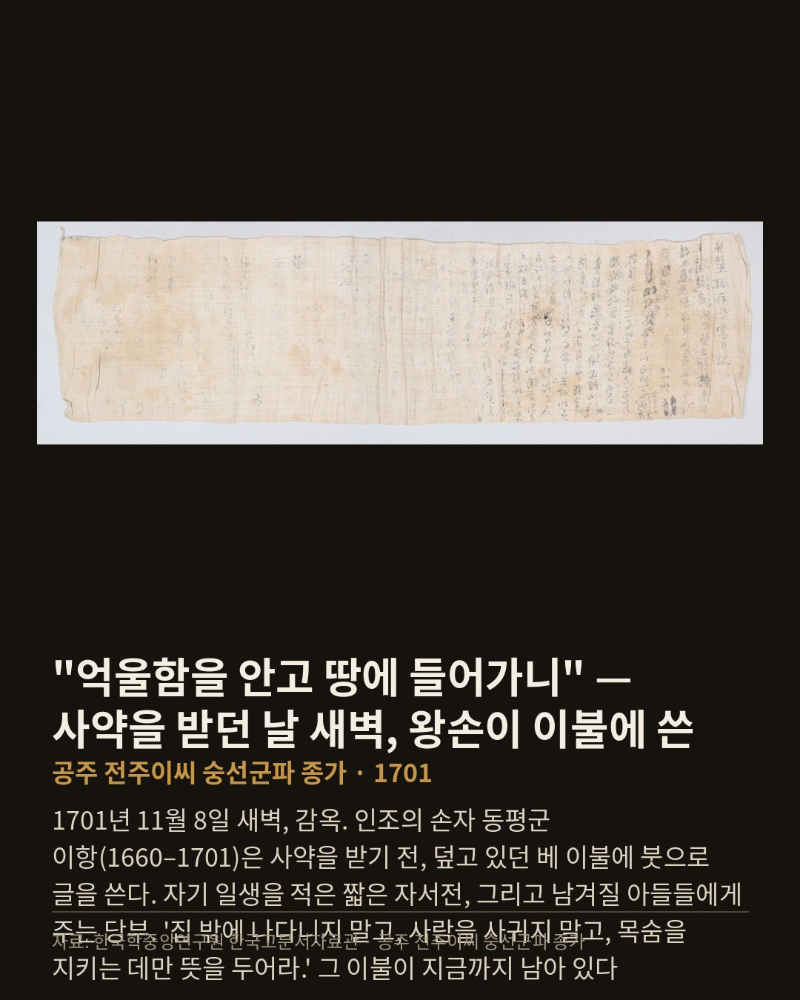
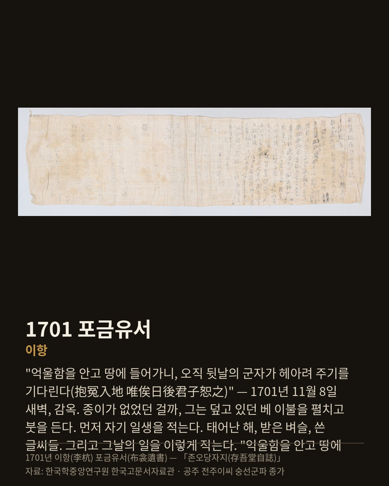
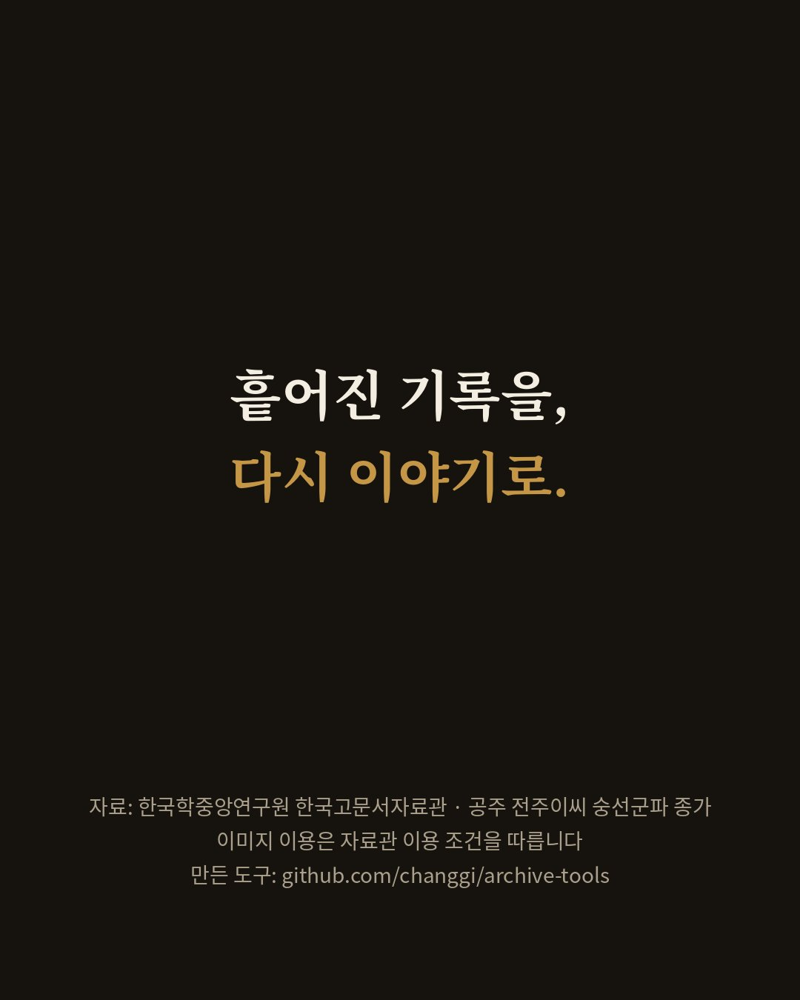

# EP.119 "억울함을 안고 땅에 들어가니" — 사약을 받던 날 새벽, 왕손이 이불에 쓴 유서

공주 전주이씨 숭선군파 종가 (문중) · 1701년 11월 8일 새벽, 감옥. 인조의 손자 동평군 이항(1660–1701)은 사약을 받기 전, 덮고 있던 베 이불에 붓으로 글을 쓴다. 자기 일생을 적은 짧은 자서전, 그리고 남겨질 아들들에게 주는 당부. '집 밖에 나다니지 말고, 사람을 사귀지 말고, 목숨을 지키는 데만 뜻을 두어라.' 그 이불이 지금까지 남아 있다

- 🌐 [전시 웹페이지](https://changgi.github.io/archive-tools/examples/sungseon/exhibit.html) (한자 위 한글 독음 · 원문 해석) · [수업 활동지](https://changgi.github.io/archive-tools/examples/sungseon/handout.html)
- 🎬 영상: [릴스 9:16](https://changgi.github.io/archive-tools/examples/media/ep119-sungseon_reel.mp4) · [가로 16:9](https://changgi.github.io/archive-tools/examples/media/ep119-sungseon_wide.mp4) · 홍보 글: [`promo.md`](promo.md)
- 카드뉴스: [`cards/`](cards/) · SNS 글: [`sns.txt`](sns.txt) · 판독·해석 표: [`selection.csv`](selection.csv)

<!-- DELIVERY -->
## 전달 에디팅 — 이 기록을 이렇게 전합니다

- **핵심 정서** — 먹먹함
- **한 문장** — 마지막 순간의 글은 무엇을 남기는가 — 억울함, 그리고 살아남을 이들에 대한 걱정.
- **열기** — 사약을 받던 날 새벽, 그는 덮고 있던 이불에 유서를 썼습니다.
- **펼치기** — 이항 포금유서 — 「존오당자지」 → 이항 포금유서 — 「계아배서」 (1701년) — 베 이불 원본을 보여 주고 → 자기 일생을 적은 자지(억울함) → 아이들에게 쓴 당부(살아남아라) 순으로, 한 사람의 마지막 새벽을 따라가게 구성했습니다.
- **절정** — "억울함을 안고 땅에 들어가니, 오직 뒷날의 군자가 헤아려 주기를 기다린다(抱冤入地 唯俟日後君子恕之)" — 화면·공간에서 이 한 줄만 크게, 소리를 줄여 집중
- **여운** — 이불을 받아 든 아이들은, 아버지의 당부대로 살았을까요? — 질문으로 끝내고 답은 보는 사람에게
- **감각과 물질** — 흐려진 먹이 번진 베 이불, 새벽의 감옥 · 역마 방울·말발굽 소리와 함께 펼치는 두루마리
- **통로와 매개** — 온라인: 릴스(열기) → 카드뉴스(펼치기) → 전시 웹페이지(절정·원문) → 비하인드 카드(여운) / 오프라인: 원본 크기 복제·낭독·참여 벽 / 남기기: 활동지·질문 카드
- **여운 장치** — 가장 소중한 사람에게 남길 한 줄을 적어 보기
- **전달 에디팅 전** — 2건의 문서를 1701년 연대순으로 놓고 문서명 · 유형 · 해설을 붙인다 — 정확하지만, 지나가면 잊힌다.
- **전달 에디팅 후** — 핵심 정서는 「먹먹함」. 「사약을 받던 날 새벽, 그는 덮고 있던 이불에 유서를 썼습니다.」로 열고, 문서를 대비와 순서로 펼친 뒤, "억울함을 안고 땅에 들어가니, 오직 뒷날의 군자가 헤아려 주기를 기다린다(抱冤入地 唯俟日後君子恕之)"에서 멈춘다. 흐려진 먹이 번진 베 이불, 새벽의 감옥. 마지막엔 「가장 소중한 사람에게 남길 한 줄을 적어 보기」로 보는 사람이 자기 이야기를 남기고 떠나게 한다.

전문: [`delivery.md`](delivery.md)
<!-- /DELIVERY -->

<!-- CURATOR -->
## 비하인드 — 큐레이터 노트

- **왜 이 문서들인가** — '포금유서(布衾遺書)'라는 이름이 무엇인지 몰라 열어 보았다가, 그것이 베 이불이라는 것을 알았습니다.
- **전하고 싶은 것** — 마지막 순간의 글은 무엇을 남기는가 — 억울함, 그리고 살아남을 이들에 대한 걱정.
- **이렇게 보이길 바랐다** — 베 이불 원본을 보여 주고 → 자기 일생을 적은 자지(억울함) → 아이들에게 쓴 당부(살아남아라) 순으로, 한 사람의 마지막 새벽을 따라가게 구성했습니다.
- **이렇게 써 주세요** — 숙종 대의 옥사와 왕실 종친, 기록의 물질성(종이가 아닌 천), 유언과 가족에 대한 이야기에 쓰세요. 옥사의 정치적 배경과 평가는 여러 관점이 있다는 점을 함께 다뤄 주세요.
- **만들며 있었던 일** — 베 원본은 먹이 흐려 거의 읽을 수 없어, 같은 집안의 등출본을 바탕으로 판독했습니다. 중간 일부는 줄였고 몇 글자는 불확실합니다. 옥사의 구체적 경위와 이항의 혐의 내용은 이 문서로는 다루지 않았습니다. 생몰년은 자지의 '현종 경자년 출생, 향년 마흔둘'에서 계산했습니다.
- **남겨 둔 질문** — 이불을 받아 든 아이들은, 아버지의 당부대로 살았을까요?
- **제작 기록** — 문서 2건 · 1701년 · 원본 사진 4면(문서 전체) · 원문 판독 2건 · 번역 2건 · 해제에 "확인 필요"를 단 문서 1건

전문: [`curator.md`](curator.md) · 비하인드 카드: [`behind/`](behind/) · 채널별 홍보안: [`channels.md`](channels.md)
<!-- /CURATOR -->

## 이야기 — 사료가 말하는 대로

사약을 받던 날 새벽, 그는 덮고 있던 이불에 유서를 썼습니다.

> **1701 포금유서** — 1701년 11월 8일 새벽, 감옥. 종이가 없었던 걸까, 그는 덮고 있던 베 이불을 펼치고 붓을 든다. 먼저 자기 일생을 적는다. 태어난 해, 받은 벼슬, 쓴 글씨들. 그리고 그날의 일을 이렇게 적는다. "억울함을 안고 땅에 들어가니, 오직 뒷날의 군자가 헤아려 주기를 기다린다(抱冤入地 唯俟日後君子恕之)." 마지막 줄은 이렇다. "누린 나이가 겨우 마흔둘이니, 슬프고 슬프다(享年僅四十二 哀哉哀哉)."
> **1701 포금유서** — 그리고 그는 아이들에게 쓴다. 벼슬도, 명예도 말하지 않는다. "오직 목숨을 보전하는 데만 뜻을 두어라(唯以得保性命爲意)." 집 밖에 나가지 말고, 사람을 사귀지 말고, 벼슬을 주어도 받지 말라고. 그리고 날짜를 적는다. "신사년 11월 8일 새벽, 옥중에서 쓰다(辛巳十一月八日曉在獄中書)." 그날 그는 세상을 떠났고, 이불은 남았다.

| 표지 | 1번 카드 | 마무리 |
|---|---|---|
|  |  |  |

## 선별 문서 (2점)

| # | 연도 | 유형 | 문서명 | 원본 |
|---|---|---|---|---|
| 1 | 1701 | 포금유서 | 1701년 이항(李杭) 포금유서(布衾遺書) — 「존오당자지(存吾堂自誌)」 | [원본 보기](https://archive.aks.ac.kr/viewer/viewer.do#imgnode.do?itemId=book&gubun=booktree&depth=6&upPath=01%5E0144%5EL014421%5EL014421F02%5EL014421F0207&dataId=G002%2BKHD%2BKSM-XG.1701.0000-20190219.C1004_002_00480_XXX&itemType=) |
| 2 | 1701 | 포금유서 | 1701년 이항(李杭) 포금유서(布衾遺書) — 「계아배서(戒兒輩書)」 | [원본 보기](https://archive.aks.ac.kr/viewer/viewer.do#imgnode.do?itemId=book&gubun=booktree&depth=6&upPath=01%5E0144%5EL014421%5EL014421F02%5EL014421F0207&dataId=G002%2BKHD%2BKSM-XG.1701.0000-20190219.C1004_002_00480_XXX&itemType=) |

## 원문 판독과 해석

### 1. 1701년 이항(李杭) 포금유서(布衾遺書) — 「존오당자지(存吾堂自誌)」

**원문 판독**

```
朝鮮王孫存吾堂自誌
王孫生顯宗庚子癸丑特授東平都正甲寅選拜
宸筆加一階敦恩殿享官丙辰以其勞封君 …
庚申拜永昭殿享官壬戌爵一品 …
… 辛巳大獄
爲賊女亂引十一月八日有後命抱冤入地唯俟日後君子恕之
王孫性嗜古文多蓄古書善篆隸作詩文 …
筆法慕晉法多書碑文書進玉冊文
題莊陵神主 …
常置心經近思錄自警 … 享年僅四十二哀哉哀哉
(포금 원본은 흐려서, 집안의 등출본 「포금유서초」로 읽음)
```

**원문 해석** 조선 왕손 존오당의 자지(自誌). 왕손은 현종 경자년(1660)에 태어났다. 계축년(1673) 특별히 동평도정에 제수되고, 갑인년(1674) 뽑혀 임명되었으며, 임금의 친필로 한 품계가 더해졌다. 돈은전 향관을 지내고, 병자년(1676) 그 수고로 군(君)에 봉해졌다. … 경신년(1680) 영소전 향관에 임명되고, 임술년(1682) 1품에 올랐다. … 신사년(1701)의 큰 옥사에서 역적 여인에게 끌려 들어가, 11월 8일 후명(後命, 사약을 내리는 명)이 있었다. 억울함을 안고 땅에 들어가니, 오직 뒷날의 군자가 헤아려 주기를 기다린다. 왕손은 성품이 옛글을 좋아하여 옛 책을 많이 모았고, 전서와 예서를 잘 썼으며 시와 문을 지었다. … 필법은 진(晉)나라 서법을 사모하여 비문을 많이 썼고, 옥책문을 써서 올렸으며, 장릉(莊陵)의 신주를 썼다. … 늘 『심경』과 『근사록』을 곁에 두고 스스로 경계하였다. … 누린 나이가 겨우 마흔둘이니, 슬프고 슬프다.

**해제** 인조의 아들 숭선군 이징(李澂)의 아들인 동평군(東平君) 이항(李杭, 1660–1701)이 1701년(숙종 27) 옥중에서 사약을 받기 전 베 이불(布衾)에 직접 쓴 유서, 포금유서(布衾遺書)의 앞부분 「존오당자지(存吾堂自誌)」입니다. 존오당은 그의 호입니다. 스스로 자기 일생과 벼슬을 적고, '신사년 큰 옥사에 역적 여인에게 끌려 들어가 11월 8일 후명이 있었다'고 적었습니다. 이해 희빈 장씨가 사사된 옥사에 연루된 것을 가리키는 것으로 보입니다. 단종의 능인 장릉의 신주를 썼다는 구절도 보입니다. 베에 쓴 원본은 먹이 흐려 대부분 읽기 어려워, 같은 집안에 전하는 등출본(「포금유서초」)의 글을 바탕으로 판독했습니다. 등출본의 작은 주석에 '임종 때 옥중에서 베 이불에 직접 썼다(臨終時在獄中親書于布衾)'고 적혀 있습니다. 중간 일부는 '…'로 줄였습니다.

### 2. 1701년 이항(李杭) 포금유서(布衾遺書) — 「계아배서(戒兒輩書)」

**원문 판독**

```
戒兒輩書
天恩如或生存吾父母血屬唯汝輩在須盡保身之責
長在家不出入不交人三寸四寸家外切勿往來唯以得保性命爲
意常觀小學宋名臣錄以此爲操身勿妄言家中絶去神佛祀
不見瞽卜雜術之人常以脩身飭行爲意若不如此匪吾子愼之兄
弟相依雖老不出居天道有知雖有付職之事宗班中無職辭
而不受
辛巳十一月八日曉在獄中書
吾死之後吾家無內外族屬之可依賴者敢以孤兒弱妻托之 …
抱冤入地天日照臨敢以孤兒弱妻托之務加顧恤 …
(포금 원본은 흐려서, 등출본으로 읽음)
```

**원문 해석** 아이들에게 경계하는 글. 임금의 은혜로 혹시 살아남게 된다면, 우리 부모의 핏줄은 오직 너희뿐이다. 반드시 몸을 지킬 책임을 다하라. 늘 집에 있으면서 나다니지 말고, 사람을 사귀지 말며, 삼촌 · 사촌 집 밖에는 절대 오가지 말고, 오직 목숨을 보전하는 데만 뜻을 두어라. 늘 『소학』과 『송명신록』을 보아 이것으로 몸가짐을 삼고, 함부로 말하지 마라. 집안에서 귀신과 부처에게 지내는 제사를 끊고, 점쟁이와 잡술 하는 사람을 만나지 마라. 늘 몸을 닦고 행실을 삼가는 데 뜻을 두어라. 이렇게 하지 않으면 내 자식이 아니니, 삼가라. 형제가 서로 의지하며 늙도록 나가지 말고 지내라. 하늘의 도가 알아줌이 있어 비록 벼슬을 내리는 일이 있더라도, 종친 가운데 직책 없는 자로서 사양하고 받지 마라. 신사년(1701) 11월 8일 새벽 옥중에서 쓰다. (이어서 친척에게) 내가 죽은 뒤 우리 집에는 의지할 만한 안팎 친족이 없으니, 감히 고아와 약한 아내를 부탁한다. … 억울함을 안고 땅에 들어가나 하늘의 해가 굽어보고 있으니, 감히 고아와 약한 아내를 맡기니 힘써 돌보아 주기를 바란다.

**해제** 포금유서의 뒷부분 「계아배서(戒兒輩書)」로, 아들들에게 남긴 당부와 처가 쪽 친척에게 남은 가족을 부탁하는 글입니다. '신사년 11월 8일 새벽 옥중에서 쓰다(辛巳十一月八日曉在獄中書)'라는 날짜는, 앞의 자지에서 '11월 8일 후명이 있었다'고 한 바로 그날입니다. 당부의 중심은 '목숨을 보전하라', '사람을 사귀지 말고 나다니지 말라', '벼슬을 주어도 사양하라'는 것으로, 옥사에 연루된 집안이 살아남기 위한 처신을 담았습니다. 등출본에는 이어서 처가 쪽 친척 박삭녕(朴朔寧) 등에게 '고아와 약한 아내'를 부탁하는 글이 이어집니다. 원본 베에서는 '戒兒輩書'라는 제목과 날짜 부분이 흐릿하게 확인됩니다. 판독은 등출본을 따랐으며 몇 글자는 불확실합니다.

판독·해석·이야기는 이미지에 근거한 초안이며(검토 전 "초안" 표시), 정확한 판독은 원문 확인이 필요합니다. □는 읽지 못한 글자, (?)는 불확실한 글자입니다.
이미지: 한국학중앙연구원 한국고문서자료관 소장·제공. "원본" 링크를 누르면 자료관 뷰어에서 그 문서가 열립니다. 재사용은 자료관에 문의하세요(소장처 동의 필요).
