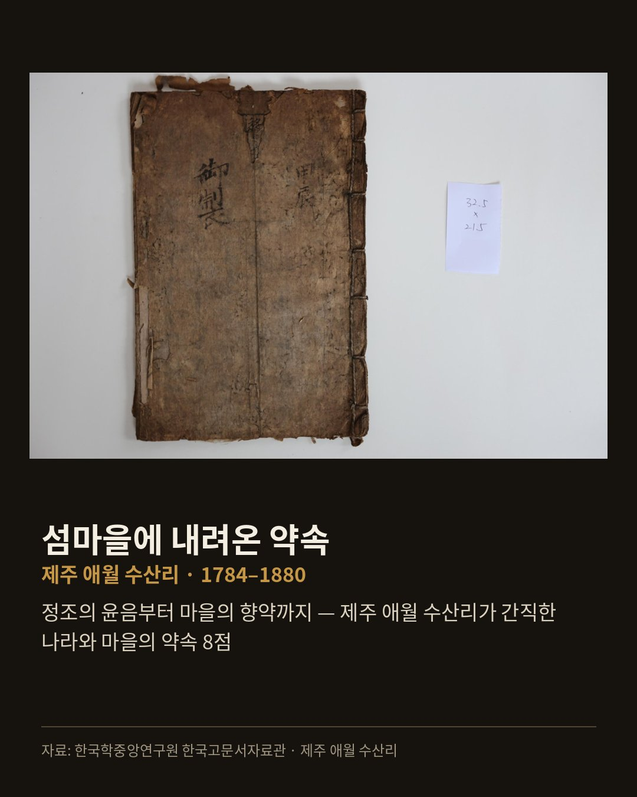
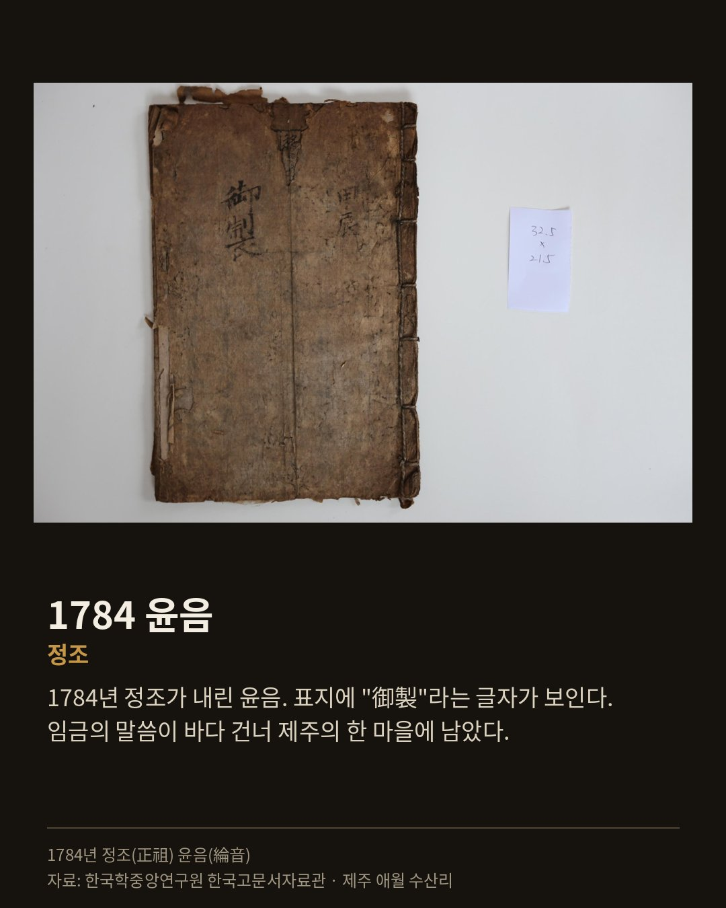
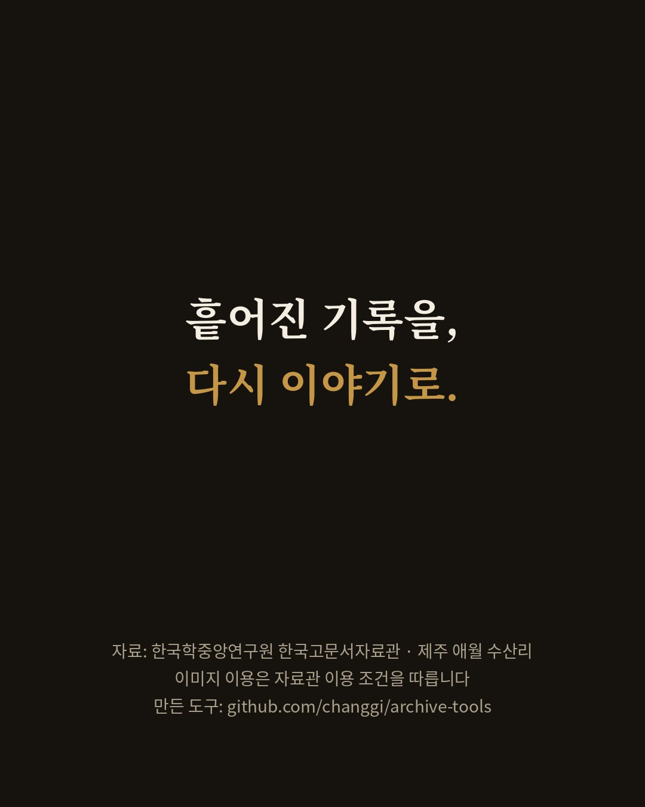

# 섬마을에 내려온 약속

제주 애월 수산리 (마을) · ③ 에디팅 후 — Claude가 문서명과 이미지에 근거해 쓴 `이야기` 문장 사용 (검토 전 초안 표시)

- 🌐 [전시 웹페이지](https://changgi.github.io/archive-tools/examples/susanri-village/exhibit.html) · [수업 활동지](https://changgi.github.io/archive-tools/examples/susanri-village/handout.html)
- 🎬 영상: [릴스 9:16](https://changgi.github.io/archive-tools/examples/media/ep4-susanri_reel.mp4) · [가로 16:9](https://changgi.github.io/archive-tools/examples/media/ep4-susanri_wide.mp4) · 홍보 글: [`promo.md`](promo.md)
- 카드뉴스: [`cards/`](cards/) · SNS 글: [`sns.txt`](sns.txt) · 에디팅 결과: [`selection.csv`](selection.csv)

| 표지 | 1번 카드 | 마무리 |
|---|---|---|
|  |  |  |

<!-- CURATOR -->
## 비하인드 — 큐레이터 노트

- **왜 이 문서들인가** — 정조의 윤음과 마을이 스스로 만든 향약·절목이 한 마을 문서에 나란히 있었습니다.
- **전하고 싶은 것** — 나라의 말씀과 마을의 약속이 한 마을 안에서 함께 작동했다는 것.
- **이렇게 보이길 바랐다** — 임금의 말씀에서 마을의 규칙으로, 위에서 아래로 내려오는 흐름으로 엮었습니다.
- **이렇게 써 주세요** — 제주 마을사, 자치 규약을 다루는 시민 교육에 쓰세요.
- **만들며 있었던 일** — 예시 세트(EP.03–06)의 둘째 편입니다. 처음에는 문서명으로 캡션 초안만 만들었고, 뒤에 원문 전문 판독(v0.3.6)과 원문 해석(v0.4.0)을 더해 지금 모습이 되었습니다.
- **남겨 둔 질문** — 우리 마을(아파트)의 규칙은 누가, 어떻게 정했을까요?
- **제작 기록** — 문서 8건 · 1784–1880년 · 원본 사진 88면(문서 전체) · 원문 판독 7건 · 번역 7건 · 못 읽은 글자 □ 0 · 불확실 (?) 3

전문: [`curator.md`](curator.md)
<!-- /CURATOR -->

## 선별 문서 (8점)

| # | 연도 | 유형 | 문서명 | 원본 |
|---|---|---|---|---|
| 1 | 1784 | 윤음 | 1784년 정조(正祖) 윤음(綸音) | [원본 보기](https://archive.aks.ac.kr/viewer/viewer.do#imgnode.do?itemId=book&gubun=booktree&depth=6&upPath=07%5E0747%5EL074702%5EL074702F02%5EL074702F0201&dataId=G002%2BAKS%2BKSM-XA.1784.5011-20201218.D108_00001&itemType=) |
| 2 | 1793 | 윤음 | 1793년 정조(正祖) 윤음(綸音)－1 | [원본 보기](https://archive.aks.ac.kr/viewer/viewer.do#imgnode.do?itemId=book&gubun=booktree&depth=6&upPath=07%5E0747%5EL074702%5EL074702F02%5EL074702F0201&dataId=G002%2BAKS%2BKSM-XA.1793.5011-20201218.D108_00002&itemType=) |
| 3 | 1796 | 혼례홀기 | 1796년 혼례홀기(婚禮笏記) | [원본 보기](https://archive.aks.ac.kr/viewer/viewer.do#imgnode.do?itemId=book&gubun=booktree&depth=6&upPath=07%5E0747%5EL074702%5EL074702F02%5EL074702F0203&dataId=G002%2BAKS%2BKSM-XC.1796.5011-20201218.D108_00003&itemType=) |
| 4 | 1822 | 호적소정식조례성책 | 1822년 호적소정식조례성책(戶籍所定式條例成冊)－1 | [원본 보기](https://archive.aks.ac.kr/viewer/viewer.do#imgnode.do?itemId=book&gubun=booktree&depth=6&upPath=07%5E0747%5EL074702%5EL074702F02%5EL074702F0203&dataId=G002%2BAKS%2BKSM-XC.1822.5011-20201218.D108_00004&itemType=) |
| 5 | 1826 | 감시절목 | 1826년 감시절목(減柴節目) | [원본 보기](https://archive.aks.ac.kr/viewer/viewer.do#imgnode.do?itemId=book&gubun=booktree&depth=6&upPath=07%5E0747%5EL074702%5EL074702F02%5EL074702F0203&dataId=G002%2BAKS%2BKSM-XC.1826.5011-20201218.D108_00005&itemType=) |
| 6 | 1862 | 향약문 | 1862년 경민장(警民長) 향약문(鄕約文) | [원본 보기](https://archive.aks.ac.kr/viewer/viewer.do#imgnode.do?itemId=book&gubun=booktree&depth=6&upPath=07%5E0747%5EL074702%5EL074702F02%5EL074702F0207&dataId=G002%2BAKS%2BKSM-XG.1862.5011-20201218.D108_00021&itemType=) |
| 7 | 1880 | 황우혁파설치본전절목 | 1880년 오면황우혁파설치본전절목(五面黃牛革罷設置本錢節目)－1 | [원본 보기](https://archive.aks.ac.kr/viewer/viewer.do#imgnode.do?itemId=book&gubun=booktree&depth=6&upPath=07%5E0747%5EL074702%5EL074702F02%5EL074702F0203&dataId=G002%2BAKS%2BKSM-XC.1880.5011-20201218.D108_00016&itemType=) |
| 8 | — | 절목 | 절목(節目) | [원본 보기](https://archive.aks.ac.kr/viewer/viewer.do#imgnode.do?itemId=book&gubun=booktree&depth=6&upPath=07%5E0747%5EL074702%5EL074702F02%5EL074702F0203&dataId=G002%2BAKS%2BKSM-XC.0000.5011-20201218.D108_00019&itemType=) |

이미지: 한국학중앙연구원 한국고문서자료관 소장·제공. "원본" 링크를 누르면 자료관 뷰어에서 그 문서가 열립니다. 이미지를 다시 쓰려면 자료관에 문의하세요(소장처 동의 필요).
