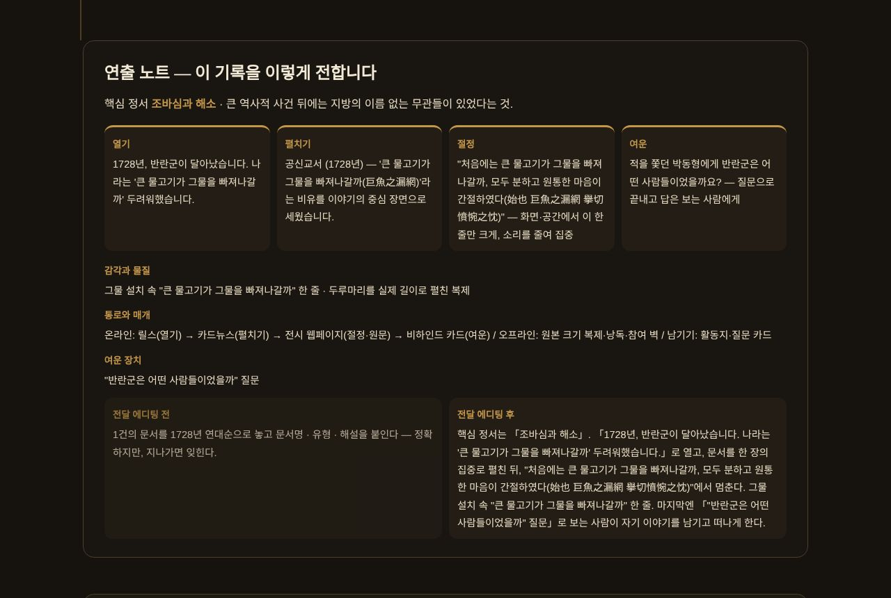
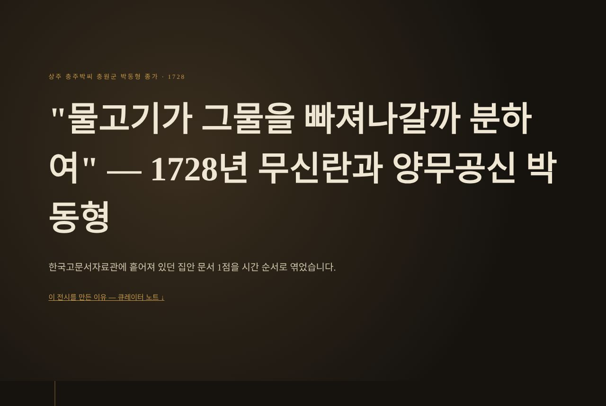
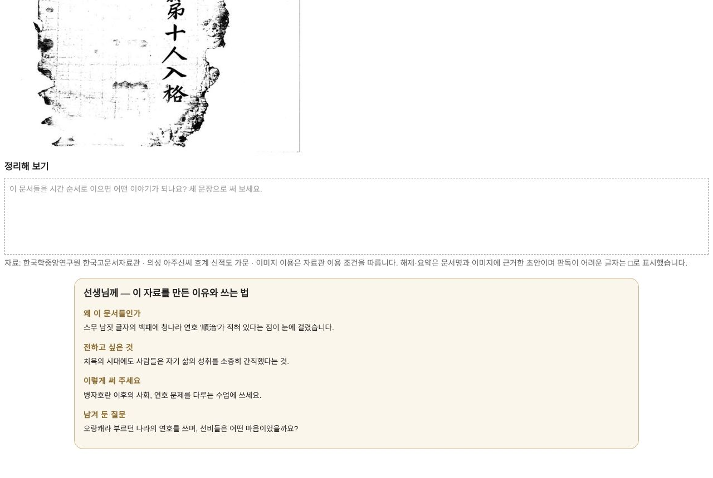
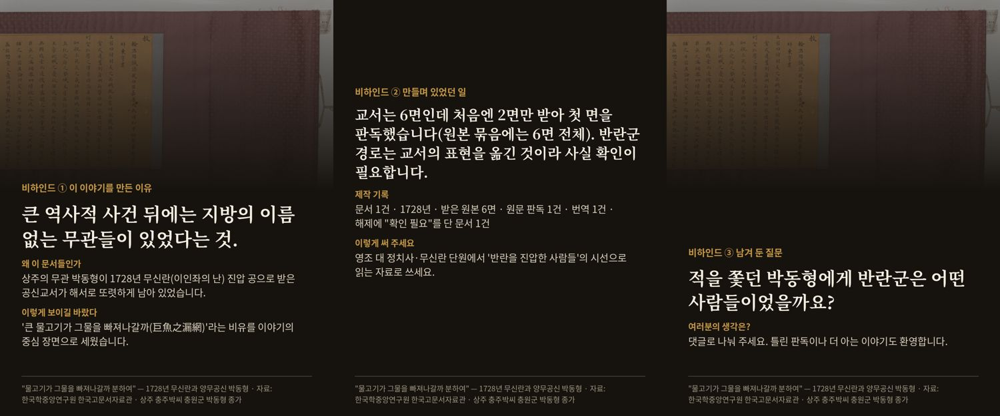

# 따라하기 — 「임금이 보낸 종이 세 장」 처음부터 끝까지

aks-archive-harvester의 **모든 단계**를 실제로 돌려 만든 예제입니다. 소장처 세 곳에서 문서 네 건을 골라, 수집 → 큐레이션 → 문구 에디팅 → 큐레이터 노트 → 전달 에디팅 → 매개(전시·카드·활동지·비하인드·채널) → 영상 → 원본 묶음 → 시리즈 사이트까지 갔습니다. 각 단계에서 **기계가 만든 초안**과 **사람(또는 Claude)이 다듬은 결과**를 함께 남겨 두었습니다.

- 완성된 시리즈 사이트: [site/index.html](https://changgi.github.io/archive-tools/examples/tutorial/site/index.html)
- 단계별 파일: [`steps/`](steps/) — W1(완석정 유지 2장) · W2(호계 백패 1장) · W3(충원군 공신교서 1장)
- 같은 방식으로 만든 100편: [예시 갤러리](https://changgi.github.io/archive-tools/examples/)

> 요리로 치면: ① 장보기(수집) ② 재료 고르기(큐레이션) ③ 손질하기(문구 에디팅) ④ 왜 이 요리인가 적기(큐레이터 노트) ⑤ 그릇·순서·조명 정하기(전달 에디팅) ⑥ 차려 내기(매개) ⑦ 영상 ⑧ 원재료 통째로 나누기(원본 묶음) ⑨ 코스 메뉴판(시리즈).

| 단계 | 명령 | 누가 | 결과 |
|---|---|---|---|
| 0 준비 | `pip install requests pillow` (+ 영상: ffmpeg, `pip install edge-tts`) | 사람 | |
| 1 찾기·목록 | `harvest.py find "완석정" --first --manifest W1 --match "유지"` | 도구 | `W1/docs.json` (맞는 문서만 면 목록) |
| 2 받기 | `harvest.py download --work W1 --match "유지"` | 도구 | 원본 해상도 JPG |
| 3 큐레이션·초안 | `harvest.py curate --work W1` → `studio.py edit --work W1 --all --id story` | 도구 | `selection.csv`(캡션 초안) · `curator.md`·`delivery.md` 틀 · 밀착인화 |
| 4 문구 에디팅 | 이미지를 읽고 `selection.csv`의 원문·번역·해제·요약·이야기 채우기 | Claude·사람 | "현대어(原文)" 인용 이야기 |
| 5 큐레이터 노트 | `curator.md` 6칸 | Claude·사람 | 왜 · 전하고 싶은 것 · 보이길 · 쓰는 법 · 비하인드 · 질문 |
| 6 전달 에디팅 | `studio.py delivery --work W1 --theme story` → 다듬기 | 도구 → 사람 | 정서 · 열기→펼치기→절정→여운 · 물질 · 통로 · 여운 장치 |
| 6+ 점검 | `studio.py check --work W1 --theme story` | 도구 | 빈 칸 · 인용 없는 이야기 · 표지 같은 대표 면 · 오래된 결과물 → 다음 할 일 |
| (선택) 대표 면 | `studio.py page --work W3 --theme story --n 1 --page 002.jpg` | 사람 | 두루마리 겉면 대신 글이 있는 면 |
| 7 매개 | `studio.py promo … --ep 1` → `studio.py mediate --work W1 --theme story --url <주소>` | 도구 | 첫 페이지 · 전시 · 카드 · 활동지 · 비하인드 카드 · `channels.md` · 홍보 글 |
| 8 영상 | `video.py --work W1 --theme story --ep 1 --url <주소> --web` | 도구 | 릴스 9:16 · 가로 16:9 · 자막 · 웹 압축본 |
| 9 원본 묶음 | `studio.py originals --work W1 --theme story --full --dry-run` → `--full --videos W1/mediate/story/video` | 도구 | 문서 전체 면 + 원본 영상 + `출처.csv` ZIP |
| 10 시리즈 | `series.py --list series.tsv --note series.md --out site` | 도구 | 갤러리 · 통합 분석 · 기획 노트 · 홍보 가이드 · 활용 가이드 · 시리즈 카드 |

Claude에게는 "완석정 유지로 전시랑 영상까지 만들어줘"처럼 말하면 이 순서대로 진행합니다. 터미널에서 직접 할 때는 아래 0단계부터.

## 0. 준비

```bash
# macOS · Linux (Git Bash 포함)
pip install requests pillow edge-tts          # edge-tts는 영상 내레이션용(선택)
git clone https://github.com/changgi/archive-tools
S="$PWD/archive-tools/plugins/aks-archive-harvester/skills/aks-archive-harvester/scripts"
mkdir work && cd work                          # 작업 폴더(W1, W2 …)는 여기에 생깁니다
```

```powershell
# Windows PowerShell — 아래 명령의 python3 → python, $S/ → $S\ 로 읽으세요
pip install requests pillow edge-tts
git clone https://github.com/changgi/archive-tools
$S = "$PWD\archive-tools\plugins\aks-archive-harvester\skills\aks-archive-harvester\scripts"
mkdir work; cd work
```

설치가 잘 됐는지 먼저 확인하세요 — 인터넷 없이 가짜 문서 3건으로 전 과정을 돌려 봅니다:

```bash
python3 $S/selftest.py            # 영상까지: --video
#   ✓ harvest.py curate … ✓ series.py … ✓ harvest.py bundle
#   통과 15 / 15
```

영상(8단계)에는 ffmpeg이 필요합니다(`ffmpeg -version`으로 확인, Windows는 `winget install ffmpeg`).

---

## 1–2. 찾고, 고른 문서만 받기

```bash
python3 $S/harvest.py find "완석정" --first --manifest W1 --match "유지"
#   → W1/docs.json  (소장처 문서 416건 목록, 면 목록은 '유지'에 맞는 문서만)
python3 $S/harvest.py download --work W1 --match "유지"
```

큰 소장처는 `--tree-only`로 문서명만 먼저 훑고, `--match "정규식"`으로 필요한 것만 받습니다. 서버 동시 접속 수(기본값)는 올리지 않습니다.

## 3. 큐레이션 — 자동 초안

```bash
python3 $S/harvest.py curate --work W2
python3 $S/studio.py edit --work W2 --all --id story
#   01. 1646 백패 — 1646년 신채(申埰) 진사 백패(進士白牌)
```

`edit`가 만든 것: [`steps/W2/1_auto/`](steps/W2/1_auto/) — `selection.csv`, 빈 `curator.md`, 초안 `delivery.md`, 밀착인화.

## 4. 문구 에디팅 — 무엇을 말할까

| 칸 | 자동 초안 (`1_auto`) | 문구 에디팅 후 (`3_final`) |
|---|---|---|
| 해제 | 1646년 신채 관련 백패. 생원·진사시(소과) 합격 증서입니다… | 1646년(인조 24) 사마시 진사과에 합격한 의성의 신채에게 내린 백패입니다. 홍패가 붉은 종이인 것과 달리 소과 합격증은 흰 종이여서 '백패'… |
| 판독 | (비어 있음) | 敎旨 幼學申埰進士三等第十八人入格者 順治三年三月初八日 |
| 번역 | (비어 있음) | 교지. 유학 신채를 진사 3등 제18인으로 입격시킨다. 순치 3년(1646) 3월 초8일. |
| 이야기 | (비어 있음) | 합격증은 짧다. 스무 남짓 글자. "유학 신채를 진사 3등 제18인으로 입격시킨다(幼學申埰進士三等第十八人入格者)." 그런데 날짜가 눈에 걸린다. "순치 3년(順治三年)." 청나라의 연호다… |

원문은 끝까지(□ 못 읽은 글자 · (?) 불확실), 이야기는 종이에 적힌 문장을 "현대어(原文)"로 인용합니다. 판독이 끝나면 `검토` 칸에 표시하면 "초안" 딱지가 사라집니다(이 예제는 초안 표시를 남겨 두었습니다).

## 5. 큐레이터 노트 — 왜 골랐고 무엇을 전하려 하나

[`steps/W2/3_final/curator.md`](steps/W2/3_final/curator.md)

> **왜 이 문서들인가** 스무 남짓 글자의 백패에 청나라 연호 '順治'가 적혀 있다는 점이 눈에 걸렸습니다.
> **전하고 싶은 것** 치욕의 시대에도 사람들은 자기 삶의 성취를 소중히 간직했다는 것.
> **남겨 둔 질문** 오랑캐라 부르던 나라의 연호를 쓰며, 선비들은 어떤 마음이었을까요?

있었던 일만 씁니다. 의도는 만든 사람이 정할 몫이라, Claude는 초안을 쓰고 확인을 받습니다.

## 6. 전달 에디팅 — 어떻게 · 무엇으로 · 어디로 전할까

문구 에디팅을 마친 뒤 초안을 다시 만들면 절정 후보(원문 한 줄)와 여운 질문이 채워집니다.

```bash
python3 $S/studio.py delivery --work W1 --theme story
#   절정: "너는 역마를 타고 올라오라(爾其乘馹上來事)" — 화면·공간에서 이 한 줄만 크게…
```

| | 다시 만든 초안 ([`2_delivery_redraft`](steps/W1/2_delivery_redraft/delivery.md)) | 다듬은 결과 ([`3_final`](steps/W1/3_final/delivery.md)) |
|---|---|---|
| 핵심 정서 | (비어 있음 — 사람이 정함) | 부름의 긴장 |
| 감각과 물질 | 역마 방울·말발굽 소리와 함께 펼치는 두루마리 | 두 유지를 마주 보게, 역마 방울 소리 |
| 여운 장치 | (비어 있음) | "두 번 부르면 가겠어요?" |
| 전달 에디팅 후 | (비어 있음) | 「왕이 보낸 쪽지의 마지막 한 마디」로 열고 … "너는 역마를 타고 올라오라"에서 멈춘다 … |

이미 사람이 쓴 칸(정서 · 여운 장치 · 전달 에디팅 후)이 있으면 덮어쓰지 않습니다(`--force`로만, 백업을 남김).



## 6+. 공개 전 점검 — `check`

에디팅이 끝났는지, 결과물이 최신인지 한 번에 봅니다. 의사가 수술 전에 체크리스트를 읽듯, 내보내기 전에 한 번.

```bash
python3 $S/studio.py check --work W1 --theme story
#   [문구 에디팅]  1. 1623년 이언영(李彦英) 유지(有旨) — 검토 칸 비어 있음 → "초안" 표시
#   [큐레이터 노트] ✓ 6칸 모두 채움
#   [전달 에디팅]  ✓ 11칸 모두 채움
#   [결과물]      홍보 글 ✓ · 전시·카드·활동지 ✓ · 영상 ✓
#   ✓ 공개 준비 완료 — … 다만 2건은 '초안' 표시가 남습니다
```

| 찾아내는 것 | 알려 주는 다음 할 일 |
|---|---|
| 판독 · 번역 · 해제 · 요약 · 이야기 빈 칸, "현대어(原文)" 인용 없는 이야기 | 그 문서의 문구 에디팅 |
| 판독 속 □(못 읽은 글자) · (?)(불확실) 개수 | — (해제에 밝히기) |
| 대표 면이 표지·두루마리 겉면 같음(어둡거나, 다른 면보다 작고 글씨가 적음) | `studio.py page …` |
| 큐레이터 노트·전달 에디팅의 빈 칸, 비어 있는 절정 | `studio.py delivery …` 또는 사람이 정할 칸 |
| 노트·CSV를 고친 뒤 다시 만들지 않은 결과물 | `promo` · `mediate` · `video.py` 다시 |

W3에서 대표 면을 바꾸기 전에 돌리면 이렇게 나옵니다(실제 출력):

```
   1. 공신교서(功臣敎書) — 검토 칸 비어 있음 → "초안" 표시 / 대표 면이 표지·겉면 같습니다(어둡거나 다른 면보다 작고 글씨가 적음) → studio.py page
```

`--strict`를 붙이면 할 일이 남았을 때 종료 코드 1 — 여러 편을 스크립트로 돌릴 때 씁니다. 1.0.1부터는 `edit`가 대표 면을 고를 때도 이런 겉면을 건너뜁니다.

## 7. 매개 — 전시 · 카드 · 활동지 · 비하인드 · 채널

```bash
python3 $S/studio.py promo   --work W1 --theme story --ep 1 --series "임금이 보낸 종이" --url <전시 주소>
python3 $S/studio.py mediate --work W1 --theme story --url <전시 주소> --issues https://github.com/<아이디>/<저장소>
#   2차 홍보: 비하인드 카드 3장 · channels.md(채널별 홍보안)
```

| 결과물 | 예시 |
|---|---|
| 전시의 「판독 고침 제보」 | `--issues`를 주면 문서마다 GitHub 이슈 양식으로 연결 |
| 첫 페이지 `index.html` |  |
| 전시 웹페이지 `exhibit.html` |  |
| 활동지 `handout.html` — 끝에 「선생님께」 |  |
| 비하인드 카드 `cards/b1–b3` |  |
| 채널별 홍보안 | [`site/eps/01-story/channels.md`](site/eps/01-story/channels.md) |

이미지 사용 동의 전에 공개하려면 `mediate --placeholder`(이미지 대신 "자료관 뷰어에서 보기" 자리).

## 8. 영상 — 릴스와 가로

```bash
python3 $S/video.py --work W3 --theme story --ep 3 --url <전시 주소> --web
#   ep03-story_reel.mp4  52초  장면 6개
#   ep03-story_wide.mp4  52초  장면 6개
```

장면: 열기(전달 에디팅) → 소개 → 문서마다 이미지 + 원문 인용 → 절정 → 비하인드 → 질문·출처. 내레이션은 edge-tts(없으면 무음 + 자막). 사내 프록시처럼 자체 인증서 환경이면 `AKS_CA_BUNDLE=인증서경로`.

| 가로 16:9 | 세로 9:16 |
|---|---|
|  |  |

영상: [EP.03 가로](site/eps/03-story/video/ep03-story_wide_web.mp4) · [EP.01 릴스](site/eps/01-story/video/ep01-story_reel_web.mp4)

## 9. 원본 묶음 — 문서 전체 면 + 원본 영상

```bash
python3 $S/studio.py originals --work W3 --theme story --full --dry-run
#   선별 문서 1건 · 전체 6면
python3 $S/studio.py originals --work W3 --theme story --full --videos W3/mediate/story/video
#   상주충주박씨충원군박동형종가_원본.zip  18MB
#   → 사진 6면 / 전체 6면 · 영상 3개
```

ZIP 안 목록: [`steps/W3/originals_list.txt`](steps/W3/originals_list.txt) (용량 때문에 ZIP은 저장소에 넣지 않았습니다).

## 10. 시리즈 — 여러 편을 한 사이트로

[`series.tsv`](series.tsv) (편 · 작업 폴더 · 테마) 와 [`series.md`](series.md) (기획 노트: 왜 만들었나 · 전하고 싶은 것 · 고른 기준 · 이렇게 보이길 바랐다 · 이렇게 써 주세요 · 지킨 원칙 · 히스토리)를 쓰고:

```bash
python3 $S/series.py --list series.tsv --note series.md --out site --home ../../index.html --home-label "← 고문서 한 장 갤러리" \
    --site-url https://changgi.github.io/archive-tools/examples/tutorial/site/
#   → site  편 3 · 문서 4 · 시리즈 카드 7장
```

- `series.tsv`의 작업 폴더는 지금 폴더 또는 `series.tsv`가 있는 폴더 기준 상대 경로로 찾습니다.
- 영상은 웹용(`_web.mp4`)이 있으면 그것만 복사합니다. 없으면 원본 크기 영상을 복사하고 "용량 큼"이라고 알려 줍니다 → `video.py … --web` 권장.
- `--home`: 상단 메뉴 맨 앞에 바깥 주소(전체 갤러리 등)로 돌아가는 링크.
- `--site-url`: 사이트를 올릴 주소. 링크 미리 보기(카카오톡 · SNS 카드)와 `sitemap.xml`(구글 서치 콘솔 · 네이버 서치어드바이저에 등록하면 검색에 잘 잡힙니다)에 씁니다.


결과: [갤러리](site/index.html)(맨 위에 「이 사이트에 있는 것」과 자동 요약) · [통합 분석](site/analysis.html) · 모아 보기 [문장](site/quotes.html) · [연표](site/timeline.html) · [질문 카드](site/questions.html) · [기획 노트](site/about.html) · [홍보 가이드](site/promote.html) · [활용 가이드](site/use.html) · 편마다 [`eps/`](site/eps/).

통합 분석만 따로: `python3 $S/analysis.py --list series.tsv --out 분석.html` — 세기 · 문서 유형 · 유형×세기 · 소장처 종류 · 지역 · 핵심 정서 · 판독 난도 · 원문 인용 · 인물 · 남겨 둔 질문 · 편별 표. `series.tsv`에 4번째 칸 `kind`(문중 · 서원 …)를 쓰면 소장처 종류도 셉니다. 같은 도구로 만든 [예시 101편 통합 분석](https://changgi.github.io/archive-tools/examples/analysis.html).

---

## 막힐 때

| 증상 | 원인 · 해결 |
|---|---|
| `ffmpeg이 필요합니다` | ffmpeg 설치(Windows `winget install ffmpeg`, macOS `brew install ffmpeg`) |
| `내레이션 생성 실패(…)` / `CERTIFICATE_VERIFY_FAILED` | 회사·기관망의 자체 인증서 → `AKS_CA_BUNDLE=<인증서 파일>`을 지정하거나 `--no-tts`(무음 + 자막) |
| `…/selection.csv가 없습니다` | 테마 이름(`--theme`)이 `edit` 때 `--id`와 같은지 확인 |
| 카드·영상 첫 장면이 검거나 비어 보임 | 대표 면이 표지·겉면 → `check`로 확인 후 `page` |
| 첫 페이지에 「홍보 글」 타일이 없음 | `promo`를 `mediate`보다 먼저(또는 `mediate` 다시) |
| 시리즈 사이트 용량이 너무 큼 | 웹용 영상이 없어 원본 크기 영상이 복사됨 → `video.py … --web` |
| 첫 페이지에 영상이 없음 | 영상을 `mediate` 뒤에 만들었음 → `mediate` 다시(첫 페이지에 자막 달린 플레이어가 들어갑니다) |
| 무엇이 문제인지 모르겠음 | `selftest.py`로 설치부터 확인 → 실패한 줄의 메시지 |
| 카카오톡 · SNS에 링크를 붙였는데 그림이 안 나옴 | `mediate --url <공개 주소>` · `series.py --site-url <공개 주소>`로 다시(미리 보기 그림은 절대 주소여야 합니다) |
| 고친 내용이 결과물에 안 보임 | `check` → 오래된 결과물 다시 만들기(같은 명령을 다시 돌려도 중복되지 않습니다) |

### 다음은

- 자기 소장처로 바꿔 보세요: `find "소장처 이름"` 한 줄부터.
- 2차 홍보(비하인드 카드 · 시리즈 카드)와 채널별 홍보: [홍보 가이드](https://changgi.github.io/archive-tools/examples/promote.html)
- 받은 사람이 무엇을 할 수 있나: [활용 가이드](https://changgi.github.io/archive-tools/examples/use.html)

이미지: 한국학중앙연구원 한국고문서자료관 소장·제공 · 성주 명곡 벽진이씨 완석정 이언영 종가 · 의성 아주신씨 호계 신적도 가문 · 상주 충주박씨 충원군 박동형 종가. 재사용은 소장처 동의가 필요합니다(031-730-8873, 8876). 판독·해석은 이미지에 근거한 초안입니다.
