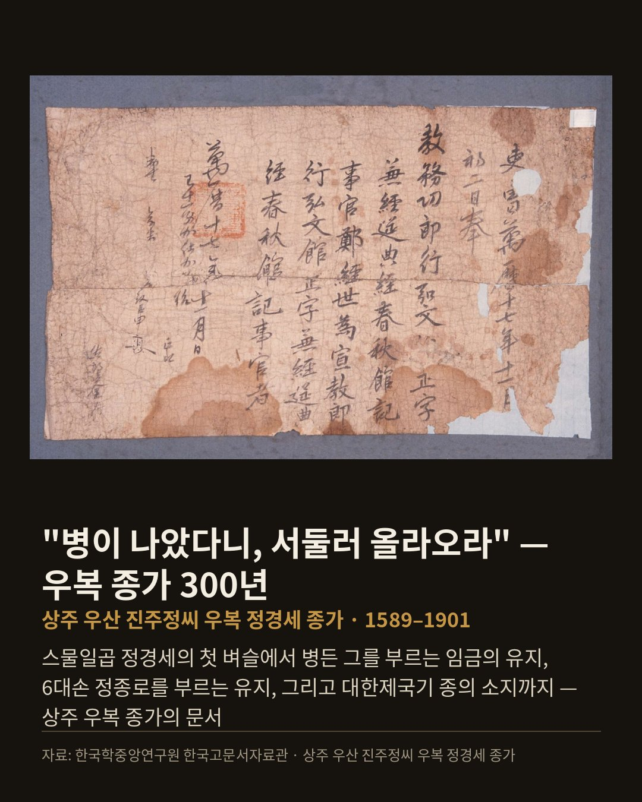
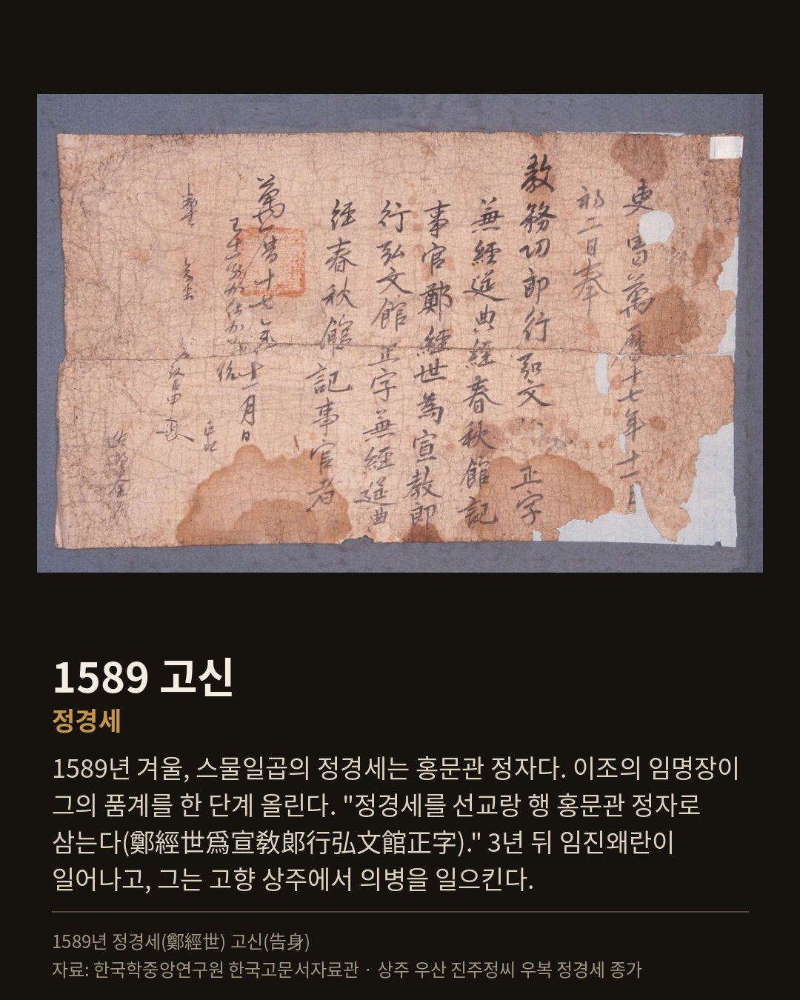
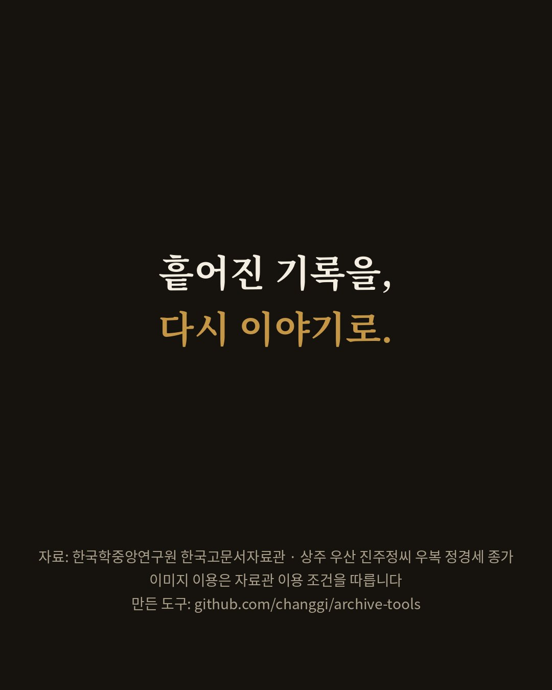

# EP.23 "병이 나았다니, 서둘러 올라오라" — 우복 종가 300년

상주 우산 진주정씨 우복 정경세 종가 (문중) · 스물일곱 정경세의 첫 벼슬에서 병든 그를 부르는 임금의 유지, 6대손 정종로를 부르는 유지, 그리고 대한제국기 종의 소지까지 — 상주 우복 종가의 문서

- 🌐 [전시 웹페이지](https://changgi.github.io/archive-tools/examples/ubok/exhibit.html) (한자 위 한글 독음 · 원문 해석) · [수업 활동지](https://changgi.github.io/archive-tools/examples/ubok/handout.html)
- 🎬 영상: [릴스 9:16](https://changgi.github.io/archive-tools/examples/media/ep23-ubok_reel.mp4) · [가로 16:9](https://changgi.github.io/archive-tools/examples/media/ep23-ubok_wide.mp4) · 홍보 글: [`promo.md`](promo.md)
- 카드뉴스: [`cards/`](cards/) · SNS 글: [`sns.txt`](sns.txt) · 판독·해석 표: [`selection.csv`](selection.csv)

## 이야기 — 사료가 말하는 대로

병든 신하에게 임금은 "사양하지 말고 올라오라"고 썼습니다. 그 집에는 무엇이 더 남았을까요?

> **1589 고신** — 1589년 겨울, 스물일곱의 정경세는 홍문관 정자다. 이조의 임명장이 그의 품계를 한 단계 올린다. "정경세를 선교랑 행 홍문관 정자로 삼는다(鄭經世爲宣敎郞行弘文館正字)." 3년 뒤 임진왜란이 일어나고, 그는 고향 상주에서 의병을 일으킨다.
> **1627 유지** — 1627년, 정묘호란이 지나간 가을. 예순다섯의 정경세가 병을 이유로 물러나기를 청하자 임금의 답이 온다. "경은 사양하지 말고 조리하여 올라오라(卿其勿辭 調理上來事)." 그는 6년 뒤 상주에서 세상을 떠난다.
> **1798 유지** — 170년 뒤인 1798년 겨울, 같은 집에 또 유지가 온다. 이번에는 6대손 정종로다. "너를 사헌부 지평으로 삼으니 서둘러 역마를 타고 올라오라(爾其斯速乘馹上來事)." 임금은 바뀌어도, 이 집 사람을 부르는 문장은 같았다.
> **1901 소지** — 그리고 1901년, 대한제국의 시대. 이번에 관청에 글을 올리는 사람은 종 만돌이다. 상전이 선산 일로 돈 80여 냥을 청구받자 그가 대신 호소한다. "이것은 관계없는 일이니(此是無關之事)… 밝게 살펴 주십시오." 300년 동안 이 집에는 임금의 부름과 백성의 호소가 함께 쌓였다.

| 표지 | 1번 카드 | 마무리 |
|---|---|---|
|  |  |  |

## 선별 문서 (4점)

| # | 연도 | 유형 | 문서명 | 원본 |
|---|---|---|---|---|
| 1 | 1589 | 고신 | 1589년 정경세(鄭經世) 고신(告身) | [원본 보기](https://archive.aks.ac.kr/viewer/viewer.do#imgnode.do?itemId=book&gubun=booktree&depth=6&upPath=01%5E0167%5EL016766%5EL016766F02%5EL016766F0201&dataId=G002%2BAKS%2BKSM-XA.1589.1111-20101008.B061a_088_00007_XXX&itemType=) |
| 2 | 1627 | 유지 | 1627년 정경세(鄭經世) 유지(有旨)－4 | [원본 보기](https://archive.aks.ac.kr/viewer/viewer.do#imgnode.do?itemId=book&gubun=booktree&depth=6&upPath=01%5E0167%5EL016766%5EL016766F02%5EL016766F0201&dataId=G002%2BAKS%2BKSM-XA.1627.1111-20101008.B061a_088_00273_XXX&itemType=) |
| 3 | 1798 | 유지 | 1798년 정종로(鄭宗魯) 유지(有旨) | [원본 보기](https://archive.aks.ac.kr/viewer/viewer.do#imgnode.do?itemId=book&gubun=booktree&depth=6&upPath=01%5E0167%5EL016766%5EL016766F02%5EL016766F0201&dataId=G002%2BAKS%2BKSM-XA.1798.1111-20101008.B061a_088_00296_XXX&itemType=) |
| 4 | 1901 | 소지 | 1901년 정승지댁노(鄭承旨宅奴) 만돌(萬乭) 소지(所志) | [원본 보기](https://archive.aks.ac.kr/viewer/viewer.do#imgnode.do?itemId=book&gubun=booktree&depth=6&upPath=01%5E0167%5EL016766%5EL016766F02%5EL016766F0202&dataId=G002%2BAKS%2BKSM-XB.1901.4725-20101008.B061a_088_00344_XXX&itemType=) |

## 원문 판독과 해석

### 1. 1589년 정경세(鄭經世) 고신(告身)

**원문 판독**

```
吏曹萬曆十七年十一月
初二日奉
敎務功郞行弘文館正字
兼經筵典經春秋館記
事官鄭經世爲宣敎郞
行弘文館正字兼經筵典
經春秋館記事官者
萬曆十七年十一月 日 (도장)
(왼쪽 작은 글씨) 判書(?) 參判(?) 參議 正郞 佐郞 (서명란, 판독 불확실)
```

**원문 해석** 이조가 만력 17년(1589) 11월 2일 임금의 명을 받들어, 무공랑 행 홍문관 정자 겸 경연전경·춘추관기사관 정경세를 선교랑 행 홍문관 정자 겸 경연전경·춘추관기사관으로 삼는다. 만력 17년 11월 일.

**해제** 1589년(선조 22, 萬曆 17) 11월, 이조가 정경세(1563~1633)의 품계를 무공랑(정7품)에서 선교랑(종6품)으로 올린 고신입니다. 정경세는 1586년 문과에 급제해 홍문관에 들어갔고, 이때 27세였습니다. 정자(正字)는 홍문관의 정9품 실무 관직이라 품계가 관직보다 높아 '行'이 붙었습니다. 얼룩과 균열이 많아 왼쪽 서명란은 판독이 어렵습니다.

### 2. 1627년 정경세(鄭經世) 유지(有旨)－4

**원문 판독**

```
(오른쪽 겉봉) 行弘文館副提學鄭(經世) 開拆 (판독 불확실)
觀卿狀啓以病乞遞矣卿其勿
辭調理上來事有
旨
天啓七年九月初二日 (도장)
同副承旨姜 (수결)
```

**원문 해석** 경의 장계를 보니 병으로 자리를 바꿔 달라고 청하였다. 경은 사양하지 말고 몸을 조리하여 올라오라는 유지이다. 천계 7년(1627) 9월 2일. 동부승지 강(姜) (서명)

**해제** 1627년(인조 5, 天啓 7) 9월 2일 승정원 동부승지가 왕명을 받들어 정경세에게 보낸 유지입니다. 오른쪽에 붙은 좁은 종이는 겉봉으로, '行弘文館副提學'이라는 받는 사람의 직함이 보입니다. 이해 정월 정묘호란이 일어났고, 65세의 정경세는 병을 이유로 사직을 청한 상태였습니다.

### 3. 1798년 정종로(鄭宗魯) 유지(有旨)

**원문 판독**

```
同副承旨鄭
今以爾爲司憲府持
平爾其斯速乘馹
上來事有
旨
嘉慶三年十二月二十一日 (도장)
```

**원문 해석** 이제 너를 사헌부 지평으로 삼으니 너는 서둘러 역마를 타고 올라오라는 유지이다. 동부승지 정(鄭). 가경 3년(1798) 12월 21일.

**해제** 1798년(정조 22, 嘉慶 3) 12월 21일, 정경세의 6대손 정종로(1738~1816)에게 보낸 유지입니다. 정종로는 상주에서 학문으로 이름난 산림(山林) 학자로, 정조가 사헌부 지평으로 불렀습니다. 같은 해 받은 고신(관직 임명장)도 함께 전합니다.

### 4. 1901년 정승지댁노(鄭承旨宅奴) 만돌(萬乭) 소지(所志)

**원문 판독**

```
外西面愚山鄭承旨宅奴萬乭
右謹陳所志段矣上典承旨令監主往年就理平理院時門下吏姜進奎
來傳尙州柳梁山先墓簡(?)欲傳于平理院洪主事云故(?)○○(?)洪主事
龍杓只以尙州書札欲傳事過去說話矣其後洪主事書而當番(?)
報錢八十餘兩於柳梁山矣今出給尙州吏朴仁鎭差人金丈(?)板
云云此是無關之事故如此訴之而已鄭無目見于此之事而柳梁山
先山之橫訴矣兒萬萬無據以此 洞燭之地千萬伏望
使道主 處分
辛丑十二月 日 (도장)
(왼쪽 아래 큰 글씨 — 관의 처분 題辭, 판독 불확실) 杉(?)查寔(?)憚 … 使令(?)悟(?)搢 … 青(?)所知是 …
(흘림이 섞여 여러 곳 판독 불확실)
```

**원문 해석** 외서면 우산 정승지 댁 종 만돌. 삼가 아룁니다. 저의 상전 승지 영감께서 지난해 평리원(재판소)에 나아가셨을 때, 문하의 아전 강진규가 와서 '상주 유량산 선산에 관한 편지를 평리원 홍 주사에게 전하려 한다'고 하기에 … 홍 주사 용표에게는 다만 상주의 편지를 전하려 한다는 말이 오갔을 뿐입니다. 그 뒤 홍 주사가 편지로 … 돈 80여 냥을 유량산 일로 … 이제 상주의 아전 박인진이 사람을 보내 김○판(?)에게 (돈을) 내놓으라 한다 하니, 이것은 (상전과) 관계없는 일이므로 이렇게 호소할 뿐입니다. 정씨 댁은 이 일을 눈으로 본 적도 없는데 유량산 선산 일로 억지 송사를 당하니 전혀 근거가 없습니다. 이를 밝게 살펴 주시기를 천만 바랍니다. 사또께서 처분하소서. 신축년(1901) 12월 일.

**해제** 1901년(광무 5, 辛丑) 12월, 상주 외서면 우산의 정승지 댁 종 만돌이 상전을 대신해 관에 올린 소지입니다. '平理院'은 1899년 대한제국이 설치한 최고 재판소이고, '主事'는 그 관원입니다. 선산(유량산) 문제와 엮인 돈 80여 냥을 상전과 무관한 일로 청구받자 억울함을 호소한 내용으로 보입니다. 상전 '정승지'는 우복 종가의 정의묵(1889년 승지)일 가능성이 있습니다(확인 필요). 흘림과 얼룩 때문에 여러 곳의 판독이 불확실합니다.

판독·해석·이야기는 이미지에 근거한 초안이며(검토 전 "초안" 표시), 정확한 판독은 원문 확인이 필요합니다. □는 읽지 못한 글자, (?)는 불확실한 글자입니다.
이미지: 한국학중앙연구원 한국고문서자료관 소장·제공. "원본" 링크를 누르면 자료관 뷰어에서 그 문서가 열립니다. 재사용은 자료관에 문의하세요(소장처 동의 필요).
