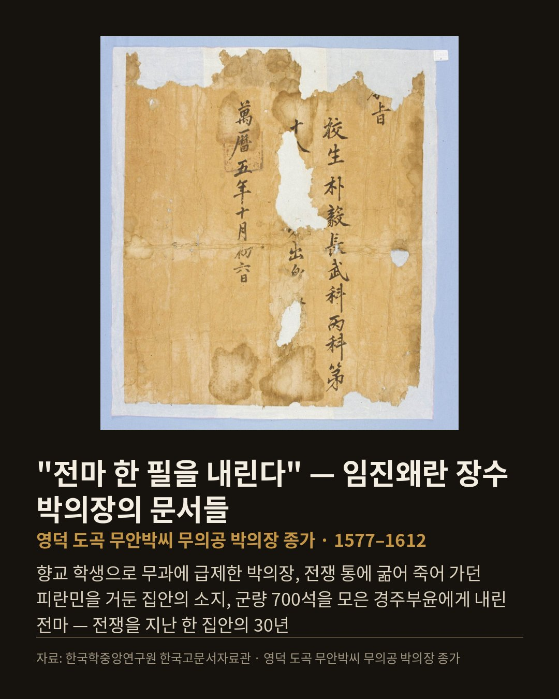
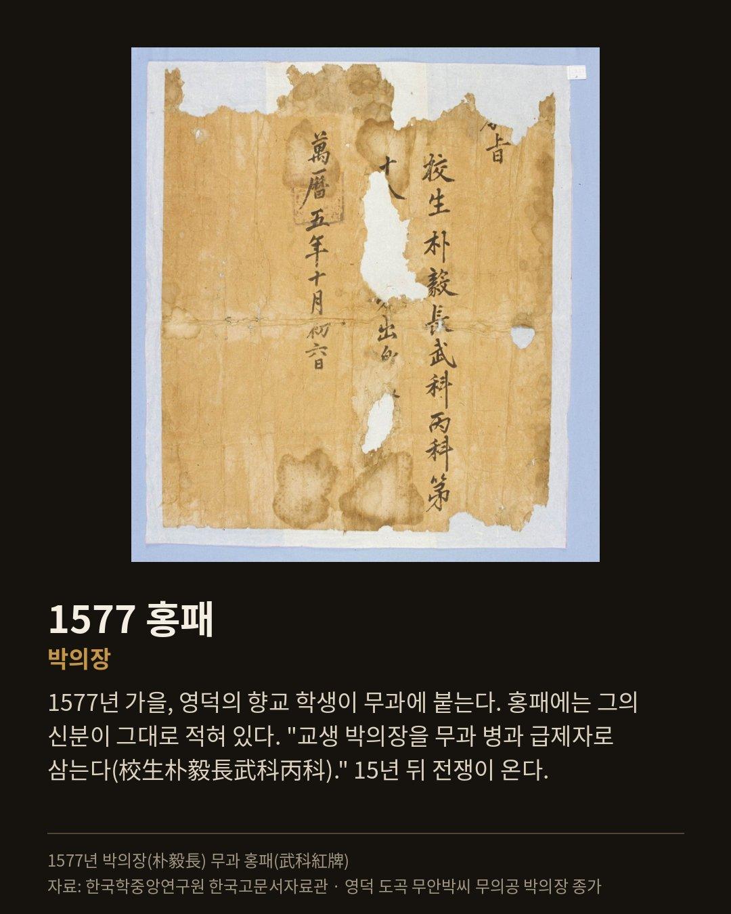
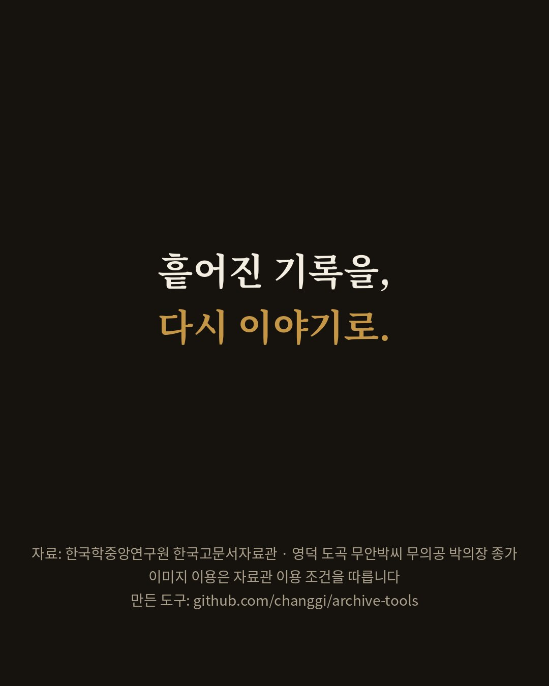

# EP.31 "전마 한 필을 내린다" — 임진왜란 장수 박의장의 문서들

영덕 도곡 무안박씨 무의공 박의장 종가 (문중) · 향교 학생으로 무과에 급제한 박의장, 전쟁 통에 굶어 죽어 가던 피란민을 거둔 집안의 소지, 군량 700석을 모은 경주부윤에게 내린 전마 — 전쟁을 지난 한 집안의 30년

- 🌐 [전시 웹페이지](https://changgi.github.io/archive-tools/examples/uiijang/exhibit.html) (한자 위 한글 독음 · 원문 해석) · [수업 활동지](https://changgi.github.io/archive-tools/examples/uiijang/handout.html)
- 🎬 영상: [릴스 9:16](https://changgi.github.io/archive-tools/examples/media/ep31-uiijang_reel.mp4) · [가로 16:9](https://changgi.github.io/archive-tools/examples/media/ep31-uiijang_wide.mp4) · 홍보 글: [`promo.md`](promo.md)
- 카드뉴스: [`cards/`](cards/) · SNS 글: [`sns.txt`](sns.txt) · 판독·해석 표: [`selection.csv`](selection.csv)

## 이야기 — 사료가 말하는 대로

전쟁 7년째, 임금은 한 장수에게 왜 말 한 필을 보냈을까요?

> **1577 홍패** — 1577년 가을, 영덕의 향교 학생이 무과에 붙는다. 홍패에는 그의 신분이 그대로 적혀 있다. "교생 박의장을 무과 병과 급제자로 삼는다(校生朴毅長武科丙科)." 15년 뒤 전쟁이 온다.
> **1593 소지** — 1593년 봄, 전쟁은 굶주림이 되었다. 박의장 집안의 노비가 관아에 글을 올린다. "여러 날 굶주려 목숨이 곧 끊어지려 하기에(累日飢餓 將絶命在頃刻), 물어보니 윗지방에서 난리 중에 흘러온 사람들이었습니다." 스물세 살 길산과 열예닐곱 살 금분, 이름 두 개가 400년 넘게 남았다.
> **1598 유지** — 1598년, 전쟁 7년째. 경주부윤 박의장에게 임금의 편지가 닿는다. "마음과 힘을 다해 군량을 마련한 것이 700여 석에 이르니, 특별히 전마 한 필을 내린다(茲以別賜戰馬一匹)." 5년 전 굶주린 피란민을 거두던 집안의 아들이, 이번에는 군대를 먹이고 있었다.
> **1610 유지** — 전쟁이 끝나고 고향에 물러나 있던 그를 나라가 다시 부른다. "경은 품계 높은 무관이니 지방에 물러나 있어서는 안 된다(不可退在外方). 서둘러 올라오라." 문서명은 1600년이지만, 원문의 날짜는 '만력 38년', 1610년이다.
> **1612 유서** — 1612년, 쉰여덟의 박의장은 충청도 바다를 지키는 수군절도사가 된다. 임금의 유서는 비밀 병부를 맡기며 이렇게 쓴다. "오직 나와 경만이 홀로 결단할 일이 있다(惟式有予與卿獨斷處)." 향교 학생에서 시작해, 임금과 비밀을 나누는 장수가 되기까지 35년이었다.

| 표지 | 1번 카드 | 마무리 |
|---|---|---|
|  |  |  |

## 선별 문서 (5점)

| # | 연도 | 유형 | 문서명 | 원본 |
|---|---|---|---|---|
| 1 | 1577 | 홍패 | 1577년 박의장(朴毅長) 무과 홍패(武科紅牌) | [원본 보기](https://archive.aks.ac.kr/viewer/viewer.do#imgnode.do?itemId=book&gubun=booktree&depth=6&upPath=01%5E0167%5EL016759%5EL016759F02%5EL016759F0201&dataId=G002%2BAKS%2BKSM-XA.1577.1111-20101008.B057a_082_00006_XXX&itemType=) |
| 2 | 1593 | 소지 | 1593년 호노(戶奴) 윤보기(允卜只) 소지(所志) | [원본 보기](https://archive.aks.ac.kr/viewer/viewer.do#imgnode.do?itemId=book&gubun=booktree&depth=6&upPath=01%5E0167%5EL016759%5EL016759F02%5EL016759F0202&dataId=G002%2BAKS%2BKSM-XB.1593.4777-20101008.B057a_082_00172_001&itemType=) |
| 3 | 1598 | 유지 | 1598년 박의장(朴毅長) 유지(有旨) | [원본 보기](https://archive.aks.ac.kr/viewer/viewer.do#imgnode.do?itemId=book&gubun=booktree&depth=6&upPath=01%5E0167%5EL016759%5EL016759F02%5EL016759F0201&dataId=G002%2BAKS%2BKSM-XA.1598.1111-20101008.B057a_082_00003_XXX&itemType=) |
| 4 | 1610 | 유지 | 1600년 박의장(朴毅長) 유지(有旨) | [원본 보기](https://archive.aks.ac.kr/viewer/viewer.do#imgnode.do?itemId=book&gubun=booktree&depth=6&upPath=01%5E0167%5EL016759%5EL016759F02%5EL016759F0201&dataId=G002%2BAKS%2BKSM-XA.1600.1111-20101008.B057a_082_00004_XXX&itemType=) |
| 5 | 1612 | 유서 | 1612년 박의장(朴毅長) 유서(諭書) | [원본 보기](https://archive.aks.ac.kr/viewer/viewer.do#imgnode.do?itemId=book&gubun=booktree&depth=6&upPath=01%5E0167%5EL016759%5EL016759F02%5EL016759F0201&dataId=G002%2BAKS%2BKSM-XA.1612.1111-20101008.B057a_082_00001_XXX&itemType=) |

## 원문 판독과 해석

### 1. 1577년 박의장(朴毅長) 무과 홍패(武科紅牌)

**원문 판독**

```
[敎]旨
校生朴毅長武科丙科第
十八(?)□[人及第]出身者 (훼손)
萬曆五年十月初六日 (도장)
```

**원문 해석** 교지. 교생(향교 학생) 박의장을 무과 병과 제18(?)인으로 급제하여 출신(出身)한 사람으로 삼는다. 만력 5년(1577) 10월 6일.

**해제** 1577년(선조 10) 박의장(朴毅長, 1555~1615)이 무과에 급제하고 받은 홍패(紅牌)입니다. 붉은 종이에 쓰는 급제 증서로, 오랜 세월 물에 젖고 찢겨 순위 숫자 일부가 사라졌습니다. 이름 앞의 '校生'은 향교에 다니던 학생이라는 뜻입니다. 박의장은 뒤에 임진왜란 때 경주 판관·경주부윤으로 경주성을 되찾는 데 공을 세웠고, 시호는 무의(武毅)입니다.

### 2. 1593년 호노(戶奴) 윤보기(允卜只) 소지(所志)

**원문 판독**

```
前縣監朴世廉戶奴允卜只
右謹陳爲白內等 奴矣段 府內仍良里前江邊良中 年二十三歲
人吉叱山稱名人及年十六七歲量女人今粉稱名人等亦 累日飢餓(?)
□言語將絶命在頃刻爲有去乙 詢其根脚則 語音分明(?)
浮爲在果 大槪上道亂離中流來之人以 作地將死極爲哀憐(?)
用良 其矣(?)救治使喚 計料爲白去乎 □死眞僞乙良 □□色□
閱依事目立案成給爲白只爲
行下向敎是事 爲在所陳
使主 處分
萬曆二十一年四月 日所志
(題辭 — 흘림, 판독 필요) (수결)
```

**원문 해석** 전 현감 박세렴 댁 호노(戶奴) 윤복지가 아룁니다. 삼가 진술하옵는 일은, 제가 부(府) 안 잉량리 앞 강가에서 나이 스물셋쯤 되는 길산(吉叱山)이라는 사람과 열예닐곱 살쯤 되는 여인 금분(今粉)이라는 사람들이 여러 날 굶주려 말도 하지 못하고 목숨이 곧 끊어지려 하기에, 그 내력을 물으니 [말씨로 보아] 떠돌이로, 대개 윗지방(上道)에서 난리 중에 흘러온 사람들이었습니다. 땅에 쓰러져 죽게 된 것이 매우 가엾어서 구해 살려 부리려 하오니, [죽게 되었던 사정의] 진위는 … 살펴 사목(事目)에 따라 입안(立案)을 만들어 주시도록 처분해 주십시오. 사또께서 처분하실 일. 만력 21년(1593) 4월 일 소지.

**해제** 1593년(선조 26) 4월, 박의장의 아버지 전 현감 박세렴(朴世廉) 집안의 노비 윤복지(允卜只)가 관아에 올린 소지(所志)입니다. 임진왜란 이듬해, 굶주려 죽어 가던 피란민 남녀를 거두어 살렸으니, 나라가 정한 사목(事目, 전란 중 굶주린 사람을 구활하면 그 사람을 부릴 수 있게 한 규정)에 따라 입안을 내 달라는 청원입니다. '爲白內等(하옵니다)', '矣段(저는)', '爲有去乙(하였기에)', '爲白只爲(하옵기 위하여)' 같은 이두가 섞여 있습니다. 왼쪽 큰 흘림 글씨는 관의 처분(題辭)입니다.

### 3. 1598년 박의장(朴毅長) 유지(有旨)

**원문 판독**

```
(겉) 慶州府尹朴 開拆
都承旨申(押)
今觀總管使柳永慶書狀 如此 □爲軍
興極艱(?)之時 卿竭心盡力 措備粮餉 至於七百
餘石之多 至爲可嘉 茲以別賜戰馬一匹
以示褒奬之意 卿其知悉領受事 有
旨
萬曆二十六年五月十六日 (도장)
```

**원문 해석** 경주부윤 박[의장]이 열어 볼 것. 도승지 신(申)이 씀. 이제 총관사 유영경의 서장(보고서)을 보니 이러하다. 군사를 일으켜 [군량이] 몹시 어려운 때에 경이 마음과 힘을 다해 군량을 마련한 것이 700여 석에 이르니 매우 가상하다. 이에 특별히 전마(戰馬) 한 필을 내려 칭찬하고 장려하는 뜻을 보이니, 경은 이를 알고 받으라는 유지. 만력 26년(1598) 5월 16일.

**해제** 1598년(선조 31) 5월, 경주부윤 박의장에게 임금의 명을 전한 유지(有旨)입니다. 정유재란 중 명나라 군대와 조선군의 군량이 바닥나던 때, 박의장이 700여 석의 군량을 마련했다는 총관사 유영경(柳永慶)의 보고를 받고 선조가 전마 한 필을 상으로 내렸습니다. 오른쪽 끝은 겉봉(받는 사람·開拆), 그다음 줄은 명을 전한 도승지의 성과 수결입니다.

### 4. 1600년 박의장(朴毅長) 유지(有旨)

**원문 판독**

```
(겉) 行副護軍朴 開拆
左副承旨李(押)
武臣堂上以上在外者 當爲召聚都下 卿以
秩高武弁 不可退在外方 斯速上
來事 有
旨
萬曆三十八年閏三月初二日 (도장 3)
```

**원문 해석** 행 부호군 박[의장]이 열어 볼 것. 좌부승지 이(李)가 씀. 당상관 이상의 무신으로 지방에 있는 사람은 마땅히 도성으로 불러 모아야 한다. 경은 품계가 높은 무관이니 지방에 물러나 있어서는 안 된다. 서둘러 올라오라는 유지. 만력 38년(1610) 윤3월 2일.

**해제** 당상관 이상 무신을 도성으로 불러 모을 때 박의장에게 내린 유지입니다. 문서명은 1600년이지만 원문의 날짜는 '萬曆三十八年閏三月'로 또렷하게 읽혀 1610년(광해군 2)입니다(1610년에는 윤3월이 있음). 문서명과 원문의 연도가 다르므로 확인이 필요합니다. 이때 박의장은 '行副護軍'이라는 군직만 가진 채 고향에 물러나 있었던 것으로 보입니다.

### 5. 1612년 박의장(朴毅長) 유서(諭書)

**원문 판독**

```
諭行公洪道水軍節度使
朴毅長 (도장)
卿受委一方 體任非輕
凡發兵應機 安民制
敵 一應常事 自有舊
章 惟式有予與卿獨
斷處 □□[置之事 …] (훼손)
可施爲 且慮外姦
可不預防 如有非常
(…) (이하 훼손)
```

**원문 해석** 행 공홍도 수군절도사 박의장에게 내리는 글. 경은 한 지방을 맡았으니 그 소임이 가볍지 않다. 무릇 군사를 일으켜 기회에 대응하고 백성을 편안히 하며 적을 제압하는 모든 일상적인 일은 이미 옛 규정이 있다. 다만 나와 경만이 홀로 결단할 일이 있으면 [밀부를 맞추어야] 시행할 수 있다. 또 바깥의 간사한 자를 염려하지 않을 수 있겠는가. 만일 비상한 [명령이] 있으면 … (이하 훼손)

**해제** 1612년(광해군 4) 공홍도(충청도) 수군절도사로 나가는 박의장에게 내린 유서(諭書)입니다. 지방 군사 지휘관에게 밀부(密符)와 함께 주는 정해진 서식으로, '나와 경만이 홀로 결단할 일'에는 밀부를 맞추어 확인한 뒤에야 군사를 움직이라는 내용입니다. 왼쪽 아래가 찢겨 끝부분은 서식으로 보충해 [ ]로 표시했습니다.

판독·해석·이야기는 이미지에 근거한 초안이며(검토 전 "초안" 표시), 정확한 판독은 원문 확인이 필요합니다. □는 읽지 못한 글자, (?)는 불확실한 글자입니다.
이미지: 한국학중앙연구원 한국고문서자료관 소장·제공. "원본" 링크를 누르면 자료관 뷰어에서 그 문서가 열립니다. 재사용은 자료관에 문의하세요(소장처 동의 필요).
