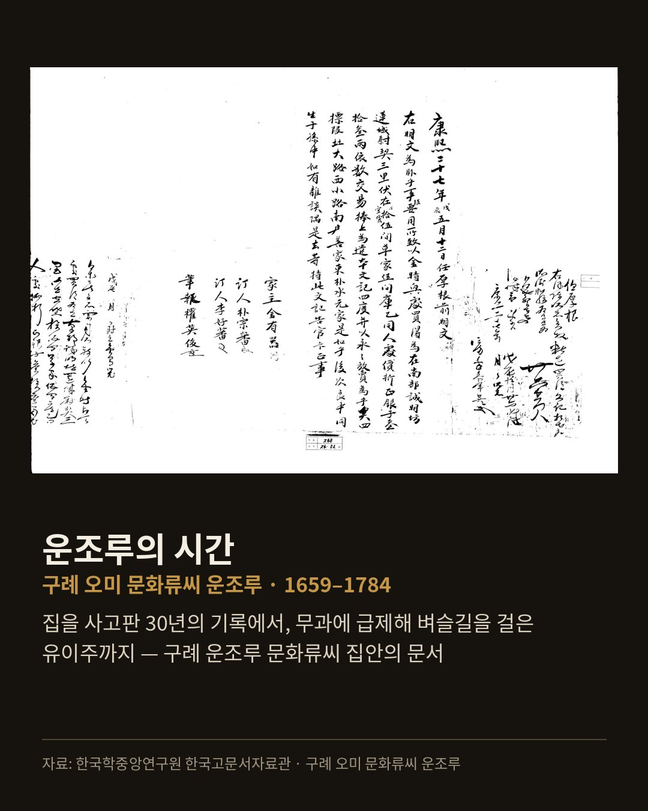
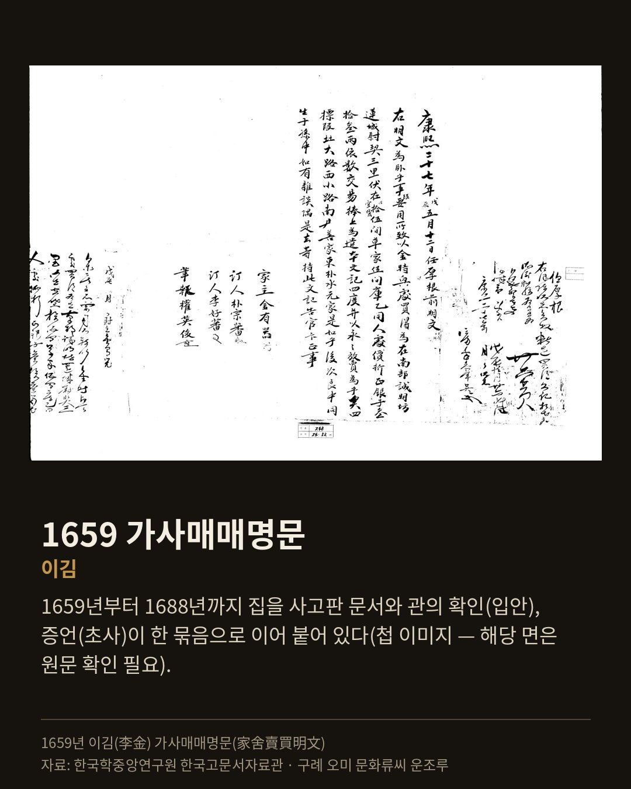
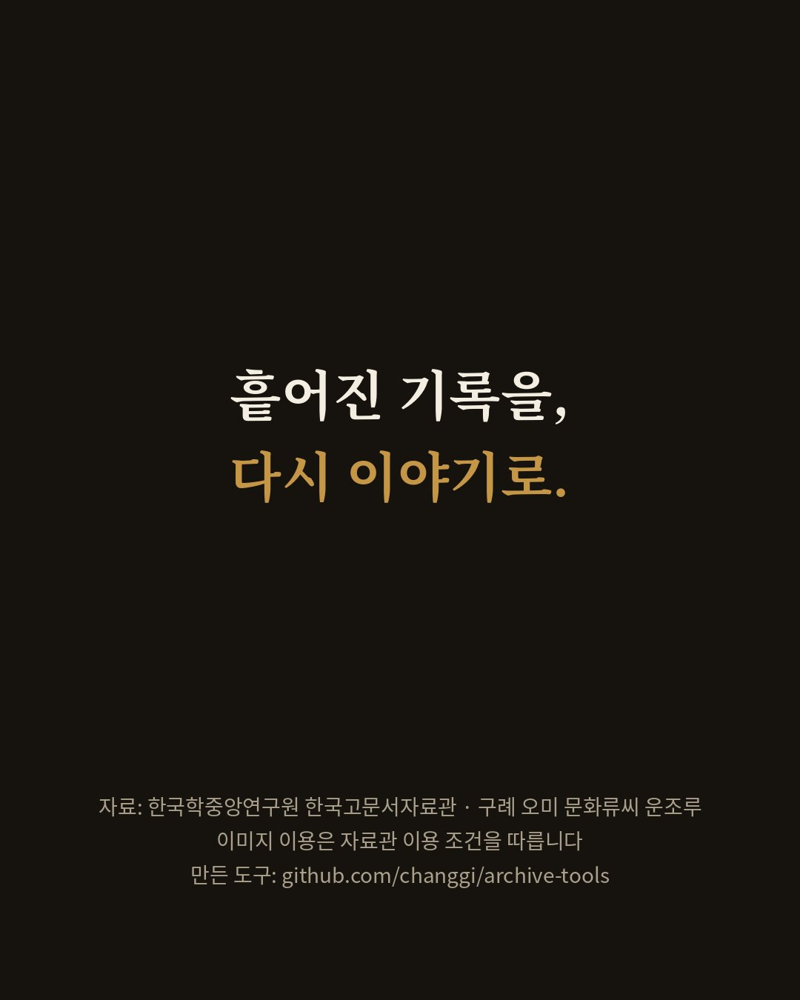

# EP.8 운조루의 시간

구례 오미 문화류씨 운조루 (문중) · 집을 사고판 30년의 기록에서, 무과에 급제해 벼슬길을 걸은 유이주까지 — 구례 운조루 문화류씨 집안의 문서

- 🌐 [전시 웹페이지](https://changgi.github.io/archive-tools/examples/unjoru/exhibit.html) · [수업 활동지](https://changgi.github.io/archive-tools/examples/unjoru/handout.html)
- 🎬 영상: [릴스 9:16](https://changgi.github.io/archive-tools/examples/media/ep8-unjoru_reel.mp4) · [가로 16:9](https://changgi.github.io/archive-tools/examples/media/ep8-unjoru_wide.mp4) · 홍보 글: [`promo.md`](promo.md)
- 카드뉴스: [`cards/`](cards/) · SNS 글: [`sns.txt`](sns.txt) · 에디팅 결과: [`selection.csv`](selection.csv)

## 이야기 (영상 내레이션)

> 운조루를 지은 유이주, 그는 어떤 길을 걸어왔을까요?
> 이야기는 1659년, 집을 사고판 문서 묶음에서 시작합니다. 30년 동안 거래와 확인이 이어 붙었죠.
> 1753년, 유이주는 무과에 급제합니다.
> 1768년엔 함경남도 병마우후,
> 1777년엔 아내 허씨도 정부인으로 높여졌고,
> 1784년, 그는 용천 도호부사에 오릅니다.
> 집 문서에서 무관의 이력까지, 운조루의 시간은 이렇게 쌓였습니다.

| 표지 | 1번 카드 | 마무리 |
|---|---|---|
|  |  |  |

## 선별 문서 (7점)

| # | 연도 | 유형 | 문서명 | 원본 |
|---|---|---|---|---|
| 1 | 1659 | 가사매매명문 | 1659년 이김(李金) 가사매매명문(家舍賣買明文) | [원본 보기](https://archive.aks.ac.kr/viewer/viewer.do#imgnode.do?itemId=book&gubun=booktree&depth=6&upPath=01%5E0148%5EL014804%5EL014804F02%5EL014804F0205&dataId=G002%2BAKS%2BKSM-XE.1659.1111-20101008.B025a_037_00227_021&itemType=) |
| 2 | 1753 | 홍패 | 1753년 유이주(柳爾胄) 무과 홍패(武科紅牌) | [원본 보기](https://archive.aks.ac.kr/viewer/viewer.do#imgnode.do?itemId=book&gubun=booktree&depth=6&upPath=01%5E0148%5EL014804%5EL014804F02%5EL014804F0201&dataId=G002%2BAKS%2BKSM-XA.1753.1111-20101008.B025a_037_00001_XXX&itemType=) |
| 3 | 1768 | 고신 | 1768년 유이주(柳爾胄) 고신(告身) | [원본 보기](https://archive.aks.ac.kr/viewer/viewer.do#imgnode.do?itemId=book&gubun=booktree&depth=6&upPath=01%5E0148%5EL014804%5EL014804F02%5EL014804F0201&dataId=G002%2BAKS%2BKSM-XA.1768.1111-20101008.B025a_037_00005_XXX&itemType=) |
| 4 | 1774 | 호구단자 | 1774년 유이주(柳爾胄) 호구단자(戶口單子)－1 | [원본 보기](https://archive.aks.ac.kr/viewer/viewer.do#imgnode.do?itemId=book&gubun=booktree&depth=6&upPath=01%5E0148%5EL014804%5EL014804F02%5EL014804F0204&dataId=G002%2BAKS%2BKSM-XD.1774.4673-20101008.B025a_037_00152_XXX&itemType=) |
| 5 | 1777 | 고신 | 1777년 유이주(柳爾胄) 고신(告身) | [원본 보기](https://archive.aks.ac.kr/viewer/viewer.do#imgnode.do?itemId=book&gubun=booktree&depth=6&upPath=01%5E0148%5EL014804%5EL014804F02%5EL014804F0201&dataId=G002%2BAKS%2BKSM-XA.1777.1111-20101008.B025a_037_00017_XXX&itemType=) |
| 6 | 1777 | 추증교지 | 1777년 유이주(柳爾胄) 처(妻) 허씨(許氏) 추증교지(追贈敎旨) | [원본 보기](https://archive.aks.ac.kr/viewer/viewer.do#imgnode.do?itemId=book&gubun=booktree&depth=6&upPath=01%5E0148%5EL014804%5EL014804F02%5EL014804F0201&dataId=G002%2BAKS%2BKSM-XA.1777.1111-20101008.B025a_037_00016_XXX&itemType=) |
| 7 | 1784 | 고신 | 1784년 유이주(柳爾胄) 고신(告身) | [원본 보기](https://archive.aks.ac.kr/viewer/viewer.do#imgnode.do?itemId=book&gubun=booktree&depth=6&upPath=01%5E0148%5EL014804%5EL014804F02%5EL014804F0201&dataId=G002%2BAKS%2BKSM-XA.1784.1111-20101008.B025a_037_00020_001&itemType=) |

이야기는 문서명과 이미지에서 보이는 것에 근거한 초안이며(검토 전 "초안" 표시), 판독·해석은 원문 확인이 필요합니다.
이미지: 한국학중앙연구원 한국고문서자료관 소장·제공. "원본" 링크를 누르면 자료관 뷰어에서 그 문서가 열립니다. 재사용은 자료관에 문의하세요(소장처 동의 필요).
