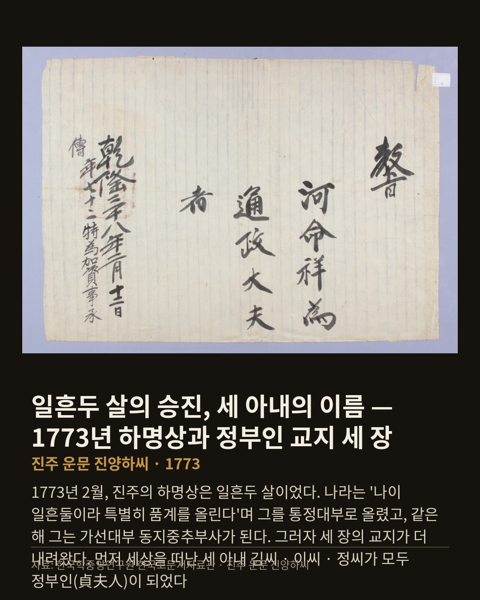
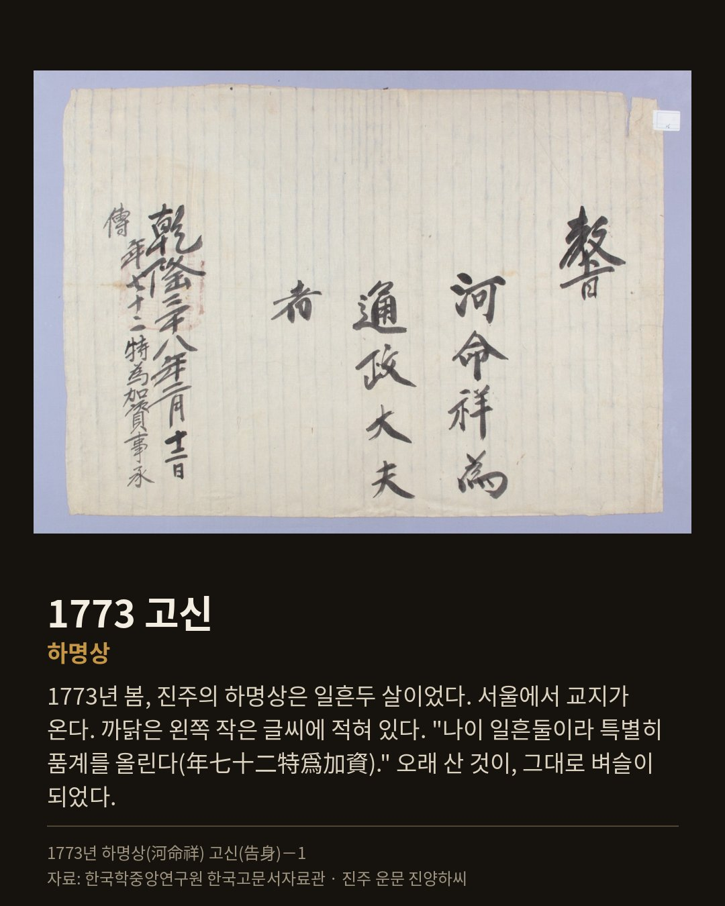
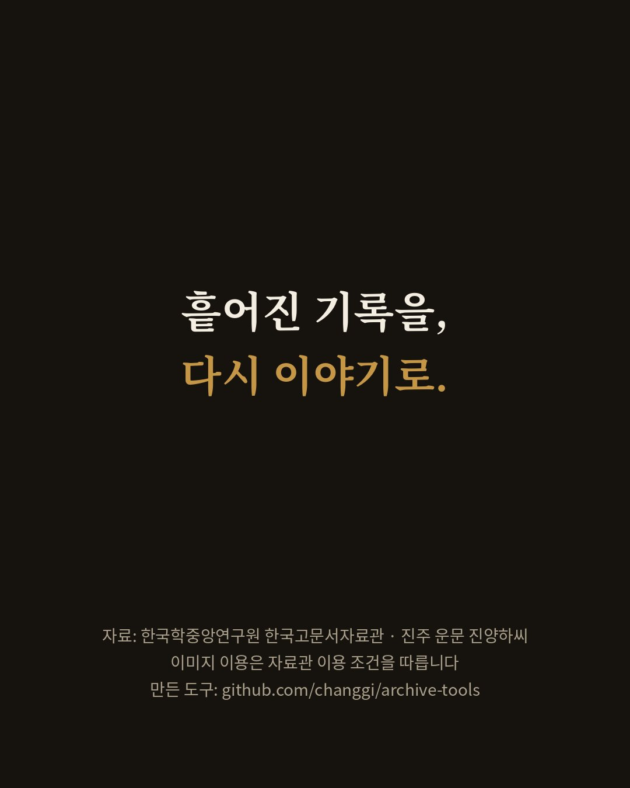

# EP.106 일흔두 살의 승진, 세 아내의 이름 — 1773년 하명상과 정부인 교지 세 장

진주 운문 진양하씨 (문중) · 1773년 2월, 진주의 하명상은 일흔두 살이었다. 나라는 '나이 일흔둘이라 특별히 품계를 올린다'며 그를 통정대부로 올렸고, 같은 해 그는 가선대부 동지중추부사가 된다. 그러자 세 장의 교지가 더 내려왔다. 먼저 세상을 떠난 세 아내 김씨 · 이씨 · 정씨가 모두 정부인(貞夫人)이 되었다

- 🌐 [전시 웹페이지](https://changgi.github.io/archive-tools/examples/unmun-ha/exhibit.html) (한자 위 한글 독음 · 원문 해석) · [수업 활동지](https://changgi.github.io/archive-tools/examples/unmun-ha/handout.html)
- 🎬 영상: [릴스 9:16](https://changgi.github.io/archive-tools-next/media/ep106-unmun-ha_reel.mp4) · [가로 16:9](https://changgi.github.io/archive-tools-next/media/ep106-unmun-ha_wide.mp4) · 홍보 글: [`promo.md`](promo.md)
- 카드뉴스: [`cards/`](cards/) · SNS 글: [`sns.txt`](sns.txt) · 판독·해석 표: [`selection.csv`](selection.csv)

<!-- DELIVERY -->
## 전달 에디팅 — 이 기록을 이렇게 전합니다

- **핵심 정서** — 애틋함
- **한 문장** — 한 사람의 승진이 집안의 이름들을 함께 불러낸다 — 그리고 그 이름의 대부분은 이미 세상을 떠난 여성들이었다.
- **열기** — 일흔두 살 남편이 승진하자, 세 장의 교지가 더 내려왔습니다.
- **펼치기** — 하명상 고신－1 → 하명상 처 김씨 추증교지 → 하명상 처 이씨 추증교지 → 하명상 처 정씨 추증교지 (1773년) — 일흔둘의 '特爲加資' → 김씨 · 이씨 · 정씨, 같은 문장이 세 번 반복되는 리듬으로 구성했습니다.
- **절정** — "나이 일흔둘이라 특별히 품계를 올린다(年七十二特爲加資)" — 화면·공간에서 이 한 줄만 크게, 소리를 줄여 집중
- **여운** — 교지에 이름 대신 성씨만 남은 세 사람의 삶은, 어디에서 찾을 수 있을까요? — 질문으로 끝내고 답은 보는 사람에게
- **감각과 물질** — 똑같은 교지 세 장의 반복, 성씨 한 글자만 바뀌는 순간 · 어보·관인 탁본 스탬프를 찍어 보는 체험
- **통로와 매개** — 온라인: 릴스(열기) → 카드뉴스(펼치기) → 전시 웹페이지(절정·원문) → 비하인드 카드(여운) / 오프라인: 원본 크기 복제·낭독·참여 벽 / 남기기: 활동지·질문 카드
- **여운 장치** — 이름 없이 성씨만 남은 사람들의 이름 상상해 보기
- **전달 에디팅 전** — 4건의 문서를 1773년 연대순으로 놓고 문서명 · 유형 · 해설을 붙인다 — 정확하지만, 지나가면 잊힌다.
- **전달 에디팅 후** — 핵심 정서는 「애틋함」. 「일흔두 살 남편이 승진하자, 세 장의 교지가 더 내려왔습니다.」로 열고, 문서를 대비와 순서로 펼친 뒤, "나이 일흔둘이라 특별히 품계를 올린다(年七十二特爲加資)"에서 멈춘다. 똑같은 교지 세 장의 반복, 성씨 한 글자만 바뀌는 순간. 마지막엔 「이름 없이 성씨만 남은 사람들의 이름 상상해 보기」로 보는 사람이 자기 이야기를 남기고 떠나게 한다.

전문: [`delivery.md`](delivery.md)
<!-- /DELIVERY -->

<!-- CURATOR -->
## 비하인드 — 큐레이터 노트

- **왜 이 문서들인가** — 글자 하나만 다른 교지 세 장이 나란히 놓였을 때, 그 똑같음이 오히려 세 사람의 다름을 생각하게 했습니다.
- **전하고 싶은 것** — 한 사람의 승진이 집안의 이름들을 함께 불러낸다 — 그리고 그 이름의 대부분은 이미 세상을 떠난 여성들이었다.
- **이렇게 보이길 바랐다** — 일흔둘의 '特爲加資' → 김씨 · 이씨 · 정씨, 같은 문장이 세 번 반복되는 리듬으로 구성했습니다.
- **이렇게 써 주세요** — 노인직, 외명부와 추증, 조선 후기 혼인과 재혼을 다루는 수업에 쓰세요.
- **만들며 있었던 일** — 세 아내의 혼인 순서와 생몰은 이 교지들만으로는 알 수 없습니다. 같은 해 가선대부 승진 교지(고신-2~4)는 이번에 읽지 않았습니다.
- **남겨 둔 질문** — 교지에 이름 대신 성씨만 남은 세 사람의 삶은, 어디에서 찾을 수 있을까요?
- **제작 기록** — 문서 4건 · 1773년 · 원본 사진 4면(문서 전체) · 원문 판독 4건 · 번역 4건

전문: [`curator.md`](curator.md) · 비하인드 카드: [`behind/`](behind/) · 채널별 홍보안: [`channels.md`](channels.md)
<!-- /CURATOR -->

## 이야기 — 사료가 말하는 대로

일흔두 살 남편이 승진하자, 세 장의 교지가 더 내려왔습니다.

> **1773 고신** — 1773년 봄, 진주의 하명상은 일흔두 살이었다. 서울에서 교지가 온다. 까닭은 왼쪽 작은 글씨에 적혀 있다. "나이 일흔둘이라 특별히 품계를 올린다(年七十二特爲加資)." 오래 산 것이, 그대로 벼슬이 되었다.
> **1773 추증교지** — 그해 가을, 그가 가선대부에 오르자 교지 세 장이 더 내려왔다. 첫 장은 김씨였다. "숙부인 김씨에게 정부인을 추증한다(淑夫人金氏贈貞夫人者)."
> **1773 추증교지** — 둘째 장은 이씨였다. "숙부인 이씨에게 정부인을 추증한다(淑夫人李氏贈貞夫人者)." 성씨 한 글자만 다르고, 나머지는 모두 같았다.
> **1773 추증교지** — 셋째 장은 정씨였다. "숙부인 정씨에게 정부인을 추증한다(淑夫人鄭氏贈貞夫人者)." 일흔두 살 남편의 승진이, 먼저 세상을 떠난 세 사람의 이름을 함께 불러냈다.

| 표지 | 1번 카드 | 마무리 |
|---|---|---|
|  |  |  |

## 선별 문서 (4점)

| # | 연도 | 유형 | 문서명 | 원본 |
|---|---|---|---|---|
| 1 | 1773 | 고신 | 1773년 하명상(河命祥) 고신(告身)－1 | [원본 보기](https://archive.aks.ac.kr/viewer/viewer.do#imgnode.do?itemId=book&gubun=booktree&depth=6&upPath=01%5E0150%5EL015005%5EL015005F02%5EL015005F0201&dataId=G002%2BAKS%2BKSM-XA.1773.1111-20101008.B037a_057_00028_XXX&itemType=) |
| 2 | 1773 | 추증교지 | 1773년 하명상(河命祥) 처(妻) 김씨(金氏) 추증교지(追贈敎旨) | [원본 보기](https://archive.aks.ac.kr/viewer/viewer.do#imgnode.do?itemId=book&gubun=booktree&depth=6&upPath=01%5E0150%5EL015005%5EL015005F02%5EL015005F0201&dataId=G002%2BAKS%2BKSM-XA.1773.1111-20101008.B037a_057_00044_XXX&itemType=) |
| 3 | 1773 | 추증교지 | 1773년 하명상(河命祥) 처(妻) 이씨(李氏) 추증교지(追贈敎旨) | [원본 보기](https://archive.aks.ac.kr/viewer/viewer.do#imgnode.do?itemId=book&gubun=booktree&depth=6&upPath=01%5E0150%5EL015005%5EL015005F02%5EL015005F0201&dataId=G002%2BAKS%2BKSM-XA.1773.1111-20101008.B037a_057_00043_XXX&itemType=) |
| 4 | 1773 | 추증교지 | 1773년 하명상(河命祥) 처(妻) 정씨(鄭氏) 추증교지(追贈敎旨) | [원본 보기](https://archive.aks.ac.kr/viewer/viewer.do#imgnode.do?itemId=book&gubun=booktree&depth=6&upPath=01%5E0150%5EL015005%5EL015005F02%5EL015005F0201&dataId=G002%2BAKS%2BKSM-XA.1773.1111-20101008.B037a_057_00042_XXX&itemType=) |

## 원문 판독과 해석

### 1. 1773년 하명상(河命祥) 고신(告身)－1

**원문 판독**

```
敎旨
河命祥爲
通政大夫
者
乾隆三十八年二月十二日 (도장)
(작은 글씨) 年七十二特爲加資事承
傳
```

**원문 해석** 교지. 하명상을 통정대부로 삼는다. 건륭 38년(1773) 2월 12일. (작은 글씨) 나이 일흔둘이므로 특별히 품계를 올리라는 전교를 받듦.

**해제** 1773년(영조 49, 乾隆 38) 2월 12일, 하명상(河命祥)을 정3품 당상 통정대부로 올린 교지입니다. 왼쪽 작은 글씨 '年七十二特爲加資'는 나이 일흔둘이라 특별히 품계를 올려 준다는 뜻으로, 나이 많은 사람에게 품계를 내리던 노인직(老人職)의 예입니다. 하명상은 1751년 무과에 급제한 무관이었고, 같은 해 다시 가선대부 동지중추부사(종2품)에 오릅니다.

### 2. 1773년 하명상(河命祥) 처(妻) 김씨(金氏) 추증교지(追贈敎旨)

**원문 판독**

```
敎旨
淑夫人金氏
贈貞夫人者
乾隆三十八年　月 (도장)
(작은 글씨) 嘉善大夫同知中樞府事河命祥妻依法典從夫職
```

**원문 해석** 교지. 숙부인 김씨에게 정부인을 추증한다. 건륭 38년(1773) 월. (작은 글씨) 가선대부 동지중추부사 하명상의 아내이니 법전에 따라 남편의 직품을 따름.

**해제** 1773년(영조 49, 乾隆 38), 하명상의 아내 김씨에게 정부인(貞夫人)을 추증한 교지입니다. 관원의 아내는 남편의 품계에 맞추어 외명부 작호를 받았는데, 종2품 가선대부의 아내는 정부인입니다. '贈'은 이미 세상을 떠난 사람에게 내린다는 뜻이고, 작은 글씨는 법전에 따라 남편의 직품을 따랐다는 근거입니다. 같은 날짜 · 같은 문구의 교지가 이씨 · 정씨에게도 내려졌습니다.

### 3. 1773년 하명상(河命祥) 처(妻) 이씨(李氏) 추증교지(追贈敎旨)

**원문 판독**

```
敎旨
淑夫人李氏
贈貞夫人者
乾隆三十八年　月 (도장)
(작은 글씨) 嘉善大夫同知中樞府事河命祥妻依法典從夫職
```

**원문 해석** 교지. 숙부인 이씨에게 정부인을 추증한다. 건륭 38년(1773) 월. (작은 글씨) 가선대부 동지중추부사 하명상의 아내이니 법전에 따라 남편의 직품을 따름.

**해제** 1773년(영조 49, 乾隆 38), 하명상의 아내 이씨에게 정부인을 추증한 교지입니다. 김씨 · 정씨의 교지와 글자 하나(성씨)만 다릅니다. 한 사람에게 아내가 셋인 것은 먼저 떠난 아내를 잇달아 다시 맞은 것으로 보이며(선후는 이 교지들만으로는 알 수 없음), 세 사람 모두 남편의 품계를 따라 같은 작호를 받았습니다.

### 4. 1773년 하명상(河命祥) 처(妻) 정씨(鄭氏) 추증교지(追贈敎旨)

**원문 판독**

```
敎旨
淑夫人鄭氏
贈貞夫人者
乾隆三十八年　月 (도장)
(작은 글씨) 嘉善大夫同知中樞府事河命祥妻依法典從夫職
```

**원문 해석** 교지. 숙부인 정씨에게 정부인을 추증한다. 건륭 38년(1773) 월. (작은 글씨) 가선대부 동지중추부사 하명상의 아내이니 법전에 따라 남편의 직품을 따름.

**해제** 1773년(영조 49, 乾隆 38), 하명상의 아내 정씨에게 정부인을 추증한 교지입니다. 이 집안에는 같은 해 하명상의 어머니 · 할머니 · 증조할머니에게 내린 추증 교지도 함께 전해, 한 사람의 승진이 윗대와 아내들의 이름까지 함께 올렸음을 보여 줍니다. 세 아내의 교지에는 달(月) 앞의 날짜가 비어 있습니다.

판독·해석·이야기는 이미지에 근거한 초안이며(검토 전 "초안" 표시), 정확한 판독은 원문 확인이 필요합니다. □는 읽지 못한 글자, (?)는 불확실한 글자입니다.
이미지: 한국학중앙연구원 한국고문서자료관 소장·제공. "원본" 링크를 누르면 자료관 뷰어에서 그 문서가 열립니다. 재사용은 자료관에 문의하세요(소장처 동의 필요).
