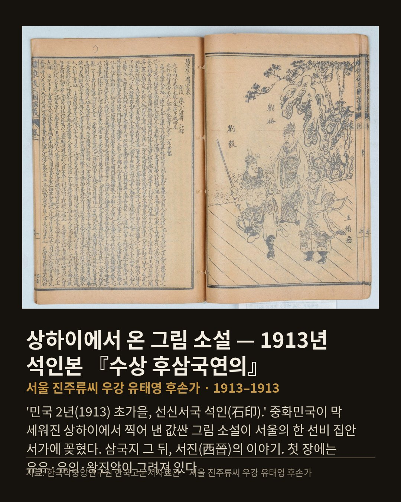
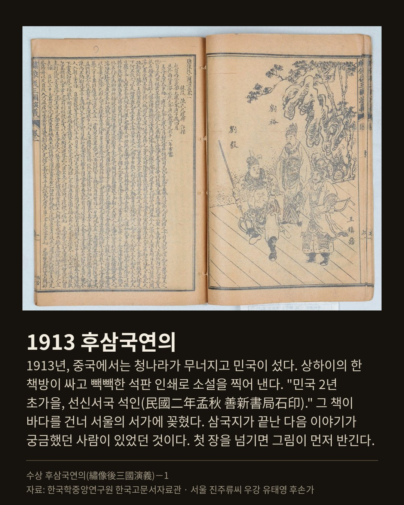
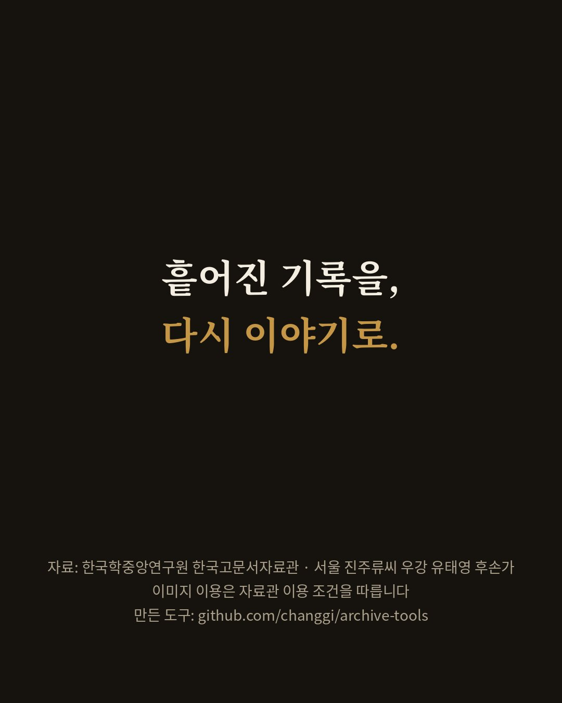

# EP.88 상하이에서 온 그림 소설 — 1913년 석인본 『수상 후삼국연의』

서울 진주류씨 우강 유태영 후손가 (문중) · '민국 2년(1913) 초가을, 선신서국 석인(石印).' 중화민국이 막 세워진 상하이에서 찍어 낸 값싼 그림 소설이 서울의 한 선비 집안 서가에 꽂혔다. 삼국지 그 뒤, 서진(西晉)의 이야기. 첫 장에는 유유·유의·왕진악이 그려져 있다

- 🌐 [전시 웹페이지](https://changgi.github.io/archive-tools/examples/utaeyoung/exhibit.html) (한자 위 한글 독음 · 원문 해석) · [수업 활동지](https://changgi.github.io/archive-tools/examples/utaeyoung/handout.html)
- 🎬 영상: [릴스 9:16](https://changgi.github.io/archive-tools/examples/media/ep88-utaeyoung_reel.mp4) · [가로 16:9](https://changgi.github.io/archive-tools/examples/media/ep88-utaeyoung_wide.mp4) · 홍보 글: [`promo.md`](promo.md)
- 카드뉴스: [`cards/`](cards/) · SNS 글: [`sns.txt`](sns.txt) · 판독·해석 표: [`selection.csv`](selection.csv)


<!-- CURATOR -->
## 비하인드 — 큐레이터 노트

- **왜 이 문서들인가** — 1913년 상하이에서 석판 인쇄한 중국 그림 소설이 서울 선비 집안의 서가에 있었습니다.
- **전하고 싶은 것** — 책은 국경을 넘어 다녔고, 근대의 독자는 '삼국지 그다음 이야기'를 궁금해했다는 것.
- **이렇게 보이길 바랐다** — 간기(民國二年 善新書局石印)를 표지 장면으로 세우고, 그림(유유·유의·왕진악)으로 마무리했습니다.
- **이렇게 써 주세요** — 독서사·출판사, 동아시아 책의 교류를 다루는 수업과 전시에 쓰세요.
- **만들며 있었던 일** — 본문 세자(細字)는 판독을 생략했습니다. 표지 면 대신 삽화 면을 대표 이미지로 바꿨습니다.
- **남겨 둔 질문** — 100년 뒤 누군가 우리 서가를 본다면, 어떤 책이 가장 낯설어 보일까요?
- **제작 기록** — 문서 1건 · 1913년 · 원본 사진 3면(문서 전체) · 원문 판독 1건 · 번역 1건

전문: [`curator.md`](curator.md)
<!-- /CURATOR -->

## 이야기 — 사료가 말하는 대로

삼국지 그다음 이야기가 궁금했던 사람이, 100년 전 서울에도 있었습니다.

> **1913 후삼국연의** — 1913년, 중국에서는 청나라가 무너지고 민국이 섰다. 상하이의 한 책방이 싸고 빽빽한 석판 인쇄로 소설을 찍어 낸다. "민국 2년 초가을, 선신서국 석인(民國二年孟秋 善新書局石印)." 그 책이 바다를 건너 서울의 서가에 꽂혔다. 삼국지가 끝난 다음 이야기가 궁금했던 사람이 있었던 것이다. 첫 장을 넘기면 그림이 먼저 반긴다. 유유, 유의, 왕진악.

| 표지 | 1번 카드 | 마무리 |
|---|---|---|
|  |  |  |

## 선별 문서 (1점)

| # | 연도 | 유형 | 문서명 | 원본 |
|---|---|---|---|---|
| 1 | 1913 | 후삼국연의 | 수상 후삼국연의(繡像後三國演義)－1 | [원본 보기](https://archive.aks.ac.kr/viewer/viewer.do#imgnode.do?itemId=book&gubun=booktree&depth=6&upPath=01%5E0111%5EL011117%5EL011117F01%5EL011117F0104&dataId=G002%2BKHD%2BKSM-WZ.1913.0000-20150915.C0702_001_00202_XXX&itemType=) |

## 원문 판독과 해석

### 1. 수상 후삼국연의(繡像後三國演義)－1

**원문 판독**

```
(간기면)
民國二年孟秋
善新書局石印

(서문 · 부분)
繡像三國後演義序
一代擧興 必有一代之史 正史而外 更有野史 …
光緖十有九年癸巳冬十一月 …

(권1 첫 면 · 부분)
繡像後三國演義卷一
秣陵 陳氏尺蠖齋 評釋
起自西晉武帝太康元年庚子歲四月 …
(이하 본문 세자(細字) · 판독 생략)

(삽화면) 劉裕　劉毅　王鎭惡
```

**원문 해석** (간기) 중화민국 2년(1913) 초가을, 선신서국에서 석판 인쇄. (서문) '그림을 곁들인 삼국 이후 연의' 서문. 한 시대가 일어나면 반드시 그 시대의 역사가 있는데, 정사 밖에 또 야사가 있다 … 광서 19년(1893) 계사 겨울 11월. (권1) 그림을 곁들인 후삼국연의 권1. 말릉 진씨 척확재 평석. 서진 무제 태강 원년(280) 경자 4월부터 시작한다 … (삽화) 유유, 유의, 왕진악.

**해제** 중국 명대 소설 『동서진연의(東西晉演義)』 계열을 '후삼국연의'라는 이름으로 펴낸 통속 역사소설입니다. 삼국 통일(280) 이후 서진·동진의 흥망을 다루며, 권마다 인물 그림(繡像)을 넣었습니다. 1913년 상하이의 선신서국(善新書局)이 석판 인쇄(石印)로 찍어 낸 판본으로, 석인본은 값이 싸고 작은 글자를 빽빽이 담을 수 있어 20세기 초 동아시아에 대량으로 퍼졌습니다. 서울의 진주류씨 우강 유태영 후손가에는 『수상 후삼국연의』, 『회도정사』, 『분장루전전』 등 이런 중국 석인 소설이 여러 종 남아 있어, 근대 전환기 선비 집안의 독서 취향을 보여 줍니다. 본문 세자는 판독을 생략했습니다.

판독·해석·이야기는 이미지에 근거한 초안이며(검토 전 "초안" 표시), 정확한 판독은 원문 확인이 필요합니다. □는 읽지 못한 글자, (?)는 불확실한 글자입니다.
이미지: 한국학중앙연구원 한국고문서자료관 소장·제공. "원본" 링크를 누르면 자료관 뷰어에서 그 문서가 열립니다. 재사용은 자료관에 문의하세요(소장처 동의 필요).
