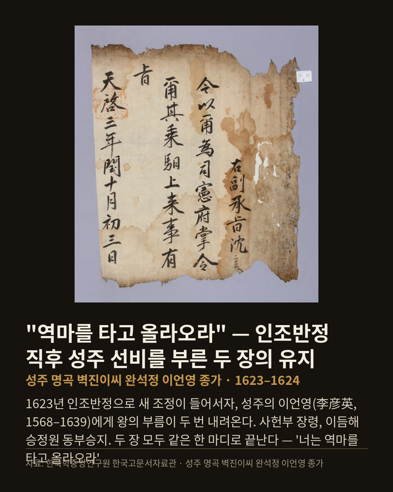
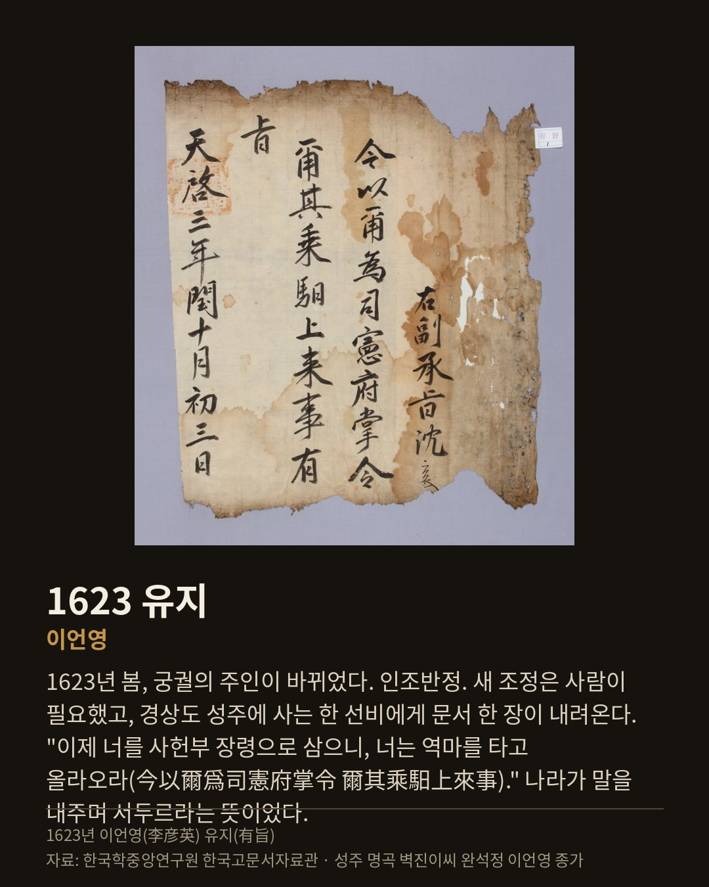
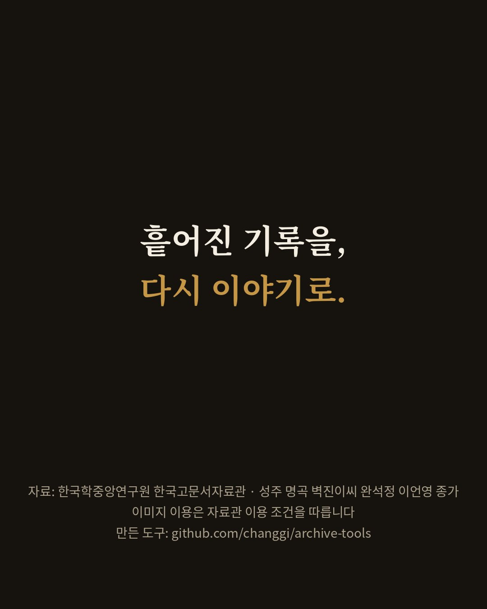

# EP.76 "역마를 타고 올라오라" — 인조반정 직후 성주 선비를 부른 두 장의 유지

성주 명곡 벽진이씨 완석정 이언영 종가 (문중) · 1623년 인조반정으로 새 조정이 들어서자, 성주의 이언영(李彦英, 1568–1639)에게 왕의 부름이 두 번 내려온다. 사헌부 장령, 이듬해 승정원 동부승지. 두 장 모두 같은 한 마디로 끝난다 — '너는 역마를 타고 올라오라'

- 🌐 [전시 웹페이지](https://changgi.github.io/archive-tools/examples/wanseokjeong/exhibit.html) (한자 위 한글 독음 · 원문 해석) · [수업 활동지](https://changgi.github.io/archive-tools/examples/wanseokjeong/handout.html)
- 🎬 영상: [릴스 9:16](https://changgi.github.io/archive-tools/examples/media/ep76-wanseokjeong_reel.mp4) · [가로 16:9](https://changgi.github.io/archive-tools/examples/media/ep76-wanseokjeong_wide.mp4) · 홍보 글: [`promo.md`](promo.md)
- 카드뉴스: [`cards/`](cards/) · SNS 글: [`sns.txt`](sns.txt) · 판독·해석 표: [`selection.csv`](selection.csv)


<!-- DELIVERY -->
## 전달 에디팅 — 이 기록을 이렇게 전합니다

- **핵심 정서** — 부름의 긴장
- **한 문장** — 정권이 바뀌는 순간, 지방의 선비에게도 역사가 문을 두드렸다는 것.
- **열기** — 왕이 보낸 쪽지의 마지막 한 마디. "역마를 타고 올라오라."
- **펼치기** — 이언영 유지 (1623–1624년) — 토씨 하나 다르지 않은 두 문장을 나란히 놓아 반복이 주는 긴장을 살렸습니다.
- **절정** — "너는 역마를 타고 올라오라(爾其乘馹上來事)" — 화면·공간에서 이 한 줄만 크게, 소리를 줄여 집중
- **여운** — 두 번 다 길을 떠난 그는, 다시 고향으로 돌아왔을까요? — 질문으로 끝내고 답은 보는 사람에게
- **감각과 물질** — 두 유지를 마주 보게, 역마 방울 소리 · 역마 방울·말발굽 소리와 함께 펼치는 두루마리
- **통로와 매개** — 온라인: 릴스(열기) → 카드뉴스(펼치기) → 전시 웹페이지(절정·원문) → 비하인드 카드(여운) / 오프라인: 원본 크기 복제·낭독·참여 벽 / 남기기: 활동지·질문 카드
- **여운 장치** — "두 번 부르면 가겠어요?"
- **전달 에디팅 전** — 2건의 문서를 1623–1624년 연대순으로 놓고 문서명 · 유형 · 해설을 붙인다 — 정확하지만, 지나가면 잊힌다.
- **전달 에디팅 후** — 핵심 정서는 「부름의 긴장」. 「왕이 보낸 쪽지의 마지막 한 마디. "역마를 타고 올라오라."」로 열고, 문서를 대비와 순서로 펼친 뒤, "너는 역마를 타고 올라오라(爾其乘馹上來事)"에서 멈춘다. 두 유지를 마주 보게, 역마 방울 소리. 마지막엔 「"두 번 부르면 가겠어요?"」로 보는 사람이 자기 이야기를 남기고 떠나게 한다.

전문: [`delivery.md`](delivery.md)
<!-- /DELIVERY -->

<!-- CURATOR -->
## 비하인드 — 큐레이터 노트

- **왜 이 문서들인가** — 인조반정 직후 같은 사람에게 내려온 두 장의 유지가 '역마를 타고 올라오라'는 똑같은 문장으로 끝났습니다.
- **전하고 싶은 것** — 정권이 바뀌는 순간, 지방의 선비에게도 역사가 문을 두드렸다는 것.
- **이렇게 보이길 바랐다** — 토씨 하나 다르지 않은 두 문장을 나란히 놓아 반복이 주는 긴장을 살렸습니다.
- **이렇게 써 주세요** — 인조반정과 조선 정치사, 유지라는 문서 서식 학습에 쓰세요.
- **만들며 있었던 일** — 승지 이름은 수결로만 남아 성씨만 적었습니다.
- **남겨 둔 질문** — 두 번 다 길을 떠난 그는, 다시 고향으로 돌아왔을까요?
- **제작 기록** — 문서 2건 · 1623–1624년 · 원본 사진 4면(문서 전체) · 원문 판독 2건 · 번역 2건

전문: [`curator.md`](curator.md)
<!-- /CURATOR -->

## 이야기 — 사료가 말하는 대로

왕이 보낸 쪽지의 마지막 한 마디. "역마를 타고 올라오라."

> **1623 유지** — 1623년 봄, 궁궐의 주인이 바뀌었다. 인조반정. 새 조정은 사람이 필요했고, 경상도 성주에 사는 한 선비에게 문서 한 장이 내려온다. "이제 너를 사헌부 장령으로 삼으니, 너는 역마를 타고 올라오라(今以爾爲司憲府掌令 爾其乘馹上來事)." 나라가 말을 내주며 서두르라는 뜻이었다.
> **1624 유지** — 이듬해 겨울, 또 한 장이 온다. 이번에는 왕의 곁, 승정원이다. 문장은 토씨 하나 다르지 않다. "너는 역마를 타고 올라오라(爾其乘馹上來事)." 같은 말을 두 번 들은 선비는 두 번 다 길을 떠났고, 집안은 그 두 장을 나란히 남겼다.

| 표지 | 1번 카드 | 마무리 |
|---|---|---|
|  |  |  |

## 선별 문서 (2점)

| # | 연도 | 유형 | 문서명 | 원본 |
|---|---|---|---|---|
| 1 | 1623 | 유지 | 1623년 이언영(李彦英) 유지(有旨) | [원본 보기](https://archive.aks.ac.kr/viewer/viewer.do#imgnode.do?itemId=book&gubun=booktree&depth=6&upPath=01%5E0167%5EL016769%5EL016769F02%5EL016769F0201&dataId=G002%2BAKS%2BKSM-XA.1623.1111-20101008.B064a_093_00003_XXX&itemType=) |
| 2 | 1624 | 유지 | 1624년 이언영(李彦英) 유지(有旨) | [원본 보기](https://archive.aks.ac.kr/viewer/viewer.do#imgnode.do?itemId=book&gubun=booktree&depth=6&upPath=01%5E0167%5EL016769%5EL016769F02%5EL016769F0201&dataId=G002%2BAKS%2BKSM-XA.1624.1111-20101008.B064a_093_00004_XXX&itemType=) |

## 원문 판독과 해석

### 1. 1623년 이언영(李彦英) 유지(有旨)

**원문 판독**

```
右副承旨 沈 [수결]
今以爾爲司憲府掌令
爾其乘馹上來事 有
旨
天啓三年閏十月初三日
(승정원 인 1과)
```

**원문 해석** 우부승지 심 [서명]. 이제 너를 사헌부 장령으로 삼으니, 너는 역마를 타고 올라오라는 일로 유지(왕의 뜻)가 있었다. 천계 3년(1623) 윤10월 초3일.

**해제** 유지(有旨)는 승정원의 승지가 왕명을 받아 해당 관원에게 전하는 문서로, 오늘의 '호출 명령'에 가깝습니다. 1623년(인조 1) 3월 인조반정 직후, 새 조정이 지방에 있던 성주의 선비 이언영을 정4품 사헌부 장령에 임명하고 역마(馹)를 이용해 서울로 올라오게 했습니다. 오른쪽에 우부승지 심(沈) 아무개가 서명했으나 이름은 수결로만 남았습니다. 오른편이 떨어져 나갔으나 본문은 온전합니다.

### 2. 1624년 이언영(李彦英) 유지(有旨)

**원문 판독**

```
右副承旨 鄭 [수결]
今以爾爲承政院同副承旨
爾其乘馹上來事 有
旨
天啓四年十二月初七日
(승정원 인 1과)
```

**원문 해석** 우부승지 정 [서명]. 이제 너를 승정원 동부승지로 삼으니, 너는 역마를 타고 올라오라는 일로 유지가 있었다. 천계 4년(1624) 12월 초7일.

**해제** 이듬해인 1624년(인조 2) 12월, 이언영을 정3품 당상관인 승정원 동부승지로 삼아 다시 역마로 상경하게 한 유지입니다. 승정원은 왕명의 출납을 맡은 비서 기관으로, 동부승지는 여섯 승지 가운데 가장 아래 자리이지만 왕을 가까이서 모시는 요직이었습니다. 1624년은 이괄의 난이 일어난 해이기도 합니다. 두 장의 문구가 '爾其乘馹上來事'로 똑같아, 유지의 정형화된 서식을 잘 보여 줍니다.

판독·해석·이야기는 이미지에 근거한 초안이며(검토 전 "초안" 표시), 정확한 판독은 원문 확인이 필요합니다. □는 읽지 못한 글자, (?)는 불확실한 글자입니다.
이미지: 한국학중앙연구원 한국고문서자료관 소장·제공. "원본" 링크를 누르면 자료관 뷰어에서 그 문서가 열립니다. 재사용은 자료관에 문의하세요(소장처 동의 필요).
