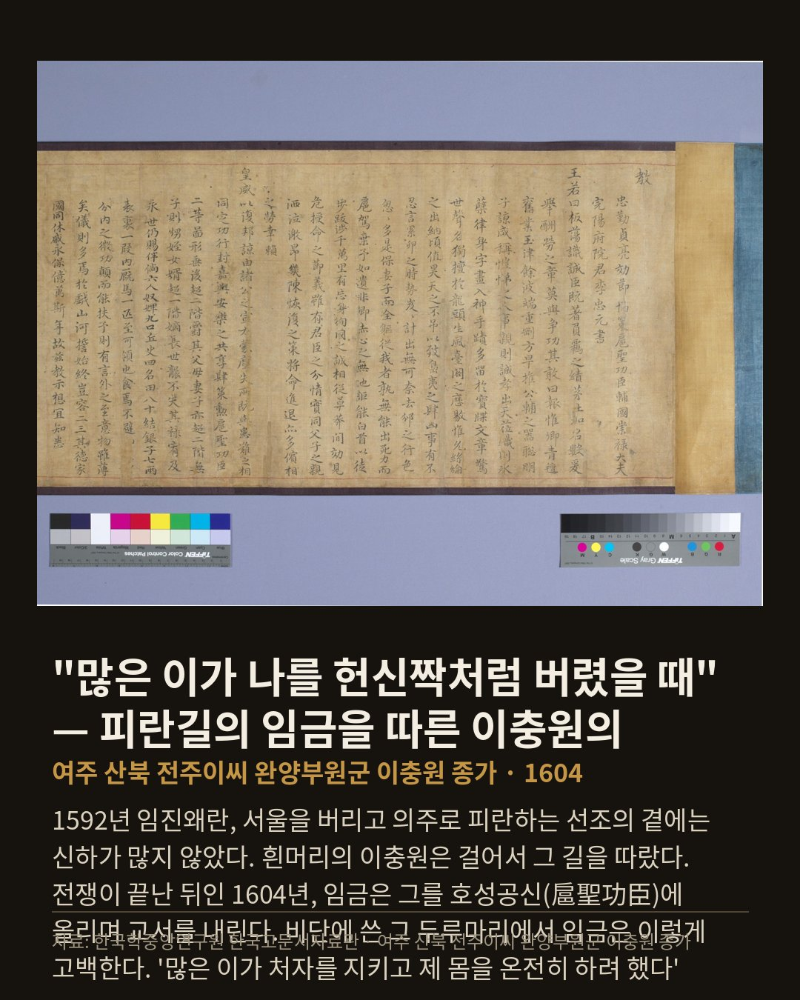
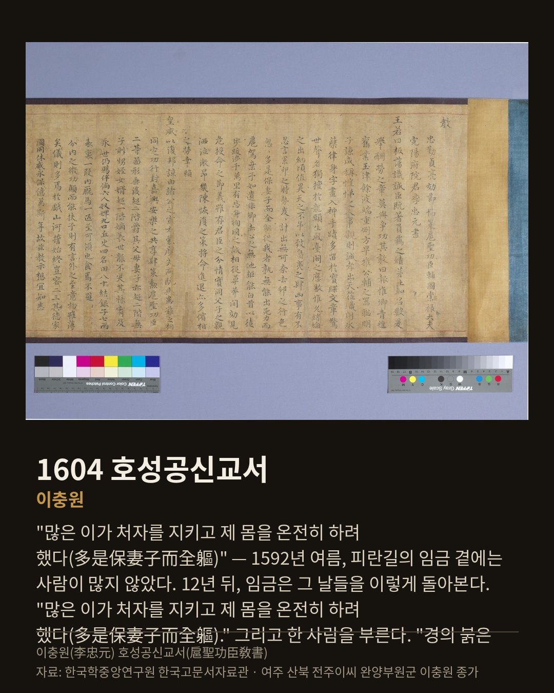
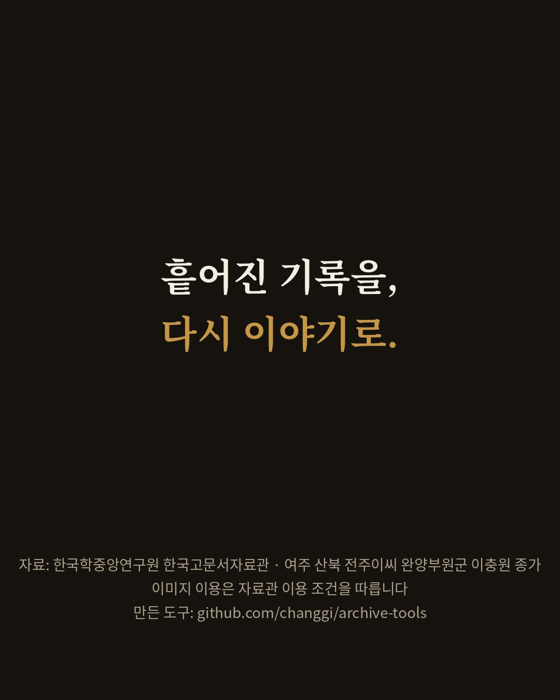

# EP.115 "많은 이가 나를 헌신짝처럼 버렸을 때" — 피란길의 임금을 따른 이충원의 호성공신교서

여주 산북 전주이씨 완양부원군 이충원 종가 (문중) · 1592년 임진왜란, 서울을 버리고 의주로 피란하는 선조의 곁에는 신하가 많지 않았다. 흰머리의 이충원은 걸어서 그 길을 따랐다. 전쟁이 끝난 뒤인 1604년, 임금은 그를 호성공신(扈聖功臣)에 올리며 교서를 내린다. 비단에 쓴 그 두루마리에서 임금은 이렇게 고백한다. '많은 이가 처자를 지키고 제 몸을 온전히 하려 했다'

- 🌐 [전시 웹페이지](https://changgi.github.io/archive-tools/examples/wanyang/exhibit.html) (한자 위 한글 독음 · 원문 해석) · [수업 활동지](https://changgi.github.io/archive-tools/examples/wanyang/handout.html)
- 🎬 영상: [릴스 9:16](https://changgi.github.io/archive-tools-next/media/ep115-wanyang_reel.mp4) · [가로 16:9](https://changgi.github.io/archive-tools-next/media/ep115-wanyang_wide.mp4) · 홍보 글: [`promo.md`](promo.md)
- 카드뉴스: [`cards/`](cards/) · SNS 글: [`sns.txt`](sns.txt) · 판독·해석 표: [`selection.csv`](selection.csv)

<!-- DELIVERY -->
## 전달 에디팅 — 이 기록을 이렇게 전합니다

- **핵심 정서** — 숙연함
- **한 문장** — 위기에서 곁에 남은 한 사람 — 공적의 목록보다 '흰머리로 걸어서 따라왔다'는 장면이 오래 남는다.
- **열기** — 피란길의 임금은 훗날 이렇게 고백했습니다. "많은 이가 나를 헌신짝처럼 버렸다."
- **펼치기** — 이충원 호성공신교서 (1604년) — 피란의 기억(헌신짝처럼 버려짐) → 흰머리로 걸어온 신하 → '아버지와 아들 같았다' → 특전 목록 순으로, 고백에서 보답으로 옮겨 가게 구성했습니다.
- **절정** — "경의 붉은 마음이 아니었다면, 어찌 흰머리로 걸어서 천만 리를 건너왔겠는가(非卿赤心之無他 詎能白首以徒步 跋涉千萬里)" — 화면·공간에서 이 한 줄만 크게, 소리를 줄여 집중
- **여운** — 흰머리로 걸었던 그 길에서, 이충원은 무엇을 보았을까요? — 질문으로 끝내고 답은 보는 사람에게
- **감각과 물질** — 비단 두루마리의 누런 결과 피란길의 먼지, 흰머리 · 두루마리를 실제 길이로 펼친 복제
- **통로와 매개** — 온라인: 릴스(열기) → 카드뉴스(펼치기) → 전시 웹페이지(절정·원문) → 비하인드 카드(여운) / 오프라인: 원본 크기 복제·낭독·참여 벽 / 남기기: 활동지·질문 카드
- **여운 장치** — 힘든 날 곁을 지켜 준 사람을 한 명 떠올리기
- **전달 에디팅 전** — 1건의 문서를 1604년 연대순으로 놓고 문서명 · 유형 · 해설을 붙인다 — 정확하지만, 지나가면 잊힌다.
- **전달 에디팅 후** — 핵심 정서는 「숙연함」. 「피란길의 임금은 훗날 이렇게 고백했습니다. "많은 이가 나를 헌신짝처럼 버렸다."」로 열고, 문서를 한 장의 집중로 펼친 뒤, "경의 붉은 마음이 아니었다면, 어찌 흰머리로 걸어서 천만 리를 건너왔겠는가(非卿赤心之無他 詎能白首以徒步 跋涉千萬里)"에서 멈춘다. 비단 두루마리의 누런 결과 피란길의 먼지, 흰머리. 마지막엔 「힘든 날 곁을 지켜 준 사람을 한 명 떠올리기」로 보는 사람이 자기 이야기를 남기고 떠나게 한다.

전문: [`delivery.md`](delivery.md)
<!-- /DELIVERY -->

<!-- CURATOR -->
## 비하인드 — 큐레이터 노트

- **왜 이 문서들인가** — 공신교서는 대개 공적을 늘어놓는 글인데, 이 교서에는 임금이 버림받았던 기억을 털어놓는 대목이 있어 그 한 줄을 중심에 두었습니다.
- **전하고 싶은 것** — 위기에서 곁에 남은 한 사람 — 공적의 목록보다 '흰머리로 걸어서 따라왔다'는 장면이 오래 남는다.
- **이렇게 보이길 바랐다** — 피란의 기억(헌신짝처럼 버려짐) → 흰머리로 걸어온 신하 → '아버지와 아들 같았다' → 특전 목록 순으로, 고백에서 보답으로 옮겨 가게 구성했습니다.
- **이렇게 써 주세요** — 임진왜란과 선조의 의주 피란, 공신 제도와 특전, '곁을 지킨다'는 것의 의미에 쓰세요. 호성공신 책봉에 대한 당대와 후대의 평가가 갈린다는 점도 함께 다루세요.
- **만들며 있었던 일** — 비단 두루마리의 앞부분만 읽었고, 중간과 공신 명단은 줄였습니다. 몇 글자는 판독이 불확실합니다. 날짜가 적힌 끝부분은 이 사진에 없어 연도는 자료관 목록(1604)을 따랐습니다.
- **남겨 둔 질문** — 흰머리로 걸었던 그 길에서, 이충원은 무엇을 보았을까요?
- **제작 기록** — 문서 1건 · 1604년 · 원본 사진 2면(문서 전체) · 원문 판독 1건 · 번역 1건 · 못 읽은 글자 □ 0 · 불확실 (?) 2

전문: [`curator.md`](curator.md) · 비하인드 카드: [`behind/`](behind/) · 채널별 홍보안: [`channels.md`](channels.md)
<!-- /CURATOR -->

## 이야기 — 사료가 말하는 대로

피란길의 임금은 훗날 이렇게 고백했습니다. "많은 이가 나를 헌신짝처럼 버렸다."

> **1604 호성공신교서** — 1592년 여름, 피란길의 임금 곁에는 사람이 많지 않았다. 12년 뒤, 임금은 그 날들을 이렇게 돌아본다. "많은 이가 처자를 지키고 제 몸을 온전히 하려 했다(多是保妻子而全軀)." 그리고 한 사람을 부른다. "경의 붉은 마음이 아니었다면, 어찌 흰머리로 걸어서 천만 리를 건너왔겠는가(非卿赤心之無他 詎能白首以徒步 跋涉千萬里)." 임금은 마지막에 덧붙인다. "정으로는 실로 아버지와 아들 같았다(情實同父子之親)."

| 표지 | 1번 카드 | 마무리 |
|---|---|---|
|  |  |  |

## 선별 문서 (1점)

| # | 연도 | 유형 | 문서명 | 원본 |
|---|---|---|---|---|
| 1 | 1604 | 호성공신교서 | 이충원(李忠元) 호성공신교서(扈聖功臣敎書) | [원본 보기](https://archive.aks.ac.kr/viewer/viewer.do#imgnode.do?itemId=book&gubun=booktree&depth=6&upPath=01%5E0141%5EL014164%5EL014164F02%5EL014164F0201&dataId=G002%2BAKS%2BKSM-XA.1604.4173-20250415.F10101-01-W000001&itemType=) |

## 원문 판독과 해석

### 1. 이충원(李忠元) 호성공신교서(扈聖功臣敎書)

**원문 판독**

```
敎
忠勤貞亮効節協策扈聖功臣輔國崇祿大夫
完陽府院君李忠元書
王若曰板蕩識誠臣旣著貞(?)厲之績茅土加名數爰
擧酬勞之章莫與爭功其敢曰報惟卿靑(?)氈
舊業玉津餘波端重剛方早推公輔之器聰明
子諒咸稱愷悌之人事親則誠孝出天莅職則氷
蘗律身字畫入神手蹟多留於寶牒文章驚
世聲名獨擅於龍頭 …
… 頃値昊天之不弔以致島夷之肆凶事有不
忍言累卵之時勢岌岌計出無可奈去邠之行色
怱怱多是保妻子而全軀從我者孰無能出死力而
扈駕棄予如遺非卿赤心之無他詎能白首以徒
步跋涉千萬里有忘身殉國之誠相從草莽間効見
危授命之節義雖有君臣之分情實同父子之親
…
肆策勳扈聖功臣
二等圖形垂後超二階爵其父母妻子亦超二階無
子則甥姪女壻超一階嫡長世襲不失其祿宥及
永世仍賜伴倘六人奴婢九口丘史四名田八十結銀子七兩
表裏一段內廐馬一匹 …
… 於戲 … 家
國同休戚永保億萬斯年故玆敎示想宜知悉
```

**원문 해석** 교서. 충근정량효절협책 호성공신 보국숭록대부 완양부원군 이충원에게 내리는 글. 왕은 이르노라. 나라가 어지러울 때 충성스러운 신하를 알아보는 법이다. … 경은 … 어버이를 섬김에는 정성과 효성이 하늘에서 나왔고, 벼슬에 임해서는 얼음을 마시고 쓴 황벽을 씹듯 청렴하게 몸을 다스렸으며, 글씨는 신묘한 경지에 들었다. … 지난번 하늘이 돕지 않아 섬 오랑캐가 함부로 흉포한 짓을 하게 되니, 차마 말할 수 없는 일이 있었다. 계란을 쌓아 놓은 듯 형세가 위태로웠고, 어찌할 도리가 없어 도성을 떠나는 행차가 총총하였다. 많은 이들이 처자를 지키고 제 몸을 온전히 하려 했으니, 누가 나를 따랐던가. 죽을힘을 다해 어가를 호종한 이가 없어 나를 헌신짝 버리듯 하였다. 경의 붉은 마음이 다른 데 있지 않았다면, 어찌 흰머리로 걸어서 천만 리를 건너왔겠는가. 몸을 잊고 나라를 위하는 정성이 있어 풀숲 사이에서 서로 따랐고, 위태로움을 보고 목숨을 바치는 절개를 보였다. 의리로는 비록 임금과 신하의 구분이 있으나, 정으로는 실로 아버지와 아들의 친함과 같았다. … 이에 호성공신 2등에 책훈하여, 초상을 그려 후세에 전하고, 품계를 두 단계 올린다. 그 부모와 처자도 두 단계 올리며, 아들이 없으면 조카와 사위를 한 단계 올린다. 맏아들이 대대로 이어받아 녹을 잃지 않게 하고, 죄를 용서하는 은전이 영원히 미치게 한다. 이어서 반당 6인, 노비 9구, 구사 4명, 밭 80결, 은 7냥, 옷감 한 벌, 내구마 1필을 내린다. … 아아, … 나라와 집안이 기쁨과 근심을 함께하여 억만년을 길이 보전하라. 그러므로 이에 교시하니, 잘 알리라 생각한다.

**해제** 1604년(선조 37) 임진왜란 때 선조의 피란길을 끝까지 따른 신하들을 호성공신(扈聖功臣)으로 책봉하면서, 완양부원군 이충원(李忠元)에게 내린 공신교서(功臣敎書)입니다. 비단에 쓰고 두루마리로 꾸몄으며, 이 사진은 앞부분입니다. 교서는 피란 당시 '많은 이가 처자를 지키고 제 몸을 온전히 하려 해 나를 헌신짝처럼 버렸다'고 적고, 흰머리로 걸어서 천만 리를 따라온 이충원의 정성을 '정으로는 아버지와 아들 같다'고 표현합니다. 이어 호성공신 2등으로서 받는 특전(초상화, 품계 승급, 부모 · 처자의 승급, 녹봉 세습, 사면, 반당 · 노비 · 구사 · 토지 · 은 · 옷감 · 말)을 나열합니다. 끝에는 같은 공신들의 명단이 이어집니다. 몇몇 글자는 판독이 불확실하며, 중간 일부는 '…'로 줄였습니다. 연도는 자료관 목록을 따랐습니다.

판독·해석·이야기는 이미지에 근거한 초안이며(검토 전 "초안" 표시), 정확한 판독은 원문 확인이 필요합니다. □는 읽지 못한 글자, (?)는 불확실한 글자입니다.
이미지: 한국학중앙연구원 한국고문서자료관 소장·제공. "원본" 링크를 누르면 자료관 뷰어에서 그 문서가 열립니다. 재사용은 자료관에 문의하세요(소장처 동의 필요).
