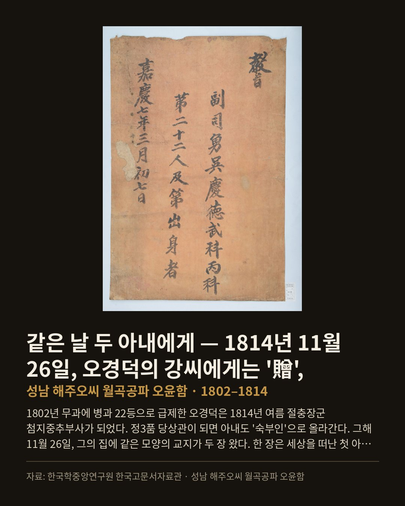
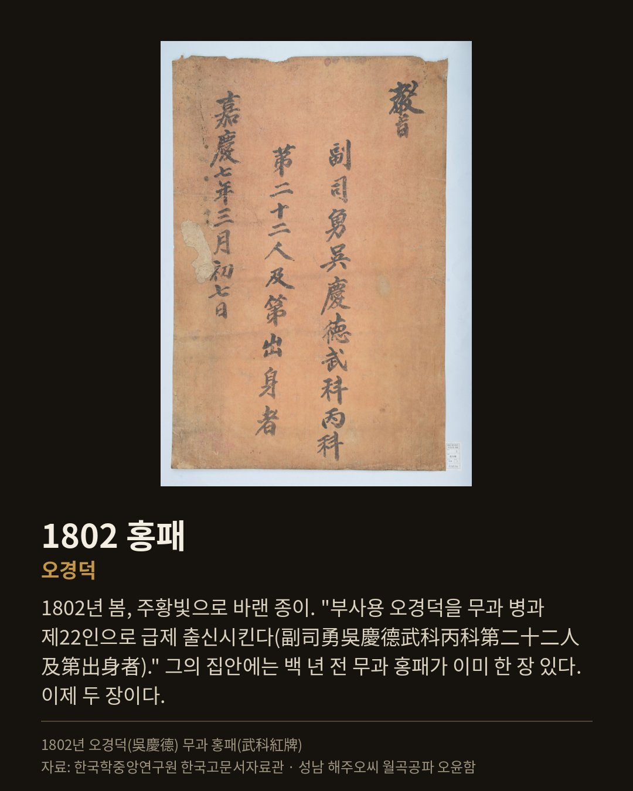
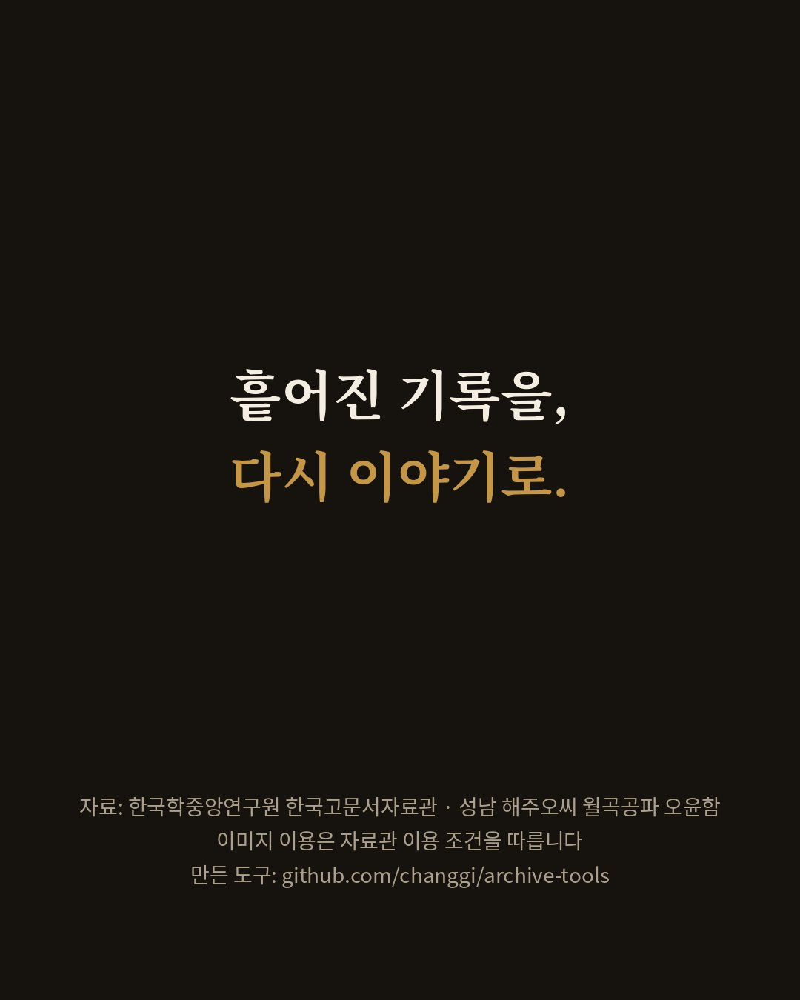

# EP.178 같은 날 두 아내에게 — 1814년 11월 26일, 오경덕의 강씨에게는 '贈', 윤씨에게는 '爲'

성남 해주오씨 월곡공파 오윤함 (문중) · 1802년 무과에 병과 22등으로 급제한 오경덕은 1814년 여름 절충장군 첨지중추부사가 되었다. 정3품 당상관이 되면 아내도 '숙부인'으로 올라간다. 그해 11월 26일, 그의 집에 같은 모양의 교지가 두 장 왔다. 한 장은 세상을 떠난 첫 아내 강씨에게, 한 장은 지금의 아내 윤씨에게. 두 장의 차이는 단 한 글자였다

- 🌐 [전시 웹페이지](https://changgi.github.io/archive-tools/examples/wolgok-oh-ugw/exhibit.html) (한자 위 한글 독음 · 원문 해석) · [수업 활동지](https://changgi.github.io/archive-tools/examples/wolgok-oh-ugw/handout.html)
- 🎬 영상: [릴스 9:16](https://changgi.github.io/archive-tools-next/media/ep178-wolgok-oh-ugw_reel.mp4) · [가로 16:9](https://changgi.github.io/archive-tools-next/media/ep178-wolgok-oh-ugw_wide.mp4) · 홍보 글: [`promo.md`](promo.md)
- 카드뉴스: [`cards/`](cards/) · SNS 글: [`sns.txt`](sns.txt) · 판독·해석 표: [`selection.csv`](selection.csv)

<!-- DELIVERY -->
## 전달 에디팅 — 이 기록을 이렇게 전합니다

- **핵심 정서** — 애틋함
- **한 문장** — 조선에서 아내의 칭호는 남편의 품계를 따랐다(從夫職) — 남편이 정3품 당상에 오르면 살아 있는 아내는 숙부인으로 '봉하고(爲)', 먼저 세상을 떠난 아내도 숙부인으로 '추증했다(贈)'. 그래서 한 남자의 승진은 두 아내의 교지로 갈라져 왔다.
- **열기** — 같은 날 두 아내에게 교지가 왔습니다. 다른 것은 단 한 글자였습니다.
- **펼치기** — 오경덕 무과 홍패 → 오경덕 고신－1 → 오경덕 처 진주강씨 추증교지 → 오경덕 처 파평윤씨 고신 (1802–1814년) — 1802 무과 홍패(출발) → 1814년 6월 절충장군 첨지중추부사 고신(승진) → 같은 해 11월 26일 첫 아내 강씨 추증 교지 → 같은 날 둘째 아내 윤씨 봉작 교지로 놓았습니다.
- **절정** — "남편의 직에 따른다(從夫職)" — 화면·공간에서 이 한 줄만 크게, 소리를 줄여 집중
- **여운** — 같은 날 같은 칭호를 받은 두 사람, 그 집에서는 이 두 장을 어떻게 함께 간직했을까요? — 질문으로 끝내고 답은 보는 사람에게
- **감각과 물질** — 두 장의 셋째 줄 — '贈淑夫人'과 '爲淑夫人', 그리고 왼쪽 작은 글씨 '從夫職' · 붉은 종이를 실물 크기로 복제해 벽에 거는 연출 · 어보·관인 탁본 스탬프를 찍어 보는 체험
- **통로와 매개** — 온라인: 릴스(열기) → 카드뉴스(펼치기) → 전시 웹페이지(절정·원문) → 비하인드 카드(여운) / 오프라인: 원본 크기 복제·낭독·참여 벽 / 남기기: 활동지·질문 카드
- **여운 장치** — 가족 묘비 · 족보에 나란히 적힌 두 배우자의 이름 떠올리기
- **전달 에디팅 전** — 4건의 문서를 1802–1814년 연대순으로 놓고 문서명 · 유형 · 해설을 붙인다 — 정확하지만, 지나가면 잊힌다.
- **전달 에디팅 후** — 핵심 정서는 「애틋함」. 「같은 날 두 아내에게 교지가 왔습니다. 다른 것은 단 한 글자였습니다.」로 열고, 문서를 대비와 순서로 펼친 뒤, "남편의 직에 따른다(從夫職)"에서 멈춘다. 두 장의 셋째 줄 — '贈淑夫人'과 '爲淑夫人', 그리고 왼쪽 작은 글씨 '從夫職'. 마지막엔 「가족 묘비 · 족보에 나란히 적힌 두 배우자의 이름 떠올리기」로 보는 사람이 자기 이야기를 남기고 떠나게 한다.

전문: [`delivery.md`](delivery.md)
<!-- /DELIVERY -->

<!-- CURATOR -->
## 비하인드 — 큐레이터 노트

- **왜 이 문서들인가** — 성남 해주오씨 월곡공파 오윤함 집안에는 1682년 오수웅부터 1860년대 오택선까지 무관 집안의 교지가 이어져 있습니다. 그 가운데 1814년 같은 날 두 아내에게 내린 교지가 나란히 남은 오경덕(吳慶德)의 네 장을 골랐습니다.
- **전하고 싶은 것** — 조선에서 아내의 칭호는 남편의 품계를 따랐다(從夫職) — 남편이 정3품 당상에 오르면 살아 있는 아내는 숙부인으로 '봉하고(爲)', 먼저 세상을 떠난 아내도 숙부인으로 '추증했다(贈)'. 그래서 한 남자의 승진은 두 아내의 교지로 갈라져 왔다.
- **이렇게 보이길 바랐다** — 1802 무과 홍패(출발) → 1814년 6월 절충장군 첨지중추부사 고신(승진) → 같은 해 11월 26일 첫 아내 강씨 추증 교지 → 같은 날 둘째 아내 윤씨 봉작 교지로 놓았습니다.
- **이렇게 써 주세요** — 조선 후기 무과와 무관의 승진, 당상관(절충장군)의 의미, 외명부 칭호(숙인 · 숙부인)와 '종부직(從夫職)', 생존자 봉작과 사망자 추증의 차이, 재혼한 집안의 문서 보존 수업에 쓰세요.
- **만들며 있었던 일** — 두 교지의 작은 글씨 '依法…' 다음 두 글자는 끝이 잘려 '依法典'으로 보았습니다. 강씨가 첫 아내, 윤씨가 둘째 아내라는 것은 '贈(죽은 이)'과 '爲(산 이)'의 구분에서 판단했고, 두 사람의 생몰은 이 문서들로 확인하지 않았습니다. 같은 해 6월에 받은 고신 두 장(용양위 부호군 등)은 해제에서 다룹니다.
- **남겨 둔 질문** — 같은 날 같은 칭호를 받은 두 사람, 그 집에서는 이 두 장을 어떻게 함께 간직했을까요?
- **제작 기록** — 문서 4건 · 1802–1814년 · 원본 사진 6면(문서 전체) · 원문 판독 4건 · 번역 4건

전문: [`curator.md`](curator.md) · 비하인드 카드: [`behind/`](behind/) · 채널별 홍보안: [`channels.md`](channels.md)
<!-- /CURATOR -->

## 이야기 — 사료가 말하는 대로

같은 날 두 아내에게 교지가 왔습니다. 다른 것은 단 한 글자였습니다.

> **1802 홍패** — 1802년 봄, 주황빛으로 바랜 종이. "부사용 오경덕을 무과 병과 제22인으로 급제 출신시킨다(副司勇吳慶德武科丙科第二十二人及第出身者)." 그의 집안에는 백 년 전 무과 홍패가 이미 한 장 있다. 이제 두 장이다.
> **1814 고신** — 열두 해 뒤, 1814년 여름. "오경덕을 절충장군 첨지중추부사 충익위장으로 삼는다(吳慶德爲折衝將軍僉知中樞府事忠翊衛將者)." 정3품 당상. 이제 그는 '영감'이라 불린다. 그리고 이 한 장은, 그 혼자의 것이 아니었다.
> **1814 추증교지** — 그해 11월 26일, 교지가 두 장 온다. 첫 장. "숙인 강씨에게 숙부인을 추증한다(淑人姜氏贈淑夫人者)." '추증(贈)'. 이 이름의 주인은 이미 세상에 없다. 남편이 오른 계단을, 떠난 아내도 함께 오른다. 왼쪽 작은 글씨. "남편의 직에 따른다(從夫職)."
> **1814 고신** — 그리고 둘째 장. 같은 날, 같은 종이, 같은 글씨. "숙인 윤씨를 숙부인으로 삼는다(淑人尹氏爲淑夫人者)." 이번에는 '삼는다(爲)'. 이 이름의 주인은 지금 이 집에 산다. 떠난 사람과 남은 사람. 두 장의 차이는 한 글자였다.

| 표지 | 1번 카드 | 마무리 |
|---|---|---|
|  |  |  |

## 선별 문서 (4점)

| # | 연도 | 유형 | 문서명 | 원본 |
|---|---|---|---|---|
| 1 | 1802 | 홍패 | 1802년 오경덕(吳慶德) 무과 홍패(武科紅牌) | [원본 보기](https://archive.aks.ac.kr/viewer/viewer.do#imgnode.do?itemId=book&gubun=booktree&depth=6&upPath=01%5E0141%5EL014139%5EL014139F02%5EL014139F0201&dataId=G002%2BKHD%2BKSM-XA.1802.0000-20161231.C0804_002_00003_XXX&itemType=) |
| 2 | 1814 | 고신 | 1814년 오경덕(吳慶德) 고신(告身)－1 | [원본 보기](https://archive.aks.ac.kr/viewer/viewer.do#imgnode.do?itemId=book&gubun=booktree&depth=6&upPath=01%5E0141%5EL014139%5EL014139F02%5EL014139F0201&dataId=G002%2BKHD%2BKSM-XA.1814.0000-20161231.C0804_002_00037_XXX&itemType=) |
| 3 | 1814 | 추증교지 | 1814년 오경덕(吳慶德) 처(妻) 진주강씨(晉州姜氏) 추증교지(追贈敎旨) | [원본 보기](https://archive.aks.ac.kr/viewer/viewer.do#imgnode.do?itemId=book&gubun=booktree&depth=6&upPath=01%5E0141%5EL014139%5EL014139F02%5EL014139F0201&dataId=G002%2BKHD%2BKSM-XA.1814.0000-20161231.C0804_002_00062_XXX&itemType=) |
| 4 | 1814 | 고신 | 1814년 오경덕(吳慶德) 처(妻) 파평윤씨(坡平尹氏) 고신(告身) | [원본 보기](https://archive.aks.ac.kr/viewer/viewer.do#imgnode.do?itemId=book&gubun=booktree&depth=6&upPath=01%5E0141%5EL014139%5EL014139F02%5EL014139F0201&dataId=G002%2BKHD%2BKSM-XA.1814.0000-20161231.C0804_002_00040_XXX&itemType=) |

## 원문 판독과 해석

### 1. 1802년 오경덕(吳慶德) 무과 홍패(武科紅牌)

**원문 판독**

```
敎旨
副司勇吳慶德武科丙科
第二十二人及第出身者
嘉慶七年三月初七日
```

**원문 해석** 교지. 부사용 오경덕을 무과 병과 제22인으로 급제 출신시킨다. 가경 7년(1802) 3월 7일.

**해제** 1802년(순조 2) 3월, 오경덕이 받은 무과 급제 증서(홍패)입니다. 붉은 종이가 지금은 주황빛으로 바랬습니다. 이름 앞의 '부사용(副司勇)'은 오위의 종9품 군직으로, 급제 전에 이미 군직에 이름을 올리고 있었음을 보여 줍니다. 병과 제22인으로, EP.172 임욱(병과 제29인)처럼 병과에서 출발했습니다. 해주오씨 월곡공파 집안에는 그보다 100여 년 앞선 1698년 오수웅의 무과 홍패도 남아 있어, 무관을 잇는 집안이었습니다.

### 2. 1814년 오경덕(吳慶德) 고신(告身)－1

**원문 판독**

```
敎旨
吳慶德爲折
衝將軍僉知
中樞府事忠
翊衛將者
嘉慶十九年六月 日
```

**원문 해석** 교지. 오경덕을 절충장군 첨지중추부사 충익위장으로 삼는다. 가경 19년(1814) 6월 일.

**해제** 열두 해 뒤인 1814년(순조 14) 6월의 고신입니다. 절충장군(折衝將軍)은 무관의 정3품 당상 품계로, 이 자리부터 '당상관'이라 하여 대우가 크게 달라졌습니다. 첨지중추부사는 실무 없는 명예직이고, 충익위장은 충익위(공신 자손 등으로 구성된 부대)를 거느리는 자리입니다. 같은 달 그는 '절충장군 행 용양위 부호군 충익위장', '절충장군 행 용양위 부호군'으로 적힌 고신도 받아, 한 달 사이에 직함이 여러 번 바뀌었습니다. 이 승진이 다섯 달 뒤 두 아내의 교지로 이어집니다.

### 3. 1814년 오경덕(吳慶德) 처(妻) 진주강씨(晉州姜氏) 추증교지(追贈敎旨)

**원문 판독**

```
敎旨
淑人姜氏
贈淑夫人
者
嘉慶十九年十一月二十六日
(작은 글씨) 折衝將軍前僉知中樞府事兼忠翊衛將吳慶德妻依法典
從夫職
```

**원문 해석** 교지. 숙인 강씨에게 숙부인을 추증한다. 가경 19년(1814) 11월 26일. (작은 글씨) 절충장군 전 첨지중추부사 겸 충익위장 오경덕의 아내이므로 법전에 따라 남편의 직에 따른다.

**해제** 1814년 11월 26일, 오경덕의 아내 진주강씨에게 숙부인(淑夫人)을 추증(贈)한 교지입니다. 숙부인은 정3품 당상관의 아내가 받는 외명부 칭호이고, 강씨는 그 전에 '숙인(淑人)', 곧 정3품 당하 · 종3품 관원의 아내 칭호를 받아 두었습니다. '贈'은 세상을 떠난 이에게 쓰는 글자이므로, 강씨는 남편이 당상관이 되기 전에 세상을 떠난 첫 아내로 보입니다. 왼쪽 작은 글씨 '…의 아내이므로 법전에 따라 남편의 직에 따른다(依法典從夫職)'가 근거입니다. EP.168의 공명첩 '정부인' 봉작과 같은 원리입니다.

### 4. 1814년 오경덕(吳慶德) 처(妻) 파평윤씨(坡平尹氏) 고신(告身)

**원문 판독**

```
敎旨
淑人尹氏
爲淑夫人
者
嘉慶十九年十一月二十六日
(작은 글씨) 折衝將軍前僉知中樞府事兼忠翊衛將吳慶德妻依法典
從夫職
```

**원문 해석** 교지. 숙인 윤씨를 숙부인으로 삼는다. 가경 19년(1814) 11월 26일. (작은 글씨) 절충장군 전 첨지중추부사 겸 충익위장 오경덕의 아내이므로 법전에 따라 남편의 직에 따른다.

**해제** 같은 날, 같은 크기 · 같은 서식 · 같은 작은 글씨로 오경덕의 아내 파평윤씨에게 내린 교지입니다. 앞 장과 다른 것은 셋째 줄 첫 글자 하나, '贈(추증한다)' 대신 '爲(삼는다)'입니다. 살아 있는 사람에게 칭호를 내리는 봉작(封爵)이므로, 윤씨는 이때 살아 있던 지금의 아내입니다. 조선에서는 정실 아내가 세상을 떠나 다시 장가들면, 남편이 오를 때 앞서 간 아내와 지금의 아내가 함께 칭호를 받았습니다. 두 장이 한 집안에 나란히 남아, 한 사람의 승진이 두 여성의 이름으로 기록된 모습을 보여 줍니다.

판독·해석·이야기는 이미지에 근거한 초안이며(검토 전 "초안" 표시), 정확한 판독은 원문 확인이 필요합니다. □는 읽지 못한 글자, (?)는 불확실한 글자입니다.
이미지: 한국학중앙연구원 한국고문서자료관 소장·제공. "원본" 링크를 누르면 자료관 뷰어에서 그 문서가 열립니다. 재사용은 자료관에 문의하세요(소장처 동의 필요).
