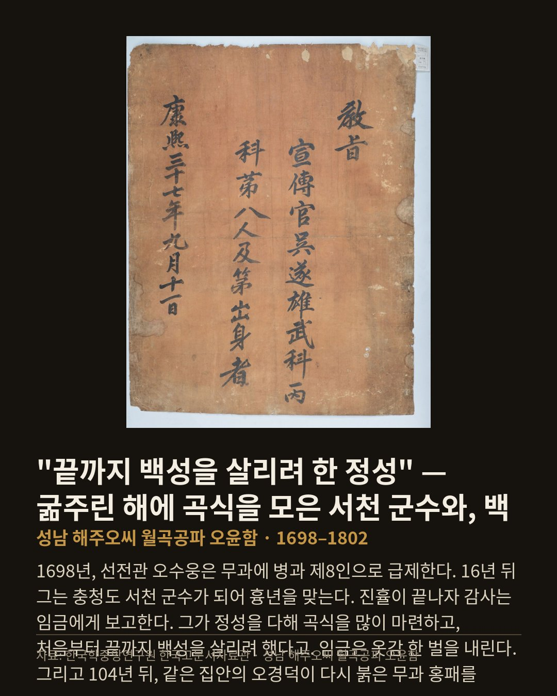
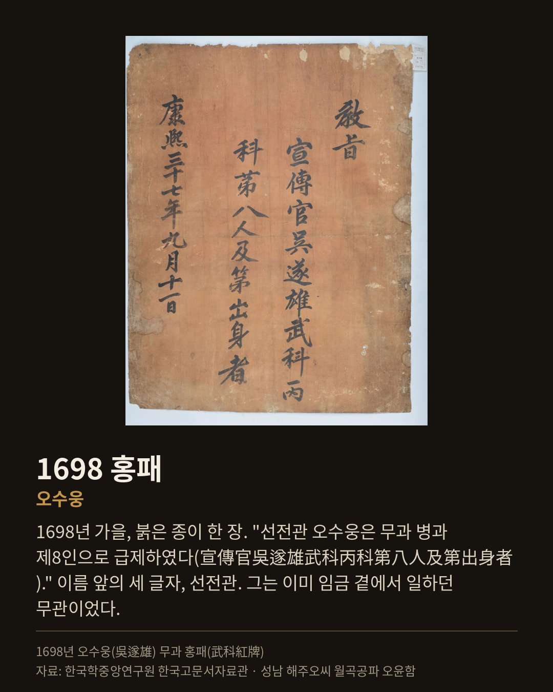
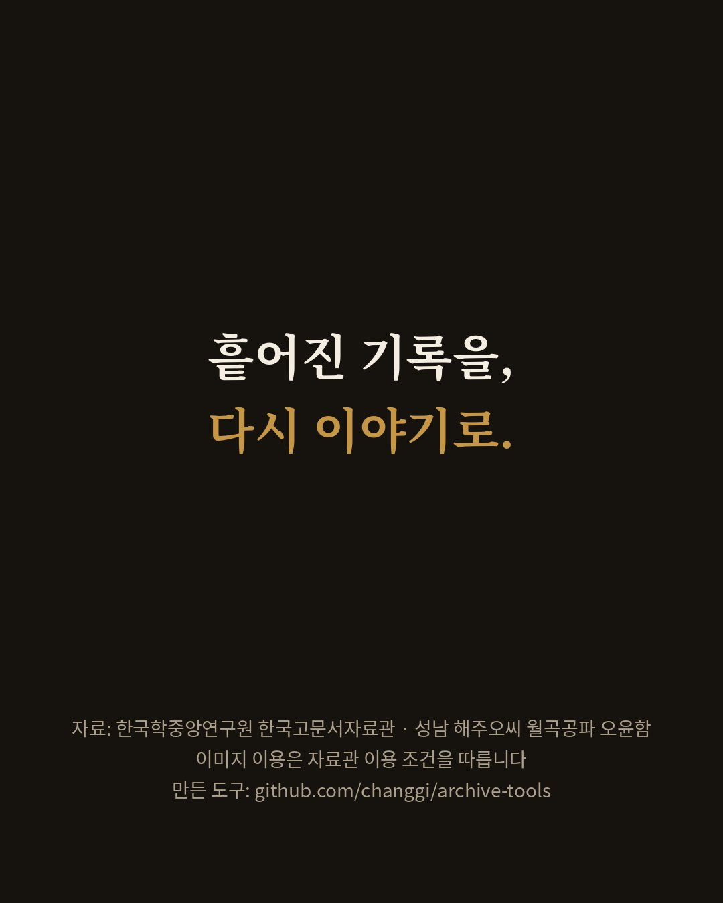

# EP.122 "끝까지 백성을 살리려 한 정성" — 굶주린 해에 곡식을 모은 서천 군수와, 백 년 뒤의 홍패

성남 해주오씨 월곡공파 오윤함 (문중) · 1698년, 선전관 오수웅은 무과에 병과 제8인으로 급제한다. 16년 뒤 그는 충청도 서천 군수가 되어 흉년을 맞는다. 진휼이 끝나자 감사는 임금에게 보고한다. 그가 정성을 다해 곡식을 많이 마련하고, 처음부터 끝까지 백성을 살리려 했다고. 임금은 옷감 한 벌을 내린다. 그리고 104년 뒤, 같은 집안의 오경덕이 다시 붉은 무과 홍패를 받는다

- 🌐 [전시 웹페이지](https://changgi.github.io/archive-tools/examples/wolgok-oh/exhibit.html) (한자 위 한글 독음 · 원문 해석) · [수업 활동지](https://changgi.github.io/archive-tools/examples/wolgok-oh/handout.html)
- 🎬 영상: [릴스 9:16](https://changgi.github.io/archive-tools-next/media/ep122-wolgok-oh_reel.mp4) · [가로 16:9](https://changgi.github.io/archive-tools-next/media/ep122-wolgok-oh_wide.mp4) · 홍보 글: [`promo.md`](promo.md)
- 카드뉴스: [`cards/`](cards/) · SNS 글: [`sns.txt`](sns.txt) · 판독·해석 표: [`selection.csv`](selection.csv)

<!-- DELIVERY -->
## 전달 에디팅 — 이 기록을 이렇게 전합니다

- **핵심 정서** — 따뜻함
- **한 문장** — 무관의 공은 칼에만 있지 않다 — 곡식을 모아 백성을 살린 한 해도 임금의 기록에 남았다.
- **열기** — 300년 전 흉년, 임금이 한 군수에게 편지를 보냈습니다. "끝까지 백성을 살리려 했다."
- **펼치기** — 오수웅 무과 홍패 → 오수웅 유서 → 오경덕 무과 홍패 (1698–1802년) — 1698년 무과 홍패 → 1714년 진휼 포상 유서 → 104년 뒤 1802년 무과 홍패 순으로, 한 무관의 다른 얼굴과 집안의 이어짐을 보여 주게 구성했습니다.
- **절정** — "처음부터 끝까지 백성을 살리려 한 정성이 크게 칭찬할 만하다(終始活民之誠 有足多者)" — 화면·공간에서 이 한 줄만 크게, 소리를 줄여 집중
- **여운** — 그해 서천에서 살아남은 사람들은, 군수를 어떻게 기억했을까요? — 질문으로 끝내고 답은 보는 사람에게
- **감각과 물질** — 바랜 붉은 홍패 두 장과 흉년의 곡식 자루, 옷감 한 벌 · 붉은 종이를 실물 크기로 복제해 벽에 거는 연출 · 역마 방울·말발굽 소리와 함께 펼치는 두루마리
- **통로와 매개** — 온라인: 릴스(열기) → 카드뉴스(펼치기) → 전시 웹페이지(절정·원문) → 비하인드 카드(여운) / 오프라인: 원본 크기 복제·낭독·참여 벽 / 남기기: 활동지·질문 카드
- **여운 장치** — 어려운 때 끝까지 해낸 일 하나를 떠올리기
- **전달 에디팅 전** — 3건의 문서를 1698–1802년 연대순으로 놓고 문서명 · 유형 · 해설을 붙인다 — 정확하지만, 지나가면 잊힌다.
- **전달 에디팅 후** — 핵심 정서는 「따뜻함」. 「300년 전 흉년, 임금이 한 군수에게 편지를 보냈습니다. "끝까지 백성을 살리려 했다."」로 열고, 문서를 대비와 순서로 펼친 뒤, "처음부터 끝까지 백성을 살리려 한 정성이 크게 칭찬할 만하다(終始活民之誠 有足多者)"에서 멈춘다. 바랜 붉은 홍패 두 장과 흉년의 곡식 자루, 옷감 한 벌. 마지막엔 「어려운 때 끝까지 해낸 일 하나를 떠올리기」로 보는 사람이 자기 이야기를 남기고 떠나게 한다.

전문: [`delivery.md`](delivery.md)
<!-- /DELIVERY -->

<!-- CURATOR -->
## 비하인드 — 큐레이터 노트

- **왜 이 문서들인가** — 무관 집안의 임명장 사이에서, 전쟁이 아니라 흉년에 백성을 살린 공으로 받은 유서 한 장이 눈에 걸렸습니다.
- **전하고 싶은 것** — 무관의 공은 칼에만 있지 않다 — 곡식을 모아 백성을 살린 한 해도 임금의 기록에 남았다.
- **이렇게 보이길 바랐다** — 1698년 무과 홍패 → 1714년 진휼 포상 유서 → 104년 뒤 1802년 무과 홍패 순으로, 한 무관의 다른 얼굴과 집안의 이어짐을 보여 주게 구성했습니다.
- **이렇게 써 주세요** — 조선의 진휼 제도와 지방관의 책임, 무과와 무관의 경력, 재난과 공공의 역할에 쓰세요.
- **만들며 있었던 일** — 세 장 모두 정서라 판독이 확실한 편입니다. 1714년 흉년의 규모와 서천의 사정, 오수웅 · 오경덕과 월곡공 오윤함의 가계상 관계는 확인하지 않았습니다.
- **남겨 둔 질문** — 그해 서천에서 살아남은 사람들은, 군수를 어떻게 기억했을까요?
- **제작 기록** — 문서 3건 · 1698–1802년 · 원본 사진 4면(문서 전체) · 원문 판독 3건 · 번역 3건 · 해제에 "확인 필요"를 단 문서 1건

전문: [`curator.md`](curator.md) · 비하인드 카드: [`behind/`](behind/) · 채널별 홍보안: [`channels.md`](channels.md)
<!-- /CURATOR -->

## 이야기 — 사료가 말하는 대로

300년 전 흉년, 임금이 한 군수에게 편지를 보냈습니다. "끝까지 백성을 살리려 했다."

> **1698 홍패** — 1698년 가을, 붉은 종이 한 장. "선전관 오수웅은 무과 병과 제8인으로 급제하였다(宣傳官吳遂雄武科丙科第八人及第出身者)." 이름 앞의 세 글자, 선전관. 그는 이미 임금 곁에서 일하던 무관이었다.
> **1714 유서** — 16년 뒤, 그는 충청도 바닷가 고을 서천의 군수가 되어 있었다. 흉년이었다. 진휼이 끝난 뒤, 감사의 보고가 임금에게 올라간다. 임금은 그 말을 그대로 옮겨 적는다. "처음부터 끝까지 백성을 살리려 한 정성이 크게 칭찬할 만하다(終始活民之誠 有足多者)." 칼이 아니라 곡식으로 백성을 지킨 해였다.
> **1802 홍패** — 그리고 104년 뒤, 같은 집안에 다시 붉은 종이가 온다. "부사용 오경덕은 무과 병과 제22인으로 급제하였다(副司勇吳慶德武科丙科第二十二人及第出身者)." 한 세기를 건너, 무관의 집안은 같은 길을 걸었다.

| 표지 | 1번 카드 | 마무리 |
|---|---|---|
|  |  |  |

## 선별 문서 (3점)

| # | 연도 | 유형 | 문서명 | 원본 |
|---|---|---|---|---|
| 1 | 1698 | 홍패 | 1698년 오수웅(吳遂雄) 무과 홍패(武科紅牌) | [원본 보기](https://archive.aks.ac.kr/viewer/viewer.do#imgnode.do?itemId=book&gubun=booktree&depth=6&upPath=01%5E0141%5EL014139%5EL014139F02%5EL014139F0201&dataId=G002%2BKHD%2BKSM-XA.1698.0000-20161231.C0804_002_00002_XXX&itemType=) |
| 2 | 1714 | 유서 | 1714년 오수웅(吳遂雄) 유서(諭書) | [원본 보기](https://archive.aks.ac.kr/viewer/viewer.do#imgnode.do?itemId=book&gubun=booktree&depth=6&upPath=01%5E0141%5EL014139%5EL014139F02%5EL014139F0201&dataId=G002%2BKHD%2BKSM-XA.1714.0000-20161231.C0804_002_00064_XXX&itemType=) |
| 3 | 1802 | 홍패 | 1802년 오경덕(吳慶德) 무과 홍패(武科紅牌) | [원본 보기](https://archive.aks.ac.kr/viewer/viewer.do#imgnode.do?itemId=book&gubun=booktree&depth=6&upPath=01%5E0141%5EL014139%5EL014139F02%5EL014139F0201&dataId=G002%2BKHD%2BKSM-XA.1802.0000-20161231.C0804_002_00003_XXX&itemType=) |

## 원문 판독과 해석

### 1. 1698년 오수웅(吳遂雄) 무과 홍패(武科紅牌)

**원문 판독**

```
敎旨
宣傳官吳遂雄武科丙
科第八人及第出身者
康熙三十七年九月十一日
```

**원문 해석** 교지. 선전관 오수웅은 무과 병과 제8인으로 급제하여 출신한 자이다. 강희 37년(1698) 9월 11일.

**해제** 1698년(숙종 24, 康熙 37) 오수웅(吳遂雄)이 무과에 병과 제8인으로 급제하고 받은 홍패입니다. 이름 앞에 이미 '선전관(宣傳官)'이라는 직함이 적혀 있어, 급제 전부터 왕명을 전하고 시위하는 선전관으로 일하고 있었음을 알 수 있습니다. 붉은 종이는 바랬지만 글씨는 또렷합니다.

### 2. 1714년 오수웅(吳遂雄) 유서(諭書)

**원문 판독**

```
諭舒川郡守吳遂雄
今觀本道監司宋正
明畢賑後狀啓則爾
竭誠料理多辦穀物
終始活民之誠有足
多者誠爲可嘉特賜
表裏一襲爾其領受
故諭
康熙五十三年九月初六日
```

**원문 해석** 서천 군수 오수웅에게 이른다. 이제 본도 감사 송정명이 진휼을 마친 뒤 올린 장계를 보니, 그대가 정성을 다해 일을 처리하고 곡물을 많이 마련하여, 처음부터 끝까지 백성을 살리려는 정성이 크게 칭찬할 만하다고 한다. 참으로 가상하다. 특별히 옷감(표리) 한 벌을 내리니 그대는 받으라. 그러므로 이른다. 강희 53년(1714) 9월 6일.

**해제** 1714년(숙종 40, 康熙 53) 서천 군수 오수웅에게 내린 포상 유서입니다. 충청 감사 송정명(宋正明)이 진휼(賑恤, 흉년에 굶주린 백성을 구제하는 일)을 마친 뒤 올린 보고(장계)에 따라, 곡물을 많이 마련해 '처음부터 끝까지 백성을 살리려 한 정성(終始活民之誠)'을 칭찬하고 표리(옷감) 한 벌을 내렸습니다. 조선의 지방관은 흉년이면 곡식을 모아 죽을 쑤어 나누는 등 진휼을 맡았고, 그 실적으로 포상이나 처벌을 받았습니다. 연호 위와 본문에 어보가 찍혀 있습니다.

### 3. 1802년 오경덕(吳慶德) 무과 홍패(武科紅牌)

**원문 판독**

```
敎旨
副司勇吳慶德武科丙科
第二十二人及第出身者
嘉慶七年三月初七日
```

**원문 해석** 교지. 부사용 오경덕은 무과 병과 제22인으로 급제하여 출신한 자이다. 가경 7년(1802) 3월 7일.

**해제** 1802년(순조 2, 嘉慶 7) 같은 집안의 오경덕(吳慶德)이 무과에 병과 제22인으로 급제하고 받은 홍패입니다. 오수웅의 홍패로부터 104년 뒤입니다. 이름 앞의 '부사용(副司勇)'은 오위의 종9품 무관직으로, 급제 전 이미 군직에 있었음을 보여 줍니다. 오경덕은 이후 고신과 부인의 추증 교지가 함께 전합니다. 두 사람의 가계상 관계는 이번에 확인하지 않았습니다.

판독·해석·이야기는 이미지에 근거한 초안이며(검토 전 "초안" 표시), 정확한 판독은 원문 확인이 필요합니다. □는 읽지 못한 글자, (?)는 불확실한 글자입니다.
이미지: 한국학중앙연구원 한국고문서자료관 소장·제공. "원본" 링크를 누르면 자료관 뷰어에서 그 문서가 열립니다. 재사용은 자료관에 문의하세요(소장처 동의 필요).
