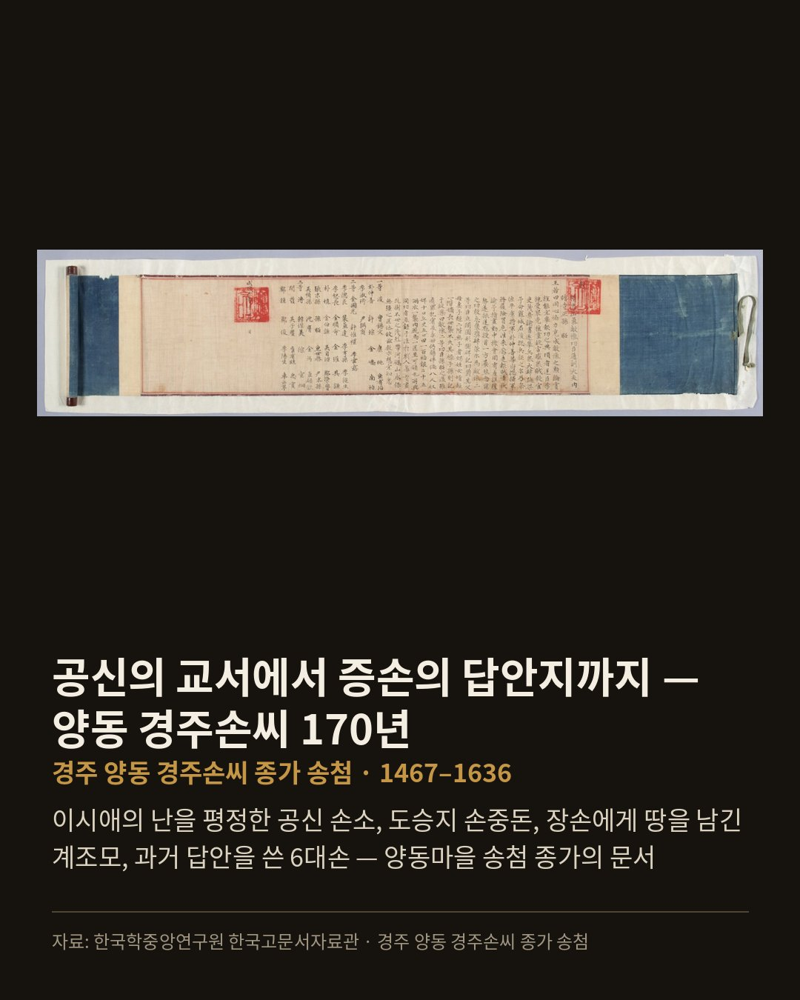
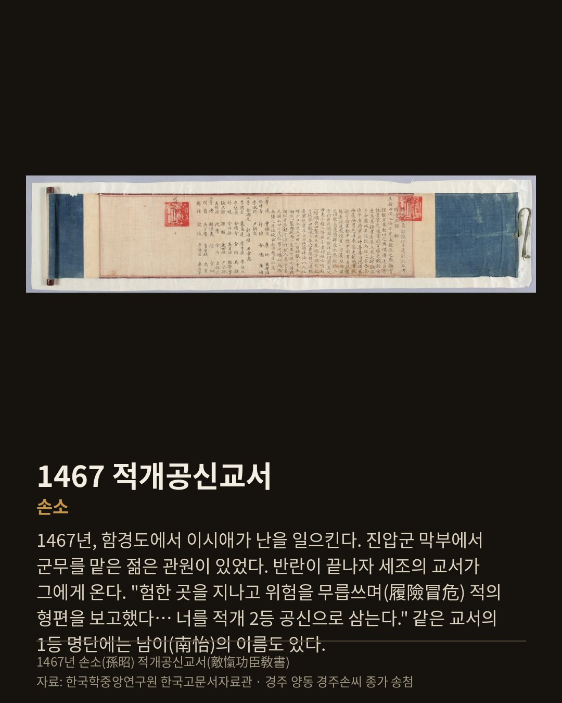
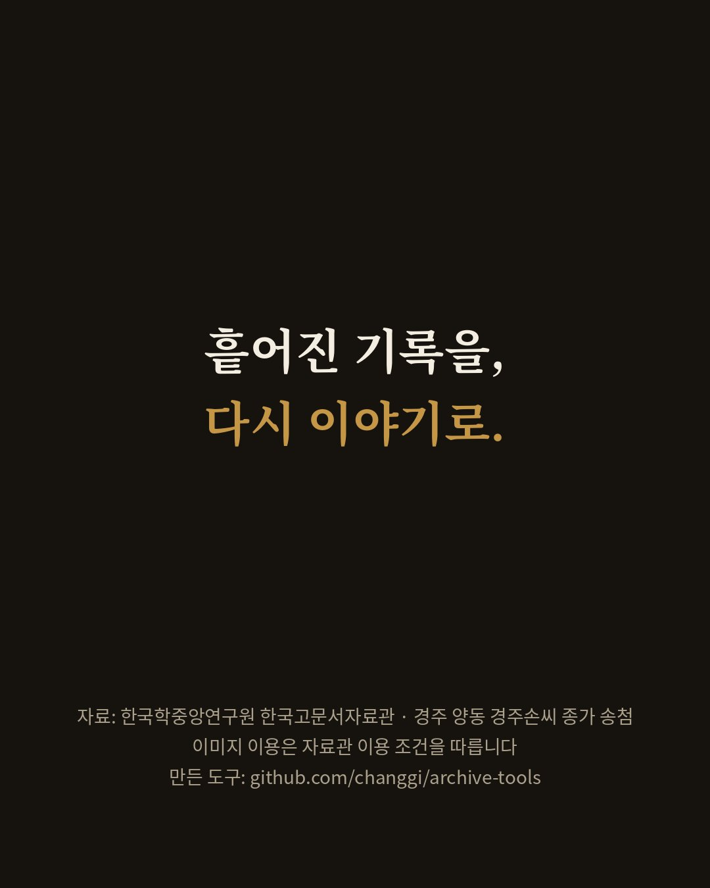

# EP.19 공신의 교서에서 증손의 답안지까지 — 양동 경주손씨 170년

경주 양동 경주손씨 종가 송첨 (문중) · 이시애의 난을 평정한 공신 손소, 도승지 손중돈, 장손에게 땅을 남긴 계조모, 과거 답안을 쓴 6대손 — 양동마을 송첨 종가의 문서

- 🌐 [전시 웹페이지](https://changgi.github.io/archive-tools/examples/yangdong-son/exhibit.html) (한자 위 한글 독음 · 원문 해석) · [수업 활동지](https://changgi.github.io/archive-tools/examples/yangdong-son/handout.html)
- 🎬 영상: [릴스 9:16](https://changgi.github.io/archive-tools/examples/media/ep19-yangdong_reel.mp4) · [가로 16:9](https://changgi.github.io/archive-tools/examples/media/ep19-yangdong_wide.mp4) · 홍보 글: [`promo.md`](promo.md)
- 카드뉴스: [`cards/`](cards/) · SNS 글: [`sns.txt`](sns.txt) · 판독·해석 표: [`selection.csv`](selection.csv)


<!-- CURATOR -->
## 비하인드 — 큐레이터 노트

- **왜 이 문서들인가** — 1467년 공신교서에서 1636년 증손의 과거 답안지까지, 한 집안의 170년이 네 장으로 이어졌습니다.
- **전하고 싶은 것** — 공신의 영광은 한 번이 아니라 후손의 공부로 이어져야 했다는 것.
- **이렇게 보이길 바랐다** — 교서의 '험한 곳을 지나고 위험을 무릅쓰며'로 시작해, 증손의 답안지로 마무리했습니다.
- **이렇게 써 주세요** — 세계유산 양동마을, 공신 제도, 과거 시험 수업에 쓰세요.
- **만들며 있었던 일** — 세로 영상 글자 맞춤 문제로 다시 만들었습니다(v0.5.0).
- **남겨 둔 질문** — 같은 교서 1등 명단에 있던 남이 장군의 이름을 후손들은 어떻게 읽었을까요?
- **제작 기록** — 문서 4건 · 1467–1636년 · 원본 사진 11면(문서 전체) · 원문 판독 4건 · 번역 4건 · 못 읽은 글자 □ 0 · 불확실 (?) 11 · 해제에 "확인 필요"를 단 문서 1건

전문: [`curator.md`](curator.md)
<!-- /CURATOR -->

## 이야기 — 사료가 말하는 대로

500년 전 공신 교서에는, 누구의 이름이 함께 적혀 있었을까요?

> **1467 적개공신교서** — 1467년, 함경도에서 이시애가 난을 일으킨다. 진압군 막부에서 군무를 맡은 젊은 관원이 있었다. 반란이 끝나자 세조의 교서가 그에게 온다. "험한 곳을 지나고 위험을 무릅쓰며(履險冒危) 적의 형편을 보고했다… 너를 적개 2등 공신으로 삼는다." 같은 교서의 1등 명단에는 남이(南怡)의 이름도 있다.
> **1515 고신** — 48년 뒤, 그 아들 손중돈은 임금의 가장 가까운 자리에 선다. "손중돈을 가선대부 행 승정원 도승지로 삼는다(爲嘉善大夫行承政院都承旨)." 양동마을의 서백당과 관가정이 이 부자의 집이다.
> **1537 별급문기** — 1537년 정월, 손소의 둘째 부인 최씨가 장손 손광서에게 문서를 써 준다. 자식이 없던 그녀는 세 살 때부터 조카딸을 길러 손광서에게 시집보냈다. "너는 나를 아침저녁으로 친자식과 다름없이 봉양했다(朝夕奉養無異親子)." 그래서 자기 몫의 노비와, 남편이 죽은 뒤 손수 사들인 논밭을 그에게 남겼다.
> **1636 시권** — 그리고 1636년, 손광서의 증손 손익이 과거장에 앉는다. 답안지 첫머리에 그는 자기 조상을 적는다. "증조 보공장군 충의위 광서(曾祖保功將軍忠義衛光曙)." 문제는 '난세에 몸을 던지는 어리석음'에 관한 것이었다. 그해 겨울, 병자호란이 일어난다.

| 표지 | 1번 카드 | 마무리 |
|---|---|---|
|  |  |  |

## 선별 문서 (4점)

| # | 연도 | 유형 | 문서명 | 원본 |
|---|---|---|---|---|
| 1 | 1467 | 적개공신교서 | 1467년 손소(孫昭) 적개공신교서(敵愾功臣敎書) | [원본 보기](https://archive.aks.ac.kr/viewer/viewer.do#imgnode.do?itemId=book&gubun=booktree&depth=6&upPath=01%5E0167%5EL016762%5EL016762F02%5EL016762F0201&dataId=G002%2BAKS%2BKSM-XA.1467.1111-20101008.B020a_032_00128_XXX&itemType=) |
| 2 | 1515 | 고신 | 1515년 손중돈(孫仲暾) 고신(告身)－1 | [원본 보기](https://archive.aks.ac.kr/viewer/viewer.do#imgnode.do?itemId=book&gubun=booktree&depth=6&upPath=01%5E0167%5EL016762%5EL016762F02%5EL016762F0201&dataId=G002%2BAKS%2BKSM-XA.1515.1111-20101008.B020a_032_00045_XXX&itemType=) |
| 3 | 1537 | 별급문기 | 1537년 계조모(繼祖母) 정부인(貞夫人) 최씨(崔氏) 별급문기(別給文記) | [원본 보기](https://archive.aks.ac.kr/viewer/viewer.do#imgnode.do?itemId=book&gubun=booktree&depth=6&upPath=01%5E0167%5EL016762%5EL016762F02%5EL016762F0205&dataId=G002%2BAKS%2BKSM-XE.1537.0000-20101008.B020a_032_00219_002&itemType=) |
| 4 | 1636 | 시권 | 1636년 손익(孫釴) 시권(試券) | [원본 보기](https://archive.aks.ac.kr/viewer/viewer.do#imgnode.do?itemId=book&gubun=booktree&depth=6&upPath=01%5E0167%5EL016762%5EL016762F02%5EL016762F0204&dataId=G002%2BKHD%2BKSM-XD.1636.0000-20180108.C0603_002_01232_XXX&itemType=) |

## 원문 판독과 해석

### 1. 1467년 손소(孫昭) 적개공신교서(敵愾功臣敎書)

**원문 판독**

```
敎精忠出氣敵愾功臣通訓大夫內
贍寺正孫昭
王若曰同心協力克成敵愾之勳論賞
旌能宜擧報功之典頃者逆臣李
施愛裒兇植黨訛言惑衆賊殺官
吏蔑棄諭書遂擧兵衆大肆跳梁
予命龜城君浚揔兵征之爾乃參
佐平虜將軍朴仲善幕府揔攝軍
務履險冒危往來奔走報賊情狀
諭予指畫動中機會罔有差誤勝
勢遂振逆魁授首一方晏然念爾
之功敢忘褒奬肆榮爾爲敵愾二
等功臣立閣圖形樹碑記功爵其父
母妻子超二階無子者甥姪女壻超
一階嫡長世襲不失其祿子孫則記
于政案曰敵愾二等功臣孫昭之後雖
有罪犯宥及永世仍賜伴倘八人奴
婢十口丘史五口田一百結銀二十五
兩衣一襲內廐馬一匹至可領也所與
同功者並錄于後於戲入幕贊畫
旣樹不世之茂烈帶河礪山永保
無疆之匹休故玆敎示想宜知悉
一等 浚 曺錫文 康純 魚有沼
朴仲善 許琮 金嶠 南怡
李淑琦 尹弼商
二等 金國光 許惟禮 李雲露
李德良 裴孟達 李亨孫 李從生
李恕長 金順命 金瓘 具謙
朴埴 金伯謙 吳自治 鄭崇曾
張末孫 孫昭 魚世恭 尹末孫
吳順孫 沈膺 金沔 孟碩欽
三等 溥 韓繼美 琮 宣炯
閔發 吳子慶 崔有臨 禹貢
鄭種 鄭俊 李陽生 車云革
成化三年十一月 日 (도장: 施命之寶)
```

**원문 해석** 정충출기적개공신 통훈대부 내섬시정 손소에게 내리는 교서. 왕은 이와 같이 말한다. 마음과 힘을 합쳐 적을 무찌른 공을 이루었으니, 상을 논하고 능력을 드러내어 공에 보답하는 법을 마땅히 행해야 한다. 지난번 역적 이시애가 흉악한 무리를 모으고 당을 심어 거짓말로 백성을 홀리고, 관리를 죽이고 (나의) 유서를 업신여겨 마침내 군사를 일으켜 크게 날뛰었다. 내가 구성군 준에게 명하여 군사를 거느려 치게 하니, 너는 평로장군 박중선의 막부를 도와 군무를 총괄하고, 험한 곳을 지나고 위험을 무릅쓰며 오가고 뛰어다니며 적의 형편을 보고하고, 나의 지시를 알려 움직임마다 기회에 맞고 어긋남이 없었다. 이기는 기세가 마침내 떨쳐 역적의 우두머리가 목을 바치고 한 지방이 평안해졌다. 너의 공을 생각하니 어찌 기리고 상 주기를 잊겠는가. 이에 너를 영예롭게 하여 적개 2등 공신으로 삼는다. 각(閣)을 세워 초상을 그리고 비석을 세워 공을 기록하며, 부모와 처자에게는 품계를 두 계급 올려 주고 아들이 없는 자는 생질·조카·사위에게 한 계급 올려 준다. 맏아들이 대를 이어 녹봉을 잃지 않게 하고, 자손은 정안(政案)에 '적개 2등 공신 손소의 후손'이라 기록하여 비록 죄를 범하더라도 용서가 영원히 미치게 한다. 이어 반당 8인, 노비 10구, 구사 5구, 토지 100결, 은 25냥, 옷 한 벌, 내구마 1필을 내리니 받으라. 공을 함께한 사람들은 뒤에 함께 적는다. 아아, 막부에 들어가 계책을 도와 세상에 드문 큰 공을 세웠으니, 황하가 띠처럼 가늘어지고 태산이 숫돌처럼 닳도록 끝없는 복을 길이 누리라. 그러므로 이에 가르쳐 보이니 마땅히 다 알 것이다. (공신 명단) 1등 구성군 준, 조석문, 강순, 어유소, 박중선, 허종, 김교, 남이, 이숙기, 윤필상 … 2등 … 손소 … 3등 … 성화 3년(1467) 11월 일.

**해제** 1467년(세조 13, 成化 3) 11월, 함경도에서 일어난 이시애의 난을 평정한 공으로 손소(1433~1484)를 적개공신(敵愾功臣) 2등에 녹훈하며 내린 공신교서입니다. 비단에 쓰고 붉은 칸을 친 두루마리로, 끝에 공신 45명의 명단이 1·2·3등으로 이어집니다. 1등에 구성군 준(세종의 손자)과 남이 장군의 이름이 보입니다. '帶河礪山'은 '황하가 허리띠처럼, 태산이 숫돌처럼 될 때까지'라는 공신 맹세의 관용구입니다.

### 2. 1515년 손중돈(孫仲暾) 고신(告身)－1

**원문 판독**

```
敎旨
孫仲暾爲嘉善
大夫行承政院都
承旨兼經筵參
贊官春秋館修
撰官藝文館直提
學尙瑞院正者
正德十年三月二十七日 (도장)
```

**원문 해석** 교지. 손중돈을 가선대부 행 승정원 도승지 겸 경연참찬관·춘추관수찬관·예문관직제학·상서원정으로 삼는다. 정덕 10년(1515) 3월 27일.

**해제** 1515년(중종 10, 正德 10) 3월 27일 손소의 아들 손중돈(1463~1529)에게 내린 고신입니다. 도승지는 임금의 비서실장 격인 승정원의 우두머리로, 경연·춘추관·예문관·상서원의 직책을 겸했습니다.

### 3. 1537년 계조모(繼祖母) 정부인(貞夫人) 최씨(崔氏) 별급문기(別給文記)

**원문 판독**

```
(오른쪽 문서 — 별급문기)
嘉靖十六年丁酉正月十五日家翁長孫忠義衛光曙亦中許與
右許與成置事段矣身亦無子息乙仍于汝矣妻是在矣三寸姪女乙三歲前收養情愛重大叱分不喩汝亦
矣身乙朝夕奉養無異親子爲乎等用良矣邊田民(?)終(?)官(?)專給爲乎爾在果別得婢石非壹所
生 年叁拾伍癸亥同婢壹所生婢靑今年拾叁乙酉貳所生婢從今年捌庚寅叁所生婢從臺年
肆所生奴千石年肆甲午同石非貳所生婢態伊年貳拾玖己巳生又金山芦蒲員田柒拾貳卜叁束庫
果家翁卒後矣私備買得內京(?)李字一百七十一畓三十三卜同字一百七十二畓七卜外京(?)李字五十二畓十二卜二束
丹字一百六畓二十三卜皇字一百九十四田二十四卜六束同字一百九十四田二十一卜一束皇字九十五田三十八卜六束同字一百八十九田(…)
卜一束等乙先可(?)別給爲去乎後所生幷以鎭長使用執持爲於右同奴婢田畓等乙良汝亦擅自任意區處爲
乎矣汝過族類等爭望偶有去等此文記內乙用良告官辨正爲乎事
財主 繼祖母貞夫人崔 (도장)
證保 忠順衛權弈(?)卿 (수결)
忠義衛孫曮 (수결)
筆執 孽三寸叔(?)孫映 (수결)
(왼쪽 문서 — 관의 확인(입안) 부분, 훼손 심함)
```

**원문 해석** 가정 16년 정유(1537) 정월 15일, 남편(家翁)의 장손 충의위 광서에게 주는 문서. 이 문서를 만드는 까닭은, 나는 자식이 없는데, 너의 아내는 나의 삼촌 조카딸로 세 살 전부터 거두어 길러 정과 사랑이 깊을 뿐 아니라, 너 또한 나를 아침저녁으로 친자식과 다름없이 봉양하였기 때문이다. 그래서 내 몫의 땅과 노비를 오로지 (너에게) 주거니와, 따로 여종 석비의 첫째 소생(35세, 계해생), 같은 여종의 첫째 소생 여종 청금(13세)·둘째 소생 여종(8세)·셋째 소생·넷째 소생 종 천석(4세), 여종 석비의 둘째 소생 여종 태이(29세, 기사생)와, 금산 노포원의 밭 72부 3속, 그리고 남편이 돌아가신 뒤 내가 사사로이 사들인 서울 근처(?) 이(李)자 171번 논 33부, 같은 자 172번 논 7부, … 단(丹)자 106번 논 23부, 황(皇)자 194번 밭 24부 6속 … 등을 특별히 준다. 뒤에 낳을 자식까지 아울러 길이 부리고 가지되, 이 노비와 논밭은 네가 마음대로 처분하라. 너의 친족 가운데 다투는 자가 있으면 이 문서를 가지고 관에 고하여 바로잡을 일이다. 재산 주인 계조모 정부인 최씨(도장). 증인 충순위 권○경, 충의위 손엄. 쓴 사람 서얼 삼촌 숙부(?) 손영.

**해제** 1537년(중종 32, 嘉靖 16) 정월 15일, 손소의 후처로 보이는 정부인 최씨가 남편(家翁) 손소의 장손 손광서에게 노비와 논밭을 특별히 준 별급문기입니다. 최씨는 손광서의 '계조모(의붓할머니)'이자, 손광서 아내의 이모(삼촌 조카딸을 거둔 사람)입니다. 왼쪽은 관에서 이를 확인해 준 입안으로 크게 훼손되었습니다. 땅은 '자호+번호+면적(負·束)'으로 적었습니다. 일부 글자는 판독 확인이 필요합니다.

### 4. 1636년 손익(孫釴) 시권(試券)

**원문 판독**

```
(오른쪽 끝 — 응시자 정보)
幼學孫釴年二十七本慶州居慶州
父通訓大夫行中部主簿宗賀
祖禦侮將軍行訓鍊院判官時(?)
曾祖保功將軍忠義衛光曙
外祖通德郞崔應奎(?)本慶州
(큰 붓글씨 — 채점) 三之二(?)
(시제)
問子曰甯武子邦有道則智邦無道則愚其智
可及也其愚不可及也所謂可及之智不可及之愚
聖人必有所指而言可得聞其詳歟
(답안 첫머리)
對 處有道而無事可見則易居無道而保身濟亂
則難知乎此則其於復 明問也何有請陳之甯武子
衛國之賢大夫而與社稷同休戚者也其仕於衛當文
公成公之時文公則有道之君也無可憂之事無可
擧之政而武子食祿於其朝安常處順行所無事
則此夫子之所以稱其智之可及者也成公則無道之
君也致國家之亂見宗社之危而武子竭力於其間卒
保其身以濟其君則此夫子之所以稱其愚之不可及
者也然則其智之可及者以其處有道而無可見之迹也
其愚之不可及者以其處無道而有濟變之功也大
(이하 다음 쪽)
```

**원문 해석** (응시자) 유학 손익, 27세, 본관 경주, 경주 거주. 아버지 통훈대부 행 중부주부 종하, 할아버지 어모장군 행 훈련원판관 시(?), 증조 보공장군 충의위 광서, 외조 통덕랑 최응규(?) 본관 경주. (시제) 묻는다. 공자께서 '영무자는 나라에 도가 있으면 지혜롭고, 나라에 도가 없으면 어리석었다. 그 지혜는 따라갈 수 있으나 그 어리석음은 따라갈 수 없다'고 하셨다. 이른바 따라갈 수 있는 지혜와 따라갈 수 없는 어리석음은 성인께서 반드시 가리키신 바가 있을 것이니, 자세히 들을 수 있겠는가. (답안) 답합니다. 도가 있는 나라에 살며 드러낼 일이 없는 것은 쉽고, 도가 없는 나라에 살며 몸을 보전하고 난을 구하는 것은 어렵습니다. 이것을 알면 밝은 물음에 답하는 데 무슨 어려움이 있겠습니까. 말씀드리겠습니다. 영무자는 위나라의 어진 대부로 나라와 기쁨과 슬픔을 함께한 사람입니다. 그가 문공과 성공 때 벼슬했는데, 문공은 도가 있는 임금이라 근심할 일도 새로 벌일 정치도 없어 무자는 조정에서 녹을 먹으며 평소대로 순리에 따라 일 없이 지냈으니, 이것이 공자께서 그 지혜는 따라갈 수 있다고 하신 까닭입니다. 성공은 도가 없는 임금이라 나라가 어지러워지고 종묘사직이 위태로워졌는데, 무자는 그 사이에서 힘을 다해 끝내 제 몸을 보전하고 임금을 구했으니, 이것이 공자께서 그 어리석음은 따라갈 수 없다고 하신 까닭입니다. … (이하 다음 쪽)

**해제** 1636년(인조 14) 손익(孫釴, 27세)이 생원·진사시 등에서 쓴 과거 답안지(시권)입니다. 오른쪽 끝에 응시자 이름·나이·본관과 4조(아버지·할아버지·증조·외조)를 적고, 시제(문제)와 답안이 이어집니다. 오른쪽의 큰 붓글씨는 채점 등급으로 보입니다. 시제는 『논어』 공야장편의 영무자 이야기입니다. 증조가 '충의위 광서', 곧 1537년 계조모에게서 재산을 받은 손광서입니다.

판독·해석·이야기는 이미지에 근거한 초안이며(검토 전 "초안" 표시), 정확한 판독은 원문 확인이 필요합니다. □는 읽지 못한 글자, (?)는 불확실한 글자입니다.
이미지: 한국학중앙연구원 한국고문서자료관 소장·제공. "원본" 링크를 누르면 자료관 뷰어에서 그 문서가 열립니다. 재사용은 자료관에 문의하세요(소장처 동의 필요).
