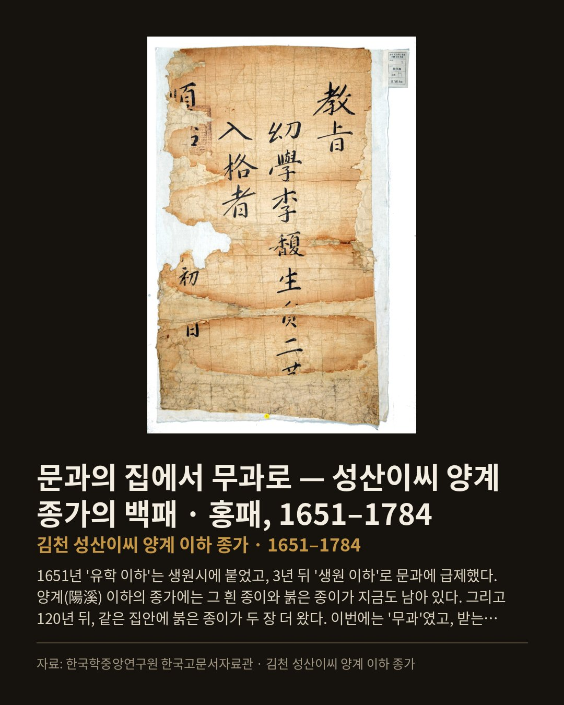
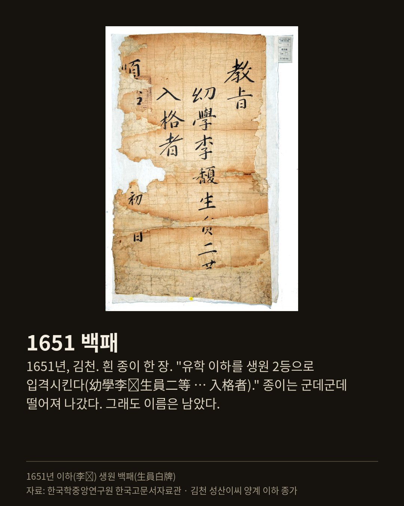
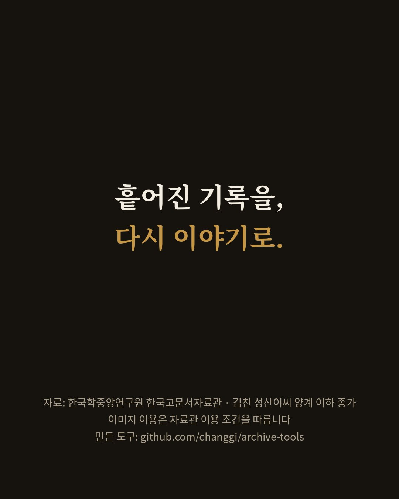

# EP.191 문과의 집에서 무과로 — 성산이씨 양계 종가의 백패 · 홍패, 1651–1784

김천 성산이씨 양계 이하 종가 (문중) · 1651년 '유학 이하'는 생원시에 붙었고, 3년 뒤 '생원 이하'로 문과에 급제했다. 양계(陽溪) 이하의 종가에는 그 흰 종이와 붉은 종이가 지금도 남아 있다. 그리고 120년 뒤, 같은 집안에 붉은 종이가 두 장 더 왔다. 이번에는 '무과'였고, 받는 사람의 이름 앞에는 '한량(閑良)'이 붙었다. 1784년의 등수는 병과 제137인이었다

- 🌐 [전시 웹페이지](https://changgi.github.io/archive-tools/examples/yanggye-hongbaek/exhibit.html) (한자 위 한글 독음 · 원문 해석) · [수업 활동지](https://changgi.github.io/archive-tools/examples/yanggye-hongbaek/handout.html)
- 🎬 영상: [릴스 9:16](https://changgi.github.io/archive-tools-next/media/ep191-yanggye-hongbaek_reel.mp4) · [가로 16:9](https://changgi.github.io/archive-tools-next/media/ep191-yanggye-hongbaek_wide.mp4) · 홍보 글: [`promo.md`](promo.md)
- 카드뉴스: [`cards/`](cards/) · SNS 글: [`sns.txt`](sns.txt) · 판독·해석 표: [`selection.csv`](selection.csv)

<!-- DELIVERY -->
## 전달 에디팅 — 이 기록을 이렇게 전합니다

- **핵심 정서** — 담담함
- **한 문장** — 조선 후기 무과는 한 번에 수백 명을 뽑는 시험이 되었고, 문과를 내던 양반 집안의 후손도 '한량'의 이름으로 무과에 응시했다 — 같은 붉은 종이에 '文科'와 '武科' 두 글자가 갈라진다.
- **열기** — 문과 급제자를 낸 집안에, 120년 뒤 무과 홍패가 왔습니다.
- **펼치기** — 이하 생원 백패 → 이하 문과 홍패 → 이천림 무과 홍패 → 이사언 무과 홍패 (1651–1784년) — 1651 유학 이하 생원 백패 → 1654 생원 이하 문과 홍패 → 1774 한량 이천림 무과 홍패(병과 제8인) → 1784 한량 이사언 무과 홍패(병과 제137인)로 놓았습니다.
- **절정** — "한량 이천림을 무과 병과 제8인으로 급제 출신시킨다(閑良李天林武科丙科第八人及第出身者)" — 화면·공간에서 이 한 줄만 크게, 소리를 줄여 집중
- **여운** — 같은 붉은 종이, 다른 두 글자 — 文과 武 사이에 이 집안은 무엇을 지키고 무엇을 바꾸었을까요? — 질문으로 끝내고 답은 보는 사람에게
- **감각과 물질** — 1654년 홍패의 '文科'와 1774 · 1784년 홍패의 '武科', 그리고 이름 앞의 '閑良' · 흰 종이 한 장에 조명 하나 · 붉은 종이를 실물 크기로 복제해 벽에 거는 연출
- **통로와 매개** — 온라인: 릴스(열기) → 카드뉴스(펼치기) → 전시 웹페이지(절정·원문) → 비하인드 카드(여운) / 오프라인: 원본 크기 복제·낭독·참여 벽 / 남기기: 활동지·질문 카드
- **여운 장치** — 집안 어른들의 직업 · 진로를 세대별로 적어 보기
- **전달 에디팅 전** — 4건의 문서를 1651–1784년 연대순으로 놓고 문서명 · 유형 · 해설을 붙인다 — 정확하지만, 지나가면 잊힌다.
- **전달 에디팅 후** — 핵심 정서는 「담담함」. 「문과 급제자를 낸 집안에, 120년 뒤 무과 홍패가 왔습니다.」로 열고, 문서를 대비와 순서로 펼친 뒤, "한량 이천림을 무과 병과 제8인으로 급제 출신시킨다(閑良李天林武科丙科第八人及第出身者)"에서 멈춘다. 1654년 홍패의 '文科'와 1774 · 1784년 홍패의 '武科', 그리고 이름 앞의 '閑良'. 마지막엔 「집안 어른들의 직업 · 진로를 세대별로 적어 보기」로 보는 사람이 자기 이야기를 남기고 떠나게 한다.

전문: [`delivery.md`](delivery.md)
<!-- /DELIVERY -->

<!-- CURATOR -->
## 비하인드 — 큐레이터 노트

- **왜 이 문서들인가** — EP.94에서 양계 이하(李𩡘)의 고신 두 장을 읽었습니다. 같은 종가에 그가 받은 백패 · 홍패와, 120년 뒤 후손들이 받은 무과 홍패 두 장이 남아 있어 함께 놓았습니다.
- **전하고 싶은 것** — 조선 후기 무과는 한 번에 수백 명을 뽑는 시험이 되었고, 문과를 내던 양반 집안의 후손도 '한량'의 이름으로 무과에 응시했다 — 같은 붉은 종이에 '文科'와 '武科' 두 글자가 갈라진다.
- **이렇게 보이길 바랐다** — 1651 유학 이하 생원 백패 → 1654 생원 이하 문과 홍패 → 1774 한량 이천림 무과 홍패(병과 제8인) → 1784 한량 이사언 무과 홍패(병과 제137인)로 놓았습니다.
- **이렇게 써 주세요** — 생원 · 진사시와 문과 · 무과, 홍패와 백패의 차이, '한량(閑良)'의 뜻, 조선 후기 무과의 대량 선발(만과), 양반 가문의 진로 변화 수업에 쓰세요.
- **만들며 있었던 일** — 1651 · 1654년 두 장은 종이가 물결 모양으로 떨어져 나가 등수와 날짜 일부가 남지 않았습니다. 연호 '順治'의 숫자와 백패의 등수, 홍패의 갑 · 을 · 병과 등수는 남은 글자까지만 적었습니다. 연도는 자료관 목록을 따랐습니다. 이천림 · 이사언과 이하의 관계(몇 대 후손인지)는 이 문서들로 확인하지 않았습니다.
- **남겨 둔 질문** — 같은 붉은 종이, 다른 두 글자 — 文과 武 사이에 이 집안은 무엇을 지키고 무엇을 바꾸었을까요?
- **제작 기록** — 문서 4건 · 1651–1784년 · 원본 사진 4면(문서 전체) · 원문 판독 4건 · 번역 4건 · 못 읽은 글자 □ 7 · 불확실 (?) 0

전문: [`curator.md`](curator.md) · 비하인드 카드: [`behind/`](behind/) · 채널별 홍보안: [`channels.md`](channels.md)
<!-- /CURATOR -->

## 이야기 — 사료가 말하는 대로

문과 급제자를 낸 집안에, 120년 뒤 무과 홍패가 왔습니다.

> **1651 백패** — 1651년, 김천. 흰 종이 한 장. "유학 이하를 생원 2등으로 입격시킨다(幼學李𩡘生員二等 … 入格者)." 종이는 군데군데 떨어져 나갔다. 그래도 이름은 남았다.
> **1654 홍패** — 세 해 뒤, 붉은 종이. "생원 이하를 문과로 급제 출신시킨다(生員李𩡘文科 … 及第出身者)." 이름 앞 두 글자가 '유학'에서 '생원'으로 바뀌었다. 흰 종이가 붉은 종이로 이어졌다.
> **1774 홍패** — 백이십 년 뒤, 1774년 봄. 같은 집안에 다시 붉은 종이가 온다. 그런데 두 글자가 다르다. "한량 이천림을 무과 병과 제8인으로 급제 출신시킨다(閑良李天林武科丙科第八人及第出身者)." 문(文)이 아니라 무(武).
> **1784 홍패** — 그리고 열 해 뒤, 1784년 가을. 또 한 장. "한량 이사언을 무과 병과 제137인으로(閑良李思彦武科丙科第一百三十七人)". 백서른일곱 번째. 문과가 서른셋을 뽑을 때, 무과는 수백을 뽑았다. 같은 붉은 종이 위에서, 이 집안의 길이 바뀌어 있었다.

| 표지 | 1번 카드 | 마무리 |
|---|---|---|
|  |  |  |

## 선별 문서 (4점)

| # | 연도 | 유형 | 문서명 | 원본 |
|---|---|---|---|---|
| 1 | 1651 | 백패 | 1651년 이하(李𩡘) 생원 백패(生員白牌) | [원본 보기](https://archive.aks.ac.kr/viewer/viewer.do#imgnode.do?itemId=book&gubun=booktree&depth=6&upPath=01%5E0167%5EL016746%5EL016746F02%5EL016746F0201&dataId=G002%2BKHD%2BKSM-XA.1651.0000-20150908.C0701_002_00001_XXX&itemType=) |
| 2 | 1654 | 홍패 | 1654년 이하(李𩡘) 문과 홍패(文科紅牌) | [원본 보기](https://archive.aks.ac.kr/viewer/viewer.do#imgnode.do?itemId=book&gubun=booktree&depth=6&upPath=01%5E0167%5EL016746%5EL016746F02%5EL016746F0201&dataId=G002%2BKHD%2BKSM-XA.1654.0000-20150908.C0701_002_00003_XXX&itemType=) |
| 3 | 1774 | 홍패 | 1774년 이천림(李天林) 무과 홍패(武科紅牌) | [원본 보기](https://archive.aks.ac.kr/viewer/viewer.do#imgnode.do?itemId=book&gubun=booktree&depth=6&upPath=01%5E0167%5EL016746%5EL016746F02%5EL016746F0201&dataId=G002%2BKHD%2BKSM-XA.1774.0000-20150908.C0701_002_00004_XXX&itemType=) |
| 4 | 1784 | 홍패 | 1784년 이사언(李思彦) 무과 홍패(武科紅牌) | [원본 보기](https://archive.aks.ac.kr/viewer/viewer.do#imgnode.do?itemId=book&gubun=booktree&depth=6&upPath=01%5E0167%5EL016746%5EL016746F02%5EL016746F0201&dataId=G002%2BKHD%2BKSM-XA.1784.0000-20150908.C0701_002_00005_XXX&itemType=) |

## 원문 판독과 해석

### 1. 1651년 이하(李𩡘) 생원 백패(生員白牌)

**원문 판독**

```
敎旨
幼學李𩡘生員二等第二十□
人入格者
順治□年□月初□日
```

**원문 해석** 교지. 유학 이하를 생원 2등 제2□인으로 입격시킨다. 순치 □년(1651) □월 초□일.

**해제** 1651년(효종 2) 이하(李𩡘)가 생원시에 입격하고 받은 백패입니다. 이하는 김천 성산이씨 양계(陽溪) 종가의 인물로, EP.94에서 그의 고신을 읽었습니다. 생원 2등은 25명 안의 상위권입니다. 종이가 여러 군데 물결 모양으로 떨어져 나가, 등수의 끝 글자와 연호 순치(順治)의 숫자, 달과 날의 일부가 남지 않았습니다. 연도는 자료관 목록을 따랐습니다. 흰 종이 위에 칸을 그린 선이 비쳐 보입니다.

### 2. 1654년 이하(李𩡘) 문과 홍패(文科紅牌)

**원문 판독**

```
敎旨
生員李𩡘文科丙科第二十一
人及第出身者
順治十一年十□月□□日
```

**원문 해석** 교지. 생원 이하를 문과 병과 제21인으로 급제 출신시킨다. 순치 11년(1654) 10□월 □□일.

**해제** 3년 뒤인 1654년(효종 5), 이하가 문과에 급제하고 받은 홍패입니다. 이번에는 이름 앞에 '유학'이 아니라 '생원'이 붙어, 3년 전의 백패가 이 홍패로 이어졌음을 보여 줍니다(EP.189 참조). 붉은 종이가 물결 모양으로 떨어져 나가 흰 배접지가 드러났습니다. 과(科)와 등수는 '丙科第二十一'로 읽힙니다. 이하는 이 급제 뒤 관직에 나갔고, 1654년 첫 고신이 이 집안에 남아 있습니다(EP.94).

### 3. 1774년 이천림(李天林) 무과 홍패(武科紅牌)

**원문 판독**

```
敎旨
閑良李天林武科丙科
第八人及第出身者
乾隆三十九年三月 日
```

**원문 해석** 교지. 한량 이천림을 무과 병과 제8인으로 급제 출신시킨다. 건륭 39년(1774) 3월 일.

**해제** 120년 뒤인 1774년(영조 50) 3월, 같은 집안의 이천림(李天林)이 무과에 급제하고 받은 홍패입니다. 이름 앞에는 '한량(閑良)'이 붙었습니다. 한량은 벼슬 없이 무예를 익히는 사람을 가리키며, 무과 응시자를 부르는 말로 쓰였습니다. 같은 붉은 종이, 같은 '及第出身者'이지만 '文科' 대신 '武科'가 쓰였습니다. 앞의 두 장과 달리 종이가 온전하고 붉은 색이 선명합니다.

### 4. 1784년 이사언(李思彦) 무과 홍패(武科紅牌)

**원문 판독**

```
敎旨
閑良李思彦武科丙科
第一百三十七人及第出身者
乾隆四十九年十月 日
```

**원문 해석** 교지. 한량 이사언을 무과 병과 제137인으로 급제 출신시킨다. 건륭 49년(1784) 10월 일.

**해제** 10년 뒤인 1784년(정조 8) 10월, 같은 집안의 이사언(李思彦)이 받은 무과 홍패입니다. 등수가 병과 제137인입니다. 문과가 한 번에 33명 안팎을 뽑았던 것과 달리, 조선 후기 무과는 수백 명, 많게는 수천 명을 한꺼번에 뽑기도 해 '만과(萬科)'라 불렸습니다. 137등이라는 숫자가 그 규모를 보여 줍니다. 1654년 문과 홍패에서 130년, 이 집안의 붉은 종이는 문과에서 무과로 이어졌습니다.

판독·해석·이야기는 이미지에 근거한 초안이며(검토 전 "초안" 표시), 정확한 판독은 원문 확인이 필요합니다. □는 읽지 못한 글자, (?)는 불확실한 글자입니다.
이미지: 한국학중앙연구원 한국고문서자료관 소장·제공. "원본" 링크를 누르면 자료관 뷰어에서 그 문서가 열립니다. 재사용은 자료관에 문의하세요(소장처 동의 필요).
