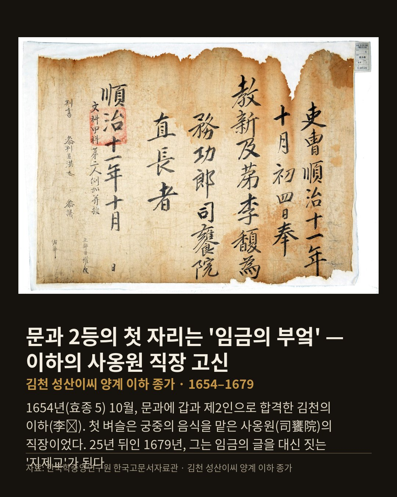
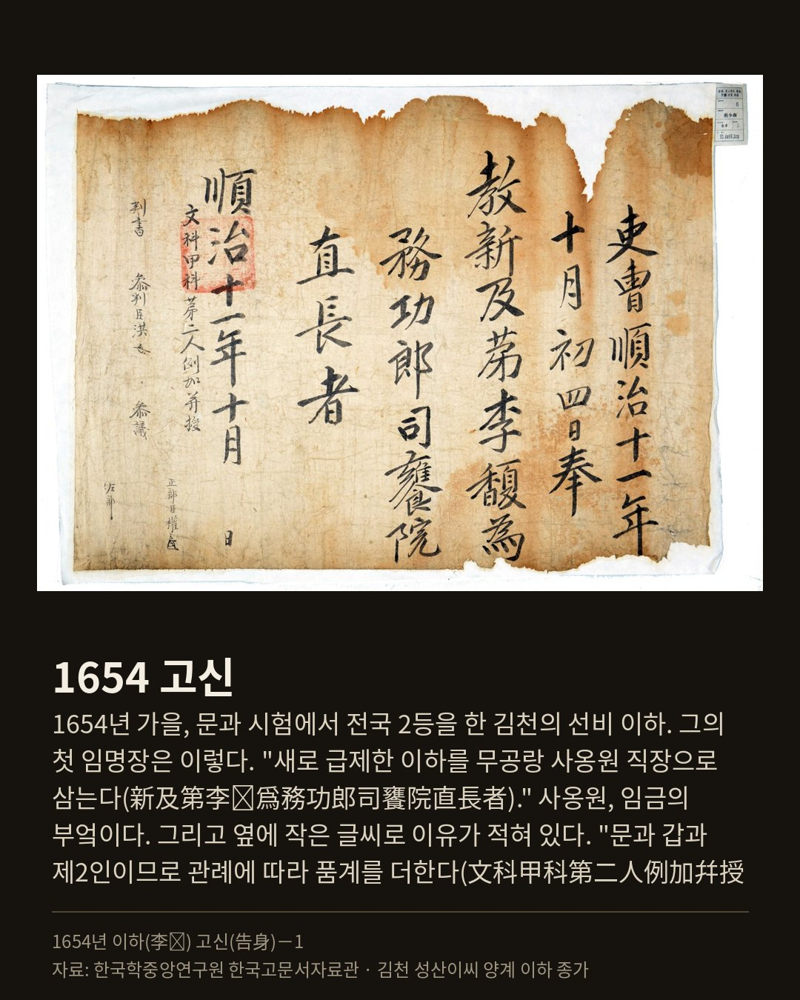
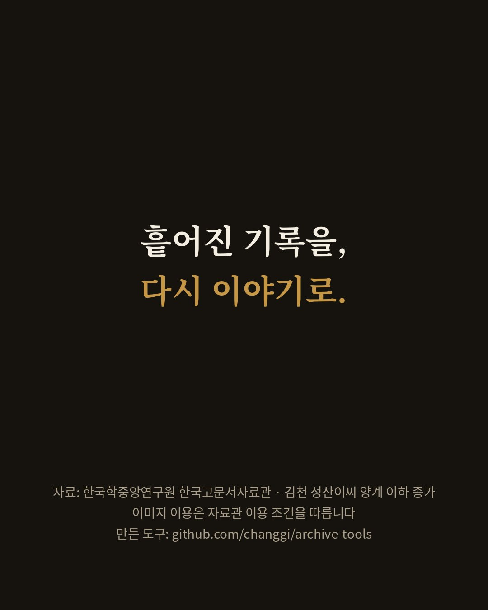

# EP.94 문과 2등의 첫 자리는 '임금의 부엌' — 이하의 사옹원 직장 고신

김천 성산이씨 양계 이하 종가 (문중) · 1654년(효종 5) 10월, 문과에 갑과 제2인으로 합격한 김천의 이하(李𩡘). 첫 벼슬은 궁중의 음식을 맡은 사옹원(司饔院)의 직장이었다. 25년 뒤인 1679년, 그는 임금의 글을 대신 짓는 '지제교'가 된다

- 🌐 [전시 웹페이지](https://changgi.github.io/archive-tools/examples/yanggye/exhibit.html) (한자 위 한글 독음 · 원문 해석) · [수업 활동지](https://changgi.github.io/archive-tools/examples/yanggye/handout.html)
- 🎬 영상: [릴스 9:16](https://changgi.github.io/archive-tools/examples/media/ep94-yanggye_reel.mp4) · [가로 16:9](https://changgi.github.io/archive-tools/examples/media/ep94-yanggye_wide.mp4) · 홍보 글: [`promo.md`](promo.md)
- 카드뉴스: [`cards/`](cards/) · SNS 글: [`sns.txt`](sns.txt) · 판독·해석 표: [`selection.csv`](selection.csv)


<!-- CURATOR -->
## 비하인드 — 큐레이터 노트

- **왜 이 문서들인가** — 문과 2등으로 급제한 선비의 첫 자리가 궁중 음식을 맡은 사옹원이었다는 점이 흥미로웠습니다.
- **전하고 싶은 것** — 관직 생활은 때로 뜻밖의 자리에서 시작되고, 시간이 지나 가장 빛나는 자리에 닿기도 한다는 것.
- **이렇게 보이길 바랐다** — '임금의 부엌'에서 '임금의 글'로, 25년의 변화를 두 장으로 대비했습니다.
- **이렇게 써 주세요** — 과거 성적과 초임 관직(예가 제도), 조선의 관직 체계 학습에 쓰세요.
- **만들며 있었던 일** — 1679년 교지는 오른쪽 위가 떨어져 원래 관직명 일부가 사라졌을 수 있습니다.
- **남겨 둔 질문** — 첫 직장이 꿈과 달랐던 경험, 여러분에게도 있나요?
- **제작 기록** — 문서 2건 · 1654–1679년 · 원본 사진 2면(문서 전체) · 원문 판독 2건 · 번역 2건

전문: [`curator.md`](curator.md)
<!-- /CURATOR -->

## 이야기 — 사료가 말하는 대로

전국 2등으로 과거에 붙은 선비의 첫 직장은, 임금의 부엌이었습니다.

> **1654 고신** — 1654년 가을, 문과 시험에서 전국 2등을 한 김천의 선비 이하. 그의 첫 임명장은 이렇다. "새로 급제한 이하를 무공랑 사옹원 직장으로 삼는다(新及第李𩡘爲務功郎司饔院直長者)." 사옹원, 임금의 부엌이다. 그리고 옆에 작은 글씨로 이유가 적혀 있다. "문과 갑과 제2인이므로 관례에 따라 품계를 더한다(文科甲科第二人例加幷授)."
> **1679 고신** — 스물다섯 해가 지나, 임금의 부엌에서 시작한 선비에게 다른 일이 맡겨진다. "이하를 지제교로 삼는다(李𩡘爲知製敎者)." 이제 그는 임금의 말을 글로 짓는 사람이 되었다. 음식을 차리던 손이, 왕의 문장을 차리게 된 것이다.

| 표지 | 1번 카드 | 마무리 |
|---|---|---|
|  |  |  |

## 선별 문서 (2점)

| # | 연도 | 유형 | 문서명 | 원본 |
|---|---|---|---|---|
| 1 | 1654 | 고신 | 1654년 이하(李𩡘) 고신(告身)－1 | [원본 보기](https://archive.aks.ac.kr/viewer/viewer.do#imgnode.do?itemId=book&gubun=booktree&depth=6&upPath=01%5E0167%5EL016746%5EL016746F02%5EL016746F0201&dataId=G002%2BKHD%2BKSM-XA.1654.0000-20150908.C0701_002_00006_XXX&itemType=) |
| 2 | 1679 | 고신 | 1679년 이하(李𩡘) 고신(告身)－4 | [원본 보기](https://archive.aks.ac.kr/viewer/viewer.do#imgnode.do?itemId=book&gubun=booktree&depth=6&upPath=01%5E0167%5EL016746%5EL016746F02%5EL016746F0201&dataId=G002%2BKHD%2BKSM-XA.1679.0000-20150908.C0701_002_00036_XXX&itemType=) |

## 원문 판독과 해석

### 1. 1654년 이하(李𩡘) 고신(告身)－1

**원문 판독**

```
吏曹順治十一年
十月初四日奉
敎 新及第李𩡘爲
務功郎司饔院
直長者
順治十一年十月　日
(소자) 文科甲科第二人例加幷授
判書　參判臣洪 [수결]　參議
正郞臣權 [수결]　佐郞
(이조 인)
```

**원문 해석** 이조에서 순치 11년(1654) 10월 초4일 왕명을 받들어, 새로 급제한 이하를 무공랑(정7품) 사옹원 직장으로 삼는다. 순치 11년 10월 일. (작은 글씨) 문과 갑과 제2인이므로 관례에 따라 품계를 더하여 함께 제수함. 판서, 참판 신 홍[서명], 참의, 정랑 신 권[서명], 좌랑.

**해제** 1654년 문과에서 갑과 제2인(전체 2등)으로 합격한 김천의 이하(李𩡘)를 정7품 무공랑의 품계로 사옹원 직장에 임명한 이조 고신입니다. 문과 갑과 합격자는 성적에 따라 처음부터 높은 품계를 주는 '예가(例加)'를 받았는데, 왼쪽 작은 글씨 '文科甲科第二人例加幷授'가 그 근거를 밝힙니다. 사옹원은 궁중 음식과 그릇(분원 백자)을 맡은 관청이었습니다. 위쪽 가장자리가 떨어져 나갔으나 본문은 온전합니다.

### 2. 1679년 이하(李𩡘) 고신(告身)－4

**원문 판독**

```
[敎旨]
李𩡘爲知
製敎者
康熙十八年九月初六日
(시명지보 1과)
```

**원문 해석** [교지.] 이하를 지제교로 삼는다. 강희 18년(1679) 9월 초6일.

**해제** 1679년(숙종 5) 이하를 지제교(知製敎)로 삼은 교지입니다. 지제교는 왕의 교서·교지 등을 대신 짓는 일을 겸하는 직임으로, 문장이 뛰어난 문신에게만 주어지는 영예로운 자리였습니다. 오른쪽 위가 크게 떨어져 '敎旨' 두 글자와 원래 관직명 일부가 사라졌을 가능성이 있습니다.

판독·해석·이야기는 이미지에 근거한 초안이며(검토 전 "초안" 표시), 정확한 판독은 원문 확인이 필요합니다. □는 읽지 못한 글자, (?)는 불확실한 글자입니다.
이미지: 한국학중앙연구원 한국고문서자료관 소장·제공. "원본" 링크를 누르면 자료관 뷰어에서 그 문서가 열립니다. 재사용은 자료관에 문의하세요(소장처 동의 필요).
