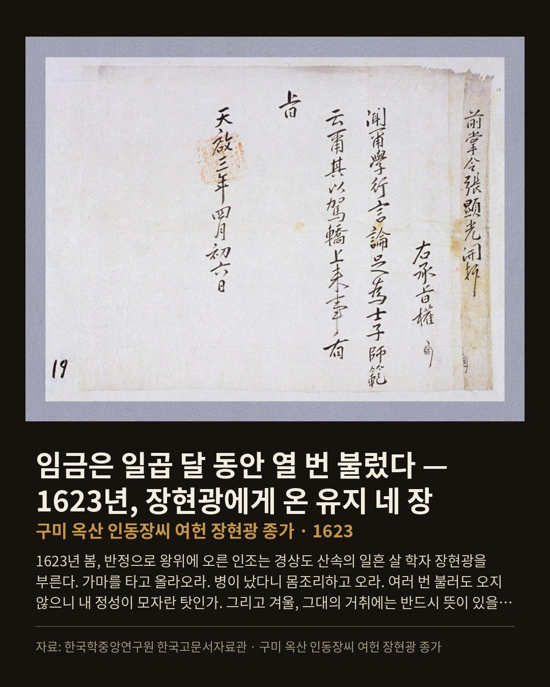
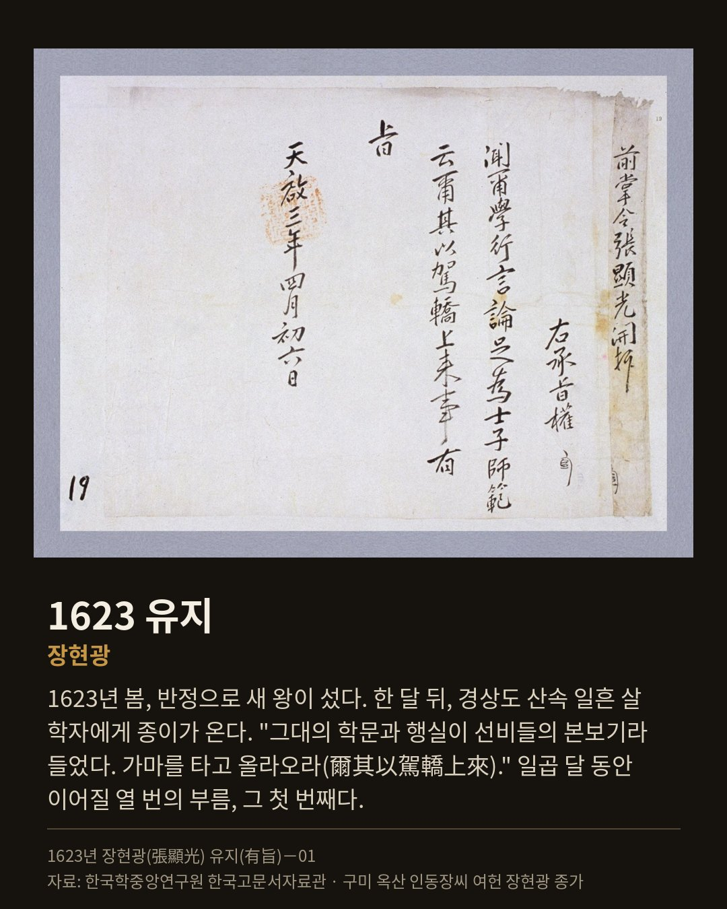
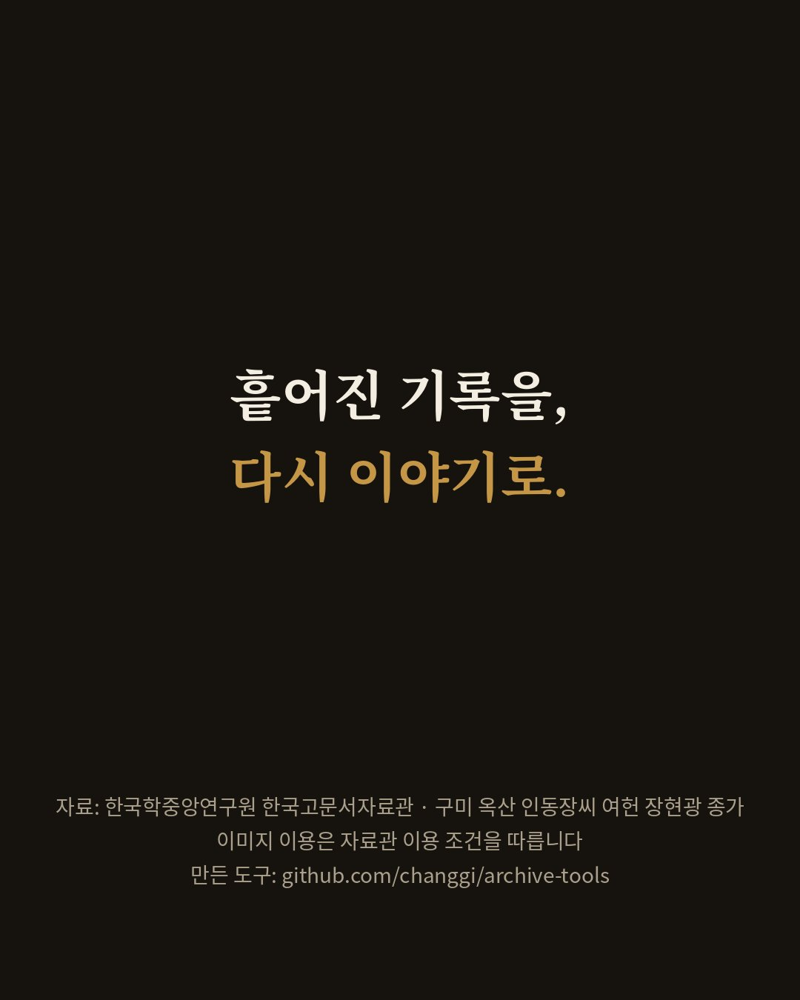

# EP.159 임금은 일곱 달 동안 열 번 불렀다 — 1623년, 장현광에게 온 유지 네 장

구미 옥산 인동장씨 여헌 장현광 종가 (문중) · 1623년 봄, 반정으로 왕위에 오른 인조는 경상도 산속의 일흔 살 학자 장현광을 부른다. 가마를 타고 올라오라. 병이 났다니 몸조리하고 오라. 여러 번 불러도 오지 않으니 내 정성이 모자란 탓인가. 그리고 겨울, 그대의 거취에는 반드시 뜻이 있을 것이다. 같은 해 장현광이 받은 유지는 열 장, 이 집안에 모두 남아 있다

- 🌐 [전시 웹페이지](https://changgi.github.io/archive-tools/examples/yeoheon-yuji/exhibit.html) (한자 위 한글 독음 · 원문 해석) · [수업 활동지](https://changgi.github.io/archive-tools/examples/yeoheon-yuji/handout.html)
- 🎬 영상: [릴스 9:16](https://changgi.github.io/archive-tools-next/media/ep159-yeoheon-yuji_reel.mp4) · [가로 16:9](https://changgi.github.io/archive-tools-next/media/ep159-yeoheon-yuji_wide.mp4) · 홍보 글: [`promo.md`](promo.md)
- 카드뉴스: [`cards/`](cards/) · SNS 글: [`sns.txt`](sns.txt) · 판독·해석 표: [`selection.csv`](selection.csv)

<!-- DELIVERY -->
## 전달 에디팅 — 이 기록을 이렇게 전합니다

- **핵심 정서** — 간절함
- **한 문장** — 임금의 부름은 명령에서 부탁으로, 부탁에서 자책으로 바뀌었다 — 산림을 불러 정통성을 세우려던 새 왕과, 쉽게 산을 떠나지 않은 학자 사이의 일곱 달.
- **열기** — 임금은 같은 사람을 일곱 달 동안 열 번 불렀습니다.
- **펼치기** — 장현광 유지－01 → 장현광 유지－04 → 장현광 유지－05 → 장현광 유지－10 (1623년) — 4월(가마를 타고 올라오라) → 5월(잠저 때부터 이름을 들었다, 병을 조리하고 오라) → 6월(내 정성이 얕은 탓인가) → 10월(그대의 거취에는 뜻이 있을 것이다)로, 같은 형식의 종이에서 임금의 말투만 달라지게 놓았습니다.
- **절정** — "여러 번 불러도 오지 않으니, 내 정성이 얕은 탓인가(爾屢招不來 豈予誠意淺薄)" — 화면·공간에서 이 한 줄만 크게, 소리를 줄여 집중
- **여운** — 열 번을 부르고 열 번을 사양한 두 사람은, 서로를 어떻게 생각했을까요? — 질문으로 끝내고 답은 보는 사람에게
- **감각과 물질** — 같은 '張顯光 開拆'의 봉투 띠, 같은 '有旨' — 그 사이 문장만 명령에서 자책으로 바뀐다 · 역마 방울·말발굽 소리와 함께 펼치는 두루마리
- **통로와 매개** — 온라인: 릴스(열기) → 카드뉴스(펼치기) → 전시 웹페이지(절정·원문) → 비하인드 카드(여운) / 오프라인: 원본 크기 복제·낭독·참여 벽 / 남기기: 활동지·질문 카드
- **여운 장치** — 누군가에게 거절당한 부탁을 다른 말로 다시 써 보기
- **전달 에디팅 전** — 4건의 문서를 1623년 연대순으로 놓고 문서명 · 유형 · 해설을 붙인다 — 정확하지만, 지나가면 잊힌다.
- **전달 에디팅 후** — 핵심 정서는 「간절함」. 「임금은 같은 사람을 일곱 달 동안 열 번 불렀습니다.」로 열고, 문서를 대비와 순서로 펼친 뒤, "여러 번 불러도 오지 않으니, 내 정성이 얕은 탓인가(爾屢招不來 豈予誠意淺薄)"에서 멈춘다. 같은 '張顯光 開拆'의 봉투 띠, 같은 '有旨' — 그 사이 문장만 명령에서 자책으로 바뀐다. 마지막엔 「누군가에게 거절당한 부탁을 다른 말로 다시 써 보기」로 보는 사람이 자기 이야기를 남기고 떠나게 한다.

전문: [`delivery.md`](delivery.md)
<!-- /DELIVERY -->

<!-- CURATOR -->
## 비하인드 — 큐레이터 노트

- **왜 이 문서들인가** — EP.29에서 종 애남이 '상전께서 병이 깊어 올라가지 못한다'고 쓴 소지를 읽었습니다. 그 '부름'의 실물을 찾아보니, 1623년 한 해에만 유지가 열 장 남아 있어 말투가 달라지는 네 장을 골랐습니다.
- **전하고 싶은 것** — 임금의 부름은 명령에서 부탁으로, 부탁에서 자책으로 바뀌었다 — 산림을 불러 정통성을 세우려던 새 왕과, 쉽게 산을 떠나지 않은 학자 사이의 일곱 달.
- **이렇게 보이길 바랐다** — 4월(가마를 타고 올라오라) → 5월(잠저 때부터 이름을 들었다, 병을 조리하고 오라) → 6월(내 정성이 얕은 탓인가) → 10월(그대의 거취에는 뜻이 있을 것이다)로, 같은 형식의 종이에서 임금의 말투만 달라지게 놓았습니다.
- **이렇게 써 주세요** — 조선의 왕명 문서(유지 · 승정원 발급), 인조반정과 산림 징소, 출처(出處)의 윤리, 관직 제수와 사직의 관행 수업에 쓰세요.
- **만들며 있었던 일** — 네 장 모두 승지가 해서 · 행서로 정서해 대부분 또렷하나, 10월 장의 몇 글자(頗 · 貫 등)는 확정하지 못했습니다. 장현광이 각각에 어떻게 답했는지(사직 상소 등)는 이 묶음에 없어 '오지 않았다'는 유지 속 말만 따랐습니다. 장현광의 생몰(1554–1637)은 알려진 사실을 따랐습니다.
- **남겨 둔 질문** — 열 번을 부르고 열 번을 사양한 두 사람은, 서로를 어떻게 생각했을까요?
- **제작 기록** — 문서 4건 · 1623년 · 원본 사진 8면(문서 전체) · 원문 판독 4건 · 번역 4건

전문: [`curator.md`](curator.md) · 비하인드 카드: [`behind/`](behind/) · 채널별 홍보안: [`channels.md`](channels.md)
<!-- /CURATOR -->

## 이야기 — 사료가 말하는 대로

임금은 같은 사람을 일곱 달 동안 열 번 불렀습니다.

> **1623 유지** — 1623년 봄, 반정으로 새 왕이 섰다. 한 달 뒤, 경상도 산속 일흔 살 학자에게 종이가 온다. "그대의 학문과 행실이 선비들의 본보기라 들었다. 가마를 타고 올라오라(爾其以駕轎上來)." 일곱 달 동안 이어질 열 번의 부름, 그 첫 번째다.
> **1623 유지** — 3주 뒤, 두 번째. 이번에는 벼슬이 붙었다. 사헌부 지평. 그리고 고백 한 줄. "내가 왕이 되기 전부터 이미 그대의 이름을 들었다(予在潛邸 已聞爾名)." 감사의 보고는 '병이 나서 못 온다'였다. 왕은 적는다. 자리를 비워 두고 기다리겠다.
> **1623 유지** — 한 달 반 뒤, 다섯 번째 부름. 이번에는 명령이 아니다. "여러 번 불러도 오지 않으니, 내 정성이 얕은 탓인가(爾屢招不來 豈予誠意淺薄)." 바람도 작아졌다. 한 번만 만나 보고 싶다고.
> **1623 유지** — 그리고 겨울, 열 번째. 왕은 이제 안다. 병 때문만이 아니라는 것을. "그대의 거취에는 반드시 뜻이 있을 것이다(爾之去就 必有其意)." 그래도 마지막 줄은 같다. 멀리 떠난 마음을 돌이켜, 올라오라. 일곱 달, 열 장. 그 종이들은 모두 산속 그의 집에 남았다.

| 표지 | 1번 카드 | 마무리 |
|---|---|---|
|  |  |  |

## 선별 문서 (4점)

| # | 연도 | 유형 | 문서명 | 원본 |
|---|---|---|---|---|
| 1 | 1623 | 유지 | 1623년 장현광(張顯光) 유지(有旨)－01 | [원본 보기](https://archive.aks.ac.kr/viewer/viewer.do#imgnode.do?itemId=book&gubun=booktree&depth=6&upPath=01%5E0167%5EL016768%5EL016768F02%5EL016768F0201&dataId=G002%2BAKS%2BKSM-XA.1623.1111-20101008.B055a_079_00006_XXX&itemType=) |
| 2 | 1623 | 유지 | 1623년 장현광(張顯光) 유지(有旨)－04 | [원본 보기](https://archive.aks.ac.kr/viewer/viewer.do#imgnode.do?itemId=book&gubun=booktree&depth=6&upPath=01%5E0167%5EL016768%5EL016768F02%5EL016768F0201&dataId=G002%2BAKS%2BKSM-XA.1623.1111-20101008.B055a_079_00009_XXX&itemType=) |
| 3 | 1623 | 유지 | 1623년 장현광(張顯光) 유지(有旨)－05 | [원본 보기](https://archive.aks.ac.kr/viewer/viewer.do#imgnode.do?itemId=book&gubun=booktree&depth=6&upPath=01%5E0167%5EL016768%5EL016768F02%5EL016768F0201&dataId=G002%2BAKS%2BKSM-XA.1623.1111-20101008.B055a_079_00010_XXX&itemType=) |
| 4 | 1623 | 유지 | 1623년 장현광(張顯光) 유지(有旨)－10 | [원본 보기](https://archive.aks.ac.kr/viewer/viewer.do#imgnode.do?itemId=book&gubun=booktree&depth=6&upPath=01%5E0167%5EL016768%5EL016768F02%5EL016768F0201&dataId=G002%2BAKS%2BKSM-XA.1623.1111-20101008.B055a_079_00015_XXX&itemType=) |

## 원문 판독과 해석

### 1. 1623년 장현광(張顯光) 유지(有旨)－01

**원문 판독**

```
前掌令張顯光開拆
右承旨權 (수결)
聞爾學行言論 足爲士子師範
云 爾其以駕轎上來事 有
旨
天啓三年四月初六日
```

**원문 해석** 전 장령 장현광 개탁(뜯어보라). 우승지 권 (수결). 그대의 학문과 행실, 언론이 선비들의 본보기가 될 만하다고 들었다. 그대는 가마를 타고 올라오라. 유지. 천계 3년(1623) 4월 6일.

**해제** 인조반정(1623년 3월) 한 달 뒤인 4월 6일, 승정원 우승지 권(權)이 왕명을 받아 '전 장령' 장현광(張顯光, 1554–1637)에게 보낸 유지(有旨)입니다. 유지는 승지가 임금의 뜻을 받아 적어 보내는 왕명 문서로, 오른쪽 띠의 '某開拆(뜯어보라)'이 받는 사람, 끝의 '有旨'와 날짜가 형식입니다. '선비들의 본보기(士子師範)'라 하며 '가마(駕轎)를 타고 올라오라'고 했습니다. 새 왕은 재야의 이름난 학자(산림)를 조정에 불러 정통성을 세우려 했고, 장현광은 그 가운데 한 사람이었습니다. 이해 이 집안에 남은 유지는 열 장입니다.

### 2. 1623년 장현광(張顯光) 유지(有旨)－04

**원문 판독**

```
司憲府持平張顯光開拆
行都承旨吳 (수결)
爾力學修行 遯居山野 予在
潛邸 已聞爾名 茲授爾司憲
府持平 今見慶尙監司狀啓
則爾以病不得上來云 深用
缺然 … 調理 速爲上來 以副予
側席之望事 有
旨
天啓三年五月初一日
```

**원문 해석** 사헌부 지평 장현광 개탁. 행 도승지 오 (수결). 그대는 학문에 힘쓰고 행실을 닦으며 산야에 숨어 살았다. 내가 잠저(즉위 전)에 있을 때 이미 그대의 이름을 들었기에, 이에 그대에게 사헌부 지평을 제수한다. 이제 경상감사의 장계를 보니 그대가 병으로 올라오지 못한다 하니 매우 서운하다. … 몸조리하여 속히 올라와 자리를 비워 두고 기다리는 내 바람에 부응하라. 유지. 천계 3년(1623) 5월 1일.

**해제** 3주 뒤 5월 1일, 도승지 오(吳)가 보낸 유지입니다. 이번에는 사헌부 지평(司憲府持平, 정5품) 벼슬을 주며 부릅니다. '내가 잠저에 있을 때 이미 그대의 이름을 들었다(予在潛邸 已聞爾名)'는 왕이 개인적인 존경을 밝힌 구절입니다. 경상감사의 장계로 장현광이 병을 이유로 올라오지 못한다는 보고를 받고, '자리를 비워 두고 기다린다(側席之望)'는 표현으로 다시 청합니다. EP.29의 종 애남 소지('상전께서 병이 깊어')는 이 무렵의 사정과 이어집니다.

### 3. 1623년 장현광(張顯光) 유지(有旨)－05

**원문 판독**

```
成均館司業張顯光開拆
右副承旨洪 (수결)
爾屢招不來 豈予誠意淺薄 不足之
以致之歟 想爾昔疾今愈 爾其勉強
… 上來 以副予一見之願事 有
旨
天啓三年六月十四日
```

**원문 해석** 성균관 사업 장현광 개탁. 우부승지 홍 (수결). 그대가 여러 번 불러도 오지 않으니, 어찌 내 정성이 얕아 그대를 오게 하기에 모자란 것이 아니겠는가. 생각건대 그대의 지난 병이 이제는 나았을 것이니, 그대는 힘써 … 올라와 한 번 만나 보고 싶은 내 바람에 부응하라. 유지. 천계 3년(1623) 6월 14일.

**해제** 6월 14일 우부승지 홍(洪)이 보낸 유지로, 이번에는 성균관 사업(成均館司業, 정4품)으로 불렀습니다. 가장 눈에 띄는 것은 '여러 번 불러도 오지 않으니, 어찌 내 정성이 얕아 모자란 것이 아니겠는가(爾屢招不來 豈予誠意淺薄 不足以致之歟)'라는, 임금이 자신을 탓하는 문장입니다. 신하를 부르는 왕명에 이런 자책을 담는 것은 산림을 예우하는 조선의 화법입니다. 바람은 '한 번 만나 보고 싶다(一見之願)'로 낮아졌습니다. EP.29의 애남 소지도 '사업에 제수되어'로 시작합니다.

### 4. 1623년 장현광(張顯光) 유지(有旨)－10

**원문 판독**

```
司憲府掌令張顯光開拆
同副承旨金 (수결)
續見本道監司狀啓 知爾一向辭
疾不來 爾之去就 必有其意 予甚
缺然 否德忝位 雖不足以有爲 而 …
予願見之誠 爾亦庶或諒之矣 神
明所扶 勿藥有喜 爾其勉回遐心
善爲調理 … 然來思 以副予望
事 有
旨
天啓三年十月二十三日
```

**원문 해석** 사헌부 장령 장현광 개탁. 동부승지 김 (수결). 이어서 본도 감사의 장계를 보니 그대가 줄곧 병을 이유로 사양하고 오지 않음을 알았다. 그대의 나아가고 물러남에는 반드시 그 뜻이 있을 것이니, 나는 몹시 서운하다. 덕이 없는 몸으로 자리를 더럽혀 비록 무엇을 해낼 만하지는 못하나, … 그대를 보고 싶어 하는 내 정성을 그대도 혹 헤아려 줄 것이다. 신명이 도와 약을 쓰지 않고도 나을 것이니, 그대는 멀리 떠난 마음을 힘써 돌이켜 잘 조리하고 … 올라와 내 바람에 부응하라. 유지. 천계 3년(1623) 10월 23일.

**해제** 같은 해 마지막 유지인 10월 23일, 동부승지 김(金)이 보낸 것입니다. 사헌부 장령(정4품)으로 부르며, '그대의 거취에는 반드시 뜻이 있을 것(爾之去就 必有其意)'이라 하여 장현광이 병보다 '출처(出處)'의 원칙으로 사양하고 있음을 왕도 알고 있음을 드러냅니다. '덕이 없는 몸으로 자리를 더럽혔다(否德忝位)'는 자기 낮춤과 '멀리 떠난 마음을 돌이키라(勉回遐心)'는 청이 이어집니다. 일곱 달 사이 지평 · 사업 · 장령으로 벼슬이 바뀌며 열 번의 유지가 갔고, 이듬해에도 유지가 이어집니다(1624년 다섯 장). 몇 글자는 확정하지 못했습니다.

판독·해석·이야기는 이미지에 근거한 초안이며(검토 전 "초안" 표시), 정확한 판독은 원문 확인이 필요합니다. □는 읽지 못한 글자, (?)는 불확실한 글자입니다.
이미지: 한국학중앙연구원 한국고문서자료관 소장·제공. "원본" 링크를 누르면 자료관 뷰어에서 그 문서가 열립니다. 재사용은 자료관에 문의하세요(소장처 동의 필요).
