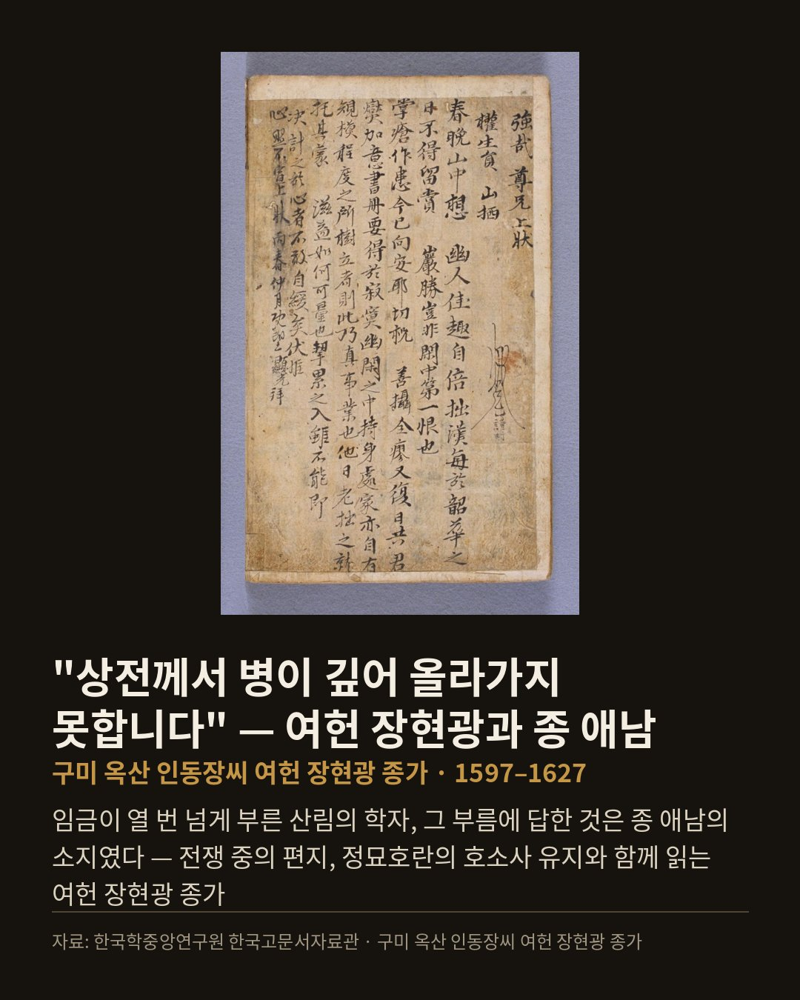
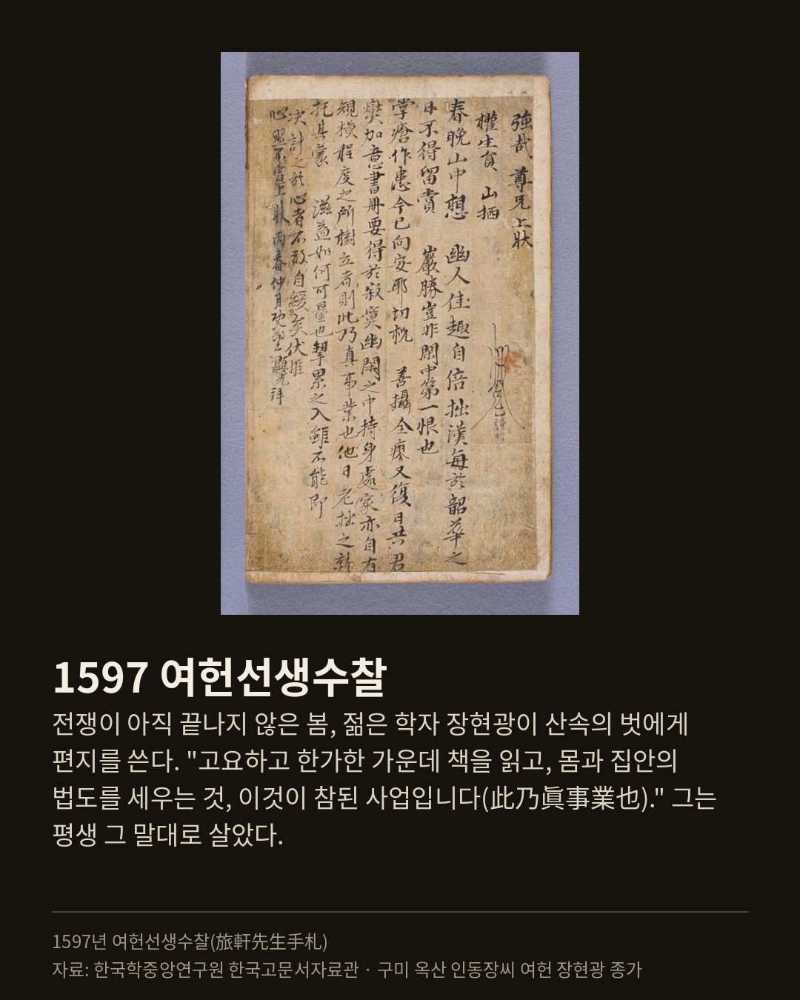
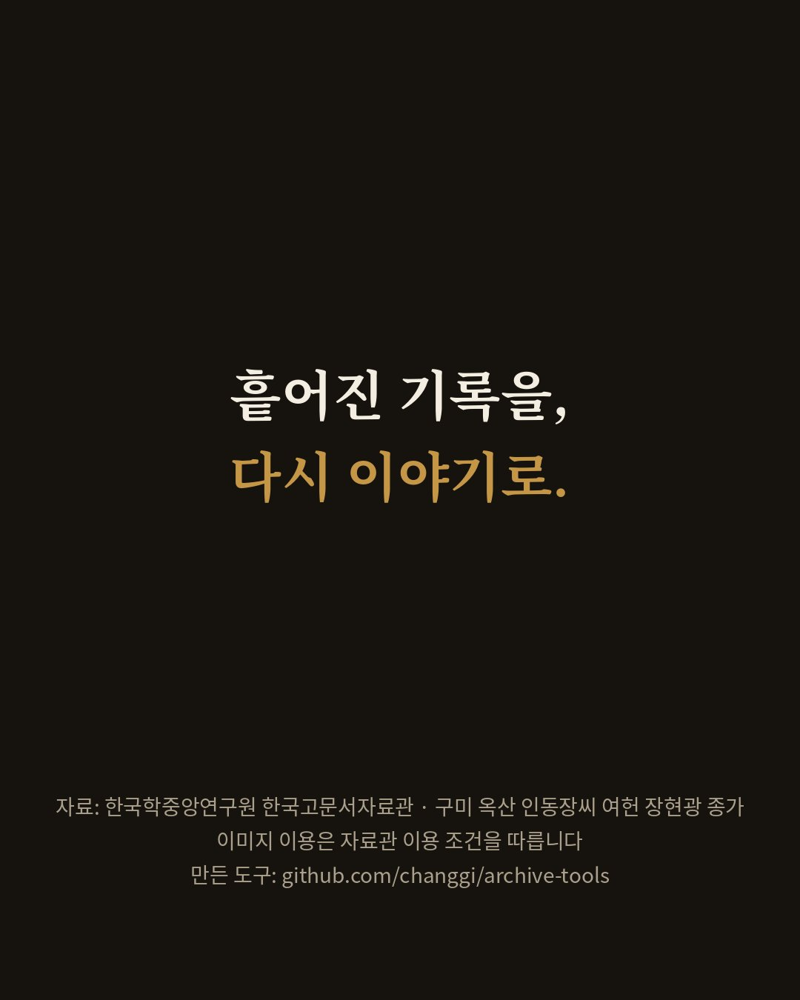

# EP.29 "상전께서 병이 깊어 올라가지 못합니다" — 여헌 장현광과 종 애남

구미 옥산 인동장씨 여헌 장현광 종가 (문중) · 임금이 열 번 넘게 부른 산림의 학자, 그 부름에 답한 것은 종 애남의 소지였다 — 전쟁 중의 편지, 정묘호란의 호소사 유지와 함께 읽는 여헌 장현광 종가

- 🌐 [전시 웹페이지](https://changgi.github.io/archive-tools/examples/yeoheon/exhibit.html) (한자 위 한글 독음 · 원문 해석) · [수업 활동지](https://changgi.github.io/archive-tools/examples/yeoheon/handout.html)
- 🎬 영상: [릴스 9:16](https://changgi.github.io/archive-tools/examples/media/ep29-yeoheon_reel.mp4) · [가로 16:9](https://changgi.github.io/archive-tools/examples/media/ep29-yeoheon_wide.mp4) · 홍보 글: [`promo.md`](promo.md)
- 카드뉴스: [`cards/`](cards/) · SNS 글: [`sns.txt`](sns.txt) · 판독·해석 표: [`selection.csv`](selection.csv)

## 이야기 — 사료가 말하는 대로

임금이 거듭 부른 학자 대신, 종이 관청에 글을 올렸습니다. 무슨 사연일까요?

> **1597 여헌선생수찰** — 전쟁이 아직 끝나지 않은 봄, 젊은 학자 장현광이 산속의 벗에게 편지를 쓴다. "고요하고 한가한 가운데 책을 읽고, 몸과 집안의 법도를 세우는 것, 이것이 참된 사업입니다(此乃眞事業也)." 그는 평생 그 말대로 살았다.
> **1623 소지** — 1623년 인조반정. 새 조정은 산속의 학자 장현광을 거듭 부른다. 그 부름에 답한 사람은 종 애남이었다. "상전께서 부르시는 뜻을 받은 것이 한두 번이 아니나(承召旨非止一再), 두 눈이 짓물러 두 달째 앞을 보지 못하십니다." 종의 이름으로 올린 소지가 1623년, 1625년, 1630년까지 이어진다.
> **1627 서목** — 1627년 정묘호란. 이번에 그는 사양하지 않는다. 일흔넷의 장현광은 경상도 호소사가 되어 보고를 올린다. "의병을 모으는 일이 급하니(號召事務時急) 전 승지 이언영과 함께 하고, 전 군수 조형도에게 군사를 거느리게 하겠습니다."
> **1627 유지** — 여드레 뒤, 임금의 유지가 온다. "적이 서쪽으로 물러간 것이 확실하니(賊之西退似爲的實), 지키던 군사를 모두 농사로 돌려보내라." 벼슬에는 병이 깊다 답하던 선비가, 나라가 위태로울 때는 앞장섰다.

| 표지 | 1번 카드 | 마무리 |
|---|---|---|
|  |  |  |

## 선별 문서 (4점)

| # | 연도 | 유형 | 문서명 | 원본 |
|---|---|---|---|---|
| 1 | 1597 | 여헌선생수찰 | 1597년 여헌선생수찰(旅軒先生手札) | [원본 보기](https://archive.aks.ac.kr/viewer/viewer.do#imgnode.do?itemId=book&gubun=booktree&depth=6&upPath=01%5E0167%5EL016768%5EL016768F01%5EL016768F0104&dataId=G002%2BAKS%2BKSM-WG.1597.1114-20190131.B055a_000_B02101553&itemType=) |
| 2 | 1623 | 소지 | 1623년 장현광(張顯光) 노(奴) 애남(愛男) 소지(所志)－2 | [원본 보기](https://archive.aks.ac.kr/viewer/viewer.do#imgnode.do?itemId=book&gubun=booktree&depth=6&upPath=01%5E0167%5EL016768%5EL016768F02%5EL016768F0202&dataId=G002%2BAKS%2BKSM-XB.1623.4719-20101008.B055a_079_00258_XXX&itemType=) |
| 3 | 1627 | 서목 | 1627년 호소사(號召使) 장현광(張顯光) 서목(書目)－1 | [원본 보기](https://archive.aks.ac.kr/viewer/viewer.do#imgnode.do?itemId=book&gubun=booktree&depth=6&upPath=01%5E0167%5EL016768%5EL016768F02%5EL016768F0203&dataId=G002%2BAKS%2BKSM-XC.1627.0000-20101008.B055a_079_00338_XXX&itemType=) |
| 4 | 1627 | 유지 | 1627년 호소사(號召使) 장현광(張顯光) 유지(有旨)－1 | [원본 보기](https://archive.aks.ac.kr/viewer/viewer.do#imgnode.do?itemId=book&gubun=booktree&depth=6&upPath=01%5E0167%5EL016768%5EL016768F02%5EL016768F0201&dataId=G002%2BAKS%2BKSM-XA.1627.1111-20101008.B055a_079_00026_XXX&itemType=) |

## 원문 판독과 해석

### 1. 1597년 여헌선생수찰(旅軒先生手札)

**원문 판독**

```
強哉 尊兄 上狀 (겉봉 쪽 제목)
權生員 山栖 (받는 곳)
春晩山中想
幽人佳趣自倍拙漢每於韶華之
日不得留賞
巖勝豈非閑中第一恨也
掌瘡作患今已向安耶切杌(?)
善攝全瘳又復日共君(?)
變加意書冊要得於寂寞幽閑之中持身處家亦自有
規模程度之所樹立者則此乃眞事業也他日老拙之就(?)
托其蒙
滋益如何可量也挈累之入鋪(?)不能卽
決計之於心者不敢自緩矣伏惟
心照不宣 上狀 丙春仲月旣望 顯光 拜
(오른쪽 큰 서명) 謹封 (판독 불확실)
```

**원문 해석** 강재 존형께 올리는 편지. 산에 사시는 권 생원께. 봄이 저무는 산중을 생각하니 숨어 사는 이의 아름다운 흥취가 갑절이겠습니다. 못난 저는 좋은 봄날마다 머물러 즐기지 못하니, 바위 경치가 좋은데도 어찌 한가한 가운데 첫째가는 한이 아니겠습니까. 손바닥 종기로 앓으시던 것은 이제 나아가십니까. 간절히 바랍니다. 잘 조섭하여 온전히 나으시고 또 날마다 그대와 함께 … 책에 마음을 더하시어 고요하고 한가한 가운데서 얻으시고, 몸가짐과 집안 다스림에도 스스로 규모와 법도를 세우시면 이것이 바로 참된 사업입니다. 뒷날 늙고 못난 제가 그 덕을 입게 되면 그 보탬이 어찌 헤아릴 수 있겠습니까. 식구를 이끌고 들어가는 일은 곧바로 하지 못하나 마음속으로 정한 것은 감히 늦추지 않겠습니다. 엎드려 바라건대 마음으로 헤아려 주십시오. 다 갖추지 못하고 올립니다. 병(丙)년 봄 2월 16일, 현광 절함.

**해제** 장현광(1554~1637)이 '강재(強哉)' 권 생원에게 보낸 친필 편지로, 첩으로 꾸민 「여헌선생수찰」의 첫 면입니다. 문서명은 1597년이고, 끝의 '丙春'은 병신년(1596) 봄으로 보입니다. 임진왜란이 아직 끝나지 않은 때로, 장현광은 전쟁 중 피란하며 학문을 이어 갔습니다. '既望'은 음력 16일입니다. 일부 글자는 판독이 불확실합니다.

### 2. 1623년 장현광(張顯光) 노(奴) 애남(愛男) 소지(所志)－2

**원문 판독**

```
新(?)○(구멍)館司業張顯光戶奴愛男
右所陳○○(구멍)等奴矣段上典蒙 除司業之職去六月
特下召命今七月初九日方到窮巷爲白在果上典前承
召旨非止一再耗荒癃廢莫克奔 謝跡涉冥頑日夜惶
允(?)劇兩皆爛合恒閉不開曚不見物者兩朔矣當此
新命之下事出尋常萬萬
聖眷罔極 異數重疊不但分義難固(?)其在區區情理亦
登途乃是當然道理是白乎矣惟其見疾非他證比也
接百思千料悶迫無計不得已復爲此訴爲白去乎緣
啓達之路爲白只爲
行下向敎是事
府官主 處分
天啓三年七月 日所志
(왼쪽 아래 큰 글씨 — 관의 처분과 수결, 판독 불확실)
```

**원문 해석** 새로 성균관 사업에 임명된 장현광 댁의 종 애남. 이 소지로 아뢰는 저희 종들의 사연은, 상전께서 사업(司業) 벼슬을 받으셨는데 지난 6월 특별히 부르시는 명이 내려와 이번 7월 9일에야 궁벽한 시골에 이르렀습니다. 상전께서는 앞서 부르시는 뜻을 받은 것이 한두 번이 아니었으나, 늙고 병들어 달려가 사은하지 못하니 그 자취가 완고하고 어리석은 것 같아 밤낮으로 두려워하고 계십니다. … (두 눈이) 모두 짓물러 늘 감겨 뜨지 못하고, 앞이 흐려 물건을 보지 못한 지 두 달입니다. 이번 새 명은 보통 일과 비교할 수 없이 임금의 은혜가 끝이 없고 특별한 대우가 거듭되니, 분의로도 굳이 사양하기 어렵고 하찮은 정리로도 길을 나서는 것이 당연한 도리입니다. 다만 그 병은 다른 핑계가 아니어서, 백 번 생각하고 천 번 헤아려도 답답하고 급해 어찌할 방법이 없어 부득이 다시 이렇게 호소하오니, 이 사정을 임금께 아뢸 길이 되도록 처분해 주실 일입니다. 부관(府官)께서 처분하소서. 천계 3년(1623) 7월 일 소지.

**해제** 1623년(인조 1, 天啓 3) 7월, 장현광 집안의 종 애남(愛男)이 상전을 대신해 인동부에 올린 소지입니다. 인조반정 직후 새 조정은 산림의 학자 장현광을 성균관 사업으로 거듭 불렀고, 장현광은 눈병 등으로 나아가지 못하는 사정을 종의 이름으로 관에 알려 임금께 전하게 했습니다. 종 애남 명의의 소지는 1623·1625·1630년 것이 여러 장 남아 있습니다. '奴矣段(저희 종들은)', '爲白在果(하옵거니와)', '爲白乎矣(하옵되)', '爲白只爲(하옵기 위해)' 등은 이두입니다. 구멍 난 곳의 글자는 비워 두었습니다.

### 3. 1627년 호소사(號召使) 장현광(張顯光) 서목(書目)－1

**원문 판독**

```
慶尙道號召使書目
一 號召事務時急前承旨李彦英李民宬與之共事事
一 前郡守趙亨道別將以帶率事
一 前都事李之華前別坐朴宗男募粮官定體事
已上書狀叁道
天啓七年正月卄八日號召使張 (수결)
(왼쪽 큰 흘림 — 처리 결과 題辭) 丁卯二月初□日 … (판독 불확실)
```

**원문 해석** 경상도 호소사의 서목(보고 요지). 하나, 의병을 불러 모으는 일이 급하니 전 승지 이언영·이민성과 함께 일하게 할 일. 하나, 전 군수 조형도를 별장으로 삼아 (군사를) 거느리게 할 일. 하나, 전 도사 이지화와 전 별좌 박종남을 군량 모으는 관원(募粮官)으로 정할 일. 이상 서장 세 통. 천계 7년(1627) 정월 28일, 호소사 장(서명).

**해제** 1627년(인조 5) 정월 28일, 정묘호란이 일어나자 호소사 장현광이 조정에 올린 보고의 요지(서목)입니다. 함께 일할 사람(이언영·이민성), 군사를 거느릴 별장(조형도), 군량을 모을 관원(이지화·박종남)을 정해 보고했습니다. 왼쪽의 큰 흘림 글씨는 처리 결과로 보이며 판독이 필요합니다. 청군은 정월 13일 압록강을 건넜습니다.

### 4. 1627년 호소사(號召使) 장현광(張顯光) 유지(有旨)－1

**원문 판독**

```
慶尙道號召使張 開拆 (겉봉)
右副承旨鄭 (수결)
卿(?)各(?)處馳啓則賊之西退似爲的
實三嶺及錦江等處把守軍兵
並罷歸農中路留住軍兵亦
爲一體施行茲遣宣傳官持標
信下去卿其知悉擧行事有
旨
天啓七年二月初五日 (도장)
```

**원문 해석** 경상도 호소사 장(현광)이 열어 볼 것. 우부승지 정(서명). 여러 곳에서 급히 올린 보고를 보니 적이 서쪽으로 물러간 것이 확실한 듯하다. 세 고개(三嶺)와 금강 등지를 지키는 군사는 모두 파하여 농사로 돌려보내고, 도중에 머물러 있는 군사도 똑같이 시행하라. 이에 선전관에게 표신(標信)을 지니고 내려가게 하니, 경은 알고 거행하라는 유지이다. 천계 7년(1627) 2월 5일.

**해제** 1627년(인조 5) 정묘호란 때, 경상도 호소사(號召使, 의병과 군량을 모으는 임시 직책)로 임명된 74세의 장현광에게 내린 유지입니다. 청군이 물러가자 모은 군사를 해산해 농사로 돌려보내라고 명했습니다. '標信'은 왕명을 전하는 관원이 지니는 신표입니다. 첫 글자 일부는 판독이 불확실합니다.

판독·해석·이야기는 이미지에 근거한 초안이며(검토 전 "초안" 표시), 정확한 판독은 원문 확인이 필요합니다. □는 읽지 못한 글자, (?)는 불확실한 글자입니다.
이미지: 한국학중앙연구원 한국고문서자료관 소장·제공. "원본" 링크를 누르면 자료관 뷰어에서 그 문서가 열립니다. 재사용은 자료관에 문의하세요(소장처 동의 필요).
