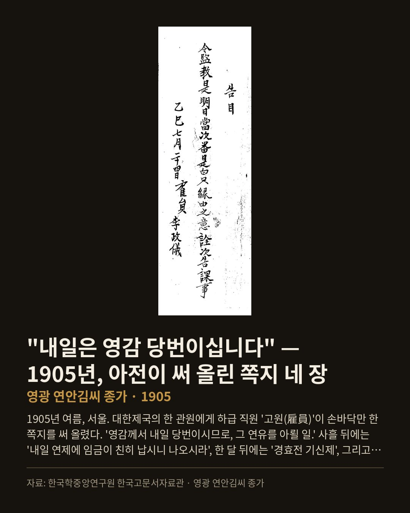
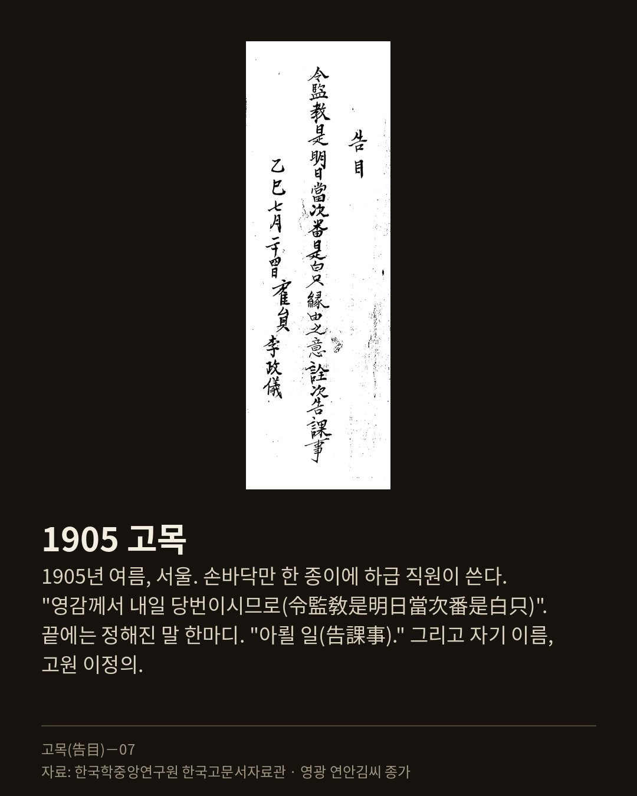
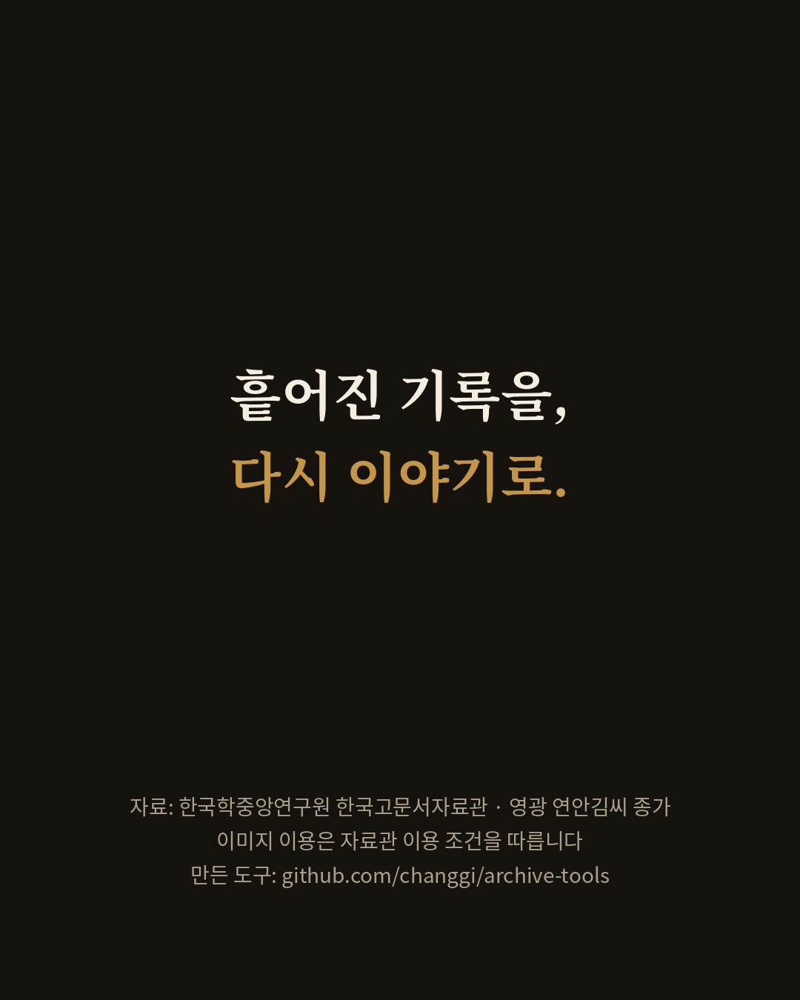

# EP.181 "내일은 영감 당번이십니다" — 1905년, 아전이 써 올린 쪽지 네 장

영광 연안김씨 종가 (문중) · 1905년 여름, 서울. 대한제국의 한 관원에게 하급 직원 '고원(雇員)'이 손바닥만 한 쪽지를 써 올렸다. '영감께서 내일 당번이시므로, 그 연유를 아뢸 일.' 사흘 뒤에는 '내일 연제에 임금이 친히 납시니 나오시라', 한 달 뒤에는 '경효전 기신제', 그리고 섣달에는 '부묘도감이 내일 통신원에서 일을 시작하니 나리께서 행차하시라'. 나라가 기울던 해에도, 궁의 제사 일정은 이 쪽지로 하루 앞서 전해졌다

- 🌐 [전시 웹페이지](https://changgi.github.io/archive-tools/examples/yeonan-kim-gomok/exhibit.html) (한자 위 한글 독음 · 원문 해석) · [수업 활동지](https://changgi.github.io/archive-tools/examples/yeonan-kim-gomok/handout.html)
- 🎬 영상: [릴스 9:16](https://changgi.github.io/archive-tools-next/media/ep181-yeonan-kim-gomok_reel.mp4) · [가로 16:9](https://changgi.github.io/archive-tools-next/media/ep181-yeonan-kim-gomok_wide.mp4) · 홍보 글: [`promo.md`](promo.md)
- 카드뉴스: [`cards/`](cards/) · SNS 글: [`sns.txt`](sns.txt) · 판독·해석 표: [`selection.csv`](selection.csv)

<!-- DELIVERY -->
## 전달 에디팅 — 이 기록을 이렇게 전합니다

- **핵심 정서** — 잔잔한 긴장
- **한 문장** — 고목(告目)은 아전 · 하인이 윗사람에게 올리는 짧은 보고 쪽지다 — 대한제국의 궁중 의례는 거창한 칙령이 아니라, 하급 직원이 하루 앞서 써 올린 이런 쪽지로 관원의 발걸음을 움직였다.
- **열기** — 1905년, 하급 직원은 날마다 쪽지를 썼습니다. "내일은 영감 당번이십니다."
- **펼치기** — 고목－07 → 고목－13 → 고목－09 → 고목－15 (1905년) — 1905년 7월 24일 당번 알림 → 7월 27일 연제와 의효전 제사 → 8월 18일 경효전 기신제 → 12월 10일 부묘도감 시작으로 놓았습니다.
- **절정** — "영감께서 내일 당번이시므로(令監敎是明日當次番是白只)" — 화면·공간에서 이 한 줄만 크게, 소리를 줄여 집중
- **여운** — 나라의 큰일이 오가던 1905년, 쪽지 속 '내일'은 어떤 하루였을까요? — 질문으로 끝내고 답은 보는 사람에게
- **감각과 물질** — 네 장의 끝 '告課事'와 서명 '雇員 李政儀 · 崔浚植 · 金成圭 · 金英勳'
- **통로와 매개** — 온라인: 릴스(열기) → 카드뉴스(펼치기) → 전시 웹페이지(절정·원문) → 비하인드 카드(여운) / 오프라인: 원본 크기 복제·낭독·참여 벽 / 남기기: 활동지·질문 카드
- **여운 장치** — 회사 · 학교의 '내일 일정 알림' 문자 떠올리기
- **전달 에디팅 전** — 4건의 문서를 1905년 연대순으로 놓고 문서명 · 유형 · 해설을 붙인다 — 정확하지만, 지나가면 잊힌다.
- **전달 에디팅 후** — 핵심 정서는 「잔잔한 긴장」. 「1905년, 하급 직원은 날마다 쪽지를 썼습니다. "내일은 영감 당번이십니다."」로 열고, 문서를 대비와 순서로 펼친 뒤, "영감께서 내일 당번이시므로(令監敎是明日當次番是白只)"에서 멈춘다. 네 장의 끝 '告課事'와 서명 '雇員 李政儀 · 崔浚植 · 金成圭 · 金英勳'. 마지막엔 「회사 · 학교의 '내일 일정 알림' 문자 떠올리기」로 보는 사람이 자기 이야기를 남기고 떠나게 한다.

전문: [`delivery.md`](delivery.md)
<!-- /DELIVERY -->

<!-- CURATOR -->
## 비하인드 — 큐레이터 노트

- **왜 이 문서들인가** — EP.174–175에서 이 종가의 김훤 유지와 사마 첩자, 그리고 1906년 김종관의 '태묘 부묘' 말 첩자를 읽었습니다. 같은 종가에 1905년(을사) 한 해에 쓰인 고목 아홉 장이 남아 있어, 날짜 순서대로 네 장을 골랐습니다.
- **전하고 싶은 것** — 고목(告目)은 아전 · 하인이 윗사람에게 올리는 짧은 보고 쪽지다 — 대한제국의 궁중 의례는 거창한 칙령이 아니라, 하급 직원이 하루 앞서 써 올린 이런 쪽지로 관원의 발걸음을 움직였다.
- **이렇게 보이길 바랐다** — 1905년 7월 24일 당번 알림 → 7월 27일 연제와 의효전 제사 → 8월 18일 경효전 기신제 → 12월 10일 부묘도감 시작으로 놓았습니다.
- **이렇게 써 주세요** — 고목이라는 문서의 형식(이두 '敎是 · 是白只 · 告課事'), 대한제국 궁내부의 하급 직원(雇員), 혼전(경효전 · 의효전 · 효혜전)과 국상 의례, 부묘도감, 1905년이라는 해의 궁중 일상 수업에 쓰세요.
- **만들며 있었던 일** — 을사는 자료관 자료 ID의 연도(1905)를 따랐습니다. 받는 사람이 누구인지는 쪽지에 '영감(令監)' · '나리(進賜)'로만 적혀 있어 확인하지 못했고, 1906년 부묘 때 말을 받은 김종관(EP.175)일 가능성이 있으나 확정하지 않았습니다. 연제 · 기신제가 누구를 위한 제사인지는 혼전 이름(의효전 · 경효전)에서 짐작할 수 있으나 해제에서 단정하지 않았습니다. 고원의 이름은 쪽지에 적힌 대로 옮겼습니다.
- **남겨 둔 질문** — 나라의 큰일이 오가던 1905년, 쪽지 속 '내일'은 어떤 하루였을까요?
- **제작 기록** — 문서 4건 · 1905년 · 원본 사진 4면(문서 전체) · 원문 판독 4건 · 번역 4건

전문: [`curator.md`](curator.md) · 비하인드 카드: [`behind/`](behind/) · 채널별 홍보안: [`channels.md`](channels.md)
<!-- /CURATOR -->

## 이야기 — 사료가 말하는 대로

1905년, 하급 직원은 날마다 쪽지를 썼습니다. "내일은 영감 당번이십니다."

> **1905 고목** — 1905년 여름, 서울. 손바닥만 한 종이에 하급 직원이 쓴다. "영감께서 내일 당번이시므로(令監敎是明日當次番是白只)". 끝에는 정해진 말 한마디. "아뢸 일(告課事)." 그리고 자기 이름, 고원 이정의.
> **1905 고목** — 사흘 뒤, 다른 고원이 쓴다. 이번에는 일정이 둘이다. "내일 연제에 친히 행하실 때 나와 참석하시라(明日練祭親行敎是時進參之意)." 그리고 이틀 동안 혼전의 저녁 밥상과 낮 차례. 상을 당한 지 한 해, 궁은 아직 상중이다.
> **1905 고목** — 한 달이 지나 8월. 또 쪽지가 온다. "내일 경효전 기신제(明日景孝殿忌辰祭)". 돌아가신 날의 제사다. 그리고 한 줄. "영감께서 관례대로 나와 참석하시라(令監依例進參之意)." 늘 하던 대로, 내일도.
> **1905 고목** — 섣달 열흘. 이번 쪽지는 새 관청에서 왔다. "부묘도감 고원 김영훈(祔廟都監雇員 金英勳)". "본 도감이 일을 시작하는 것을 내일 통신원에서 하오니(本都監始役明日通信院良中設行是乎尼)". 우편과 전신을 맡던 관청 건물에서, 종묘로 신주를 모실 준비가 시작된다. 두 달 뒤, 이 집안의 김종관은 그 의식에서 말 한 필을 받는다.

| 표지 | 1번 카드 | 마무리 |
|---|---|---|
|  |  |  |

## 선별 문서 (4점)

| # | 연도 | 유형 | 문서명 | 원본 |
|---|---|---|---|---|
| 1 | 1905 | 고목 | 고목(告目)－07 | [원본 보기](https://archive.aks.ac.kr/viewer/viewer.do#imgnode.do?itemId=book&gubun=booktree&depth=6&upPath=01%5E0148%5EL014810%5EL014810F02%5EL014810F0203&dataId=G002%2BAKS%2BKSM-XC.1905.4687-20211130.B074a_104_00276_XXX&itemType=) |
| 2 | 1905 | 고목 | 고목(告目)－13 | [원본 보기](https://archive.aks.ac.kr/viewer/viewer.do#imgnode.do?itemId=book&gubun=booktree&depth=6&upPath=01%5E0148%5EL014810%5EL014810F02%5EL014810F0203&dataId=G002%2BAKS%2BKSM-XC.1905.4687-20211130.B074a_104_00282_XXX&itemType=) |
| 3 | 1905 | 고목 | 고목(告目)－09 | [원본 보기](https://archive.aks.ac.kr/viewer/viewer.do#imgnode.do?itemId=book&gubun=booktree&depth=6&upPath=01%5E0148%5EL014810%5EL014810F02%5EL014810F0203&dataId=G002%2BAKS%2BKSM-XC.1905.4687-20211130.B074a_104_00278_XXX&itemType=) |
| 4 | 1905 | 고목 | 고목(告目)－15 | [원본 보기](https://archive.aks.ac.kr/viewer/viewer.do#imgnode.do?itemId=book&gubun=booktree&depth=6&upPath=01%5E0148%5EL014810%5EL014810F02%5EL014810F0203&dataId=G002%2BAKS%2BKSM-XC.1905.4687-20211130.B074a_104_00284_XXX&itemType=) |

## 원문 판독과 해석

### 1. 고목(告目)－07

**원문 판독**

```
告目
令監敎是明日當次番是白只
緣由之意詮次告課事
乙巳七月二十四日 雇員 李政儀
```

**원문 해석** 고목. 영감께서 내일 당번이시므로, 그 연유를 차례로 아뢸 일. 을사년(1905) 7월 24일 고원 이정의.

**해제** 1905년(광무 9) 7월 24일, 고원(雇員) 이정의(李政儀)가 '영감(令監)'에게 올린 고목(告目)입니다. 고목은 아전이나 하인이 윗사람에게 일을 알리는 짧은 쪽지로, '敎是(께서)', '是白只(이옵기에)', '告課事(아뢸 일)' 같은 이두가 정해진 말투입니다. 고원은 대한제국 관청에서 일한 하급 직원입니다. 내용은 '내일이 영감의 당번(當次番)'이라는 것뿐입니다. 영감은 정3품 이상 관원을 높여 부르는 말이니, 받는 이는 궁 안 어느 관청의 당상관으로 보입니다. 같은 고원이 8월 4일 · 8월 17일에도 같은 문장의 쪽지를 올려, 당번이 열흘 남짓 간격으로 돌아왔음을 보여 줍니다.

### 2. 고목(告目)－13

**원문 판독**

```
告目
明日練祭 親行敎是時進參之意告課事
明再明日 懿孝殿夕上食晝茶禮
親行敎是時進參之意告課事
乙巳七月二十七日 雇員 金成圭
```

**원문 해석** 고목. 내일 연제에 (황제께서) 친히 행하실 때 나와 참석하시라는 뜻을 아뢸 일. 내일과 모레 의효전의 저녁 상식과 낮 다례에 친히 행하실 때 나와 참석하시라는 뜻을 아뢸 일. 을사년(1905) 7월 27일 고원 김성규.

**해제** 사흘 뒤인 7월 27일, 고원 김성규(金成圭)가 올린 고목입니다. 두 가지 일정을 알렸습니다. 하나는 '내일 연제(練祭)', 곧 상을 당한 지 한 해 만에 지내는 제사에 황제가 친히 나서니 참석하라는 것, 또 하나는 내일과 모레 의효전(懿孝殿)의 저녁 상식(上食)과 낮 다례(茶禮)에도 친히 나서니 참석하라는 것입니다. 의효전은 왕실 여성의 신주를 종묘에 모시기 전 임시로 모신 혼전(魂殿)입니다. 받는 관원이 국상 의례에 참여하는 자리에 있었음을 알 수 있습니다. 이 고목에는 '영감'이라는 호칭 없이 일정만 적혔습니다.

### 3. 고목(告目)－09

**원문 판독**

```
告目
明日 景孝殿忌辰祭 親行時
令監依例進參之意告課事
乙巳八月十八日 雇員 崔浚植
```

**원문 해석** 고목. 내일 경효전 기신제를 (황제께서) 친히 행하실 때 영감께서 관례대로 나와 참석하시라는 뜻을 아뢸 일. 을사년(1905) 8월 18일 고원 최준식.

**해제** 8월 18일, 고원 최준식(崔浚植)이 올린 고목입니다. 내일 경효전(景孝殿)에서 기신제(忌辰祭), 곧 돌아가신 날 지내는 제사를 황제가 친히 지내니 '관례대로(依例)' 참석하라는 내용입니다. 경효전은 대한제국 시기 궁 안에 둔 혼전으로, 왕실 사람의 기일 제사를 이곳에서 지냈습니다. '경효전'과 '친행(親行)'은 글자를 띄우거나 줄을 높여 써서 높였습니다. 7월 24일 쪽지를 쓴 이정의, 7월 27일의 김성규에 이어 또 다른 고원이 썼으니, 이 관원에게 쪽지를 올리는 하급 직원이 여럿이었습니다.

### 4. 고목(告目)－15

**원문 판독**

```
告目
本都監始役明日通信院良中設行是乎尼
進賜敎是 行次之意告課事
乙巳十二月十日 祔廟都監雇員 金英勳
```

**원문 해석** 고목. 본 도감이 일을 시작하는 것을 내일 통신원에서 하오니, 나리께서 행차하시라는 뜻을 아뢸 일. 을사년(1905) 12월 10일 부묘도감 고원 김영훈.

**해제** 1905년 12월 10일, 부묘도감(祔廟都監)의 고원 김영훈(金英勳)이 올린 고목입니다. 부묘도감은 혼전에 모신 신주를 종묘(태묘)로 옮겨 모시는 부묘 의식을 준비하려고 임시로 세운 관청입니다. '본 도감이 내일 통신원(通信院)에서 일을 시작하니 행차하시라'는 내용으로, 통신원은 대한제국의 우편 · 전신 관청인데 그 건물을 도감의 자리로 빌린 것으로 보입니다. 이번에는 받는 이를 '영감'이 아니라 '나리(進賜)'로 불러, 앞의 세 장과 받는 사람이 다르거나 직위가 달랐을 수 있습니다. 두 달 뒤인 1906년 2월, 같은 종가의 김종관은 태묘 부묘 때 일을 맡아 말 한 필을 받았습니다(EP.175).

판독·해석·이야기는 이미지에 근거한 초안이며(검토 전 "초안" 표시), 정확한 판독은 원문 확인이 필요합니다. □는 읽지 못한 글자, (?)는 불확실한 글자입니다.
이미지: 한국학중앙연구원 한국고문서자료관 소장·제공. "원본" 링크를 누르면 자료관 뷰어에서 그 문서가 열립니다. 재사용은 자료관에 문의하세요(소장처 동의 필요).
