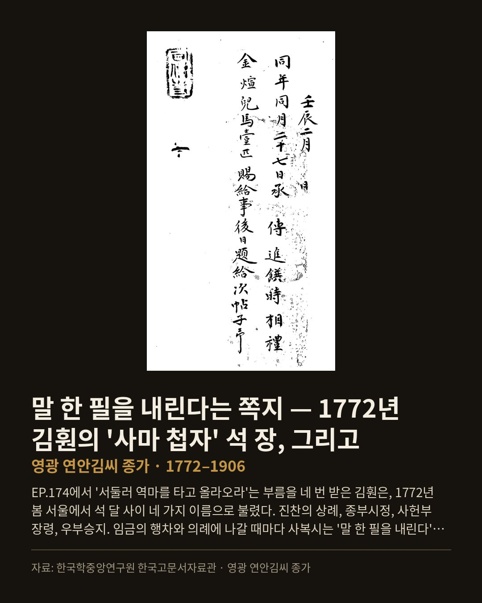
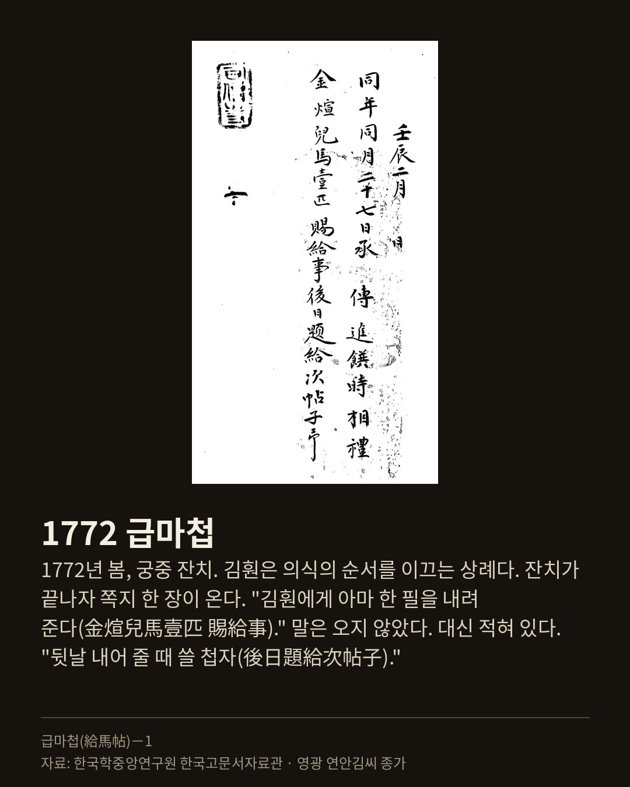
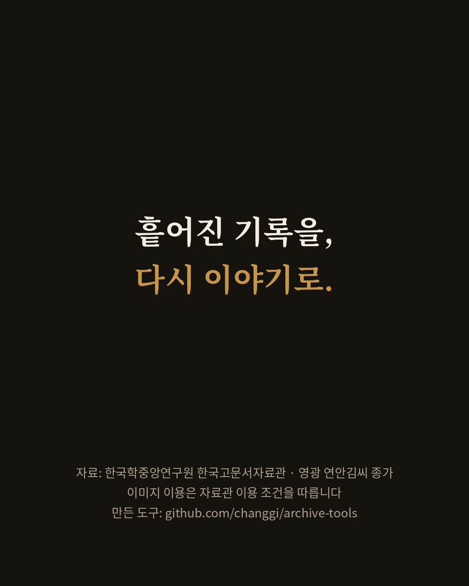

# EP.175 말 한 필을 내린다는 쪽지 — 1772년 김훤의 '사마 첩자' 석 장, 그리고 1906년 한 장

영광 연안김씨 종가 (문중) · EP.174에서 '서둘러 역마를 타고 올라오라'는 부름을 네 번 받은 김훤은, 1772년 봄 서울에서 석 달 사이 네 가지 이름으로 불렸다. 진찬의 상례, 종부시정, 사헌부 장령, 우부승지. 임금의 행차와 의례에 나갈 때마다 사복시는 '말 한 필을 내린다'는 쪽지를 써 주었다. 그리고 134년 뒤, 같은 집안의 김종관도 같은 문장의 쪽지를 받았다

- 🌐 [전시 웹페이지](https://changgi.github.io/archive-tools/examples/yeonan-kim-mapyo/exhibit.html) (한자 위 한글 독음 · 원문 해석) · [수업 활동지](https://changgi.github.io/archive-tools/examples/yeonan-kim-mapyo/handout.html)
- 🎬 영상: [릴스 9:16](https://changgi.github.io/archive-tools-next/media/ep175-yeonan-kim-mapyo_reel.mp4) · [가로 16:9](https://changgi.github.io/archive-tools-next/media/ep175-yeonan-kim-mapyo_wide.mp4) · 홍보 글: [`promo.md`](promo.md)
- 카드뉴스: [`cards/`](cards/) · SNS 글: [`sns.txt`](sns.txt) · 판독·해석 표: [`selection.csv`](selection.csv)

<!-- DELIVERY -->
## 전달 에디팅 — 이 기록을 이렇게 전합니다

- **핵심 정서** — 뿌듯함
- **한 문장** — 조선 국왕은 행차 · 제례 · 잔치에서 일을 맡은 신하에게 사복시의 말을 상으로 내렸다 — 그러나 말을 바로 끌어 주지 않고 '뒷날 내어 줄 때 쓸 첩자'를 주었다. 같은 틀의 쪽지에 적힌 직함이 석 달 사이에 네 번 바뀐다.
- **열기** — 임금 곁에서 의식을 한 번 치를 때마다, 말 한 필이 내려왔습니다.
- **펼치기** — 급마첩－1 → 급마첩－4 → 급마첩－2 → 급마첩－5 (1772–1906년) — 1772년 2월 진찬 상례(相禮) → 5월 1일 종부시정 → 5월 30일 우부승지 → 1906년 김종관으로, 날짜 순서대로 놓았습니다. 5월 10일 장령으로 받은 한 장은 해제에서 다룹니다.
- **절정** — "김종관에게 아마 한 필을 내려 준다(金鍾琯 兒馬壹匹 賜給)" — 화면·공간에서 이 한 줄만 크게, 소리를 줄여 집중
- **여운** — 말 대신 쪽지를 받은 사람은, 그 쪽지를 어디에 썼을까요? — 질문으로 끝내고 답은 보는 사람에게
- **감각과 물질** — 네 장 모두 같은 자리의 '馬壹匹 賜給事 後日題給次帖子' — 바뀌는 것은 날짜와 직함, 말의 종류 · 책장을 넘기는 소리, 확대 열람대
- **통로와 매개** — 온라인: 릴스(열기) → 카드뉴스(펼치기) → 전시 웹페이지(절정·원문) → 비하인드 카드(여운) / 오프라인: 원본 크기 복제·낭독·참여 벽 / 남기기: 활동지·질문 카드
- **여운 장치** — 우리 집에 남은 상장 · 표창장 · 상품권 꺼내 보기
- **전달 에디팅 전** — 4건의 문서를 1772–1906년 연대순으로 놓고 문서명 · 유형 · 해설을 붙인다 — 정확하지만, 지나가면 잊힌다.
- **전달 에디팅 후** — 핵심 정서는 「뿌듯함」. 「임금 곁에서 의식을 한 번 치를 때마다, 말 한 필이 내려왔습니다.」로 열고, 문서를 대비와 순서로 펼친 뒤, "김종관에게 아마 한 필을 내려 준다(金鍾琯 兒馬壹匹 賜給)"에서 멈춘다. 네 장 모두 같은 자리의 '馬壹匹 賜給事 後日題給次帖子' — 바뀌는 것은 날짜와 직함, 말의 종류. 마지막엔 「우리 집에 남은 상장 · 표창장 · 상품권 꺼내 보기」로 보는 사람이 자기 이야기를 남기고 떠나게 한다.

전문: [`delivery.md`](delivery.md)
<!-- /DELIVERY -->

<!-- CURATOR -->
## 비하인드 — 큐레이터 노트

- **왜 이 문서들인가** — EP.174에서 1763–1768년 김훤(金煊)을 서울로 부른 유지 네 장을 읽었습니다. 같은 종가에 1772년 그가 받은 사복시의 말 하사 첩자 넉 장과, 1906년 김종관(金鍾琯)이 받은 한 장이 함께 남아 있어 그 가운데 네 장을 골랐습니다.
- **전하고 싶은 것** — 조선 국왕은 행차 · 제례 · 잔치에서 일을 맡은 신하에게 사복시의 말을 상으로 내렸다 — 그러나 말을 바로 끌어 주지 않고 '뒷날 내어 줄 때 쓸 첩자'를 주었다. 같은 틀의 쪽지에 적힌 직함이 석 달 사이에 네 번 바뀐다.
- **이렇게 보이길 바랐다** — 1772년 2월 진찬 상례(相禮) → 5월 1일 종부시정 → 5월 30일 우부승지 → 1906년 김종관으로, 날짜 순서대로 놓았습니다. 5월 10일 장령으로 받은 한 장은 해제에서 다룹니다.
- **이렇게 써 주세요** — 조선 후기 사복시와 말 하사(賜馬), 진찬 · 망배례 · 거동 같은 궁중 의례, 첩자(帖子)라는 증서의 쓰임, 승지 · 대간 · 종부시 등 관직의 잦은 교체, 대한제국기의 전통 의례 수업에 쓰세요.
- **만들며 있었던 일** — 자료관 이미지는 흑백으로 대비를 높인 복사본입니다. 壬辰은 김훤의 경력(EP.174)에 맞춰 1772년(영조 48)으로 보았습니다. 1906년 첩자의 직함과 의례 이름은 흘림이 섞여 '秘書監□', '孝定□ … 祔太廟'처럼 읽히는 데까지만 적었고, 효정왕후(헌종 계비)의 태묘 부묘 때로 보이지만 확정하지 않았습니다. 김종관이 김훤의 몇 대 후손인지는 이 문서들로 확인하지 않았습니다. 첩자로 실제 말을 받았는지, 값으로 바꾸었는지도 알 수 없습니다.
- **남겨 둔 질문** — 말 대신 쪽지를 받은 사람은, 그 쪽지를 어디에 썼을까요?
- **제작 기록** — 문서 4건 · 1772–1906년 · 원본 사진 4면(문서 전체) · 원문 판독 4건 · 번역 4건 · 못 읽은 글자 □ 2 · 불확실 (?) 0 · 해제에 "확인 필요"를 단 문서 1건

전문: [`curator.md`](curator.md) · 비하인드 카드: [`behind/`](behind/) · 채널별 홍보안: [`channels.md`](channels.md)
<!-- /CURATOR -->

## 이야기 — 사료가 말하는 대로

임금 곁에서 의식을 한 번 치를 때마다, 말 한 필이 내려왔습니다.

> **1772 급마첩** — 1772년 봄, 궁중 잔치. 김훤은 의식의 순서를 이끄는 상례다. 잔치가 끝나자 쪽지 한 장이 온다. "김훤에게 아마 한 필을 내려 준다(金煊兒馬壹匹 賜給事)." 말은 오지 않았다. 대신 적혀 있다. "뒷날 내어 줄 때 쓸 첩자(後日題給次帖子)."
> **1772 급마첩** — 5월 초하루, 임금이 왕실 족보를 맡은 관청에 들른다. 맞이한 사람은 그 관청의 우두머리. "종부시정 김훤(宗簿寺正金煊)". 이번에도 말 한 필. 반쯤 길들인 말이다. 열흘 뒤 그는 또 다른 직함으로 같은 쪽지를 받는다.
> **1772 급마첩** — 5월 그믐, 임금이 옛 경복궁 터로 나간다. 곁을 따르는 사람. "우부승지 김훤(右副承旨金煊)". 아홉 해 전 그를 부르던 유지를 쓰던 자리, 승지다. 이번 말은 "숙마 한 필(熟馬壹匹)", 잘 길들인 말이다.
> **1906 급마첩** — 그리고 134년 뒤, 1906년. 나라 이름은 대한제국이 되었고, 종이에는 꽃무늬 테두리가 인쇄되어 있다. 받는 사람은 같은 집안의 김종관. 문장은 그대로다. "김종관에게 아마 한 필을 내려 준다(金鍾琯 兒馬壹匹 賜給)." 그리고 "뒷날 내어 줄 때 쓸 첩자".

| 표지 | 1번 카드 | 마무리 |
|---|---|---|
|  |  |  |

## 선별 문서 (4점)

| # | 연도 | 유형 | 문서명 | 원본 |
|---|---|---|---|---|
| 1 | 1772 | 급마첩 | 급마첩(給馬帖)－1 | [원본 보기](https://archive.aks.ac.kr/viewer/viewer.do#imgnode.do?itemId=book&gubun=booktree&depth=6&upPath=01%5E0148%5EL014810%5EL014810F02%5EL014810F0203&dataId=G002%2BAKS%2BKSM-XC.1772.4687-20211130.B074a_104_00287_XXX&itemType=) |
| 2 | 1772 | 급마첩 | 급마첩(給馬帖)－4 | [원본 보기](https://archive.aks.ac.kr/viewer/viewer.do#imgnode.do?itemId=book&gubun=booktree&depth=6&upPath=01%5E0148%5EL014810%5EL014810F02%5EL014810F0203&dataId=G002%2BAKS%2BKSM-XC.1772.4687-20211130.B074a_104_00290_XXX&itemType=) |
| 3 | 1772 | 급마첩 | 급마첩(給馬帖)－2 | [원본 보기](https://archive.aks.ac.kr/viewer/viewer.do#imgnode.do?itemId=book&gubun=booktree&depth=6&upPath=01%5E0148%5EL014810%5EL014810F02%5EL014810F0203&dataId=G002%2BAKS%2BKSM-XC.1772.4687-20211130.B074a_104_00288_XXX&itemType=) |
| 4 | 1906 | 급마첩 | 급마첩(給馬帖)－5 | [원본 보기](https://archive.aks.ac.kr/viewer/viewer.do#imgnode.do?itemId=book&gubun=booktree&depth=6&upPath=01%5E0148%5EL014810%5EL014810F02%5EL014810F0203&dataId=G002%2BAKS%2BKSM-XC.1906.4687-20211130.B074a_104_00291_XXX&itemType=) |

## 원문 판독과 해석

### 1. 급마첩(給馬帖)－1

**원문 판독**

```
壬辰二月 日
同年同月二十七日承 傳 進饌時相禮
金煊兒馬壹匹 賜給事後日題給次帖子
印
```

**원문 해석** 임진년(1772) 2월 일. 같은 해 같은 달 27일에 받든 전교: 진찬 때 상례를 맡은 김훤에게 아마(兒馬) 한 필을 내려 준다. 뒷날 내어 줄 때 쓸 첩자. (도장)

**해제** 1772년(영조 48) 2월, 궁중 잔치인 진찬(進饌)에서 의식을 이끄는 상례(相禮)를 맡은 김훤에게 사복시(司僕寺)가 말 한 필을 내린다고 써 준 첩자입니다. 사복시는 궁중의 말과 수레를 맡은 관청이고, 왼쪽에 그 관인이 찍혔습니다. '전교를 받들어(承傳)' 말을 내리되, 말은 '뒷날 내어 줄 때(後日題給)' 이 쪽지를 근거로 받게 했습니다. 아마(兒馬)는 어린 말입니다. EP.174에서 1768년 사헌부 장령으로 불려 올라왔던 그가, 네 해 뒤 궁중 의례에서 일을 맡고 있습니다.

### 2. 급마첩(給馬帖)－4

**원문 판독**

```
壬辰五月 日
同年同月初一日承 傳 宗簿寺 擧動時宗簿寺正金煊
半熟馬壹匹 賜給事後日題給次帖子
印
```

**원문 해석** 임진년(1772) 5월 일. 같은 해 같은 달 초하루에 받든 전교: 종부시 거동 때 종부시정 김훤에게 반숙마 한 필을 내려 준다. 뒷날 내어 줄 때 쓸 첩자. (도장)

**해제** 석 달 뒤인 5월 초하루, 임금이 종부시(宗簿寺)에 거동했을 때 그 관청의 장관 종부시정(宗簿寺正, 정3품 당하)으로서 맞이한 김훤에게 내린 첩자입니다. 종부시는 왕실 족보(선원록)를 맡은 관청입니다. 이번 말은 반숙마(半熟馬), 반쯤 길들인 말입니다. 같은 달 10일에는 망배례에 임금이 친림했을 때 사헌부 장령 김훤에게 반숙마를 내린 첩자도 남아 있어, 열흘 사이 그의 직함이 종부시정에서 장령으로 바뀌었음을 보여 줍니다.

### 3. 급마첩(給馬帖)－2

**원문 판독**

```
壬辰五月 日
同年同月三十日承 傳 景福宮 擧動時右副承旨金煊
熟馬壹匹 賜給事後日題給次帖子
印
```

**원문 해석** 임진년(1772) 5월 일. 같은 해 같은 달 30일에 받든 전교: 경복궁 거동 때 우부승지 김훤에게 숙마 한 필을 내려 준다. 뒷날 내어 줄 때 쓸 첩자. (도장)

**해제** 같은 5월 30일, 임금이 경복궁에 거동했을 때 우부승지(右副承旨, 정3품 당상)로 수행한 김훤에게 내린 첩자입니다. 1772년 당시 경복궁은 임진왜란 때 불탄 뒤 터만 남아 있었고, 영조는 이따금 그 옛 궁터에 거동했습니다. 승지는 왕명을 전하는 승정원의 관원으로, EP.174에서 김훤에게 '올라오라'는 유지를 써 보내던 바로 그 자리입니다. 이번 말은 숙마(熟馬), 잘 길들인 말로 앞의 두 장보다 높은 등급입니다. 한 달 사이 종부시정 → 장령 → 우부승지로 직함이 세 번 바뀌었습니다.

### 4. 급마첩(給馬帖)－5

**원문 판독**

```
光武十年二月二十五日
同年同月十八日承 傳 秘書監□
孝定□ … 祔太廟時 … 金鍾琯 兒馬壹匹 賜給
事後日題給次帖子印
司僕寺
```

**원문 해석** 광무 10년(1906) 2월 25일. 같은 해 같은 달 18일에 받든 전교: 비서감□ … 태묘에 부묘할 때 … 김종관에게 아마 한 필을 내려 준다. 뒷날 내어 줄 때 쓸 첩자. (도장) 사복시.

**해제** 134년 뒤인 1906년(광무 10), 같은 집안의 김종관(金鍾琯)이 받은 첩자입니다. 대한제국 시기이지만 '전교를 받들어 말 한 필을 내린다, 뒷날 내어 줄 때 쓸 첩자'라는 문장은 1772년과 같습니다. 달라진 것은 꽃무늬 테두리를 인쇄한 종이와, 직함에 보이는 대한제국 관청 비서감(秘書監)입니다. 의례 이름은 '孝定… 祔太廟'로 읽혀, 1904년에 세상을 떠난 효정왕후(헌종의 계비)의 신주를 태묘에 모실 때로 보이나 흘림이라 확정하지 않았습니다. 김종관과 김훤의 관계는 이 문서로 확인하지 않았습니다.

판독·해석·이야기는 이미지에 근거한 초안이며(검토 전 "초안" 표시), 정확한 판독은 원문 확인이 필요합니다. □는 읽지 못한 글자, (?)는 불확실한 글자입니다.
이미지: 한국학중앙연구원 한국고문서자료관 소장·제공. "원본" 링크를 누르면 자료관 뷰어에서 그 문서가 열립니다. 재사용은 자료관에 문의하세요(소장처 동의 필요).
