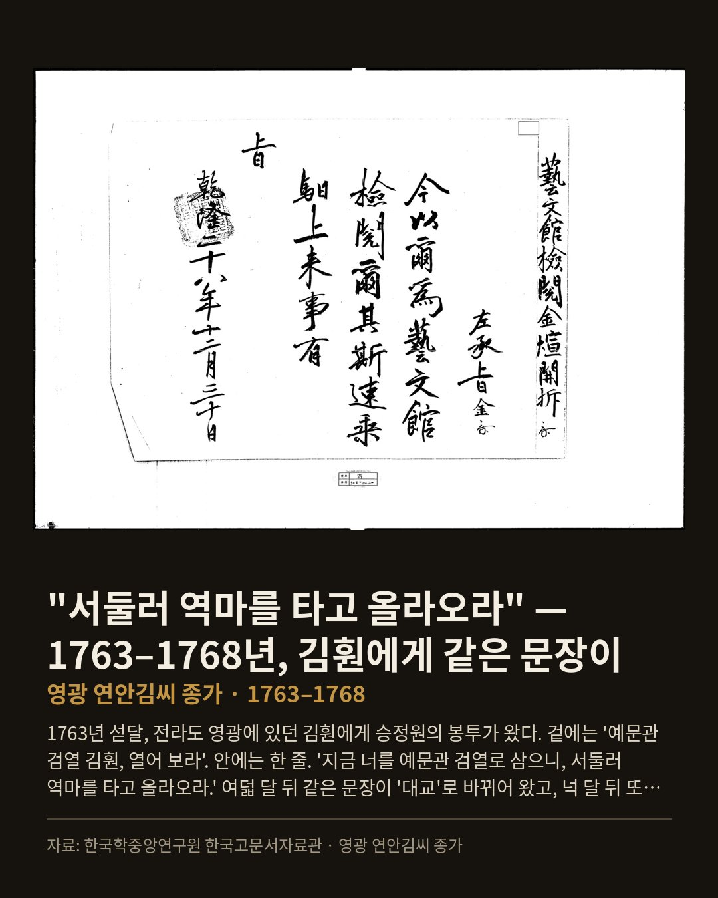
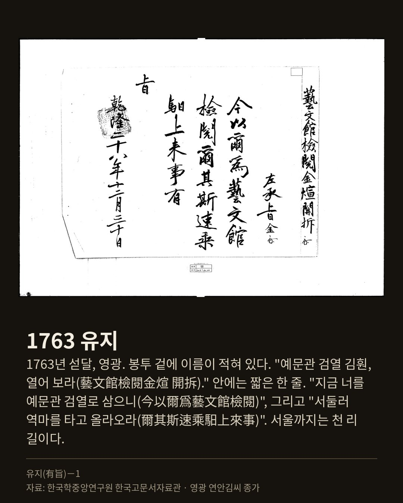
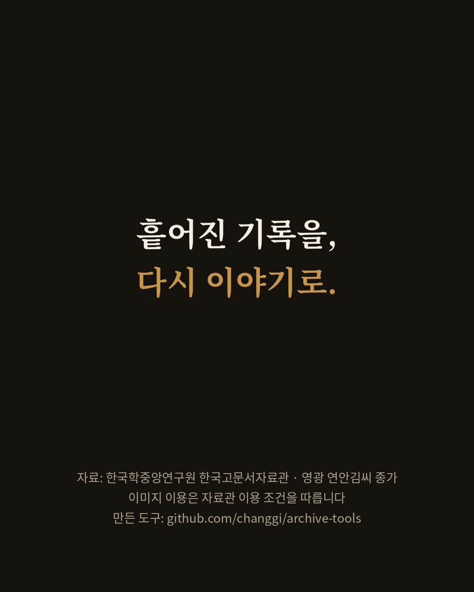

# EP.174 "서둘러 역마를 타고 올라오라" — 1763–1768년, 김훤에게 같은 문장이 네 번 왔다

영광 연안김씨 종가 (문중) · 1763년 섣달, 전라도 영광에 있던 김훤에게 승정원의 봉투가 왔다. 겉에는 '예문관 검열 김훤, 열어 보라'. 안에는 한 줄. '지금 너를 예문관 검열로 삼으니, 서둘러 역마를 타고 올라오라.' 여덟 달 뒤 같은 문장이 '대교'로 바뀌어 왔고, 넉 달 뒤 또 '대교'로 왔고, 다시 네 해 뒤 '사헌부 장령'으로 왔다. 임금의 부름은 늘 같은 아홉 글자였다

- 🌐 [전시 웹페이지](https://changgi.github.io/archive-tools/examples/yeonan-kim-yuji/exhibit.html) (한자 위 한글 독음 · 원문 해석) · [수업 활동지](https://changgi.github.io/archive-tools/examples/yeonan-kim-yuji/handout.html)
- 🎬 영상: [릴스 9:16](https://changgi.github.io/archive-tools-next/media/ep174-yeonan-kim-yuji_reel.mp4) · [가로 16:9](https://changgi.github.io/archive-tools-next/media/ep174-yeonan-kim-yuji_wide.mp4) · 홍보 글: [`promo.md`](promo.md)
- 카드뉴스: [`cards/`](cards/) · SNS 글: [`sns.txt`](sns.txt) · 판독·해석 표: [`selection.csv`](selection.csv)

<!-- DELIVERY -->
## 전달 에디팅 — 이 기록을 이렇게 전합니다

- **핵심 정서** — 설렘과 재촉
- **한 문장** — 조선의 임명은 '임명장'만으로 끝나지 않았다 — 지방에 있는 사람을 서울로 부르는 유지가 따로 갔고, 그 문장은 '역마를 타고 서둘러 올라오라'는 정해진 틀이었다. 같은 틀이 반복되기에, 바뀐 직함 한 줄이 한 사람의 경력을 보여 준다.
- **열기** — 임금은 같은 문장을 네 번 보냈습니다. "서둘러 역마를 타고 올라오라."
- **펼치기** — 유지－1 → 유지－2 → 유지－3 → 유지－4 (1763–1768년) — 1763 예문관 검열(정9품) → 1764년 8월 예문관 대교(정8품) → 1764년 12월 다시 대교 → 1768 사헌부 장령(정4품)으로 날짜 순서대로 놓았습니다.
- **절정** — "서둘러 역마를 타고 올라오라(爾其斯速乘馹上來事)" — 화면·공간에서 이 한 줄만 크게, 소리를 줄여 집중
- **여운** — 같은 아홉 글자를 네 번 받은 사람에게, 다섯 번째 봉투는 왔을까요? — 질문으로 끝내고 답은 보는 사람에게
- **감각과 물질** — 네 장 모두 같은 자리의 '斯速乘馹上來事' — 바뀌는 것은 직함 한 줄과 날짜뿐 · 역마 방울·말발굽 소리와 함께 펼치는 두루마리
- **통로와 매개** — 온라인: 릴스(열기) → 카드뉴스(펼치기) → 전시 웹페이지(절정·원문) → 비하인드 카드(여운) / 오프라인: 원본 크기 복제·낭독·참여 벽 / 남기기: 활동지·질문 카드
- **여운 장치** — 급한 연락이 왔던 순간(전보 · 문자 · 전화) 떠올리기
- **전달 에디팅 전** — 4건의 문서를 1763–1768년 연대순으로 놓고 문서명 · 유형 · 해설을 붙인다 — 정확하지만, 지나가면 잊힌다.
- **전달 에디팅 후** — 핵심 정서는 「설렘과 재촉」. 「임금은 같은 문장을 네 번 보냈습니다. "서둘러 역마를 타고 올라오라."」로 열고, 문서를 대비와 순서로 펼친 뒤, "서둘러 역마를 타고 올라오라(爾其斯速乘馹上來事)"에서 멈춘다. 네 장 모두 같은 자리의 '斯速乘馹上來事' — 바뀌는 것은 직함 한 줄과 날짜뿐. 마지막엔 「급한 연락이 왔던 순간(전보 · 문자 · 전화) 떠올리기」로 보는 사람이 자기 이야기를 남기고 떠나게 한다.

전문: [`delivery.md`](delivery.md)
<!-- /DELIVERY -->

<!-- CURATOR -->
## 비하인드 — 큐레이터 노트

- **왜 이 문서들인가** — 영광 연안김씨 종가 문서 657건 가운데, 승정원 승지가 쓴 유지(有旨) 네 장을 처음 꺼냈습니다. 받는 사람은 모두 김훤(金煊)이고, 본문은 직함 말고는 한 글자도 다르지 않습니다.
- **전하고 싶은 것** — 조선의 임명은 '임명장'만으로 끝나지 않았다 — 지방에 있는 사람을 서울로 부르는 유지가 따로 갔고, 그 문장은 '역마를 타고 서둘러 올라오라'는 정해진 틀이었다. 같은 틀이 반복되기에, 바뀐 직함 한 줄이 한 사람의 경력을 보여 준다.
- **이렇게 보이길 바랐다** — 1763 예문관 검열(정9품) → 1764년 8월 예문관 대교(정8품) → 1764년 12월 다시 대교 → 1768 사헌부 장령(정4품)으로 날짜 순서대로 놓았습니다.
- **이렇게 써 주세요** — 조선 후기 유지 · 승정원의 왕명 전달, 역마(乘馹)와 역참, 예문관 한림(검열 · 대교 · 봉교)과 사헌부 대간, 승지의 서명 방식 수업에 쓰세요.
- **만들며 있었던 일** — 자료관 이미지는 흑백으로 대비를 높인 복사본이라 종이 색과 도장 색은 볼 수 없습니다. 넷째 장 오른쪽 겉봉 글씨는 흐려 판독하지 않았습니다. 같은 '대교'로 넉 달 사이에 두 번 부른 까닭, 김훤이 실제로 올라갔는지는 이 문서들로 알 수 없습니다. 승지들의 이름은 성만 쓰고 서명했으므로 성까지만 적었습니다.
- **남겨 둔 질문** — 같은 아홉 글자를 네 번 받은 사람에게, 다섯 번째 봉투는 왔을까요?
- **제작 기록** — 문서 4건 · 1763–1768년 · 원본 사진 4면(문서 전체) · 원문 판독 4건 · 번역 4건

전문: [`curator.md`](curator.md) · 비하인드 카드: [`behind/`](behind/) · 채널별 홍보안: [`channels.md`](channels.md)
<!-- /CURATOR -->

## 이야기 — 사료가 말하는 대로

임금은 같은 문장을 네 번 보냈습니다. "서둘러 역마를 타고 올라오라."

> **1763 유지** — 1763년 섣달, 영광. 봉투 겉에 이름이 적혀 있다. "예문관 검열 김훤, 열어 보라(藝文館檢閱金煊 開拆)." 안에는 짧은 한 줄. "지금 너를 예문관 검열로 삼으니(今以爾爲藝文館檢閱)", 그리고 "서둘러 역마를 타고 올라오라(爾其斯速乘馹上來事)". 서울까지는 천 리 길이다.
> **1764 유지** — 여덟 달 뒤, 같은 모양의 봉투가 또 온다. 이번에는 "예문관 대교(藝文館待敎)". 한 계단 올랐다. 그 뒤의 문장은 한 글자도 다르지 않다. "서둘러 역마를 타고 올라오라."
> **1764 유지** — 그해 섣달, 또 봉투. 그런데 직함이 같다. "예문관 대교(藝文館待敎)." 넉 달 전과 똑같은 자리로, 똑같은 문장으로 다시 부른다. 그 사이에 무슨 일이 있었는지, 종이는 말하지 않는다.
> **1768 유지** — 네 해 뒤, 1768년 봄. 마지막 봉투. "사헌부 장령(司憲府掌令)." 관리의 잘못을 따지는 자리다. 정9품에서 시작한 이름이 정4품에 닿았다. 그리고 다섯 해 동안 변하지 않은 아홉 글자. "너는 서둘러 역마를 타고 올라오라(爾其斯速乘馹上來事)."

| 표지 | 1번 카드 | 마무리 |
|---|---|---|
|  |  |  |

## 선별 문서 (4점)

| # | 연도 | 유형 | 문서명 | 원본 |
|---|---|---|---|---|
| 1 | 1763 | 유지 | 유지(有旨)－1 | [원본 보기](https://archive.aks.ac.kr/viewer/viewer.do#imgnode.do?itemId=book&gubun=booktree&depth=6&upPath=01%5E0148%5EL014810%5EL014810F02%5EL014810F0201&dataId=G002%2BAKS%2BKSM-XA.1763.4687-20211130.B074a_104_00087_XXX&itemType=) |
| 2 | 1764 | 유지 | 유지(有旨)－2 | [원본 보기](https://archive.aks.ac.kr/viewer/viewer.do#imgnode.do?itemId=book&gubun=booktree&depth=6&upPath=01%5E0148%5EL014810%5EL014810F02%5EL014810F0201&dataId=G002%2BAKS%2BKSM-XA.1764.4687-20211130.B074a_104_00088_XXX&itemType=) |
| 3 | 1764 | 유지 | 유지(有旨)－3 | [원본 보기](https://archive.aks.ac.kr/viewer/viewer.do#imgnode.do?itemId=book&gubun=booktree&depth=6&upPath=01%5E0148%5EL014810%5EL014810F02%5EL014810F0201&dataId=G002%2BAKS%2BKSM-XA.1764.4687-20211130.B074a_104_00089_XXX&itemType=) |
| 4 | 1768 | 유지 | 유지(有旨)－4 | [원본 보기](https://archive.aks.ac.kr/viewer/viewer.do#imgnode.do?itemId=book&gubun=booktree&depth=6&upPath=01%5E0148%5EL014810%5EL014810F02%5EL014810F0201&dataId=G002%2BAKS%2BKSM-XA.1768.4687-20211130.B074a_104_00090_XXX&itemType=) |

## 원문 판독과 해석

### 1. 유지(有旨)－1

**원문 판독**

```
(겉) 藝文館檢閱金煊 開拆
今以爾爲藝文館
檢閱爾其斯速乘
馹上來事有
旨
左承旨金(서명)
乾隆二十八年十二月二十日
```

**원문 해석** (겉) 예문관 검열 김훤, 열어 보라. 지금 너를 예문관 검열로 삼으니, 너는 서둘러 역마를 타고 올라오라는 유지가 있었다. 좌승지 김(서명). 건륭 28년(1763) 12월 20일.

**해제** 1763년(영조 39) 12월, 승정원 좌승지가 김훤(金煊)에게 보낸 유지(有旨)입니다. 유지는 임금의 명을 받은 승지가 대신 써서 보내는 문서로, 끝에 '유지가 있었다(有旨)'라고 적고 승지가 성과 서명을 남깁니다. 오른쪽 겉면에 받는 사람의 새 직함과 이름, 그리고 '열어 보라(開拆)'를 적었습니다. 예문관 검열(檢閱, 정9품)은 사관(史官)으로 '한림'이라 불린 자리입니다. 본문 '爾其斯速乘馹上來'는 지방에 있는 사람에게 역마를 내어 서울로 부르는 정해진 문장입니다. 날짜 위에 승정원 도장이 찍혔습니다.

### 2. 유지(有旨)－2

**원문 판독**

```
(겉) 藝文館待敎金煊 開拆
今以爾爲藝文館待敎
爾其斯速乘馹上來事
有
旨
同副承旨李(서명)
乾隆二十九年八月二十二日
```

**원문 해석** (겉) 예문관 대교 김훤, 열어 보라. 지금 너를 예문관 대교로 삼으니, 너는 서둘러 역마를 타고 올라오라는 유지가 있었다. 동부승지 이(서명). 건륭 29년(1764) 8월 22일.

**해제** 여덟 달 뒤인 1764년(영조 40) 8월, 동부승지가 보낸 유지입니다. 직함이 예문관 대교(待敎, 정8품)로 한 등 올랐습니다. 예문관의 검열 · 대교 · 봉교는 차례로 오르는 사관 자리였습니다. 본문은 직함 두 글자를 빼면 앞 장과 똑같고, 쓴 승지만 바뀌었습니다. 같은 문장을 되풀이하는 이 형식 덕분에, 겉봉과 본문의 직함만 비교해도 한 사람의 승진을 따라갈 수 있습니다.

### 3. 유지(有旨)－3

**원문 판독**

```
今以爾爲藝文館待敎爾
其斯速乘馹上來事
有
旨
右副承旨金(서명)
乾隆二十九年十二月二十三日
```

**원문 해석** 지금 너를 예문관 대교로 삼으니, 너는 서둘러 역마를 타고 올라오라는 유지가 있었다. 우부승지 김(서명). 건륭 29년(1764) 12월 23일.

**해제** 같은 해 12월, 넉 달 만에 다시 김훤을 예문관 대교로 삼아 부른 유지입니다. 직함이 앞 장과 같아, 그 사이에 자리에서 물러났거나 다른 사정으로 다시 임명된 것으로 보이나 이 문서로는 까닭을 알 수 없습니다. 오른쪽 겉면 글씨는 흐려 판독하지 않았습니다. 이번에는 우부승지가 썼습니다. 승지 여섯 사람(도 · 좌 · 우 · 좌부 · 우부 · 동부) 가운데 그날 맡은 사람이 쓰기 때문에, 네 장의 서명자가 모두 다릅니다.

### 4. 유지(有旨)－4

**원문 판독**

```
今以爾爲司憲府掌令
爾其斯速乘馹上來事
有
旨
左副承旨洪(서명)
乾隆三十三年四月二十四日
(오른쪽 겉면 글씨 흐림)
```

**원문 해석** 지금 너를 사헌부 장령으로 삼으니, 너는 서둘러 역마를 타고 올라오라는 유지가 있었다. 좌부승지 홍(서명). 건륭 33년(1768) 4월 24일.

**해제** 1768년(영조 44) 4월, 김훤을 사헌부 장령(掌令, 정4품)으로 삼아 부른 유지입니다. 사헌부는 관리의 잘못을 따지고 풍속을 바로잡는 대간(臺諫) 기관이고, 장령은 그 중간 자리입니다. 예문관 대교(정8품)에서 네 해 만에 정4품으로 올라, 사관에서 대간으로 길이 바뀌었습니다. 문장은 다섯 해 동안 바뀌지 않았습니다. 오른쪽에 겉봉 글씨가 남아 있으나 흐려 읽지 않았습니다.

판독·해석·이야기는 이미지에 근거한 초안이며(검토 전 "초안" 표시), 정확한 판독은 원문 확인이 필요합니다. □는 읽지 못한 글자, (?)는 불확실한 글자입니다.
이미지: 한국학중앙연구원 한국고문서자료관 소장·제공. "원본" 링크를 누르면 자료관 뷰어에서 그 문서가 열립니다. 재사용은 자료관에 문의하세요(소장처 동의 필요).
