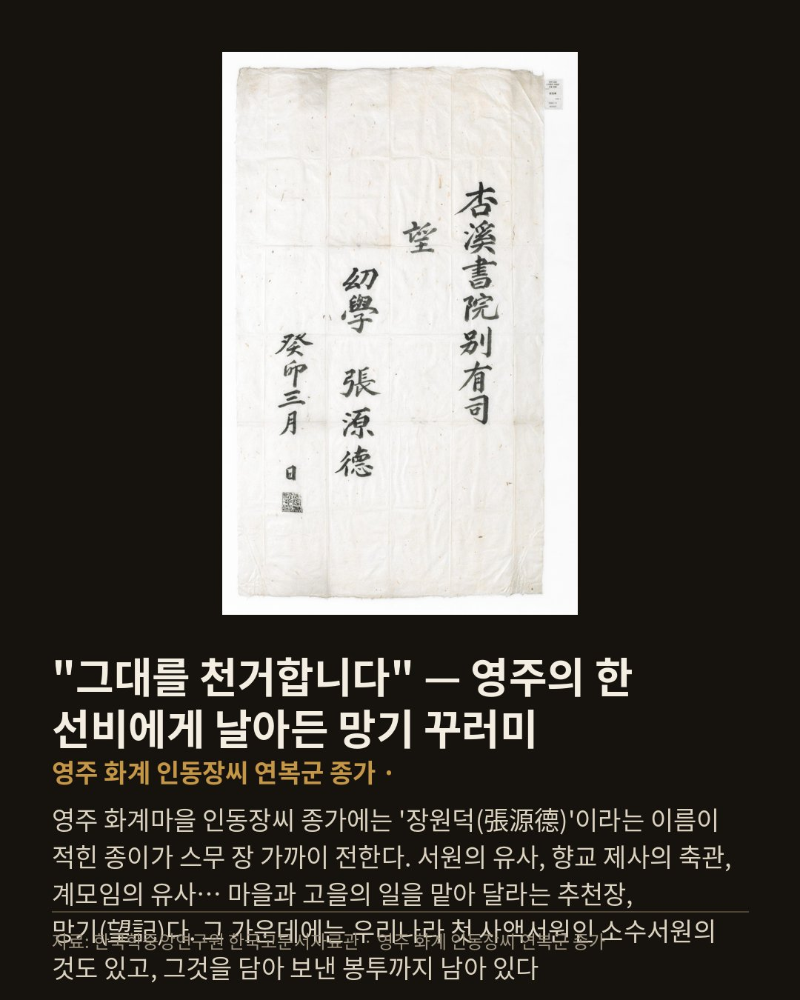
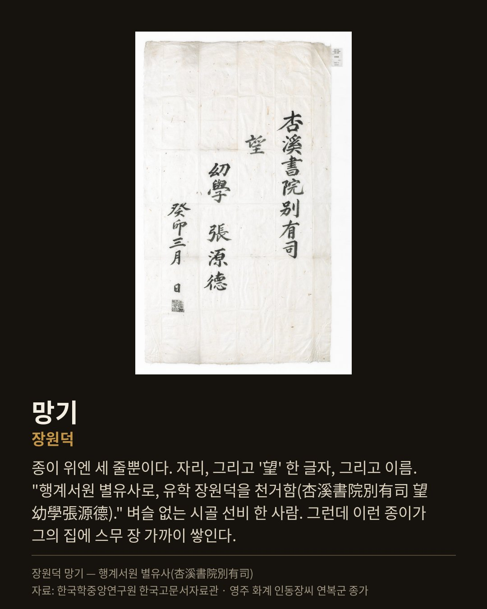
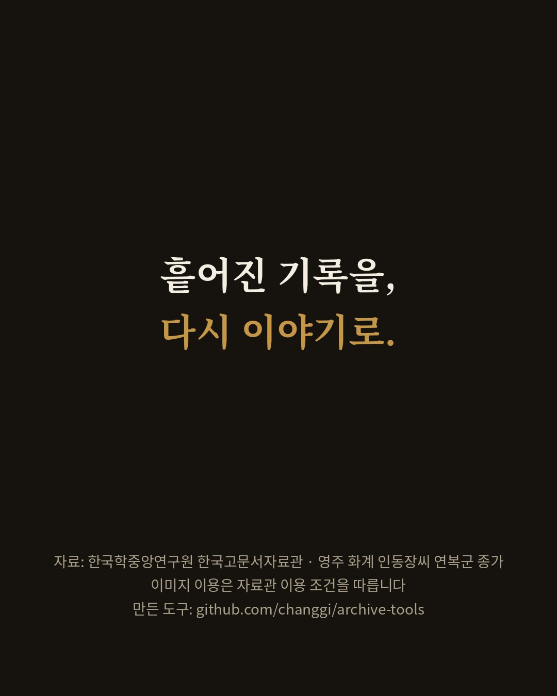

# EP.110 "그대를 천거합니다" — 영주의 한 선비에게 날아든 망기 꾸러미

영주 화계 인동장씨 연복군 종가 (문중) · 영주 화계마을 인동장씨 종가에는 '장원덕(張源德)'이라는 이름이 적힌 종이가 스무 장 가까이 전한다. 서원의 유사, 향교 제사의 축관, 계모임의 유사… 마을과 고을의 일을 맡아 달라는 추천장, 망기(望記)다. 그 가운데에는 우리나라 첫 사액서원인 소수서원의 것도 있고, 그것을 담아 보낸 봉투까지 남아 있다

- 🌐 [전시 웹페이지](https://changgi.github.io/archive-tools/examples/yeonbokgun/exhibit.html) (한자 위 한글 독음 · 원문 해석) · [수업 활동지](https://changgi.github.io/archive-tools/examples/yeonbokgun/handout.html)
- 🎬 영상: [릴스 9:16](https://changgi.github.io/archive-tools-next/media/ep110-yeonbokgun_reel.mp4) · [가로 16:9](https://changgi.github.io/archive-tools-next/media/ep110-yeonbokgun_wide.mp4) · 홍보 글: [`promo.md`](promo.md)
- 카드뉴스: [`cards/`](cards/) · SNS 글: [`sns.txt`](sns.txt) · 판독·해석 표: [`selection.csv`](selection.csv)

<!-- DELIVERY -->
## 전달 에디팅 — 이 기록을 이렇게 전합니다

- **핵심 정서** — 자부심
- **한 문장** — 벼슬이 없어도 공동체가 그를 부른다 — 망기는 한 사람이 마을과 고을에서 얼마나 믿음을 받았는지 보여 주는 이력서다.
- **열기** — 벼슬 없는 시골 선비의 집에, '당신을 천거합니다'라는 종이가 스무 장 가까이 쌓였습니다.
- **펼치기** — 장원덕 망기 — 행계서원 별유사 → 장원덕 망기 — 영주향교 석전 대 → 장원덕 망기 — 소수서원 별유사 → 소수서원 망기 봉투 — 화계 장원 (연대 미상) — 서원 유사 → 향교 석전 대축 → 소수서원 별유사 → 그 망기를 담아 온 봉투 순으로, 천거가 점점 무게를 더하다 집 문 앞에 닿는 흐름으로 구성했습니다.
- **절정** — "행계서원 별유사로, 유학 장원덕을 천거함(杏溪書院別有司 望 幼學張源德)" — 화면·공간에서 이 한 줄만 크게, 소리를 줄여 집중
- **여운** — 그는 이 많은 자리를 모두 맡았을까요, 사양한 것도 있었을까요? — 질문으로 끝내고 답은 보는 사람에게
- **감각과 물질** — 크고 반듯한 '望' 한 글자와 접힌 봉투
- **통로와 매개** — 온라인: 릴스(열기) → 카드뉴스(펼치기) → 전시 웹페이지(절정·원문) → 비하인드 카드(여운) / 오프라인: 원본 크기 복제·낭독·참여 벽 / 남기기: 활동지·질문 카드
- **여운 장치** — 나를 불러 준 자리 하나를 떠올리기
- **전달 에디팅 전** — 4건의 문서를 연대 미상 연대순으로 놓고 문서명 · 유형 · 해설을 붙인다 — 정확하지만, 지나가면 잊힌다.
- **전달 에디팅 후** — 핵심 정서는 「자부심」. 「벼슬 없는 시골 선비의 집에, '당신을 천거합니다'라는 종이가 스무 장 가까이 쌓였습니다.」로 열고, 문서를 대비와 순서로 펼친 뒤, "행계서원 별유사로, 유학 장원덕을 천거함(杏溪書院別有司 望 幼學張源德)"에서 멈춘다. 크고 반듯한 '望' 한 글자와 접힌 봉투. 마지막엔 「나를 불러 준 자리 하나를 떠올리기」로 보는 사람이 자기 이야기를 남기고 떠나게 한다.

전문: [`delivery.md`](delivery.md)
<!-- /DELIVERY -->

<!-- CURATOR -->
## 비하인드 — 큐레이터 노트

- **왜 이 문서들인가** — '증빙류'라는 이름으로 묶인 67건 가운데 스무 장 가까이 같은 이름 '장원덕'이 반복되는 것을 보고, 한 사람의 이야기라는 걸 알았습니다.
- **전하고 싶은 것** — 벼슬이 없어도 공동체가 그를 부른다 — 망기는 한 사람이 마을과 고을에서 얼마나 믿음을 받았는지 보여 주는 이력서다.
- **이렇게 보이길 바랐다** — 서원 유사 → 향교 석전 대축 → 소수서원 별유사 → 그 망기를 담아 온 봉투 순으로, 천거가 점점 무게를 더하다 집 문 앞에 닿는 흐름으로 구성했습니다.
- **이렇게 써 주세요** — 향교와 서원의 역할, 지역 공동체의 자치, '추천'과 '봉사'의 의미, 동아리 · 학생회 임원 이야기와 연결해 쓰세요.
- **만들며 있었던 일** — 네 장 모두 글씨가 크고 반듯해 판독은 비교적 확실하나, 봉투의 이름 앞 한 글자는 불확실합니다. 날짜가 간지로만 적혀 서기 연도를 정하지 않았습니다. 행계서원의 위치와 장원덕의 생애는 확인하지 않았습니다.
- **남겨 둔 질문** — 그는 이 많은 자리를 모두 맡았을까요, 사양한 것도 있었을까요?
- **제작 기록** — 문서 4건 · 원본 사진 4면(문서 전체) · 원문 판독 4건 · 번역 4건 · 못 읽은 글자 □ 0 · 불확실 (?) 1

전문: [`curator.md`](curator.md) · 비하인드 카드: [`behind/`](behind/) · 채널별 홍보안: [`channels.md`](channels.md)
<!-- /CURATOR -->

## 이야기 — 사료가 말하는 대로

벼슬 없는 시골 선비의 집에, '당신을 천거합니다'라는 종이가 스무 장 가까이 쌓였습니다.

> ** 망기** — 종이 위엔 세 줄뿐이다. 자리, 그리고 '望' 한 글자, 그리고 이름. "행계서원 별유사로, 유학 장원덕을 천거함(杏溪書院別有司 望 幼學張源德)." 벼슬 없는 시골 선비 한 사람. 그런데 이런 종이가 그의 집에 스무 장 가까이 쌓인다.
> ** 망기** — 가을, 영주향교에서 공자에게 제사를 올리는 날. 제사의 한가운데서 축문을 읽을 사람으로, 향교는 그를 골랐다. "석전 대축으로 유학 장원덕을 천거함(釋奠大祝 望 幼學張源德)." 고을 사람들 앞에서 목소리를 내는 자리였다.
> ** 망기** — 같은 해 봄에는 이 종이가 왔다. "소수서원 별유사로, 유학 장원덕을 천거함(紹修書院別有司 望 幼學張源德)." 소수서원. 이 나라에서 처음으로 임금이 이름을 내려 준 서원이다. 봄에는 서원의 살림을, 가을에는 향교의 축문을. 한 해가 그렇게 채워졌다.
> ** 피봉** — 그리고 봉투가 남았다. "화계 장원덕 씨 댁에 들여 드림, 소수서원 망기(花溪 張貴源德氏宅入納 紹修書院望記)." 누군가 이 봉투를 들고 화계마을까지 걸어왔을 것이다. 그는 봉투를 버리지 않았다. 천거받은 종이와 그것을 싸 온 종이까지, 모두 접어 간직했다.

| 표지 | 1번 카드 | 마무리 |
|---|---|---|
|  |  |  |

## 선별 문서 (4점)

| # | 연도 | 유형 | 문서명 | 원본 |
|---|---|---|---|---|
| 1 | — | 망기 | 장원덕 망기 — 행계서원 별유사(杏溪書院別有司) | [원본 보기](https://archive.aks.ac.kr/viewer/viewer.do#imgnode.do?itemId=book&gubun=booktree&depth=6&upPath=01%5E0167%5EL016791%5EL016791F02%5EL016791F0204&dataId=G002%2BAKS%2BKSM-XD.0000.4721-20231108.F24801-01-W000660&itemType=) |
| 2 | — | 망기 | 장원덕 망기 — 영주향교 석전 대축(釋奠大祝) | [원본 보기](https://archive.aks.ac.kr/viewer/viewer.do#imgnode.do?itemId=book&gubun=booktree&depth=6&upPath=01%5E0167%5EL016791%5EL016791F02%5EL016791F0204&dataId=G002%2BAKS%2BKSM-XD.0000.4721-20231108.F24801-01-W000682&itemType=) |
| 3 | — | 망기 | 장원덕 망기 — 소수서원 별유사(紹修書院別有司) | [원본 보기](https://archive.aks.ac.kr/viewer/viewer.do#imgnode.do?itemId=book&gubun=booktree&depth=6&upPath=01%5E0167%5EL016791%5EL016791F02%5EL016791F0204&dataId=G002%2BAKS%2BKSM-XD.0000.4721-20231108.F24801-01-W000683&itemType=) |
| 4 | — | 피봉 | 소수서원 망기 봉투 — 화계 장원덕 댁 입납 | [원본 보기](https://archive.aks.ac.kr/viewer/viewer.do#imgnode.do?itemId=book&gubun=booktree&depth=6&upPath=01%5E0167%5EL016791%5EL016791F02%5EL016791F0204&dataId=G002%2BAKS%2BKSM-XD.0000.4721-20231108.F24801-01-W000684&itemType=) |

## 원문 판독과 해석

### 1. 장원덕 망기 — 행계서원 별유사(杏溪書院別有司)

**원문 판독**

```
杏溪書院別有司
望
幼學 張源德
癸卯三月 日
```

**원문 해석** 행계서원 별유사. 천거함. 유학 장원덕. 계묘년 3월 일.

**해제** 서원에서 장원덕(張源德)을 별유사(別有司)로 천거한다고 알린 망기(望記)입니다. 망기는 어떤 자리를 맡을 사람을 추천(望)하여 그 사람에게 알리는 문서로, 맨 위에 자리, 가운데에 '望', 그 아래 추천받은 사람의 신분과 이름, 끝에 날짜를 씁니다. '유학(幼學)'은 벼슬하지 않은 선비를 뜻합니다. 유사는 서원의 살림과 행사를 맡는 소임입니다. 날짜는 간지(癸卯)만 있어 서기 연도를 정할 수 없습니다. 같은 꾸러미의 봉투에 '영주군 장수면 화계리' 같은 근대 행정구역 이름이 보여 20세기 전반의 것일 가능성이 있습니다(추정).

### 2. 장원덕 망기 — 영주향교 석전 대축(釋奠大祝)

**원문 판독**

```
釋奠大祝
望
幼學 張源德
丁未八月 日
榮州鄕校
```

**원문 해석** 석전 대축. 천거함. 유학 장원덕. 정미년 8월 일. 영주향교.

**해제** 영주향교가 석전(釋奠)의 대축(大祝)으로 장원덕을 천거한 망기입니다. 석전은 봄 · 가을에 향교와 문묘에서 공자와 성현에게 올리는 제사이며, 대축은 그 제사에서 축문을 읽는 중요한 소임입니다. 8월이므로 가을 석전으로 보입니다. 날짜 아래에 붉은 도장이 찍혀 있습니다. 간지만 있어 서기 연도는 정하지 않았습니다.

### 3. 장원덕 망기 — 소수서원 별유사(紹修書院別有司)

**원문 판독**

```
紹修書院別有司
望
幼學 張源德
丁未三月 日
```

**원문 해석** 소수서원 별유사. 천거함. 유학 장원덕. 정미년 3월 일.

**해제** 소수서원(紹修書院)이 장원덕을 별유사로 천거한 망기입니다. 소수서원은 1543년 주세붕이 세운 백운동서원에서 비롯하여 1550년 '소수서원'이라는 사액을 받은, 우리나라 첫 사액서원으로 영주에 있습니다. 앞의 석전 대축 망기와 같은 정미년에 나온 것이어서, 그해 봄과 가을에 서원과 향교 양쪽에서 소임을 맡았음을 알 수 있습니다. 날짜 옆에 도장이 찍혀 있습니다.

### 4. 소수서원 망기 봉투 — 화계 장원덕 댁 입납

**원문 판독**

```
花溪
張貴(?) 源德氏宅 入納
紹修書院望記
```

**원문 해석** 화계 장원덕 씨 댁에 들여 드림. 소수서원 망기.

**해제** 소수서원 망기를 담아 보낸 봉투(피봉)입니다. 받는 곳은 '화계(花溪)'의 장원덕 댁이고, '입납(入納)'은 '들여 드린다'는 뜻의 편지 겉봉 투식입니다. 왼쪽에 '소수서원 망기'라고 내용물을 적었습니다. 이름 앞의 한 글자는 '貴'처럼 보이나 확실하지 않습니다(존칭이나 '생원'의 줄임일 가능성). 망기와 봉투가 함께 남아, 이 문서가 실제로 집까지 전해졌음을 보여 줍니다.

판독·해석·이야기는 이미지에 근거한 초안이며(검토 전 "초안" 표시), 정확한 판독은 원문 확인이 필요합니다. □는 읽지 못한 글자, (?)는 불확실한 글자입니다.
이미지: 한국학중앙연구원 한국고문서자료관 소장·제공. "원본" 링크를 누르면 자료관 뷰어에서 그 문서가 열립니다. 재사용은 자료관에 문의하세요(소장처 동의 필요).
