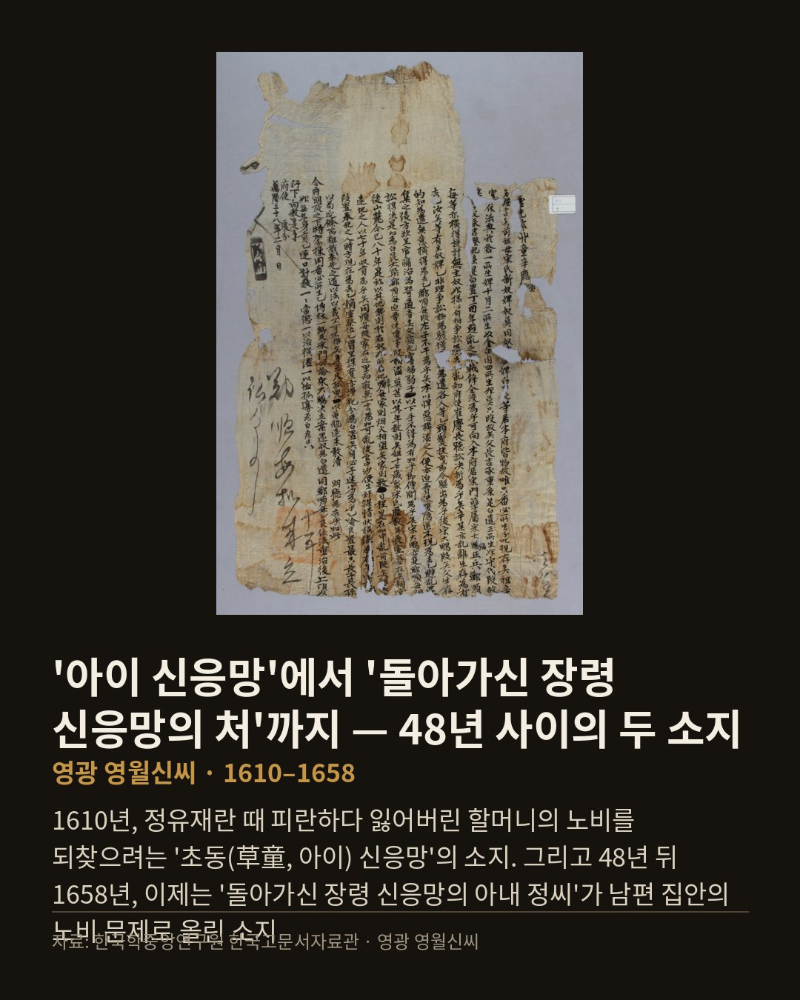
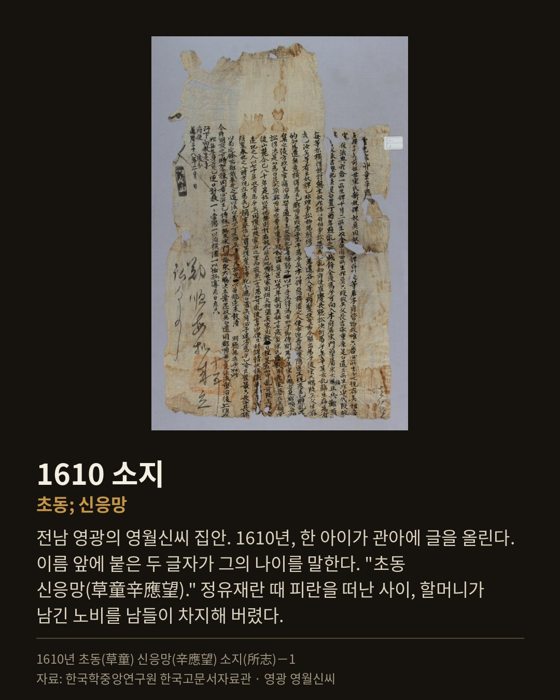
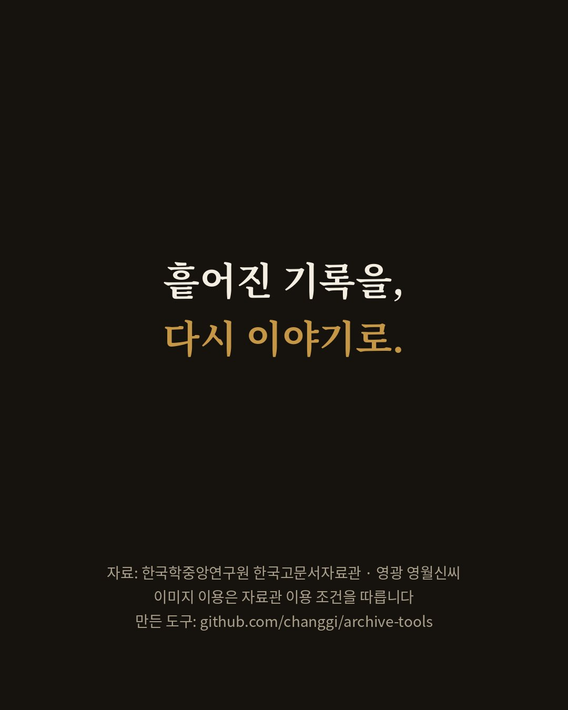

# EP.68 '아이 신응망'에서 '돌아가신 장령 신응망의 처'까지 — 48년 사이의 두 소지

영광 영월신씨 (문중) · 1610년, 정유재란 때 피란하다 잃어버린 할머니의 노비를 되찾으려는 '초동(草童, 아이) 신응망'의 소지. 그리고 48년 뒤 1658년, 이제는 '돌아가신 장령 신응망의 아내 정씨'가 남편 집안의 노비 문제로 올린 소지

- 🌐 [전시 웹페이지](https://changgi.github.io/archive-tools/examples/yeongwol-shin/exhibit.html) (한자 위 한글 독음 · 원문 해석) · [수업 활동지](https://changgi.github.io/archive-tools/examples/yeongwol-shin/handout.html)
- 🎬 영상: [릴스 9:16](https://changgi.github.io/archive-tools/examples/media/ep68-yeongwol-shin_reel.mp4) · [가로 16:9](https://changgi.github.io/archive-tools/examples/media/ep68-yeongwol-shin_wide.mp4) · 홍보 글: [`promo.md`](promo.md)
- 카드뉴스: [`cards/`](cards/) · SNS 글: [`sns.txt`](sns.txt) · 판독·해석 표: [`selection.csv`](selection.csv)

## 이야기 — 사료가 말하는 대로

같은 이름이 두 장의 소지에 나옵니다. 한 번은 '아이', 한 번은 '돌아가신'.

> **1610 소지** — 전남 영광의 영월신씨 집안. 1610년, 한 아이가 관아에 글을 올린다. 이름 앞에 붙은 두 글자가 그의 나이를 말한다. "초동 신응망(草童辛應望)." 정유재란 때 피란을 떠난 사이, 할머니가 남긴 노비를 남들이 차지해 버렸다.
> **1658 소지** — 48년 뒤, 같은 이름이 다시 소지에 나온다. 이번에는 첫 줄이 이렇다. "돌아가신 장령 신응망의 아내 정씨(故掌令辛應望妻丁氏)." 아이였던 그는 사헌부 장령까지 지내고 세상을 떠났다. 남은 아내가 남편 집안의 재산을 지키려 붓을 들었다. "과부인 저에게 이렇게 함부로 빼앗으니(寡婦是可向入 如是橫奪)."

| 표지 | 1번 카드 | 마무리 |
|---|---|---|
|  |  |  |

## 선별 문서 (2점)

| # | 연도 | 유형 | 문서명 | 원본 |
|---|---|---|---|---|
| 1 | 1610 | 소지 | 1610년 초동(草童) 신응망(辛應望) 소지(所志)－1 | [원본 보기](https://archive.aks.ac.kr/viewer/viewer.do#imgnode.do?itemId=book&gubun=booktree&depth=6&upPath=01%5E0148%5EL014802%5EL014802F02%5EL014802F0202&dataId=G002%2BAKS%2BKSM-XB.1610.4687-20101008.B017a_027_00025_XXX&itemType=) |
| 2 | 1658 | 소지 | 1658년 장령(掌令) 신응망(辛應望) 처(妻) 정씨(丁氏) 소지(所志) | [원본 보기](https://archive.aks.ac.kr/viewer/viewer.do#imgnode.do?itemId=book&gubun=booktree&depth=6&upPath=01%5E0148%5EL014802%5EL014802F02%5EL014802F0202&dataId=G002%2BAKS%2BKSM-XB.1658.4687-20101008.B017a_027_00033_XXX&itemType=) |

## 원문 판독과 해석

### 1. 1610년 초동(草童) 신응망(辛應望) 소지(所志)－1

**원문 판독**

```
靈光郡(?) 草童辛應望
右謹言矣前 祖母宋氏新奴婢奴莫同(?)(…)
寔 依法典 衿給 一所生婢十月 二所生奴金伊(…)
(…)矣 文承吉祭祀條是白置 丁酉年避亂之(…)
每(?)等亦 橫得設計 無主奴婢樣以 自相爭訟 爲(…)
去(?)汝矣等 有主奴婢乙 非理爭訟 極爲駭愕(…)
內如爲遣 無意(?)橫得爲去乙 鄭順每段 左于不干(…)
(이하 왼쪽 — 이어지는 사연과 관의 처분, 훼손 · 판독 필요)
萬曆三十八年(?) … 月 日
```

**원문 해석** 영광군의 아이(草童) 신응망. 삼가 아룁니다. 저의 할머니 송씨가 새로 얻은 노비 노 막동(?) … 법전에 따라 몫으로 나누어 준 첫째 소생 비 시월, 둘째 소생 노 금이 … 문승길의 제사 몫이었는데, 정유년(1597) 난리를 피하여 … [그 사이에] … 등이 꾀를 내어 주인 없는 노비인 것처럼 하여 서로 소송하니 … 너희가 주인 있는 노비를 이치에 맞지 않게 다투는 것은 매우 놀라운 일이라 … 뜻밖에 함부로 차지하였으니 … (훼손으로 이하 판독 필요)

**해제** 1610년(광해군 2), 영광의 '초동(草童)' 신응망(辛應望)이 관에 올린 소지입니다. 초동은 관례를 치르지 않은 아이를 뜻하므로, 신응망은 아직 어린 나이에 직접 소지를 올린 것입니다. 할머니 송씨에게서 물려받은 노비가 정유재란(1597) 피란 중에 흩어지자, 다른 사람들이 '주인 없는 노비'라며 차지하려 다툰 데 대해 되찾아 달라는 내용으로 보입니다. 심하게 해지고 구멍이 나서 오른쪽 몇 줄만 판독했습니다.

### 2. 1658년 장령(掌令) 신응망(辛應望) 처(妻) 정씨(丁氏) 소지(所志)

**원문 판독**

```
故掌令辛應望妻丁氏
右謹言所志段 女矣家翁 前後室同生五娚妹亦中 奴(…)
後身死爲白齊 旣爲無後 身死則 同李偉妻衿 分田民乙 癸(…)
有一家之義 自李偉 昏朝時 廢 大妃 獨孫之後 彼此相(…)
還推之田民乙 不爲還推爲白遣 其矣孫 奴奉生 一口 叱分 居在(…)
餘年 是白如乎 今月初三日 場市良中 同奴奉生子 一所 亦(…)
同李偉 亦其矣 後室子 相爭 辛家之 遺 多辛 奴 單 同奴一所乙 擁(…)
亦乏(?)後 爲(?)…爲乎旀 因 … 爲白遣 同奴一所 父奉生乙 (…)
大槪 法典 因無後 同生田民乙 還本孫 自同李偉 亦其矣 時方 耕食(…)
十餘年 庫果 奴婢 四口 多般 新産乙 沒數 都執是乎矣 貪(?)(…)
實爲不測爲乎旀 況(?) 孫同奴 奉生乙 女矣 姑與 家翁 生時 推來 使(…)
及至今日 以(?)中 沙(?)挾子 辛奴 而 坐行 市門 毆(?)傳 物棄(?) 貸 利 爲乎(…)
寡婦是可向入 如是橫奪爲去乎 昏朝未盡之凶計乙 欲(…)
(이하 왼쪽 — 이어지는 사연과 처분, 판독 필요)
戊戌十月 日
```

**원문 해석** 돌아가신 장령 신응망의 아내 정씨. 삼가 아뢰는 소지. 제 남편의 앞뒤 부인에게서 난 다섯 남매 가운데 … 노비를 … 뒤에 [남편이] 죽었는데, 이미 후사가 없으니, 죽으면 이위(李偉)의 아내 몫으로 나눈 논밭과 노비를 … 한 집안의 의리가 있으나, 이위가 혼조(광해군) 때 대비를 폐하던 … 독손 뒤로 서로 … 되찾아야 할 논밭과 노비를 되찾지 않고, 그 손자 노 봉생 한 명만 … 살게 한 지 … 여 년이었는데, 이달 초사흘 장터에서 노 봉생의 아들 한 명을 … 이위가 그 뒤 부인의 아들과 함께 서로 다투어 … 대개 법전에, 후사가 없으면 동생의 논밭과 노비는 본손에게 돌린다 하였는데, 이위가 지금 경작해 먹은 지 십여 년이고 노비 네 명과 여러 새로 낳은 아이까지 모두 차지하니 탐욕이 … 실로 헤아릴 수 없습니다. … 과부인 저에게 이렇게 함부로 빼앗으니 … (판독 불확실 다수)

**해제** 1658년(효종 9, 戊戌), 죽은 장령(掌令, 사헌부 정4품) 신응망의 아내 정씨(丁氏)가 올린 소지입니다. 48년 전 '초동'이던 신응망이 장령까지 지내고 세상을 떠난 뒤, 남편 집안의 노비를 두고 사위 쪽인 이위(李偉) 집안과 다툼이 생기자, 과부가 직접 호소한 것입니다. '후사가 없으면 논밭과 노비를 본손에게 돌린다'는 법전 조항을 근거로 들었습니다. 행서로 본문은 비교적 또렷하지만 인물 관계가 복잡해 해석에 확인이 필요합니다.

판독·해석·이야기는 이미지에 근거한 초안이며(검토 전 "초안" 표시), 정확한 판독은 원문 확인이 필요합니다. □는 읽지 못한 글자, (?)는 불확실한 글자입니다.
이미지: 한국학중앙연구원 한국고문서자료관 소장·제공. "원본" 링크를 누르면 자료관 뷰어에서 그 문서가 열립니다. 재사용은 자료관에 문의하세요(소장처 동의 필요).
