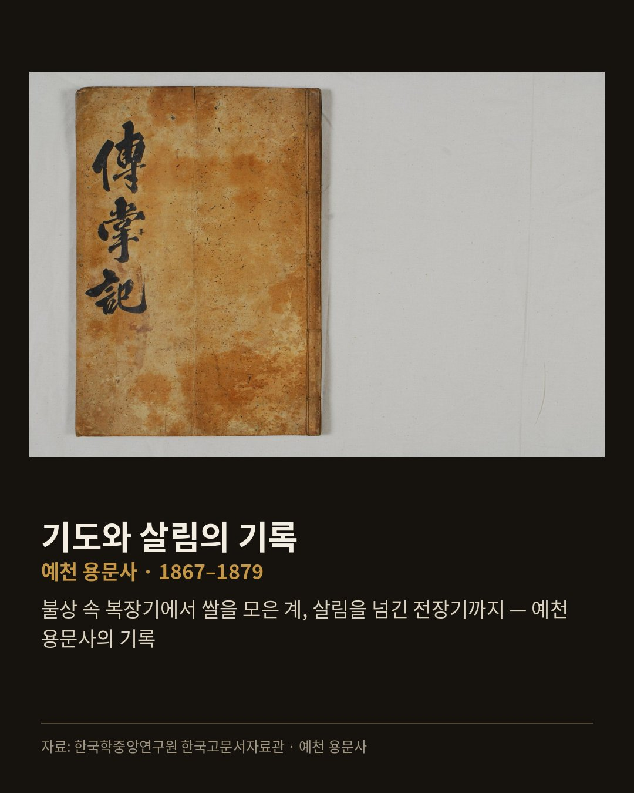
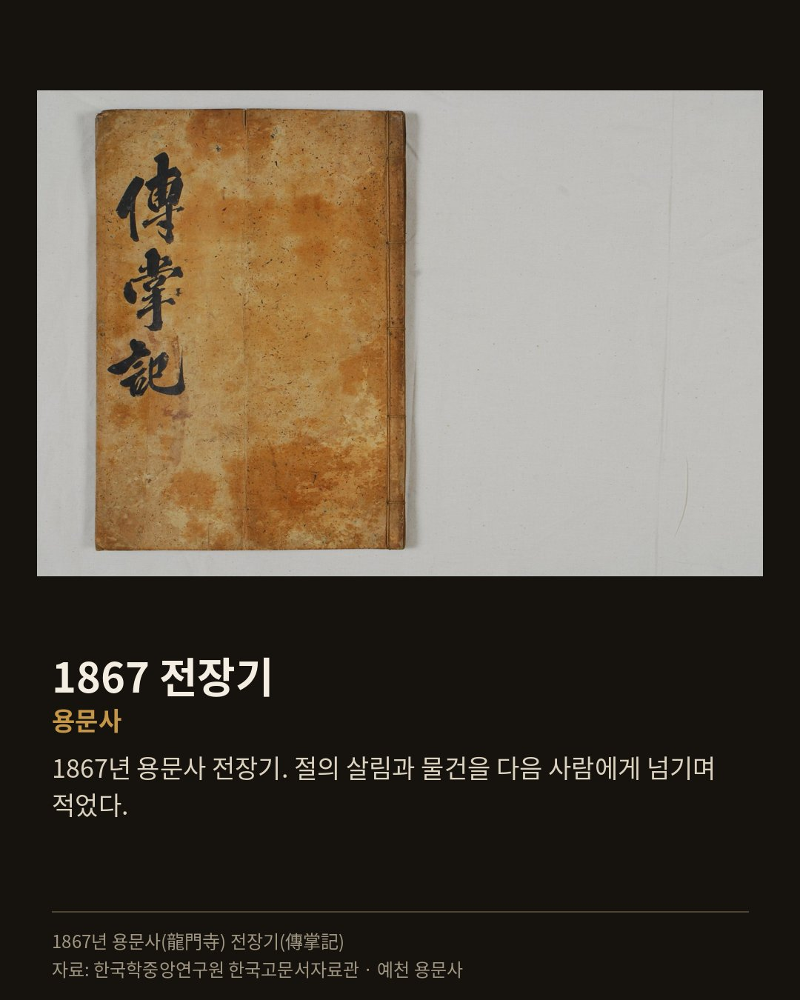
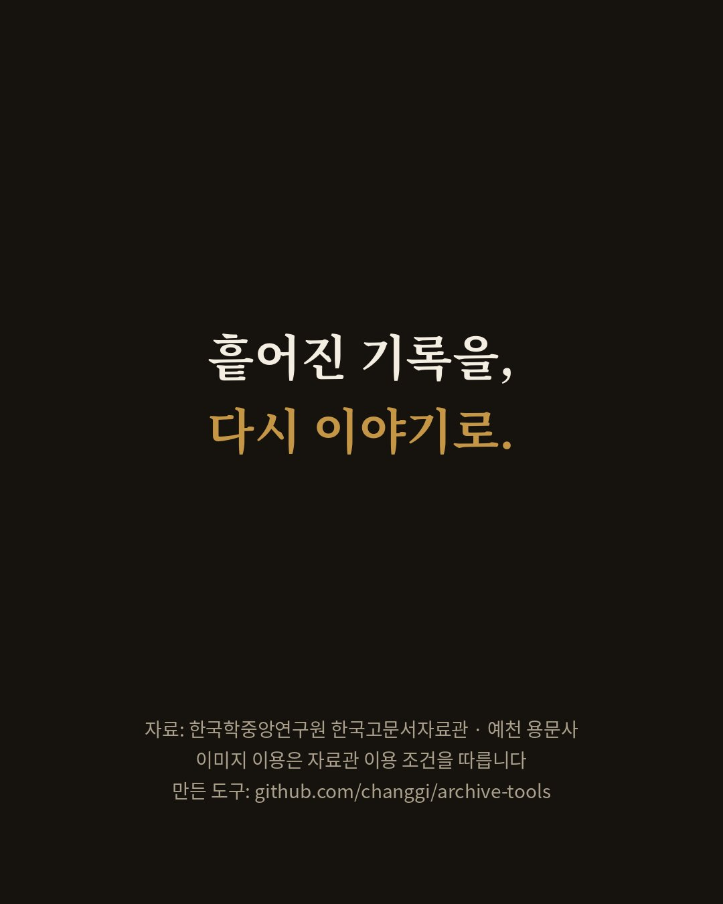

# EP.12 기도와 살림의 기록

예천 용문사 (사찰) · 불상 속 복장기에서 쌀을 모은 계, 살림을 넘긴 전장기까지 — 예천 용문사의 기록

- 🌐 [전시 웹페이지](https://changgi.github.io/archive-tools/examples/yongmunsa/exhibit.html) · [수업 활동지](https://changgi.github.io/archive-tools/examples/yongmunsa/handout.html)
- 🎬 영상: [릴스 9:16](https://changgi.github.io/archive-tools/examples/media/ep12-yongmunsa_reel.mp4) · [가로 16:9](https://changgi.github.io/archive-tools/examples/media/ep12-yongmunsa_wide.mp4) · 홍보 글: [`promo.md`](promo.md)
- 카드뉴스: [`cards/`](cards/) · SNS 글: [`sns.txt`](sns.txt) · 에디팅 결과: [`selection.csv`](selection.csv)

## 이야기 (영상 내레이션)

> 불상 안에는 무엇이 들어 있을까요?
> 절의 내력을 적은 사적,
> 그리고 불상을 만들며 그 안에 넣은 것들을 적은 복장기.
> 1514년, 소원을 적어 올린 원문이 있고,
> 1879년엔 부처님께 올릴 쌀을 함께 마련하는 계가 만들어집니다.
> 살림은 전장기로 다음 사람에게 넘겨졌죠.
> 기도와 살림, 그리고 기억이 한 절에 함께 남았습니다.

| 표지 | 1번 카드 | 마무리 |
|---|---|---|
|  |  |  |

## 선별 문서 (8점)

| # | 연도 | 유형 | 문서명 | 원본 |
|---|---|---|---|---|
| 1 | 1867 | 전장기 | 1867년 용문사(龍門寺) 전장기(傳掌記) | [원본 보기](https://archive.aks.ac.kr/viewer/viewer.do#imgnode.do?itemId=book&gubun=booktree&depth=6&upPath=05%5E0549%5EL054901%5EL054901F02%5EL054901F0208&dataId=G002%2BAKS%2BKSM-XG.1867.4715-20211130.B073a_100_00054_XXX&itemType=) |
| 2 | 1879 | 계안 | 1879년 용문사(龍門寺) 대장전불량계(大藏殿佛糧禊) 계안(禊案) | [원본 보기](https://archive.aks.ac.kr/viewer/viewer.do#imgnode.do?itemId=book&gubun=booktree&depth=6&upPath=05%5E0549%5EL054901%5EL054901F02%5EL054901F0207&dataId=G002%2BAKS%2BKSM-XG.1879.4715-20211130.B073a_100_00060_XXX&itemType=) |
| 3 | — | 교지 | 교지(敎旨) | [원본 보기](https://archive.aks.ac.kr/viewer/viewer.do#imgnode.do?itemId=book&gubun=booktree&depth=6&upPath=05%5E0549%5EL054901%5EL054901F02%5EL054901F0201&dataId=G002%2BAKS%2BKSM-XA.1457.4715-20211130.B073a_100_00062_XXX&itemType=) |
| 4 | — | 기일록 | 기일록(忌日錄) | [원본 보기](https://archive.aks.ac.kr/viewer/viewer.do#imgnode.do?itemId=book&gubun=booktree&depth=6&upPath=05%5E0549%5EL054901%5EL054901F02%5EL054901F0207&dataId=G002%2BAKS%2BKSM-XG.9999.4715-20211130.B073a_100_00061_XXX&itemType=) |
| 5 | — | 복장기 | 복장기(腹藏記) | [원본 보기](https://archive.aks.ac.kr/viewer/viewer.do#imgnode.do?itemId=book&gubun=booktree&depth=6&upPath=05%5E0549%5EL054901%5EL054901F02%5EL054901F0208&dataId=G002%2BAKS%2BKSM-XG.1684.4715-20211130.B073a_100_00059_XXX&itemType=) |
| 6 | — | 사적 | 용문사(龍門寺) 사적(事蹟)－1 | [원본 보기](https://archive.aks.ac.kr/viewer/viewer.do#imgnode.do?itemId=book&gubun=booktree&depth=6&upPath=05%5E0549%5EL054901%5EL054901F02%5EL054901F0208&dataId=G002%2BAKS%2BKSM-XG.1726.4715-20211130.B073a_100_00051_XXX&itemType=) |
| 7 | — | 원문 | 원문(願文)－1 | [원본 보기](https://archive.aks.ac.kr/viewer/viewer.do#imgnode.do?itemId=book&gubun=booktree&depth=6&upPath=05%5E0549%5EL054901%5EL054901F02%5EL054901F0208&dataId=G002%2BAKS%2BKSM-XI.1515.4715-20211130.B073a_100_00055_XXX&itemType=) |
| 8 | — | 원문 | 원문(願文)－3 | [원본 보기](https://archive.aks.ac.kr/viewer/viewer.do#imgnode.do?itemId=book&gubun=booktree&depth=6&upPath=05%5E0549%5EL054901%5EL054901F02%5EL054901F0208&dataId=G002%2BAKS%2BKSM-XI.1812.4715-20211130.B073a_100_00058_XXX&itemType=) |

이야기는 문서명과 이미지에서 보이는 것에 근거한 초안이며(검토 전 "초안" 표시), 판독·해석은 원문 확인이 필요합니다.
이미지: 한국학중앙연구원 한국고문서자료관 소장·제공. "원본" 링크를 누르면 자료관 뷰어에서 그 문서가 열립니다. 재사용은 자료관에 문의하세요(소장처 동의 필요).
