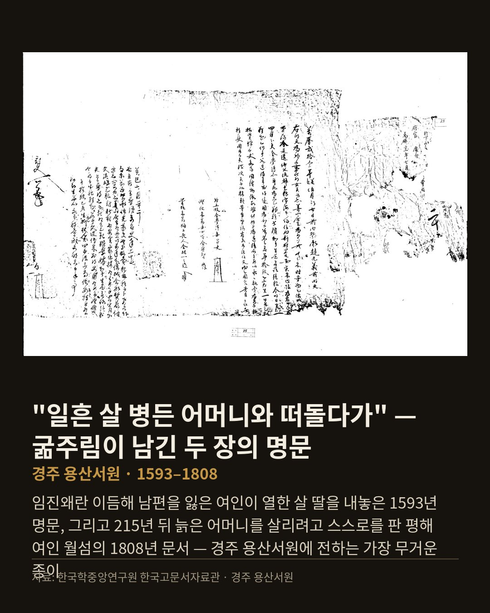
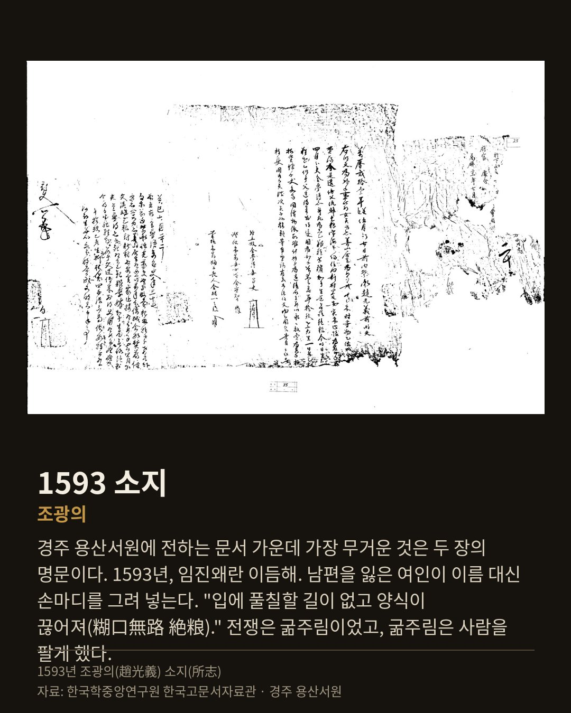
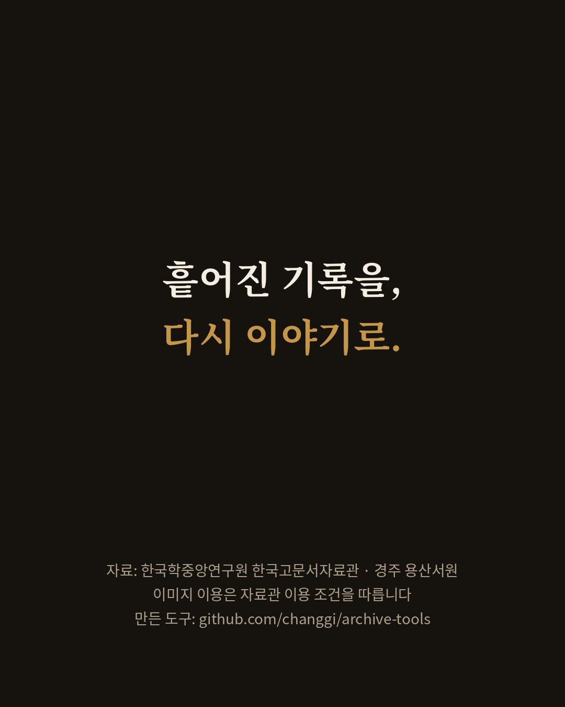

# EP.45 "일흔 살 병든 어머니와 떠돌다가" — 굶주림이 남긴 두 장의 명문

경주 용산서원 (서원) · 임진왜란 이듬해 남편을 잃은 여인이 열한 살 딸을 내놓은 1593년 명문, 그리고 215년 뒤 늙은 어머니를 살리려고 스스로를 판 평해 여인 월섬의 1808년 문서 — 경주 용산서원에 전하는 가장 무거운 종이

- 🌐 [전시 웹페이지](https://changgi.github.io/archive-tools/examples/yongsan/exhibit.html) (한자 위 한글 독음 · 원문 해석) · [수업 활동지](https://changgi.github.io/archive-tools/examples/yongsan/handout.html)
- 🎬 영상: [릴스 9:16](https://changgi.github.io/archive-tools-next/media/ep45-yongsan_reel.mp4) · [가로 16:9](https://changgi.github.io/archive-tools-next/media/ep45-yongsan_wide.mp4) · 홍보 글: [`promo.md`](promo.md)
- 카드뉴스: [`cards/`](cards/) · SNS 글: [`sns.txt`](sns.txt) · 판독·해석 표: [`selection.csv`](selection.csv)


<!-- DELIVERY -->
## 전달 에디팅 — 이 기록을 이렇게 전합니다

- **핵심 정서** — 비통
- **한 문장** — 기근의 기록은 가장 무거운 개인의 선택으로 남아 있다는 것.
- **열기** — 20냥. 한 여인이 늙은 어머니를 살리려고 받은 값입니다.
- **펼치기** — 조광의 소지 → 자매비 월섬 소지 (1593–1808년) — 숫자(20냥)와 손마디 그림을 피하지 않고 보여 주되, 존엄을 해치지 않도록 이야기 중심으로 엮었습니다.
- **절정** — "일흔 살 병든 어머니와 떠돌며 빌어먹다가(與七十歲病母 流離丐乞)" — 화면·공간에서 이 한 줄만 크게, 소리를 줄여 집중
- **여운** — 자신을 판 월섬의 어머니는 살아났을까요? — 질문으로 끝내고 답은 보는 사람에게
- **감각과 물질** — 어두운 방, 손마디 그림 하나와 "20냥"만 조명 — 존엄을 위해 확대·연출 최소화 · 연명한 이름을 벽에 길게 나열하고 관아 마당처럼 서서 읽는 동선
- **통로와 매개** — 온라인: 릴스(열기) → 카드뉴스(펼치기) → 전시 웹페이지(절정·원문) → 비하인드 카드(여운) / 오프라인: 원본 크기 복제·낭독·참여 벽 / 남기기: 활동지·질문 카드
- **여운 장치** — 조용히 이름을 불러 주는 시간
- **전달 에디팅 전** — 2건의 문서를 1593–1808년 연대순으로 놓고 문서명 · 유형 · 해설을 붙인다 — 정확하지만, 지나가면 잊힌다.
- **전달 에디팅 후** — 핵심 정서는 「비통」. 「20냥. 한 여인이 늙은 어머니를 살리려고 받은 값입니다.」로 열고, 문서를 대비와 순서로 펼친 뒤, "일흔 살 병든 어머니와 떠돌며 빌어먹다가(與七十歲病母 流離丐乞)"에서 멈춘다. 어두운 방, 손마디 그림 하나와 "20냥"만 조명 — 존엄을 위해 확대·연출 최소화. 마지막엔 「조용히 이름을 불러 주는 시간」로 보는 사람이 자기 이야기를 남기고 떠나게 한다.

전문: [`delivery.md`](delivery.md)
<!-- /DELIVERY -->

<!-- CURATOR -->
## 비하인드 — 큐레이터 노트

- **왜 이 문서들인가** — 굶주림 때문에 자신을 판 사람들의 명문 두 장(1593·1808)이 서원에 남아 있었습니다.
- **전하고 싶은 것** — 기근의 기록은 가장 무거운 개인의 선택으로 남아 있다는 것.
- **이렇게 보이길 바랐다** — 숫자(20냥)와 손마디 그림을 피하지 않고 보여 주되, 존엄을 해치지 않도록 이야기 중심으로 엮었습니다.
- **이렇게 써 주세요** — 기근과 자매(自賣), 인권의 역사 수업에 쓰세요. 민감한 내용이니 맥락 설명과 함께 쓰세요.
- **남겨 둔 질문** — 자신을 판 월섬의 어머니는 살아났을까요?
- **제작 기록** — 문서 2건 · 1593–1808년 · 원본 사진 11면(문서 전체) · 원문 판독 2건 · 번역 2건 · 못 읽은 글자 □ 39 · 불확실 (?) 27 · 해제에 "확인 필요"를 단 문서 1건

전문: [`curator.md`](curator.md)
<!-- /CURATOR -->

## 이야기 — 사료가 말하는 대로

20냥. 한 여인이 늙은 어머니를 살리려고 받은 값입니다.

> **1593 소지** — 경주 용산서원에 전하는 문서 가운데 가장 무거운 것은 두 장의 명문이다. 1593년, 임진왜란 이듬해. 남편을 잃은 여인이 이름 대신 손마디를 그려 넣는다. "입에 풀칠할 길이 없고 양식이 끊어져(糊口無路 絶粮)." 전쟁은 굶주림이었고, 굶주림은 사람을 팔게 했다.
> **1808 소지** — 215년 뒤 1808년 겨울. 평해에서 흘러온 여인 월섬이 스스로를 판다. "일흔 살 병든 어머니와 떠돌며 빌어먹다가(與七十歲病母 流離丐乞)." 값은 20냥. 세 살배기를 포함한 세 아이, 아직 태어나지 않은 아이까지 문서에 들어갔다. 어머니를 살리려는 딸의 선택이었다.

| 표지 | 1번 카드 | 마무리 |
|---|---|---|
|  |  |  |

## 선별 문서 (2점)

| # | 연도 | 유형 | 문서명 | 원본 |
|---|---|---|---|---|
| 1 | 1593 | 소지 | 1593년 조광의(趙光義) 소지(所志) | [원본 보기](https://archive.aks.ac.kr/viewer/viewer.do#imgnode.do?itemId=book&gubun=booktree&depth=6&upPath=01%5E0167%5EL016798%5EL016798F02%5EL016798F0202&dataId=G002%2BAKS%2BKSM-XB.1593.4777-20101008.B021a_033_00241_001&itemType=) |
| 2 | 1808 | 소지 | 1808년 자매비(自賣婢) 월섬(月暹) 소지(所志) | [원본 보기](https://archive.aks.ac.kr/viewer/viewer.do#imgnode.do?itemId=book&gubun=booktree&depth=6&upPath=01%5E0167%5EL016798%5EL016798F02%5EL016798F0202&dataId=G002%2BAKS%2BKSM-XB.1808.4777-20101008.B021a_033_00267_003&itemType=) |

## 원문 판독과 해석

### 1. 1593년 조광의(趙光義) 소지(所志)

**원문 판독**

```
萬曆貳拾壹年癸巳 五月初七日 前內禁衛趙光義前明文
右明文爲臥乎事段 矣女(?) 本以善山居(?)□ □□ 年十一(?) 歲(?) 賊變(?)
奔(?)竄(?) 流離 □粮(?)缺(?) □□ 新村里 寓接(?) 實(?)□□□□
□□□ 夫 金夢得 身死爲 □□ 糊口無路 絶粮 今時日(?)□
□□□ 父(?)遺(?)□ □□ 年十一(?) □ □□(?) □□ 一口乙(?)
□□ 價物 依數(?) 准(?)捧(?) 爲遣 後所生 幷以 永永放賣爲(?)□
□□ 族類等 爭望(?)□□ 此文(?) 內(?)用(?)□ 告官 卞正事
財主 故金夢得妻 召史 (手寸 — 손마디 그림)
證保 □□□
(오른쪽 — 관의 처분: 府官 處分 / 萬曆二十一年七月(?) … 판독 필요)
(흘림, 마이크로필름 복사본 — 많은 글자 판독 불확실)
```

**원문 해석** 만력 21년 계사(1593) 5월 7일, 전 내금위 조광의에게 [써 주는] 명문. 이 명문을 만드는 일은, 저(제 딸?)는 본디 선산에 살던 … 적변(왜란)으로 달아나 떠돌다가 양식이 떨어져 … 신촌리에 의탁해 살았는데, … 남편 김몽득이 죽어 … 입에 풀칠할 길이 없고 양식이 끊어져 … 열한 살 된 [딸] 한 명을 … 값을 받고 … 뒤에 낳을 아이까지 영영 팔아넘기니, 뒷날 친족 가운데 다투는 자가 있으면 이 문서로 관에 고하여 바로잡을 일. 물주(파는 사람) 돌아간 김몽득의 아내 소사(손마디 그림). 증인 ○○○. (판독 불확실 다수)

**해제** 1593년(선조 26) 5월, 임진왜란 이듬해에 남편 김몽득을 잃은 여인 소사(召史)가 전 내금위 조광의(趙光義)에게 써 준 명문(매매 계약서)으로 보입니다. 문서명은 '조광의 소지'이지만 본문 서식은 '○○前明文'으로 시작하는 명문입니다. 전란으로 선산에서 떠돌다 양식이 끊어져 열한 살(?) 된 아이를 내놓은 것으로 읽히나, 마이크로필름 복사본의 흘림이라 판독 불확실한 글자가 많아 원문 확인이 필요합니다. 글을 모르는 여인은 서명 대신 손마디를 그렸습니다(手寸). 오른쪽에는 관의 처분이 붙어 있습니다.

### 2. 1808년 자매비(自賣婢) 월섬(月暹) 소지(所志)

**원문 판독**

```
嘉慶十三年戊辰十二月二十五日 李生員宅戶奴庚戌前明文
右明文爲 矣女 本以平海之人 貧窮無依 不得安[接]
土 與七十歲病母 流離丐乞是如可 今年二月分
[入]里矣 矣母之老病 將至難醫之境是遣 矣[身]
段 三子女 無路保[全]之道是如 他官流丐之
而 他族屬是遣 又無男妹是乎則 矣女一身 計
無所出 依爲父母自賣之法典 不得已 以生母之
爲[命(?)] 受價二十兩後 自請鬻賣於右人上典宅是
[遣] 矣女之子女 亦矣母之子孫也 矣女之一所生男興孫
[年]庚申 二所生女月娥年 歲乙丑 三所生男[□]
[年]三歲丁卯生 及後所生 幷以 永永仰役之意 如是
成文是乎矣 呈官立旨 幷以納上爲去乎 日後
[有]子孫族類中雜談是去等 持此文告官卞正事
(왼쪽 아래 — 자매비 월섬, 증인, 필집 서명, 판독 필요)
(오른쪽 큰 흘림 — 관의 처분: 依[願]…, 판독 필요)
```

**원문 해석** 가경 13년 무진(1808) 12월 25일, 이생원 댁 호노 경술에게 [써 주는] 명문. 이 명문을 만드는 일은, 저는 본디 평해 사람으로 가난하고 의지할 데가 없어 [한곳에] 편히 붙어살지 못하고, 일흔 살 병든 어머니와 함께 떠돌며 빌어먹다가 올해 2월 무렵 이 마을에 들어왔습니다. 어머니의 늙은 병은 장차 고치기 어려운 지경에 이르렀고, 저는 세 자녀를 지킬 길이 없으며, 다른 고을을 떠도는 처지라 다른 친족도 없고 형제자매도 없으니, 제 한 몸으로는 아무 방도가 없습니다. 그래서 부모를 위해 스스로를 파는 법전의 규정에 따라, 부득이 낳아 준 어머니의 [목숨을] 위하여 값 20냥을 받은 뒤 스스로 청하여 위 사람의 상전 댁에 몸을 팝니다. 제 자녀 또한 제 어머니의 자손이니, 저의 첫째 아들 흥손(경신년생), 둘째 딸 월아(을축년생), 셋째 아들 ○(정묘년생, 세 살)과 뒤에 낳을 자식까지 모두 영영 [상전을] 받들어 부린다는 뜻으로 이와 같이 문서를 만들고, 관에 올려 입지(立旨)를 받아 함께 바치니, 뒷날 자손이나 친족 가운데 딴말하는 자가 있으면 이 문서를 가지고 관에 고하여 바로잡을 일.

**해제** 1808년(순조 8) 12월, 평해(지금의 울진) 출신 여인 월섬(月暹)이 경주 이생원 댁에 스스로를 판 자매문기(自賣文記)입니다. 일흔 살 병든 어머니와 떠돌며 빌어먹다가, '부모를 위해 스스로를 파는 법전(爲父母自賣之法典)'에 따라 20냥을 받고 세 자녀와 앞으로 낳을 자식까지 함께 노비가 되기로 했습니다. 관에 입지를 청한 문서와 함께 전하며, 오른쪽 큰 글씨는 관의 처분입니다. 마이크로필름 복사본이지만 본문은 해서로 또렷해 대부분 판독했습니다.

판독·해석·이야기는 이미지에 근거한 초안이며(검토 전 "초안" 표시), 정확한 판독은 원문 확인이 필요합니다. □는 읽지 못한 글자, (?)는 불확실한 글자입니다.
이미지: 한국학중앙연구원 한국고문서자료관 소장·제공. "원본" 링크를 누르면 자료관 뷰어에서 그 문서가 열립니다. 재사용은 자료관에 문의하세요(소장처 동의 필요).
